<div align="center">

# 化言 HuaYan

### 传声不走样 · 让判断有来处 · 让创新有余力

**从专业需求理解到企业决策智能：面向功能化学产业的智能决策与研发协同架构**

**「觉」独立决策发现层 × Jue-K × Jev / [OneJev](https://github.com/OmniJev/OneJev) × 多角色 Agent × 分层知识治理 × 完整研发闭环**

AI＋功能化学赛道 · 项目总览、技术论证、业务证据与可复现演示

</div>

<div align="center">

**[▶ 业务过程流介绍视频](docs/assets/intro.mp4)** · **[在线交互演示 · HuaYan Demo](https://www.soranori.com/huayan-demo/)** · [完整价值论证](docs/PITCH.md) · [技术架构](docs/ARCHITECTURE.md)

<sub>无需先安装项目即可观看业务流程；可按演示路径查看完整工作面，也可接入自己的兼容模型进行实时试用。</sub>

</div>

> **我们要改变的，不只是一条需求在企业里如何传递，而是企业如何发现值得解决的问题、组织专业决策，并把每一次判断转化为下一次创新的能力。**
>
> 今天的 Agent 可以检索、推理、生成与调用工具；化言向前多走了一步：**如果还没有人明确提出任务，系统能否知道此刻什么值得被决定？**

对于功能化学事业部，一份**尚未澄清关键条件便进入开发的客户需求**，可能引发方向偏差、重复试样与跨部门返工。功能化学一线业务需求交流进一步揭示：当需求信息反复补充、开发目标反复修正，受到挤占的不仅是当前项目工时，还有原本可用于新品、工艺和技术突破的**中长期研发资源**。

这让化言的价值不再局限于提升问答准确率或传递速度：**让专业判断更早建立在充分的需求依据上，让研发投入更多指向有价值的技术问题。**

化言首先按赛题要求实现了**专业需求理解、知识检索融合、方案辅助生成、研发转译、试样评价、知识沉淀、受控发布与成果回流**的完整闭环；又依据一线业务需求交流，使需求能按其性质动态分流：**常规问题自助解决，商务诉求回到销售，产品机会交由产品经理判断，需要专业技术判断的需求才进入研发。**

贯穿两者的不是一条更复杂的固定工作流，而是独立于生成式 Agent 的**可训练决策发现层「觉」**：它持续计算此刻有没有值得处理的决策，交由正确的 Agent 或专业人员完成，并让结果成为可追溯、可复用的组织知识。

在企业经营层面，这一架构形成三条相互支撑的价值路径：**降本增效**——减少重复沟通、无效研发投入与低价值流转；**客户体验提升**——让下游客户更及时、更准确地获得经批准的专业方案；**创新能力释放**——使销售、产品经理和研发的专业精力回到高价值工作。

**从提升个体执行效率，走向提升组织决策质量；从减少重复处理，走向释放研发创新产能。**

<p align="center"></p>

| **95.1% → 19.5%** | **49.2% → 90.9%** | **30 → 14 → 5** | **3 / 3 · 0 / 4** |
|:---:|:---:|:---:|:---:|
| 进入研发的模拟需求<br>按定义需退回补问的比例 | 同批需求<br>必问信息完整率 | 6 份模拟需求的人工中转节点<br>传统流转 / 逐岗协作 / 化言 | 模拟业务周关键事件命中<br>与困难负样本误报 |

<sub>**读数说明：**前两项来自 300 张程序生成的模拟需求卡中应进入研发的 41 张；第三项的「传统流转」按黑线流程定义计数，「逐岗协作」与「化言」是同一套代码以两种协作方式运行、由业务事件日志计出；第四项来自含 3 个正例和 4 个困难负样本的一周模拟。全部为模拟数据上的真实运行结果，**不是传化真实业务数据，也不是实际产品研发返工率或节约工时**；各项口径与不利结果见 [§12](#12-48-小时交付范围与试点验证路线) 及 [失真对照](docs/reports/distortion/README.md) · [协作方式对照](docs/reports/v6_routes/metrics.json) · [业务周评测](docs/reports/week/README.md)。</sub>

**阅读入口：** [方案价值与产业逻辑](docs/PITCH.md) · [技术架构](docs/ARCHITECTURE.md) · [Jue-K 模型卡与评测](models/jue_k/model_card.md) · [OneJev 开源项目](https://github.com/OmniJev/OneJev) · [真实模型录制](runs/demo_record/README.md) · **[在线 Demo](https://www.soranori.com/huayan-demo/)** · [本地运行与试用说明](#10-运行与试用三种模式一套系统) · [测试结果](#107-测试结果) · [团队](#166-团队)

### 五项评审标准速读

| 评审标准 | 一句话结论 | 可以当场核验的硬证据 |
|---|---|---|
| **技术可行性** | 不是页面原型，是一套已公网部署、可回放、可自带模型实时运行的系统 | [在线 Demo](https://www.soranori.com/huayan-demo/)；两段真实模型录制（专业深链路 11 次签字断言、全路径讲解 16 步无偏离）；BYOK 接入前自动检测对话 / JSON / 工具调用；11 个离线测试约 3 秒跑完 |
| **技术创新** | 把「任务从哪里来」从大模型和固定流程中独立出来，做成可训练的决策发现层「觉」 | Jue-K 在 4 类决策上经配对 bootstrap 统计胜过规则才启用；发现环节 0 次大模型调用；三层编译逐句带原话与知识来源 |
| **业务价值** | 让进入研发的需求先问清楚，让一次专业判断服务后续所有同类客户 | 应入研需求必问信息完整率 49.2% → 90.9%；同批 6 份需求人工中转 30 → 14 → 5、入研单据 6 → 4 → 2 |
| **工程化能力** | 48 小时交付约 1.6 万行代码，契约、门面、网关、降级标注、会话隔离、可复现一应俱全 | 22 个决策模板、30 个原子工具、统一模型网关的计量 / 录制 / 回放、同种子可复现 |
| **企业落地** | 站在事业部已有的知识库、实验系统和协作入口之上，影子模式起步 | 两个公开真实产品只改产品种子即接入、代码零改动；Demo 内置按企业参数自填的收益估算；四阶段试点路线 |

---

## 目录

1. [赛题要求与真实业务矛盾](#1-赛题要求与真实业务矛盾)
2. [架构原创性：觉是任务的来源](#2-架构原创性觉是任务的来源)
3. [三层语义编译与四层知识治理](#3-三层语义编译与四层知识治理)
4. [专业研发闭环：不只是会路由的系统](#4-专业研发闭环不只是会路由的系统)
5. [动态协作：从固定岗位流水线，到按需求价值组织协作](#5-动态协作从固定岗位流水线到按需求价值组织协作)
6. [技术创新与常见方案对照](#6-技术创新与常见方案对照)
7. [经营价值与产业愿景：让创新资源重新流向创新](#7-经营价值与产业愿景让创新资源重新流向创新)
8. [证据与可复现评测：从业务示例到受控对照](#8-证据与可复现评测从业务示例到受控对照)
9. [工程化能力：48 小时交付的工程底座与规模扩展](#9-工程化能力48-小时交付的工程底座与规模扩展)
10. [运行与试用：三种模式，一套系统](#10-运行与试用三种模式一套系统)
11. [企业落地路径：站在既有投入之上](#11-企业落地路径站在既有投入之上)
12. [48 小时交付范围与试点验证路线](#12-48-小时交付范围与试点验证路线)
13. [从功能化学事业部走向企业决策神经系统](#13-从功能化学事业部走向企业决策神经系统)
14. [五项评审标准如何核验](#14-五项评审标准如何核验)
15. [评委可能会问](#15-评委可能会问)
16. [代码来源、开源组件、团队信息与文档索引](#16-代码来源开源组件团队信息与文档索引)

---

## 1. 赛题要求与真实业务矛盾

### 1.1 赛题的三项能力，我们不是拆成三个问答按钮

「AI＋功能化学」推荐场景关注**专业需求理解、知识检索与融合、解决方案辅助生成**。大模型已经擅长回答问题，但在一个真正的功能化学研发组织里，回答并不等于需求处理完成。

| 赛题方向 | 常规做法 | 化言的实现 | 更深一层的价值 |
|---|---|---|---|
| **专业需求理解** | LLM 多轮问答、抽关键词 | 场景结构化抽取；觉按信息价值提出 `ask_slot`；专业转译中 `ask_back`；原话与槽位绑定 | **发现客户没说、却会改变下游判断的条件** |
| **知识检索与融合** | RAG 召回后拼接回答 | 产品/案例/机理/实验分层；检索与身份权限隔离；跨层转化对照；知识来源、引用、归属 | **知识不仅被找到，还能安全地参与决策** |
| **方案辅助生成** | 推荐产品或给一段建议 | 已批准产品推荐；研发需求转译；Agent 准备草稿；研发试样、客户评价、封存/放出、审定发布 | **一次解决结果能够沉淀并回流市场，提升后续服务质量** |

化言围绕这三项能力搭出了从客户问题到专业解决结果的纵向闭环，并在闭环之上回答更进一步的问题：**是否每份需求都值得让每个岗位完整走一遍？**

### 1.2 原赛题的五项痛点，化言逐项回答

| 业务痛点 | 为什么普通方案容易停在表面 | 化言怎样回答 | 证据或可核验位置 |
|---|---|---|---|
| **客户需求描述不专业、难以标准化** | 只能翻译已说出的内容，漏掉的工艺条件无法凭空补全 | 觉主动追问；已知、未知、原话逐项关联 | 300 张模拟卡的完整率对照；客户工作面 |
| **专业知识分散、难以复用** | 资料即使进入向量库，专业判断仍留在专家脑中 | 知识分层、转化对照、研发修改沉淀、发布回流 | 知识归属账本；新品回流链路 |
| **内外部知识融合缺少边界** | 外部片段可能覆盖企业内部经验，或越权暴露配方 | 结构化来源与层级、检索前权限过滤、逐条引用归属 | 知识契约与权限测试 |
| **复杂专业需求不能靠检索拼接解决** | 不同角色使用不同语言；一次性翻译会错配技术知识 | 场景 → 产品需求 → 化学语言分层编译；必要时跨层回问 | 转译 source map；错译率对照 |
| **方案生成高度依赖专家个体经验** | 专家每次都要重新解释，交知识还可能失去认可 | Agent 起草、人负责专业审定；知识署名、引用记分、受控披露 | 角色 Agent、贡献账本、研发审定与发布 |

这五项已经构成一个比「更懂化学的聊天机器人」更完整的研究对象：**专业语言如何互相转换，知识怎样合法流动，方案怎样被验证，专家为什么愿意使经验成为组织能力。**

### 1.3 一线业务需求交流：问题不止在信息失真

在功能化学一线业务需求交流中，我们不仅讨论了知识分层和需求转译，还进一步归纳出三项相互关联的业务问题：

1. **需求澄清不充分，使研发前期判断和实际开发目标存在偏差风险。** 一些关键工艺条件在试样或反馈阶段才被补充，容易造成反复修改与验证。
2. **信息反复转述，让专业岗位承担了不必要的协调与重复劳动。** 销售、产品经理和研发并非不需要协作，而是不应为同一信息缺口反复对接。
3. **短期重复性工作挤占了研发的长期创新投入。** 减少低价值的重复答疑、技术审查和因需求不清引发的返工，有助于将有限的专业资源重新集中到产品迭代与中长期课题。

我们据此归纳了销售、产品经理、研发的**岗位本应创造的价值**与**容易被需求问题挤占的精力**（定性归纳，来自项目需求交流，不代表事业部官方立场或实测数据）：

| 角色 | 岗位本应创造的价值 | 容易被需求问题挤占的精力 |
|---|---|---|
| **销售** | 客户开发维护、谈判报价、订单与回款、市场反馈 | 重复技术问答、替研发反复收集工艺信息、将解释往返传递 |
| **产品经理** | 产品定位、规格与成本目标、路线图、产品全生命周期与商业机会 | 逐单翻译、协调信息缺口、反复补充同一上下文 |
| **研发** | 配方与性能突破、中试、现场技术支持、定制方案、技术验证 | 需求不清的返工、已知产品适用性重复判断、零散短平快需求 |

**跨部门协作本身不是问题。** 产品经理必须协调研发，研发必须参与必要的技术拜访，销售必须持续反馈需求。化言要消除的是由于信息缺失、转述错误或知识未沉淀而**被迫重复发生**的劳动。

### 1.4 为什么「需求没说清楚」会挤占企业创新能力？

<a href="docs/assets/readme/problem-causality.png">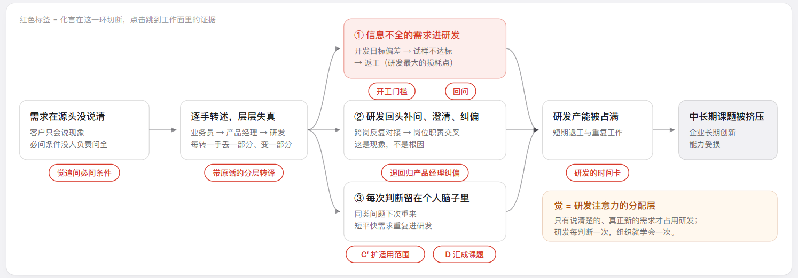</a>

<sub>**图 1 · 业务问题因果链。** 根据一线业务需求交流归纳的机制示意。红色标签在 [在线 Demo](https://www.soranori.com/huayan-demo/) 中可以跳转相应工作面；这里是静态图，可点击图片查看原尺寸。</sub>

传统做法往往把这件事当成沟通效率问题，于是增加表单、升级审批或会议。即便每个岗位都配一个 Agent，**如果任务本身没有被正确发现、缺失信息没有被及时问到、判断结果不能改变下一次需求走向，企业只是更快地重复了原有的流程。**

化言把解决思路拆成两种互相强化的能力：

1. **纵向把需求处理正确。** 在客户还在线时主动追问，用专业知识逐层转译，研发能回到原话和依据，复杂问题经过技术确认、试样、评价、审定发布。
2. **横向把专业能力用在正确的地方。** 成熟产品覆盖的需求自助解决，商务诉求交销售，技术问题才入研；研发对一种适用场景的判断能够被产品经理审定为匹配边界，多位客户的重复问题能汇聚成一个产品机会。

**化言不止优化需求传递效率，更进一步改善研发资源的投入方向：减少可避免的反复澄清与重复判断，让高价值技术研发获得更稳定的精力保障。** 这是化言在专业技术闭环之上建立的组织级价值。

> **边界**：需求理解错误是研发返工的一种来源，而不是所有研发失败的原因。配方探索、材料与工艺验证本来就有技术不确定性。化言降低的是可预见的信息缺失与重复判断风险，不承诺消灭研发失败。

---

## 2. 架构原创性：觉是任务的来源

### 2.1 从「模型如何回答」，向前一步到「谁来出题」

大语言模型正在改变人与知识交互的方式，Agent 则把推理连接到工具与外部状态。但企业真正需要的许多决定不会自动以一条任务出现：

- 客户只说了「深一块浅一块」：**现在要不要追问面料或染缸？**
- 专业转译缺一个染浴 pH：**继续起草，还是趁客户在线先问？**
- 多位客户升级同类问题：**这是三份临时需求，还是一个新的产品机会？**
- 研发发现既有产品实际上适用：**产品经理该不该更新适用范围？**
- 试样持续不符合产品已声明的适用场景：**应不应该提示核对说明书？**
- 某个账号频繁换角度索取敏感内容：**何时值得审查，而不是误伤正常咨询？**

**这些都不是「有了任务怎样执行」的问题，而是「还没有任务时，什么值得成为任务」的问题。**

化言把这件事单独做成可训练、可度量的计算层。它来自团队赛前 JUE 关于**信息反射层**的技术研究，在功能化学中进一步落实为明确的决策目录、模型、问题总线、原子动作和审计记录。

### 2.2 觉、Jev、Agent、人：四种不同的智能与责任

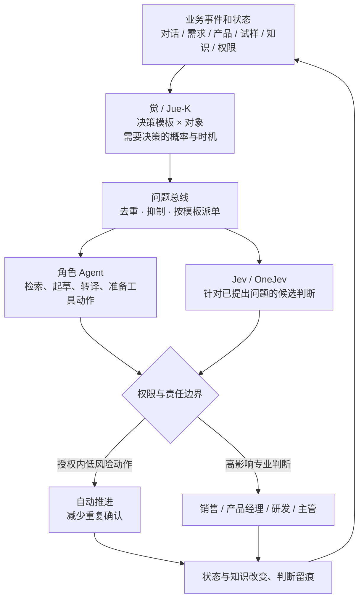

| 层 | 回答什么问题 | 主要实现与边界 |
|---|---|---|
| **觉（Jue）** | 此刻**需要什么决定**？针对哪个对象？有多急？ | 本地规则/训练模型判断；不生成最终回答，不代替审批 |
| **Jue-K** | 需要决定的概率能否从处置结果里学习？ | 统一特征、梯度提升树与分类别概率校准；统计胜出才启用 |
| **Jev / [OneJev](https://github.com/OmniJev/OneJev)** | 一个已被提出的问题，各候选答案有多大可能？ | 用于产品匹配、披露等 System 1 决策；与发现层职责分离。OneJev 为外部开源模型，按服务可用性接入或回退 |
| **多角色 Agent** | 怎样准备材料、查知识、改草稿、执行授权动作？ | 自研 Agent Loop 和原子工具；委托关系限定权限 |
| **人** | 哪些结论需要承担专业与商业责任？ | 产品范围、立项、技术确认、保密授权、发布等关键动作 |

化言既跑通了**觉提出、Agent 起草、人确认、结果回流**的完整过程，也在同一治理底座上区分低风险自动动作和高影响人工决定。**减少低风险事项的重复审批，不是弱化治理，而是让专业人员把注意力放在真正需要其承担责任的决策上。**

### 2.3 决策目录：以业务对象为中心，而不是画一条新的审批线

每类待判断的事都有一个模板：**针对什么对象、何时值得评估、怎么打分、派给谁准备、由谁负责最终生效、有多急**。

以产品机会汇聚为例，下面是 [`config/templates/opportunity.yaml`](config/templates/opportunity.yaml) 的实际配置（节选，省略提示词文本字段）：

```yaml
id: opportunity
family: opportunity
kind: advance
object_type: theme
decision_label: 同类需求是否合并立项
# 同类需求至少升级 2 次、还没有在途立项就进入评估（同一客户反复升级也进来，作为 Jue-K 要学会区分的困难负样本）
precondition: "attrs.n_escalations >= 2 and not attrs.open_project"
# 规则：至少两个不同客户才算机会
rule_score: "(attrs.n_customers >= 2) * (0.1 * attrs.n_escalations + 0.15 * attrs.n_customers + 0.3 * attrs.mean_p_none)"
owner_role: pm
# 机会判断是产品经理的商业判断
signer_role: pm
# 涉及客户越多越紧急
urgency: "min(1, attrs.n_customers / 4)"
bounty_points: 10
```

`rule_score` 是冷启动的规则先验；Jue-K 在这一类上统计胜出后，由训练模型的校准概率接管打分。

过程不是「第 1 步之后必然进入第 2 步」，而是：

1. 客户发言、签字、试样或检索等事件改变业务对象状态。
2. 觉对通过前置条件的「模板 × 对象」组合批量打分。
3. 超阈值的决定进入问题总线，合并重复事项，抑制已处理对象。
4. 由正确角色的 Agent 起草，授权内低风险动作自动生效，关键动作由责任人确认。
5. 状态变化、处置结果与判断记录反馈到下一轮扫描，成为未来训练资料。

**业务组织改变时，不必为每条新的决策关系重建一条流程引擎。** 新类型先有受控模板和规则冷启动，有真实处置数据后再评测能否交给 Jue-K。决策目录不是无限自主生成的开放世界，新增类型仍需人为批准。

### 2.4 Jue-K：用学习到的价值替代部分手写先验

原型规则知道「信息缺失可能需要问」，但很难从单轮规则看出：某一项条件**可能不影响眼前的产品推荐，却决定未来研发能否直接开展技术工作**。

Jue-K 的训练标签因此同时纳入两端收益：

- **即时价值**：追问后，L1 推荐是否从错变对？
- **下游价值**：当需求最终应进入研发时，此项是否是研发必问条件？

模型对通过前置条件的「模板 × 对象」构造统一特征，使用 `HistGradientBoostingClassifier`（单模型）加按决策类型拟合的 isotonic 校准层；CPU 本地推理，不调用大模型完成发现。

| 决策类型 | Jue-K AUC（校准后） | 原型规则 AUC | 采用策略 |
|---|---:|---:|---|
| 主动追问 `ask_slot` | **0.755** | 0.670 | Jue-K |
| 跨层回问 `ask_back` | **0.713** | 0.500 | Jue-K |
| 产品机会汇聚 `opportunity` | **0.953** | 0.854 | Jue-K |
| 拼凑敏感知识 `leak_risk` | **0.941** | 0.500 | Jue-K |
| 产品知识冲突 `knowledge_conflict` | 1.000 | 1.000 | **回落规则** |

**模型选择有硬门槛，而不是哪组数字好看就选哪组。** 在相同测试组合上进行 500 次配对 bootstrap：AUC 差的 95% 置信区间下界需大于 0，且 Brier 差的上界小于 0，才采用该类别的模型输出；未赢过规则就退回规则分数。规则分数不伪装成校准后的概率。

| Jue-K 能力 | 证明材料 | 为什么值得关注 |
|---|---|---|
| **稀疏触发** | 追问、机会、冲突、泄露等不同决策评测 | 绝大多数时候必须沉默，误报会打扰专家 |
| **校准的概率** | AUC / Brier / ECE 与可靠性图 | 可以按漏问/多问成本调整阈值 |
| **跨岗位价值标签** | `ask_slot` 正例定义与消融对照 | 上游提问同时考虑下游研发实际需要 |
| **结果塑造注意** | 学习曲线与先验偏离实验 | 历史处置有机会改变系统下一次关注什么 |
| **规则冷启动、数据接管** | 分类别胜负判定，知识冲突仍用规则 | 不把机器学习当成必须出现的装饰 |

在模拟的先验偏离实验里，Jue-K 能纠正原型里由专家预估造成的一部分偏差；但在未见过的现象上它并不总胜出。**「经验塑造注意」是有适用域、有训练数据依赖的模型命题，不是模型具有通用意识的宣传。**

完整模型实现、样本定义、训练参数、统计检验与不利结果：[模型卡](models/jue_k/model_card.md) · [训练方案](docs/JUE_K_TRAINING.md) · [评估报告](docs/reports/jue_k/README.md)。

### 2.5 为什么把发现层与大模型拆开？

| 做法 | 任务从哪里来 | 成本与稳定性特点 | 对组织责任的处理 |
|---|---|---|---|
| **人工推动** | 谁想起来就建单、通知下一人 | 依赖注意力和经验，重要盲点可能遗漏 | 人员之间口头协调 |
| **BPM / 固定规则流** | 上一步结束就执行定义好的下一步 | 稳定、便宜，但必须先画出流程 | 按预定义岗位层层推进 |
| **通用 LLM Agent 轮询** | 让大模型反复审视业务状态 | 可推理开放问题，但推理成本、波动与审计要另行治理 | 容易把发现、执行与权限混在同一个提示词中 |
| **化言：觉 + Agent + 人** | **可训练的发现层对状态 × 决策对象持续评估** | **发现环节本地推理 0 LLM 调用**，生成仍在必要时使用大模型 | 决策可追溯、分级授权、责任明确 |

这不是说普通 Agent 或 BPM 绝不可能达到类似效果，而是**把原本容易混在一起的「发现任务—回答问题—执行工具—承担责任」拆成可以分别检验和演进的层**。

### 2.6 一个更大的主张：同一套发现机制，换的是领域经验

觉的研究来源不是功能化学场景的提示词堆砌。在此前的 JUE 探索中，决策对象可以是车队、线路与港区；在化言中，决策对象变为槽位、对话、需求单、主题、产品、知识和人员。

| 不随场景改变的架构 | 迁移到新领域必须替换的内容 |
|---|---|
| 「状态 × 决策模板 × 对象 → 判断是否值得决定」的接口 | 业务对象、事件、决策目录与特征 |
| 问题总线、合并与抑制、按责任派单 | 领域专业工具与人员分工 |
| 原型规则与训练模型可替换 | 领域处置样本、标签、阈值校准 |
| 每次决策留痕，可复盘、可重训 | 新领域的真实绩效与风险约束 |

**可迁移的是计算层与工程方法，不是训练好的模型权重。** 化言所验证的，是一套领域决策基础设施如何落在真正的产业需求上，而不是空泛的「通用企业大脑」概念。

---
## 3. 三层语义编译与四层知识治理

化言的技术架构不是「先客户，再业务员，再产品经理，再研发」的固定顺序，而是由**觉主动发现决策点**，让多角色 Agent、专业知识和责任主体在需要时协作；从 L0 客户到 L3 研发，专业判断经过审定还能回流到下一次产品推荐。

<a href="docs/assets/readme/full-architecture.png">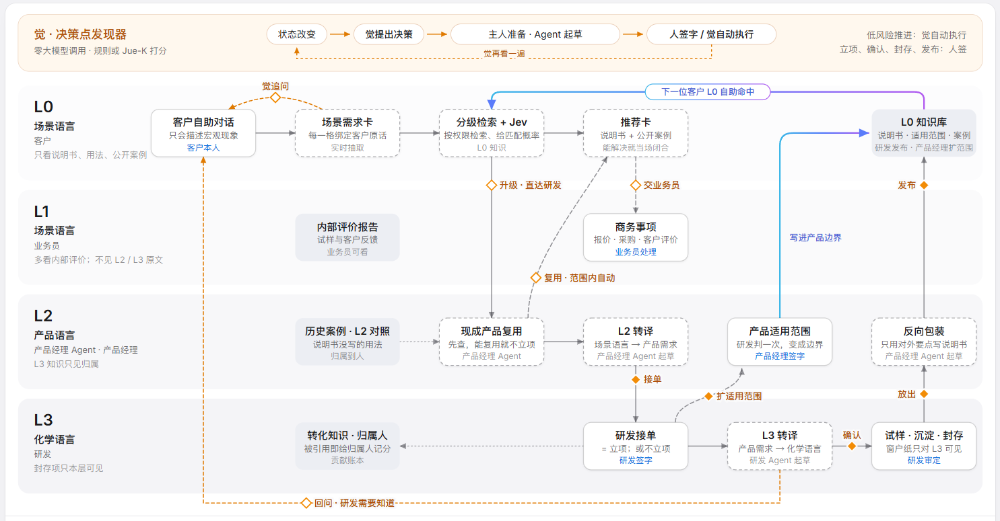</a>

<sub>**图 2 · 全链路系统架构。** 涵盖知识分层、三层编译、专业研发闭环、决策分流、客户自助及产品适用范围回流。可点击查看原图；交互操作请进入 [在线 Demo](https://www.soranori.com/huayan-demo/)。箭头表示可能的路径，不代表每次业务请求都要经过所有岗位。</sub>

### 3.1 解决专业问题的前提：让不同的人看到不同的知识

在功能化学事业部，客户只应获得经批准的产品和用法，销售可以使用内部评价报告，产品经理需要市场、产品与场景知识，研发则需要掌握机理、配方、实验与技术判断。

**不分层，要么企业不敢把关键知识交给系统，要么 AI 可能把不该披露的“窗户纸”捅破。** 这不是简单在页面上隐藏菜单，而是知识、转译、工具与输出本身的访问边界。

化言把知识分为四层：L1 / L2 / L3 构成事业部内部的专业知识体系，**L0 公开入口**直接服务下游客户：

| 级别 | 主要使用者 | 代表性内容 | 最核心的动作 |
|---|---|---|---|
| **L0 · 客户** | 下游印染企业等 | 公开产品说明书、公开用法与经脱敏案例 | 自助描述问题、回答补问、获取可公开推荐、提出商务诉求 |
| **L1 · 销售** | 商务与客户关系人员 | L0 内容 + 内部许可的评价资料 | 报价、销售跟进、客户维护、反馈需求 |
| **L2 · 产品经理** | 人与后台产品经理 Agent | 产品需求、案例、产品定位、L2 转化对照 | 产品适用范围、机会汇聚、L2 转译与例外纠偏 |
| **L3 · 研发** | 配方、应用技术与工艺人员 | 专业机理、实验记录、技术转化对照及授权配方 | 技术确认、试样、研发知识沉淀、受控披露与发布 |

**知识层级并不等于人工审批层级。** 同一份需求可以在 L0 当场解决、带着已有信息转交 L1，或由后台 L2 自动转译后直达 L3。是否需要专业人员签字取决于行动的影响与责任，而不是层级数字。

### 3.2 一份需求的三层编译：每一句都有 source map

客户说的是生活化的生产现象，产品经理要表达的是产品需要达成什么效果，研发要理解的是技术条件与可验证的约束。把三者塞进一次大模型翻译，可能写出流畅但没有依据的专业术语。

化言采用逐层编译与知识约束：

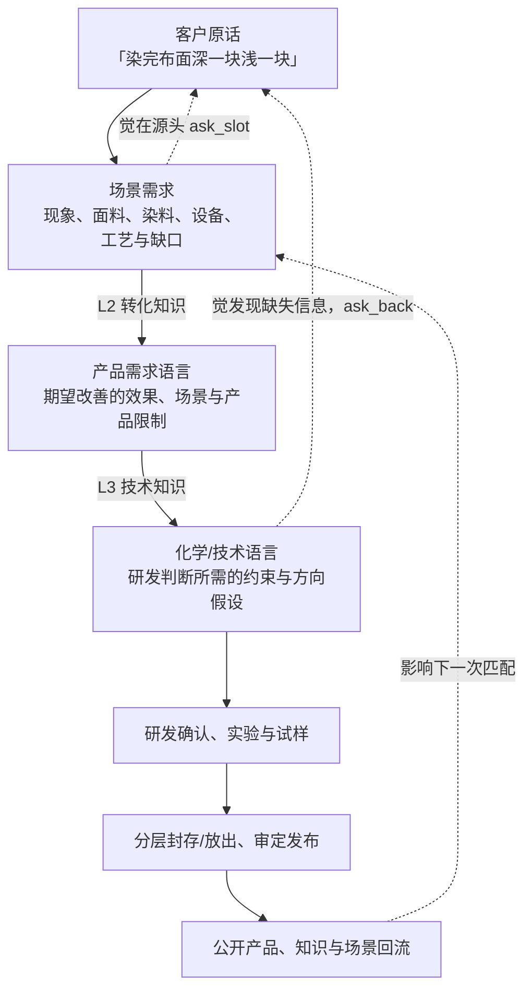

每个结构化槽位带客户原话来源，需求条目使用 `quote_refs` 与知识引用记录关联原始语句和领域知识。**研发不是被迫相信一段 AI 改写后的总结，而是能查这条要求从客户哪句话来、引了谁的哪条知识。**

| 关键机制 | 如何避免失真 | 面向研发的意义 |
|---|---|---|
| **原话不被覆盖** | 客户发言作为独立事实保存，转译条目只引用而不替换 | 改错时能回看真实表达，而不是继续传话 |
| **条件明确与未知标记** | 已知面料、设备、工艺等条件与待追问项分离 | 不把模型猜测写成客户确认的目标 |
| **分层知识访问** | L2 不使用 L3 敏感原文伪装专业判断 | 防止跨权引用和错误披露 |
| **转化对照与 source map** | 每条专业内容说明知识及原话依据 | 发生争议时能定位哪里发生了理解偏差 |
| **主动回问 `ask_back`** | 当未知条件会改变 L3 结论时向客户追问 | 尽可能在研发投入前澄清会影响方向的约束 |
| **失真与一致性检查** | 发现遗漏约束、缺原话依据等异常 | 让错误在专业确认前显形，而不是等到试样后 |

### 3.3 「开工门槛」：把需求质量变成可以检查的业务状态

开工门槛让补问与校验能力变得可见：在客户侧展示专业处理需要的条件，在研发侧展示已齐的必问项、原话来源、待回问和待处理失真情况。

这不是新增一张漂亮的需求表，而是让研发判断**这份输入是否足以开展下一步技术工作**。按照当前契约，接单前还必须处理未答回问及未解决的失真问题。

需要明确的是，当前模型覆盖种子里已定义的场景必问槽位，不等同于完整的企业级立项规格书。真正的性能指标、验收条件、技术可行性与实验设计仍需要专业判断。**化言把“可预见的信息缺口”前移，而不假装已经消除了化学研发的不确定性。**

### 3.4 专业知识向外只有受控出口

知识存入系统后，不能因为模型会检索就无条件对客户披露。化言已实现多种面向客户的披露版本，并由用户身份和知识归属控制可见范围。

| 披露层次 | 内容 | 控制原则 |
|---|---|---|
| 产品级 | 产品身份与公开用途 | 客户可获得已发布的信息 |
| 产品 + 用法 | 经批准的操作与使用建议 | 默认公开上限须受产品披露策略限制 |
| 受控机理 | 对作用机理的解释，不含保密配方 | 需要研发归属者授权且不超出身份上限 |
| 内部机密 | 配方、完整实验与敏感机理 | 仅对应权限内的专业角色可见 |

**两个关键出口**：经过专业审定后向下发布的公开要点，以及有明确授权流程的受控解密。`Jev` 可以在允许范围内选择表达版本，但**不能用一个高概率结果突破硬权限边界**。

越权检索会记录事件，觉可据此观察连续拼凑敏感知识的行为。它提高可审计性；面向复杂推断攻击的安全测试列入试点阶段，见[第 12 节](#12-48-小时交付范围与试点验证路线)。

### 3.5 知识产权责对等：不是知识越公开越成功

企业推动专业知识共享，必须回应一个现实问题：**研发人员多年积累的经验，怎样在被组织使用的同时获得明确归属与合理认可？** 如果贡献难以追溯、责任难以界定，关键知识就不易持续沉淀。

化言默认**知识有主人**：

| 机制 | 当前实现 | 组织意义 |
|---|---|---|
| **可见归属、不可见原文** | 高层知识只向非授权角色透露归属或存在性 | 既知道该找谁，也不越过机密边界 |
| **引用即记分** | 引用留下知识单元与人员归属，在积分账本计数 | 专家贡献可见、可审计 |
| **修改即沉淀** | 研发对 L3 转译的修订可被提炼、审定并入库 | 有效经验不止服务一张需求单 |
| **产品边界由 PM 管理** | 产品经理审定适用范围、场景知识和机会 | 产品经验不再只由研发口头维护 |
| **解密由主人批准** | 对受控机理等内容执行审批 | 谁贡献专业知识，谁参与披露责任 |
| **技术与商业责任分开** | 研发判断技术适用，产品经理确认产品批准范围 | 不让一个岗位独自承担所有决策 |

**知识贡献从「上传文档」升级为「在真正解决问题时顺带沉淀被使用过的判断」。** 当前以引用和贡献**积分**记录每位专家的贡献；积分与绩效、知识激励制度如何衔接，留给试点阶段由事业部按自身政策设计。

### 3.6 安全治理不是一段「请模型保密」的提示词

系统在知识库、披露和应用门面执行权限；交给模型的上下文在检索和组装时已经过滤。Agent 的权限不能超过其角色及委托关系，客户原话不能被当成对 Agent 的系统指令。

化言已把这条约束放进测试与业务代码，而非只写在产品说明里。低层查看高层知识、L2 转译引用 L3 原文、封存项下放、无委托人的 Agent 越权执行等路径属于重点验证对象。

**Agent 可起草、可调用授权工具，不等于它有权作出生效的专业决定。** 低风险自动推进同样依据决策模板中明确的动作授权，而不是给 Agent 一个不受限的管理员权限。

---

## 4. 专业研发闭环：不只是会路由的系统

### 4.1 已建立一条从客户到新品再回客户的专业闭环

如果只看动态分流，化言可能被误解为一个智能工单分配器。但真实的系统远不止于此：**进入研发以后，一份需求仍然有完整的技术处理、知识验证与商业回流过程。**

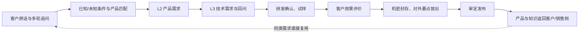

这条专业链既回应了赛题「复杂知识理解与方案辅助生成」，也回答了一个比问答准确率更重要的问题：**客户的问题得到了解释后，企业怎样知道结果有效、怎样管理发布、怎样让下一位客户受益？**

### 4.2 专业深链路真实模型录制：一条复杂需求是怎样被处理的

专业深链路录制选择锦氨面料的染色不均作为主线，经过产品不匹配、同类需求汇聚、L3 回问、研发确认、试样成功、客户评价、对外披露与新品发布，最后下一位客户直接命中新产品。

| 环节 | 实际发生的业务动作 | 觉与 Agent 分别扮演什么角色 |
|---|---|---|
| 1. 客户只说现象 | 「染完以后布面深一块浅一块」 | 觉提出面料和染缸追问，销售 Agent 起草话术 |
| 2. 场景逐渐明确 | 客户补充锦氨、气流缸等信息 | 结构化需求保留每个槽位的原话 |
| 3. 既有产品不匹配 | 升级为产品需求 | 觉提出升级，业务员在陪同会话中签字 |
| 4. 同类问题汇聚 | 两份需求发现同一主题 | Jue-K 触发机会问题，产品经理 Agent 准备合并说明，责任人签字合并 |
| 5. 研发接单 | 起草化学/技术语言 | 研发 Agent 使用 L3 权限与转化对照 |
| 6. 发现关键缺口 | 染浴 pH 会改变转译结论 | 觉 `ask_back`，业务员回问客户；Agent 重起草 |
| 7. 技术内容修订 | 研发审定、修改并提炼知识 | 贡献归属与知识账本记录 |
| 8. 效果验证 | 记录试样结果、带回客户评价 | 结果参与下一轮决策与发布条件 |
| 9. 分级发布 | 哪些机理封存，哪些要点对外 | 研发确认，产品经理 Agent 准备说明书 |
| 10. 下次同类需求 | 新客户可推荐已发布产品 | 原本重复的专业工作由知识与产品成果承担 |

该次录制 **11 次签字断言全部通过**，大模型计量 86 条（72 次新请求、14 次缓存命中、0 次失败），OneJev 调用 3 次（产品匹配 1、披露 2）；回放时按事件与录制逐条比对，只忽略事件 id。完整签字表、对话、草稿与回放过程见 [`runs/demo_record/README.md`](runs/demo_record/README.md)。

### 4.3 角色 Agent 不是聊天皮肤：它们能操作真实的业务对象

化言的 Agent Loop 允许角色通过自然语言协作完成检索、起草、修改和准备签字事项，而不是只输出一段没有去处的 Markdown。

**销售 Agent（L1）**

| 人可以怎样提问 | Agent 要做的实际工作 |
|---|---|
| 「这个客户到底说了什么？还缺什么？」 | 读取当前场景、已知槽位、客户原话和觉的补问建议 |
| 「帮我问清是什么布、用什么缸」 | 准备简洁的客户追问消息，写回工作面 |
| 「查一下有没有适用锦氨面料的产品」 | 在授权层级检索产品说明书、用法、可披露案例 |
| 「这不是商务问题，帮我整理技术需求」 | 起草带原话的交接说明，不伪造客户条件 |
| 「客户想了解产品机理」 | 判断可披露范围，必要时准备申请专业授权 |

**研发 Agent（L3）**

| 人可以怎样提问 | Agent 要做的实际工作 |
|---|---|
| 「把这张单的客户原话和技术条件调出来」 | 读取会话、来源引用、需求条目及知识依赖 |
| 「以前有类似的气流缸色花案例吗？」 | 检索 L1/L2/L3 授权知识、案例、机理与试验记录 |
| 「这个结论会不会受到 pH 的影响？」 | 结合已有证据起草方向假设，必要时配合回问 |
| 「起草 L3 需求单，第 2 条改成低泡约束」 | 调用原子工具形成可检查的需求条目或修改草稿 |
| 「这些内容哪些可发布，哪些必须封存？」 | 准备披露草稿及保密核对，待研发本人审定 |
| 「这段修正值得沉淀吗？」 | 提炼转译经验、关联原作者并准备知识贡献动作 |

**产品经理 Agent（L2）**负责产品需求起草、复用候选判断、场景与产品知识组织、同类需求汇聚、面向市场的说明书准备；它可自动完成例行 L2 转译，人类产品经理则专注适用边界、机会与例外纠偏。

**人与 Agent 的协作不止于收到通知。** 用户可以直接在工作面与 Agent 讨论并修改草稿，也可以查看具体工具调用及其写入的领域对象。越权动作不因为 Agent 说「我已经处理好了」就生效。

### 4.4 研发成果回到市场，是闭环而不是结尾

产品研发成功后，结果不是仅成为一份实验报告。通过审批的对外内容经过分层包装，成为可供销售、客户再次使用的产品说明与知识；新的有效产品或适用范围改变下一次产品匹配。

这构成化言真正可积累的闭环：

**一次客户需求 → 一次专业判断 → 一次技术验证 → 一份有归属的知识/产品能力 → 下一次更短、更准确的需求处理。**

C′ 判断复用则把「已有产品其实能覆盖新场景」也纳入这一循环：**不必等全新产品研发完成，既有研发结论也能改变下一次客户的处理结果。**

---

## 5. 动态协作：从固定岗位流水线，到按需求价值组织协作

### 5.1 动态协作让专业闭环被更正确地调用

专业闭环保证一份复杂需求能够被完整处理；一线组织协作的交流进一步提出：**让不值得重复占用研发的需求尽早止步，把真正需要专业研发的问题带着完整条件送到研发手上。**

旧的人工假设是客户 → 销售 → 产品经理 → 研发依次流转。化言不再把四个角色当成一条必须走完的人工审批线，而让觉发现业务意义、Agent 处理低风险转换、人保留重要专业决策。

<a href="docs/assets/readme/workflow-contrast.png">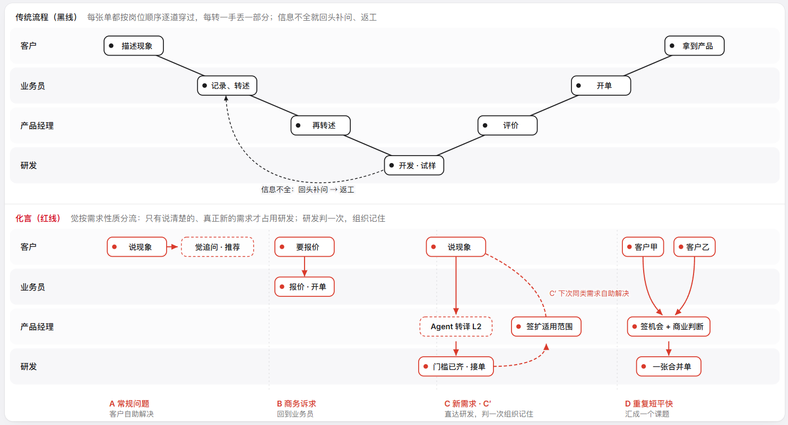</a>

<sub>**图 3 · 传统流程与化言动态协作的对照。** 黑线是用于阐明问题的传统流程定义，红线是化言演示路径。相应的可操作工作面及路由证据见 [在线 Demo](https://www.soranori.com/huayan-demo/)；下文给出五条路径的精确机制。</sub>

### 5.2 五条路径：重要的不是绕过了谁，而是为什么不需要打扰谁

| 演示路径 | 化言真实执行的动作 | 谁仍承担重要责任 | 为什么具有经营意义 |
|---|---|---|---|
| **A · 自助** | 客户只说现象；觉追问；系统依据公开知识完成推荐 | 无需为每个常规咨询动用专业人员 | 让销售集中在商业机会，减少重复答疑 |
| **B · 商务归位** | 客户已获得技术推荐后询价，携原话及推荐信息交销售 | 销售负责商务谈判、价格和客户关系 | 技术信息不必从头再采，报价入口更短 |
| **C · 技术需求** | 无批准适用产品；觉推进低风险升级；L2 后台转译；向研发提供来源与条件 | 研发负责是否接单、技术适用性与专业方案 | 减少因重复转述和缺信息产生的早期错判 |
| **C′ · 判断复用** | 研发发现已有产品适用；PM 审定产品适用范围；下次同类需求在前台命中 | 研发判技术可行，PM 管批准产品范围 | 一次技术判断可服务多个潜在客户 |
| **D · 机会汇聚** | 多客户同类问题被觉发现；PM 形成商业判断并合并需求；研发接一项技术任务 | PM 对产品机会负责，研发对技术工作负责 | 把零散短平快变成可评估的产品研发方向 |

这里保留两种经常被混淆的决定：**研发发现「现有产品可以解决」属于专业适用性判断；产品经理决定是否把这一结果写入正式产品适用范围，属于产品管理责任。**

同样，**没有现成产品可用，并不等于一份信息不全的需求应立刻开工**。觉仍应先根据已建模的关键条件追问或标记待补信息，研发保留最后的技术确认。

### 5.3 产品范围不是宣传字段，它改变后续真实匹配

C′ 的价值不是显示「产品经理已签字」而已。研发确认某个产品在新场景的技术适用后，产品经理的批准更新进入产品匹配所读取的适用知识，使下一个同类客户的推荐结果发生改变。

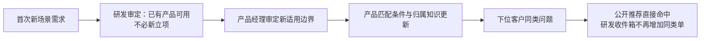

**这体现了知识参与决策与传统知识库的本质区别：结论不只被存储，而是改变了系统下一次选择什么、是否升级、需要谁介入。**

### 5.4 同一批需求的三种协作方式：受控模拟中的组织变化

同一批六份模拟需求，分别按三种方式处理：

- **传统人工流转**：按「业务员记录 → 产品经理转述 → 研发接收 → 产品经理评价 → 业务员开单」的流程定义计数。
- **逐岗协作**：同一套代码以业务员陪同会话运行——每个岗位都配了 Agent，但仍由业务员签升级、研发逐张接单，不启用不立项判断、适用范围扩展和产品经理机会签字。
- **化言动态协作**：客户自助入口，觉动态分流、低风险自动推进，研发判断复用与机会汇聚全部启用。

逐岗协作一列相当于一次**消融对照**：Agent 能力完全相同，差别只在任务由谁、在何时提出。它直接检验 §1.4 的判断——**即便每个岗位都配一个 Agent，如果任务仍按固定岗位顺序流转，企业只是更快地重复原有流程。**

| 指标 | 传统人工流转（定义基线） | 逐岗协作 | **化言动态协作** |
|---|---:|---:|---:|
| 人工中转节点 | 30 | 14 | **5** |
| 客户自助完成 | 0 / 6 | 0 / 6 | **2 / 6** |
| 研发介入次数 / 进入研发的单据 | 6 / 6 | 4 / 4 | **2 / 2** |
| 人工签字（其中低风险项） | — | 8（4） | **4（0）** |

**口径说明**：后两列取自同一批需求的模拟运行事件；本对照的觉采用 `jue_proto`，检验的是业务路由和状态变化，Jue-K 的模型优劣见 §8。「客户自助完成」指已推荐且没有需求单和销售介入；「研发介入」计研发本人的接单、不立项等处理事件。完整定义见 [`docs/reports/v6_routes/metrics.json`](docs/reports/v6_routes/metrics.json)。

「研发退回/回问次数」不宜直接排成改进幅度：动态协作下，有些需求更早由研发判定无需立项，根本不会走到逐岗协作中相同的技术阶段。应比较**同一条件下进入研发的需求质量**（见 §8.1），而不是只追求更少的回问。

### 5.5 专业人员回归本位：把无效工作拿掉，把专业判断留下

| 角色 | 被系统接管的重复事务 | 人真正需要做的事 | 对企业的重要性 |
|---|---|---|---|
| **销售** | 常规咨询、重复记条件、传话式升级 | 客户经营、商务报价、回款与市场反馈 | 专注商业机会与客户关系 |
| **产品经理** | 逐单重写产品语言、翻翻资料再转一次 | 产品定位、生命周期、成本目标、适用范围、市场机会、例外纠偏 | 专注有竞争力的产品组合 |
| **研发** | 不完整需求反复补问、成熟产品重复审定、近似单逐个处理 | 配方设计、性能突破、试样、中试、定制方案与必要现场支持 | 专注真正新的、说清楚的技术任务 |

这项组织优化不是以削减专业岗位为目标，而是**通过降低重复事务占比、改善需求流转效率，让专业人员能够把更多精力投入各自最具价值、也最需要经验与责任的工作。**

### 5.6 评委可以在工作面上看到的证据

四类工作面和演示讲解并不是静态 PPT。它们通过和普通手工操作相同的应用门面改变业务状态，再向评委展示变化：

- **客户工作面**：哪些条件从客户开场就已知，哪些由觉追问才得到；推荐结果来自哪个批准产品。
- **销售工作面**：商务请求如何携带已有产品与客户上下文抵达，而不是让销售再问一轮。
- **产品经理工作面**：为什么两个客户构成同一个机会；哪一次产品适用范围更新有本人审定和知识归属。
- **研发工作面**：需求的原话、技术条目、开工前条件、专业决定；同类问题再次出现后是否还需接新单。
- **评测与总览**：失真评测、觉的发现记录、三种协作方式的业务结构对照及演示生产力账本。

**工作面说明的是因果和运行结果，评测则检验结果是否可重复。** 一个只展示“人工节点少了”的系统不够有说服力；化言要让评委实际看到为什么这些节点不必再次发生。

---

## 6. 技术创新与常见方案对照

**化言的创新不是「用了多个 Agent」，而是它们的任务来源、知识边界、决策责任和结果学习，被构造成了一套可运行的架构。**

| 常见产品路线 | 解决得比较好的一部分 | 化言补上的关键能力 | 在代码中怎样验证 |
|---|---|---|---|
| **专业知识库 / RAG** | 从大量报告中召回片段 | 权限、来源、归属、分层编译，以及何时应该使用某条知识作决定 | `KnowledgeBase.search`、权限裁剪、知识引用账本 |
| **单一 LLM 助手** | 对明确指令进行问答与推理 | 系统在无人提问时发现值得被判断的事项，调用角色 Agent 执行 | 觉模板、问题总线、事件扫描与决策记录 |
| **多 Agent 工作流** | 角色之间固定交接任务 | 决策来自对象状态，低风险可自动，高影响由职责人判断，不必逐层过人 | 动态分流路由与责任人、需求状态、审定操作 |
| **企业 BPM / 审批 OA** | 稳定执行预设节点与审批 | 发现不同客户的隐性关联、异常信息缺口与需要改知识的时刻 | `ask_back`、`opportunity`、`knowledge_conflict` |
| **PLM / 研发项目系统** | 管理既有产品项目、文档、审定阶段 | 研发开始之前的需求质量、技术与产品语义连接、专业判断的跨需求复用 | Readiness、source map、C′ 与 D |
| **通用 Agent 轮询** | 动态审阅较开放的情境 | 持续判断独立为低成本、本地、可度量、可训练的层 | Jue-K 模型卡、业务周发现与成本记录 |

### 6.1 七项彼此相连的架构创新

其中最核心的是三条：**任务来源单独成层且可训练（1、2）、跨岗位需求按层编译并逐句溯源（3）、知识共享自带权责治理（4）**；其余各项是这三条在组织运行与评测上的延伸。

1. **任务来源单独成层**：在 LLM/Agent 之外建立可训练的决策发现模型，回答「现在该决定什么」。
2. **发现不是一次提示词**：决策目录、前置条件、对象特征、阈值、抑制与事后标签构成可审计的体系。
3. **跨岗位需求是编译而非转述**：L1 场景 → L2 产品 → L3 技术，每条结论有原话及知识来源。
4. **知识共享自带治理机制**：权限、受控披露、署名与引用记分使企业知识能够被长期使用。
5. **专业结果能改变系统状态**：产品适用范围扩展、技术知识沉淀和新品回流改变下一次真实匹配。
6. **人机协作按责任而不是流程图划分**：常规事项自动，商务/产品/研发决策保留专业主体。
7. **评测不依赖一句“效果更好”**：AUC、Brier、ECE、失真对照、困难负样本、模拟业务周与真实调用过程分开验证。

### 6.2 为什么它具有架构层而不只是工具层的价值？

传统单点工具的效益随着一次任务结束而结束。化言把一次专业判断变成**会影响后续路由、产品匹配、知识使用、模型关注点与商业机会**的结构化结果。

**因此，其价值不只来自某个 Agent 写得更快，还来自企业不必反复就相同的问题付出同样的组织成本。** 专业研发闭环提供技术深度，动态协作则提供了这种架构改变组织协作方式的直接证据。

---
## 7. 经营价值与产业愿景：让创新资源重新流向创新

### 7.1 企业关心的不是「Agent 做了什么」，而是「研发被什么占用」

对于一个以技术与产品竞争的功能化学事业部，研发时间不只是费用，更是有限的创新产能。需求不明确导致的补问与返工、成熟产品本可解决的问题重复立项、多个客户的同一问题拆成零散课题，都会降低这份产能投入高价值研发的机会。

化言提出的不是一个简单的节约人力目标，而是一个**更重要的资源配置问题：企业能否尽可能让技术人才只在真正需要技术判断的地方投入精力？**

| 企业价值路径 | 化言切入的具体机制 | 可以当场看到的证据 | 必须通过真实试点验证的收益 |
|---|---|---|---|
| **减少错误研发投入风险** | 源头主动追问、三层原话溯源、开工前缺项检查 | 需求完整率、待回问、开工门槛与来源 | 因需求理解问题导致的返工轮次、重复试样成本 |
| **释放研发注意力** | 自助解决、低风险动态路由、C′ 适用范围复用 | 入研单据、重复判断减少、人工中转变化 | 研发实际工时结构与中长期课题投入占比 |
| **扩大成熟产品的商业覆盖** | 研发判适用、PM 批准扩边界、下一次产品匹配复用 | C 与 C′ 前后的推荐结果 | 新增应用场景的客户转化与收入贡献 |
| **从分散客户需求识别产品机会** | 觉汇聚多客户同类问题，PM 给商业判断 | D 的多需求合一、专业责任分工 | 新品立项质量、新品转化率、产品线利润 |
| **专业知识资产积累与复用** | 知识署名、引用记分、L2/L3 沉淀与受控披露 | 知识/积分账本、原话与引用来源 | 重复答疑下降、关键知识留存与复用质量 |

**一份需求越早被理解正确，研发越少可能因方向偏差反复消耗；一次专业判断越能复用，下一份相同需求的边际处理成本越低。** 这两条机制形成潜在的长期复利，而不是一次性把流程缩短几个节点。

### 7.2 商业转化与产品线增长：让既有产品覆盖更多高价值场景

C′ 是值得关注的产品价值释放路径。一次客户反馈使研发发现「某现成产品实际上适用于尚未公开覆盖的生产场景」，产品经理将其审定为新的正式适用范围后，后续同类客户可获得更准确的推荐，无须重复发起相同的技术审查。

这条路径至少提出三个可以验证的经营假设：**更快服务下游客户、减少重复技术判断、使成熟产品获得潜在新增应用市场**。但从推荐到实际订单，还需要商务报价、技术适配、客户验证与采购决策。

D 则进一步让产品经理看到多个客户共同表达的未满足场景，形成研发可能投入的新产品机会。它不是自动立项，更不是自动生成配方，而是让研发项目在进入技术阶段前拥有更清楚的**市场问题与产品责任**。

### 7.3 客户体验与产业协同：让专业服务能力成为长期竞争优势

功能化学产业天然存在一条语言鸿沟：**客户描述生产现象，产品经理理解应用与规格，研发处理机理及技术约束。** 对企业而言，持续积累这些语言之间经过专业确认的对应关系，既有助于提升客户咨询的响应效率、一致性与可追溯性，也有助于增强跨产品线的场景服务能力。

L0 公开自助入口、分层知识和经批准的脱敏案例，为下游客户提供更加及时、可信且边界清晰的技术服务；L2/L3 的专业知识保留归属和披露边界。随着真实案例和验证结果积累，这一结构有机会发展为企业特有的**产业需求语义资产和上下游协同服务网络**，形成差异化技术服务能力与长期品牌影响力。

这是需要在试点中逐步验证的价值路径（见 §11.4）。

### 7.4 降本增效如何量化：用可审计的参数开展收益测算

化言不给出拍脑袋的节约金额，而是给出**由事业部自填参数、口径透明的测算方法**。[在线 Demo](https://www.soranori.com/huayan-demo/) 的「放到贵司算一算」估算卡已实现这一方法：比例取自同一批模拟需求的结构对照，研发小时成本等参数由企业自填，即时算出每月少进研发的单据、释放的前期工时与折合人力。测算公式为：

> **前期处理工时的情景估算** ≈ 月度相关需求量 × 有望减少的重复处理比例 × 每份需求原先的平均处理工时 × 12。
>
> **情景金额** ≈ 上述工时 × 企业按同一口径提供的小时成本。

若评估新增销售，还必须另有新增可服务客户量、实际转化率、客单贡献、毛利等输入。**少一次人工中转不必然等于少一小时工时，增加一次推荐也不等于形成一笔销售。**

因此，化言为管理层提供的是**透明的收益测算方法和可验证的指标体系**：试点一开始就能按同一口径记录，随后用真实数据逐项替换估算参数。

### 7.5 更远一步：把员工的生产力增益转成组织的长期创新能力

很多 AI 工具的收益停留在「一个销售写消息更快」「一个研发查报告更快」。化言的更高层价值在于：**一名专家的判断能否改变其他员工和 Agent 未来的行动，组织是否会因为处理过一次问题而更少重复处理同一问题。**

这意味着企业积累的资产不止有文档和模型参数，还有**领域问题、专业判断、责任归属、处置结果与复用记录**。若未来在真实企业数据上形成稳定的反馈和学习循环，创新能力才有可能真正超出单点工具的效率上限。

---

## 8. 证据与可复现评测：从业务示例到受控对照

### 8.1 需求失真：先造一把尺子，再说自己更准

团队构建了程序生成的需求卡、只说现象且被问到才透露条件的模拟客户，以及一组明确区分的比较基线：

- **业务员转述**：按照模拟的漏记、误记和固定提问习惯，将需求传递给后续阶段。
- **一次性翻译**：没有主动补问，只能处理客户开场已经说出的信息；其对照实现为规则式一次性转译。
- **化言规则觉**：由规则前置条件与模板分数决定追问、回问。
- **化言 Jue-K**：用训练模型进行通过统计检验的发现判断，其他链路口径保持一致。

同一批 300 张模拟需求卡里，按评测定义**有 41 张应进入研发**，其余 259 张原则上可以在 L1 解决。最有业务意义的是「真正到研发的需求是否准备充分」：

| 指标与人群 | 业务员转述 | 一次性翻译 | 规则觉 | **Jue-K** |
|---|---:|---:|---:|---:|
| **应升级的 41 张：需退回补问比例** | 95.1% | 95.1% | 65.9% | **19.5%** |
| **应升级的 41 张：必问信息完整率** | 49.2% | 50.8% | 75.8% | **90.9%** |
| L1 可解的 259 张：需退回补问比例 | 96.1% | 98.8% | **44.4%** | 59.5% |
| 全部 300 张：需退回补问比例 | 96.0% | 98.3% | **47.3%** | 54.0% |

**对照结果同时披露有利与不利的评测表现。** 在全部需求卡上，以同一「必问完整性」定义评价，规则觉优于 Jue-K。其原因之一是：Jue-K 会有选择地把追问预算投向更有可能进入研发的需求；那些可以在前台解决的需求不一定需要凑齐全部研发槽位。

「需退回」指**现象或必问条件缺失/错误**的离线判定（口径见 §12）。数字为 v7 按「家族 × 判断层」重训的模型与规则觉同批重跑（2026-10-20）；应升级的 41 张与 v5 相同。详见[评测方法、基线噪声、未见现象与局限](docs/reports/distortion/README.md)。

### 8.2 模型能力：不只报 AUC，还验证校准和选择标准

Jue-K 对多类决策采用一个梯度提升模型，按类别进行概率校准，与相应模板规则在测试集上配对比较：

| 判断 | Jue-K AUC（校准后） | 规则 AUC | Jue-K ECE | 选择 |
|---|---:|---:|---:|---|
| `ask_slot` 追问 | **0.755** | 0.670 | 0.043 | 模型 |
| `ask_back` 回问 | **0.713** | 0.500 | 0.152 | 模型 |
| `opportunity` 机会 | **0.953** | 0.854 | 0.039 | 模型 |
| `leak_risk` 风险 | **0.941** | 0.500 | 0.081 | 模型 |
| `knowledge_conflict` 冲突 | 1.000 | 1.000 | 0.000 | 规则 |

模型评测还包含测试集与留出现象（heldout）、追问预算与推荐正确率的权衡、业务先验偏移下的学习曲线。**模型在未见现象上的提升并不稳定，少量追问预算时也存在弱于规则的情况**，因此部署必须遵守适用域和回落机制。

<details>
<summary>展开：Jue-K 的学习曲线、校准图及完整训练证据</summary>

| 学习曲线 | 概率可靠性 |
|---|---|
|  | 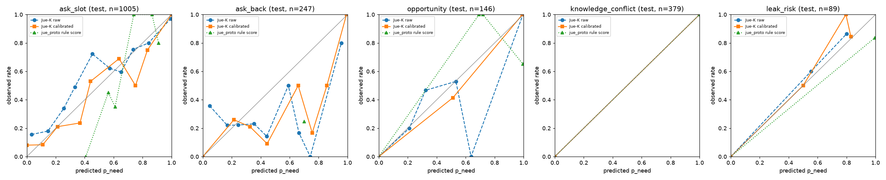 |

完整资料：[Jue-K 模型卡](models/jue_k/model_card.md) · [训练方案](docs/JUE_K_TRAINING.md) · [评估方法与操作点](docs/reports/jue_k/README.md)。

</details>

### 8.3 模拟业务周：真正困难的是该沉默的时候沉默

另一个不依赖单个精彩对话的证据，是**五个模拟业务日、130 条剧本**中的事件发现任务。测试包含三个真情况：同类需求构成机会、产品声明与试样发生冲突、有人拼凑敏感知识；另外构造四个容易误报的相似情况。

| 发现器 | 真情况命中 | 困难负样本误报 | 发现环节大模型调用 |
|---|---:|---:|---:|
| 常见规则告警 | 2 / 3 | 2 / 4 | 0 |
| 觉原型规则 | 3 / 3 | 1 / 4 | 0 |
| **Jue-K** | **3 / 3** | **0 / 4** | **0** |

这说明在受控样本下，训练模型对某些常见误报能做出更好的区分，而不是任何提示都发给人。业务周还记录了处置/不处置的分支：发现产品机会并完成模拟研发和发布后，下一位同主题客户可以直接命中新品；并非只停留在屏幕上弹出告警。

业务周的规模与口径见 §12；详见[业务周报告](docs/reports/week/README.md)及[决策目录统计](docs/reports/catalog_stats.md)。

### 8.4 两段真实模型录制与多组受控对照，互相补充

| 可核验证据 | 回答的评审问题 | 来源 |
|---|---|---|
| **专业深链路真实模型录制** | Agent 真能推进复杂专业任务、调用工具并完成研发—试样—发布链吗？ | [`runs/demo_record/`](runs/demo_record/README.md) 的深链路主线、计量与签字记录 |
| **全路径讲解 16 步真实模型录制与回放** | 动态分流、跨岗位协作、讲解是否具有真实模型执行记录？ | [`config/app.demo.v6.yaml`](config/app.demo.v6.yaml) · [`scripts/record_story.py`](scripts/record_story.py) |
| **三种协作方式结构对照** | 同样六份需求，人工中转与责任路径有没有实际改变？ | [`scripts/demo_routes.py`](scripts/demo_routes.py) · [`metrics.json`](docs/reports/v6_routes/metrics.json) |
| **失真对照** | 必问信息与需求正确性是否确实改变？ | [`docs/reports/distortion/`](docs/reports/distortion/README.md) |
| **Jue-K 测试** | 发现层是否是可训练、可评估的模型？ | [`docs/reports/jue_k/`](docs/reports/jue_k/README.md) |
| **实时模型试用** | 是否只能观看排练好的剧本？ | 工作面 BYOK、状态条、进度与工具调用记录 |

全路径讲解使用 `demo/story.yaml` 的 16 步剧本，仓库提供相应的**真实模型录制缓存与回放配置**。最近一次录制（换入两个公开真实产品之后）为 **65 次模型调用、约 25.6 万 token、370 秒，16 步无偏离**；该录制未接 OneJev，Jev 由大模型降级承担并在状态条明确标注，觉仍然是本地 Jue-K 判断。

**回放**重用已经录下的模型输出，**BYOK** 则由试用者的接口进行实时生成。两者都可能改变本系统的业务状态，但不是同一个模型费用或随机性的统计口径。

### 8.5 哪些已经真实运行，哪些留给试点测量？

- **已经真实运行**：程序化需求卡与业务周、Jue-K 训练与评测、专业研发闭环、动态分流五条路径、两段真实模型录制、可连接用户自有模型的交互入口。
- **试点阶段测量**：试样不达标归因、返工轮次与成本、研发课题工时结构、客户转化、知识采纳率及跨产品线泛化。

**化言的每一个宏大主张，都指向一项已经跑通的机制，以及试点阶段下一步可测量的结果。**

---
## 9. 工程化能力：48 小时交付的工程底座与规模扩展

### 9.1 48 小时交付的不是页面原型，而是一套可运行的系统

化言是 48 小时黑客松内完成的作品（模型网关、System 1 接口与 Agent Loop 的部分基础复用团队赛前 JUE 研究，见 §16）。在这段时间内交付的是一套**可运行、可回放、可测试、已公网部署**的系统：

| 交付物 | 规模与实现 |
|---|---|
| 业务与模型代码 | 约 7,100 行 Python 核心库，另有约 2,100 行脚本覆盖数据生成、训练、评测与录制 |
| 交互界面 | 约 6,600 行 React / TypeScript：四类角色工作面、觉视图、评测、演示讲解与 BYOK |
| 决策目录 | 22 个决策模板（推进类与异常类），主人、签字人、自动动作均由模板写定 |
| Agent 工具 | 30 个原子工具：一个工具 = 一个动作 = 一次门面调用，业务规则不散落在工具里 |
| 测试 | 11 个离线不变量与端到端测试，约 3 秒跑完，不访问网络 |
| 部署 | [公网在线 Demo](https://www.soranori.com/huayan-demo/)，录制回放与 BYOK 实时两种模式 |

### 9.2 已具备的工程能力

| 工程能力 | 实现方式 | 代码位置 |
|---|---|---|
| **冻结契约** | 领域对象、事件、动作、权限与工具约定写成契约，各模块只依赖契约并行开发 | [`docs/CONTRACTS.md`](docs/CONTRACTS.md) · [`src/huayan/contracts/`](src/huayan/contracts/) |
| **应用门面 + 原子方法** | 界面、Agent 工具、脚本都只经门面改变业务状态；权限与校验只写在门面和知识库 | [`src/huayan/app.py`](src/huayan/app.py) |
| **统一模型网关** | 所有大模型调用必须带调用方标识，统一计量、缓存、录制与回放；更换模型供应商不动业务代码 | [`src/huayan/gateway/`](src/huayan/gateway/) |
| **降级逐条标注** | Jev 降级、觉规则模式、规则抽取在结果上标 `scored_by` / `extracted_by`，界面状态条可见 | [`src/huayan/jue/`](src/huayan/jue/) · [`src/huayan/jev/`](src/huayan/jev/) |
| **可复现** | 业务时间只来自统一时钟、随机数显式传种子；同种子模拟可复现，录制回放按事件逐条比对 | [`src/huayan/clock.py`](src/huayan/clock.py) · [`tests/test_wp_b2.py`](tests/test_wp_b2.py) |
| **评测隔离** | 觉、Jev、Agent、门面不得读取需求卡与注入清单，只有 `sim/` 与 `eval/` 可读，由测试守住 | [`tests/test_wp_b2.py`](tests/test_wp_b2.py) |
| **会话隔离** | 每个浏览器会话拥有独立的门面与业务时钟，多人同时试用互不干扰 | [`src/huayan/ui/server.py`](src/huayan/ui/server.py) |
| **BYOK 安全接入** | 接入前自动检测对话、JSON 输出与工具调用；模型地址只允许公网地址以防内网探测；密钥只在会话内存中使用 | [`src/huayan/gateway/byok.py`](src/huayan/gateway/byok.py) |

### 9.3 规模扩展：把不同增长维度拆开

| 增长维度 | 当前架构怎样应对 | 规模化路径与后续验证 |
|---|---|---|
| **知识与报告量** | 统一 `KnowledgeBase.search`；排序/召回与权限过滤、引用记分分开 | 当前检索为轻量实现；企业级召回质量由接入的 RAG 保证，需验证多权限下的性能 |
| **客户会话与需求单数量** | 觉面向通过前置条件的「模板 × 对象」批量推理；总线合并、抑制重复事项 | 批量推理不等于已经完成大并发压测；需测试对象规模与扫描频率 |
| **业务角色数量** | 按身份作用域授权，Agent 通过受控原子工具操作，专业责任可配置 | 正式企业部署需映射实际组织、账户、审计与审批策略 |
| **业务决策种类** | 新模板规则冷启动，有可靠数据再加入 Jue-K 的训练与统计选择 | 新类型仍需开发特征与标签，不是零成本凭空自动发现所有问题 |
| **生成式模型替换** | OpenAI 兼容网关、调用计量、JSON 与工具调用能力检测 | 模型供应商的 API、结构化输出、工具语义差异需逐项验证 |
| **行业和产品线扩展** | 复用觉的计算接口、事件、总线与权限/归属机制 | 必须替换领域对象、种子、工具、训练样本与专家约束 |

**真正有价值的工程思想，是让业务规模增长时被替换的部分尽可能明确。** 化言不是把所有任务封装成一段无法管理的提示词，而是将发现、生成、业务状态、权限、知识与界面分成职责清楚的模块。

### 9.4 实际架构：发现、判断、生成、业务状态各自独立

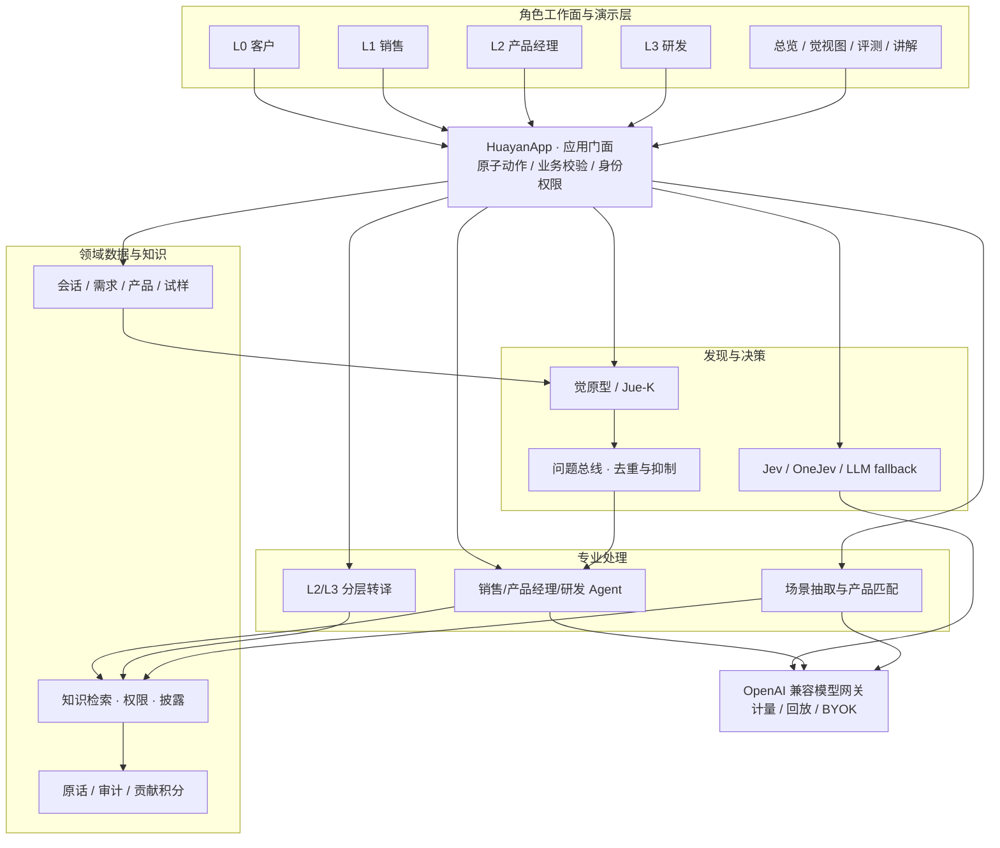

实现采用 **Python 应用门面 + React/TypeScript 前端**。界面经 JSON 接口访问门面，不在 React 页面上复制服务端权限逻辑；Agent 使用自研 Loop 与原子工具，不依赖 LangChain 等通用 Agent 框架；Demo 当前不依赖向量数据库。

| 核心部件 | 代码位置 | 工程职责 |
|---|---|---|
| 应用门面与业务动作 | [`src/huayan/app.py`](src/huayan/app.py) | 状态、动作、校验、角色权限与业务事件 |
| UI 与 HTTP API | [`src/huayan/ui/server.py`](src/huayan/ui/server.py) | 原子操作的接口、会话处理、演示与观测数据 |
| 觉及决策模板 | [`src/huayan/jue/`](src/huayan/jue/) · [`config/templates/`](config/templates/) | 发现、模型特征、决策对象、推进责任 |
| Agent Loop | [`src/huayan/agent/`](src/huayan/agent/) | 工具调用、准备草稿与角色协作 |
| Jev / [OneJev](https://github.com/OmniJev/OneJev) | [`src/huayan/jev/`](src/huayan/jev/) | 对已提出问题进行候选判断；可选对接开源 System One 服务 |
| 模型与计量网关 | [`src/huayan/gateway/`](src/huayan/gateway/) | OpenAI 兼容调用、缓存、录制与回放 |
| Jue-K 模型 | [`models/jue_k/`](models/jue_k/) | CPU 训练版决策发现及校准器 |
| 评测与脚本 | [`scripts/`](scripts/) · [`docs/reports/`](docs/reports/) | 需求、模型、业务周与协作方式对照实验 |
| React 工作面 | [`web/`](web/) | 多角色展示、真实操作、BYOK 与讲解 |

### 9.5 一份演示给不同评委：可重放，也能自己验证

仓库目前支持三种清晰区分的运行模式：

| 模式 | 运行方式 | 适合谁 | 透明性 |
|---|---|---|---|
| **真实模型录制回放** | 按已录制的模型输出重新执行业务动作 | 快速看完整故事、可复现展示 | 明确显示「回放」，不能偏离已缓存的轨迹随意生成 |
| **自带模型实时试用（BYOK）** | 填 OpenAI 兼容接口与密钥，抽取、Agent 等现场调用 | AI 评委验证真实模型能力 | 展示模型名、调用过程、Token 和实际状态；与剧本偏离会提示 |
| **离线规则/模型演示** | 本地 Jue-K 实际推理，抽取与 Jev 等采用规则或桩 | 无密钥、无模型服务时验证路由结构 | 状态条标明降级，不将规则冒充在线 Agent |

**BYOK 不只是替换聊天界面的模型。** 试用者可以用自己的话描述客户问题、改变说法、让研发 Agent 修改草稿，并观察真实工具动作写进系统状态。模型接入前会检查基本对话、JSON 输出与工具调用能力；可选连接 OneJev，未连接时让 Jev 使用 LLM fallback，并公开标注。

演示服务按浏览器会话隔离业务状态，使用者提供的密钥在会话内存中使用，不写入代码仓库或运行目录；代理请求的模型服务地址进行公网地址检查。企业级身份认证、安全审计与高并发加固在试点部署时接入事业部现有体系（见 §11）。

### 9.6 成本要拆开算：觉零 LLM 调用，不代表整套系统免费

- 觉在报告所覆盖的发现任务中使用 CPU 本地模型/规则，**发现环节的大模型调用为 0**。
- 自然语言抽取、System 1 的 LLM 降级、Agent 草稿、回答客户，仍可能产生模型调用、Token 与费用。
- 录制回放的缓存命中不应当当成新增实际模型费用；录制和实时试用分别记录来源。
- 当前模型成本无法由未配置单价的计量直接推导，部署时应根据供应商价格、请求量和平均调用规模估算。

**同一个架构把「持续观察是否有事」和「真正有事时进行生成与工具执行」解耦。** 这是可以进行精细预算和后续性能优化的工程基础。

---

## 10. 运行与试用：三种模式，一套系统

**直接在线体验：** [https://www.soranori.com/huayan-demo/](https://www.soranori.com/huayan-demo/)，浏览器直接打开，无需注册登录，评审期间保持在线。业务过程流介绍视频随仓库提供（[`docs/assets/intro.mp4`](docs/assets/intro.mp4)），不依赖网盘。建议评委先使用已提供的演示讲解查看业务证据，再按需接入自己的模型验证实时推理与 Agent 工具执行；无需在本地搭建环境即可浏览演示。

下列命令均在仓库根目录执行。

### 10.1 安装与运行

需要 Python 3.11+、[`uv`](https://docs.astral.sh/uv/) 和 Node.js / npm。

```bash
uv sync
npm --prefix web install
npm --prefix web run build
```

**无需模型密钥：离线演示**（当前配置用 Jue-K 本地推理、规则抽取与 Jev 桩）：

```bash
# Linux / macOS
HUAYAN_CONFIG=config/app.demo.offline.yaml uv run python -m huayan.ui.server
```

```powershell
# Windows PowerShell
$env:HUAYAN_CONFIG = "config/app.demo.offline.yaml"
uv run python -m huayan.ui.server
```

服务默认地址：`http://127.0.0.1:8766`。无密钥模式能检验业务路径，但 Agent 实时生成能力会显示降级。

### 10.2 真实模型录制回放

全路径讲解（公开部署默认）：

```bash
HUAYAN_CONFIG=config/app.demo.v6.yaml uv run python -m huayan.ui.server
```

此配置对应 [`demo/story.yaml`](demo/story.yaml) 的 16 步讲解，回放缓存位于 `runs/demo_record/llm_cache_v6/`；大模型输出来自真实录制，**不是启动后每步重新调用大模型**。该录制未接 OneJev，Jev 由 LLM fallback 承担，状态条如实显示降级。

录制与回放自检脚本：

```bash
uv run python scripts/record_story.py replay
# 接入录制用模型并配置密钥后，可参考 runs/demo_record/README.md 重新录制
```

专业深链路录制（研发—试样—评价—发布—回流）：

```bash
uv run python scripts/demo_mainline.py --replay
```

两段录制各自有独立的台词、事件基线与缓存。

### 10.3 评委自己接入真实模型

在运行的 Web 界面右上方选择 **「接入真实模型」**，填写自己的 OpenAI 兼容 API 地址、模型名、密钥；如果另有可访问的 [OneJev](https://github.com/OmniJev/OneJev) 服务，可选填写对应接口。切换只影响当前会话。**OneJev 不是 BYOK 必填项**：未接入时由兼容大模型承担 System 1 降级判断，界面显示实际来源。

推荐先通过界面的模型连通性测试，确认对话、JSON 输出和工具调用是否受到当前提供商支持。随后可选择**跟着 16 步演示讲解**，或在「自己试」页面用非剧本客户描述验证实际推理、工具动作与业务状态。

如果模型的判断与讲解剧本不同，系统会提示当前真实状态和可能的待追问条件；**这属于实时模型的不确定性，而不是自动把结果修饰成预设演示答案。**

### 10.4 复现模型、需求与业务周证据

```bash
# 需求失真：单卡与 300 张卡对照
uv run python scripts/make_single_card.py
uv run python scripts/run_distortion.py --n 300

# 五个工作日的受控模拟业务周
uv run python scripts/run_week.py --week data/week/w1

# Jue-K 数据、训练与评估（训练较耗时）
uv run python scripts/make_jue_k_data.py
uv run python scripts/train_jue_k.py
uv run python scripts/eval_jue_k.py
uv run python scripts/eval_ask_policies.py

# 同一批模拟需求的三种协作方式对照
uv run python scripts/demo_routes.py

# 基础离线测试
uv run pytest
```

还可以单独尝试研发 Agent 或浏览分层转译：

```bash
uv run python scripts/agent_cli.py --actor rd:R01   # 需要真实 LLM 网关
uv run python scripts/translate_cli.py              # 规则骨架的分层转译示例
```

报告所在位置：[失真对照](docs/reports/distortion/README.md) · [Jue-K](docs/reports/jue_k/README.md) · [业务周](docs/reports/week/README.md) · [协作方式对照](docs/reports/v6_routes/metrics.json)。

### 10.5 契：能力层演示

契把「能读」和「能用」分开：研发的判断经授予成为前台可用的能力，前台用得上、读不到背后的资料。每一次正式适用判断都落在某个已授权的完整情境内，条件没问全只说「可能适用」（目前只在业务员陪同时出现）；撤销或依据变化后行为立即停止，状态跨重启保留。追问能力不带条件：授予「问 pH」后所有色花客户都会被问。觉从运行中的处置里按层重训；客户层能问什么由视图和授予决定，训练改不了。5 个种子的对照里，重训的觉与冻结的觉差别小，没有更快问全（`docs/reports/jue_evolution/`）。

```bash
uv run python scripts/demo_qi.py            # 三态 + 四步 + 重启 → docs/reports/qi_demo/demo.md
git worktree add --detach ../Huayan-v6 351c2c9
uv run python scripts/compare_v6_qi.py      # 同一批问题与 V6 对照 → docs/reports/qi_demo/compare.md
uv run python scripts/demo_evolution.py     # 觉的自进化与安全对照 → docs/reports/jue_evolution/
```

报告：[契的主演示](docs/reports/qi_demo/demo.md) · [与 V6 对照](docs/reports/qi_demo/compare.md) · [觉的自进化](docs/reports/jue_evolution/README.md) · 设计见 [`docs/QI.md`](docs/QI.md)。全部为模拟数据，离线运行。

### 10.6 第一次打开应该怎么体验？

建议评委先看左侧的**「演示讲解」**，选择「一个上午」或某条 A / B / C / C′ / D 路径：

1. 先看客户只说现象，觉如何主动追问必要条件。
2. 看常规问题当场推荐；报价需求则携上下文交销售。
3. 进入研发工作面，展开需求的已知条件、原话与开工门槛。
4. 让研发判断一次「已有产品可用」，再看产品经理审定范围后下一位客户直接命中。
5. 看两个客户的相似问题被产品经理汇聚为一个有商业判断的研发课题。
6. 最后查看觉的判断记录、Jue-K 评测与结构对照；要检验生成能力可改用 BYOK。

**演示最值得看的是「同一套业务状态会因为一个真实判断而变化」**，而不是让评委盲点十几个工具按钮。

### 10.7 测试结果

`uv run pytest`：**11 passed in 2.94s**（2026-10-12 本地运行；离线、不访问网络，只用 `tests/fixtures/mini_seeds/` 夹具与 `MockGateway`、`MockSystem1Client` 两个桩）。测试只守关键不变量与端到端行为：

| 测试 | 守住什么 |
|---|---|
| `test_wp0` ×2 | 产品候选匹配的四步关系；问题总线的合并与抑制 |
| `test_wp_a1` | L1 身份拿不到 L2 / L3 内容 |
| `test_wp_a2` | L1 链路端到端：追问 → 推荐，或觉提出升级并签字；L1 与 L3 视图不同 |
| `test_wp_t` | L2 转译不含 L3 知识；L3 条目引用两位研发的知识并带客户原话；对外包装不含 L3 内容 |
| `test_wp_a3` | 升级 → L2 → 接单 → L3 → 沉淀 → 封存 / 放出 → 审定发布 → 同类需求在 L1 命中新品；引用与贡献记分；L2 看不到 L3 原文与封存项 |
| `test_wp_l` | 产品经理 Agent 的工具拿不到 L3 原文与封存项、只见归属，且没有生效工具；生效类工具确认前不改状态；非委托人不能确认 |
| `test_wp_b1` | 定时发现命中注入、不碰困难负样本；推进类决策到点提出；觉零大模型调用 |
| `test_wp_b2` | 同种子可复现；业务代码不引用需求卡与注入清单（评测不作弊） |
| `test_wp_b3` | 事后有用性标签在手算样例上正确 |
| `test_e2e` | 演示主线离线跑通 |

模型与业务层面的评测结果见 §8（失真对照、Jue-K、模拟业务周、三种协作方式对照），录制回放的逐事件比对见 [`runs/demo_record/README.md`](runs/demo_record/README.md)，当前限制见 §12。

---
## 11. 企业落地路径：站在既有投入之上

### 11.1 已经验证的接入方式：真实产品资料只改种子即可上线

开发后期，我们把两个虚构产品替换为取自公开产品资料的真实产品——**白地防沾皂洗剂 TF-231A、涤纶清洗剂 TF-288B**（名称、说明与用量来自公开资料）。整个替换**只改产品种子，代码、提示词、决策模板一行不动，演示路线不变**，替换后重新录制的全路径讲解 16 步无偏离。

这说明化言与业务知识之间的接缝是清楚的：**事业部现有的产品说明书、适用场景与用量资料，按种子契约整理后就能进入推荐、追问、转译与披露链路**，不需要为每个产品改写系统。

### 11.2 不重做 RAG：企业知识库越强，化言能利用的专业知识越多

企业往往已经投入大量资源建设实验报告、行业资料、向量化知识库和产品管理系统。化言的落地思路不是要求企业把这些全部迁移进另一套应用。

**RAG 解决「找到什么知识」；化言要进一步解决「谁能看、何时该用、怎样转换为决策、依据属于谁、结果如何变成下一次能力」。**

当前 `KnowledgeBase.search` 是知识检索入口，召回/排序与权限、审计和归属逻辑分层组织。未来接入企业 RAG 应当使现有知识管理投资被更充分使用，而不是与其竞争。与事业部现有知识库的正式对接是试点第一阶段的工作。

### 11.3 对接企业系统时，尽量不要求员工换工作入口

| 企业现有系统 | 设想中的结合方式 | 已有接口或能力 | 当前状态 |
|---|---|---|---|
| **钉钉 / 飞书** | 客户交流转写、专业待办卡片、审批确认、每人 Agent 协作 | 问题总线、角色工作面、HTTP API 与原子动作 | **接口已具备，试点阶段对接** |
| **企业 RAG / 报告库** | 提供授权召回，继续复用企业已有检索质量 | `KnowledgeBase.search` 与知识契约 | **接口已具备，试点阶段对接** |
| **ELN / 实验系统** | 将试样反馈写回需求与产品知识，触发冲突检查 | 试样、评价与知识事件 | **接口已具备，试点阶段对接** |
| **私有化 LLM 服务** | 通过兼容网关替换生成、抽取与 Agent 模型 | OpenAI 兼容网关、BYOK 与模型能力检查 | **通用兼容接入已实现；企业专用接口未验证** |
| **现有产品、场景与转化资料** | 按层级、作者、用途纳入知识与转译对照 | 种子契约、产品模型、知识归属与披露 | **两个公开真实产品已接入；内部资料待试点导入** |
| **企业现有决策规则** | 明确为决策目录中的模板及责任关系 | 规则前置条件、模型打分、责任人配置 | **原型已实现；真实组织映射待完成** |

这套接入思路的优势是**不把组织创新误解成再开发一个所有人必须迁移的新 App**：未来可以使现有协作入口负责交互，已有知识库负责召回，化言负责持续发现决策、组织专业动作和保留责任链。

### 11.4 四个阶段：从一条产品线到集团其他事业部

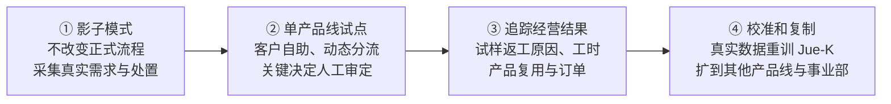

**影子模式**让觉仅提示、不自动修改正式业务，积累真实的决策记录；**单产品线试点**优先选择知识边界清晰、重复咨询多、产品适用范围可明确的业务；**经营结果追踪**用 §7.4 的同一口径记录因需求不清造成的返工、重复询问、入研质量及收入；确认价值后，先扩到功能化学事业部的其他产品线，再把觉的计算层、权限与归属机制复制到集团内其他事业部的需求协同——届时替换的是业务对象、决策目录与训练数据，而不是整套系统。

这条路径也回答了一个难题：**Jue-K 当前的训练数据来自模拟处置，不能直接假定对真实功能化学业务分布最优。** 真实运行时记录模型提出了什么、人员如何处理、结果如何，才可能形成企业自己的决策数据壁垒。

### 11.5 面对企业采用的阻力，不用「模型很强」来搪塞

| 实际阻力 | 化言已有的工程或组织回应 | 还需要做什么 |
|---|---|---|
| 研发担心知识被拿走 | 知识归属、引用记分、受控披露、本人专业审定 | 与真实知识贡献制度和权限政策匹配 |
| 真实资料敏感 | 身份分层、服务端过滤、角色权限与计量审计 | 企业级安全测试、内网部署和数据合规验收 |
| 员工不愿更换工作系统 | 门面 API、问题总线与独立工作面 | 钉钉 / 飞书与既有 OA 的正式集成 |
| AI 会产生错误结论 | 原话溯源、来源知识、缺项检查、关键专业责任留在人 | 真实技术审定、异常案例与人工接管机制 |
| 新模型在陌生场景不准 | 决策模板冷启动、分类别统计选择、规则回退 | 用真实处置与实验结果持续校准 |
| ROI 很难量化 | 需求质量、路由、重复判断与贡献账本已有模拟指标 | 真实项目级工时、返工原因与商业转化跟踪 |

---

## 12. 48 小时交付范围与试点验证路线

化言在 48 小时内交付了可运行的完整架构与多组受控评测；需要真实业务数据才能证明的收益，留给试点阶段按同一口径测量。对技术评委，证据可核验本身就是竞争力；对企业评委，清楚的试点路线意味着项目可以被管理地落地。

| 分类 | 本次已经交付 | 试点阶段验证 |
|---|---|---|
| **代码已经实现** | 觉原型/Jue-K、决策目录、多角色 Agent、L0–L3、转译溯源、知识披露与归属、专业研发闭环、动态分流、录制回放与 BYOK | 在事业部现有系统中上线运行 |
| **模拟环境验证** | 300 张需求卡、Jue-K 模型评估、一周异常发现、6 份需求的三种协作方式事件对照 | 真实需求上的返工轮次、人工处理成本变化 |
| **合理的业务预期** | 更早澄清技术条件、减少重复判断、改善新场景推荐、帮助研发集中处理真正新的问题 | 节约金额、新品转化与利润贡献 |
| **长期产业愿景** | 决策数据飞轮、跨产品线的需求语言资产、企业决策神经系统、上下游技术服务网络 | 跨产品线、跨事业部的复制效果 |

### 12.1 数据与评测口径

- 全部客户、产品型号、配方示意及训练数据来自占位种子和程序化模拟，不含传化真实客户或内部配方。例外是 TF-231A、TF-288B 两个产品的名称、说明与用量取自公开产品资料（见 §11.1），其机理、配方仍为模拟。
- 评测（失真对照、模拟业务周、Jue-K 训练数据）按替换前的模拟产品表计算，未重跑。
- 模拟客户与规则抽取部分共用术语表，结构化抽取的表现可能比真实客户表达更乐观。
- 业务员转述组使用假设的漏记和误记比例，不是企业实测的销售转述错误率。
- 一次性翻译基线由规则流程实现，不代表最强通用 LLM 翻译的上界。
- 模拟业务周只有一周、三个正例与四个困难负样本，不能当作真实漏报率/误报率估计。
- 评测中部分签字由模拟人按脚本立即完成，试样耗时与业务时钟经过压缩。
- 「退回补问」是评测规则对缺信息的判定，不是研发阶段产品开发返工次数。
- 训练版 Jue-K 在留出现象及部分低追问预算区间不优于规则，新增业务域必须重新取得数据并校准。

### 12.2 工程与落地的下一步

- 知识检索：当前实现聚焦权限、归属与披露治理；召回质量交给事业部已有的实验报告检索与知识平台（§11.2）。
- 决策目录：由人编制与审核，新增决策类型先规则冷启动，有真实处置数据后再交给 Jue-K。
- 模型接入：BYOK 已检测对话、JSON 与工具调用；不同供应商的专业结论质量需在试点中逐项评估。
- 知识激励：积分与归属账本已就绪，与绩效、知识许可制度的衔接由事业部按自身政策设计。
- 系统集成：钉钉、飞书、ELN、企业 RAG、生产环境权限系统的接口位置已具备，正式对接在试点阶段完成。
- 开工门槛：覆盖已建模的场景必问条件；正式性能指标、验收标准与实验设计仍由研发专业判断。
- 生产规模：吞吐量、并发上限、CPU 预算与全链路 SLA 在试点部署时做生产型测量；会话隔离与本地 CPU 发现模型是已就位的工程起点。

---

## 13. 从功能化学事业部走向企业决策神经系统

对传统企业软件，工作流是人为预先画出的；对普通 Agent，目标往往来自外部用户的指令。化言提出第三种值得研究的分工：**让业务状态持续产生候选决策，再把决策交给专业智能体和真正有责任的人。**

专业研发闭环证明这套机制可以贯穿复杂的专业需求、知识转译和研发结果回流；动态协作进一步让同一套计算层影响客户、销售、产品经理、研发之间的任务分配。

近期路径是从功能化学事业部的一条产品线试点起步，扩到事业部其他产品线，再复制到集团内其他事业部的需求协同。更远一步，可能复用这一架构的不只是一条需求链：

| 领域 | 对象 | 未来可能主动提出的决定 |
|---|---|---|
| **配方与实验优化** | 配方方案、试样批次、技术假设 | 本次失败是否应该调整实验方向？是否存在几组重复验证的假设？ |
| **生产切换与清洗** | 设备、排产批次、清洗结果 | 下一批是否需要额外清洗？何时切换更合理？ |
| **原材料供给** | 原料、供应商、库存与替代方案 | 是否提前准备关键物料？是否通知研发验证替代品？ |
| **组织知识治理** | 技术知识、产品范围与被忽略的决策 | 哪条知识需要复核？哪类经常被人工批准的低风险动作可申请自动执行？ |

这些是未来方向，**不是功能化学原型已经完成的其他赛道产品**。跨行业迁移仍需替换业务数据、专业工具、决策目录和训练样本。

**长期愿景是形成一套企业决策神经系统：从业务事件中发现有价值的问题，由模型与 Agent 做好准备，让有责任的人只在真正需要时介入，让每个判断都能在下一次业务中继续产生价值。**

这不是「让所有岗位都消失」，而是**让有限的人类专业能力拥有更高的长期复用率**。

---

## 14. 五项评审标准如何核验

| 评审标准 | 化言提供的硬证据 | 本 README 的主要入口 |
|---|---|---|
| **技术可行性** | 公网在线 Demo；专业深链路与全路径讲解两段真实模型录制（11 次签字断言、16 步无偏离）；BYOK 实时执行与接入能力检测；原子动作；11 个离线测试与复现方法 | [4](#4-专业研发闭环不只是会路由的系统) · [8](#8-证据与可复现评测从业务示例到受控对照) · [10](#10-运行与试用三种模式一套系统) |
| **技术创新** | 独立可训练的决策发现层、Jue-K 与规则的统计对照、三层编译逐句溯源、知识权责治理、动态协作的消融对照 | [2](#2-架构原创性觉是任务的来源) · [3](#3-三层语义编译与四层知识治理) · [6](#6-技术创新与常见方案对照) |
| **业务价值** | 赛题三方向五痛点、一线业务根因、岗位职责归纳、判断复用与产品机会、三种协作方式对照、经营验证路径 | [1](#1-赛题要求与真实业务矛盾) · [5](#5-动态协作从固定岗位流水线到按需求价值组织协作) · [7](#7-经营价值与产业愿景让创新资源重新流向创新) |
| **工程化能力** | 48 小时交付约 1.6 万行代码；冻结契约、应用门面、统一网关、降级标注、可复现、评测隔离、会话隔离、BYOK 安全接入；对象化决策与本地 CPU 发现 | [9](#9-工程化能力48-小时交付的工程底座与规模扩展) · [10](#10-运行与试用三种模式一套系统) |
| **企业落地** | 公开真实产品只改种子即接入；现有 RAG / ELN / OA 的接缝；影子模式与四阶段试点；技术保密、知识贡献与收益测算 | [7](#7-经营价值与产业愿景让创新资源重新流向创新) · [11](#11-企业落地路径站在既有投入之上) · [12](#12-48-小时交付范围与试点验证路线) |

**评委可以只看前三屏理解商业价值，也可以顺着每个维度查到具体代码、原始指标、模型卡和运行方式。** README 不依赖评委一定先打开另一份文档才能理解项目。

---

## 15. 评委可能会问

| 质疑 | 我们怎样回答 |
|---|---|
| **这不就是 BPM + 多 Agent？** | BPM 擅长执行已明确的流转；化言把决策需求的发现单独成层，含模板、对象、训练模型、阈值、抑制和处置记录，能够发现新机会、信息缺口与知识冲突。 |
| **为什么不让 LLM 每隔几分钟看一遍？** | 可以，但持续推理成本、稳定性与可审计性要单独解决。觉在受控发现任务中由本地 CPU 推理完成；生成式 LLM 用于需要实际表达与操作的时刻。 |
| **觉只是规则告警吗？** | 并非所有类别都采用 ML；Jue-K 在四类任务统计胜过规则才启用，第五类规则足够就保留规则，指标及不利结果完整公开。 |
| **每个岗位都配一个 Agent 不就够了？** | 我们做了这组消融：同一批 6 份需求、同样的 Agent 能力，按固定岗位顺序逐岗协作时人工中转 14 次、入研 4 张；由觉动态分流时人工中转 5 次、入研 2 张。差别来自任务由谁、在何时提出，而不是 Agent 写得更快。 |
| **48 小时的作品，可信度怎么保证？** | 公网 Demo 可直接操作；两段真实模型录制按事件逐条回放；评委可接入自己的模型实时运行；11 个离线测试守住权限与端到端行为；评测的不利结果同样公开。 |
| **演示是否只依赖录制缓存或 Mock？** | 系统同时提供专业深链路与全路径讲解两段真实模型录制与回放，以及评委可自行配置兼容模型的 BYOK 实时执行；离线降级模式也明确标注来源。 |
| **只比需求完整性，凭什么说能减少返工？** | 一线业务需求交流中反复提到这条因果链；当前实验只验证研发前的信息质量和组织复用机制，真实返工下降需要真实项目的试样轮次和原因归因。 |
| **研发真的能不用参与客户问题？** | 不能也不应该。必要的技术判断、现场支持、配方开发由研发负责；去掉的是不完整需求、已解决场景和重复事项带来的无效消耗。 |
| **产品经理为什么没有被 Agent 取代？** | Agent 可承担重复 L2 转译，产品经理仍负责市场机会、产品边界、生命周期与商业判断；C′ 判断复用与 D 机会汇聚都要求真人产品经理的关键决定。 |
| **资料都来自模拟，技术可信度在哪？** | 可检查的决策模型、业务对象、权限实现、真模型调用与多组受控对照；模拟指标证明机制，不冒充真实企业 ROI。 |
| **企业已有 RAG、ELN、OA，还需要这套系统？** | 化言站在它们之上增加决策发现、跨层语义与责任治理，通过现有检索、试验与协作入口连接，而不是重造全部基础设施。 |
| **行业领先、行业标准有什么证据？** | 目前没有真实的第三方行业采用或标准采纳数据。我们提出可验证的需求语义和决策架构研究路线，长期目标与已实现原型分开陈述。 |

---

## 16. 代码来源、开源组件、团队信息与文档索引

### 16.1 与赛前 JUE 研究项目的关系

化言是 48 小时黑客松作品。它使用团队此前 **JUE「觉」**研究积累的部分模型网关、System 1 接口、计量与 Agent Loop 思路，在黑客松期间围绕功能化学重新实现业务对象、分层知识、需求编译、评测与工作面。来源如实列出如下：

| 主要来源 | 在化言中的角色 | 说明 |
|---|---|---|
| JUE 的信息反射层与决策发现研究 | 觉的计算思想与候选决策接口 | 迁移架构，领域对象、目录与训练数据重新构建 |
| 赛前模型网关 / 外部 OneJev 适配 / Agent 基础 | 兼容模型调用、System 1、计量、工具 Loop | 复用与改写接口；OneJev 模型及其训练成果归属外部开源项目，不作为化言原创成果 |
| 化言的新工作 | 需求、权限、溯源、专业知识、业务闭环、Jue-K 场景数据与动态协作 | 面向功能化学场景设计、实现和验证 |

### 16.2 数据与外部服务

- **占位数据**：`seeds/` 里的产品、案例、转化对照与角色信息均为模拟数据，由大模型按印染行业常识编写、团队审定，型号、客户、人物与配方要点均为虚构，不包含传化真实配方与客户数据；TF-231A、TF-288B 两个产品的名称、说明与用量取自公开产品资料（见 §11.1）。
- **需求模拟与训练**：需求卡、程序对话、受控事件和不同决策标签由仓库的 `sim/`、`eval/` 和脚本生成。
- **模型与外部依赖**：生成、抽取与 Agent 使用 OpenAI 兼容模型网关；[OneJev（OmniJev/OneJev）](https://github.com/OmniJev/OneJev) 是 OmniJev 团队发布的开源多模态 System One 决策模型（Apache-2.0），化言接入其候选答案接口。它不同于化言自训的 Jue-K 决策发现模型。录制回放与 BYOK 运行使用不同口径。
- **研发真实性**：当前真实的是**系统软件、模型训练与实际调用**，不是占位化学产品经过企业实验室验证。

### 16.3 开源组件与许可证

| 组件 | 用途 | 许可证 |
|---|---|---|
| [OneJev](https://github.com/OmniJev/OneJev)（外部服务，可选） | System One 候选判断 | Apache-2.0 |
| pydantic | 契约与数据模型 | MIT |
| openai（Python SDK） | OpenAI 兼容模型调用 | Apache-2.0 |
| httpx | HTTP 客户端 | BSD-3-Clause |
| numpy · pandas · scikit-learn | 特征、评测与 Jue-K 训练（梯度提升树、isotonic 校准） | BSD-3-Clause |
| matplotlib | 评测图表 | Matplotlib License（PSF 风格） |
| PyYAML · tzdata | 配置与种子读取；时区数据 | MIT · Apache-2.0 |
| pytest | 测试 | MIT |
| React · React DOM | 工作面界面 | MIT |
| Vite · @vitejs/plugin-react · Tailwind CSS | 前端构建与样式 | MIT |
| TypeScript | 前端语言 | Apache-2.0 |
| Inter（@fontsource-variable/inter） | 界面字体 | SIL OFL 1.1 |

未使用 LangChain、LangGraph 等 Agent 框架，也未使用向量数据库；Agent Loop、觉、Jue-K、知识库与转译均为自研实现（部分基础来自团队赛前 JUE 研究，见 §16.1）。

### 16.4 人工操作环节说明

- **系统设计中的人工环节**：立项 / 接单、技术确认、产品适用范围、产品机会、知识沉淀、封存 / 放出、发布、解密等高影响动作必须由人在工作面上签字；Agent 只起草，低风险推进由觉按决策模板自动执行。
- **在线 Demo 与录制中的人工环节**：讲解中「轮到你」的步骤由评委亲自点击工作面按钮完成，也可点「替我做这一步」由服务端按剧本代为执行；两段真实模型录制中，人的签字与按钮操作由录制脚本按剧本经同一接口代为执行。
- **评测中的人工环节**：失真对照、模拟业务周中的「模拟人」签字由脚本按规则立即完成，不是真人处置；口径见 §12.1。
- **数据中的人工环节**：种子数据与决策目录由团队编写和审定；两个公开产品的资料由团队人工检索公开资料后录入。

### 16.5 完整资料索引

| 文档/资源 | 适合查看什么 |
|---|---|
| **[`docs/PITCH.md`](docs/PITCH.md)** | **项目宏大叙事、产业逻辑、商业价值与评审答辩材料** |
| [`docs/VISION.md`](docs/VISION.md) | 决策发现路线、技术与组织长期愿景 |
| [`docs/ARCHITECTURE.md`](docs/ARCHITECTURE.md) | 领域对象、模块依赖、数据与动作流 |
| [`docs/CONTRACTS.md`](docs/CONTRACTS.md) | 权限、事件、动作、工具、业务契约与不变量 |
| [`docs/JUE_K_TRAINING.md`](docs/JUE_K_TRAINING.md) | 模型训练、统计检验、策略与留出实验 |
| **[OneJev 开源项目（OmniJev）](https://github.com/OmniJev/OneJev)** | **外部 System One 模型的官方仓库、模型权重与部署说明；化言可选对接** |
| [`models/jue_k/model_card.md`](models/jue_k/model_card.md) | 已训练模型的结构、来源、适用范围、限制 |
| [`docs/reports/distortion/`](docs/reports/distortion/README.md) | 失真评测与应入研需求的模拟完整率 |
| [`docs/reports/jue_k/`](docs/reports/jue_k/README.md) | Jue-K AUC、校准、操作点、学习曲线与不利结果 |
| [`docs/reports/week/`](docs/reports/week/README.md) | 机会、冲突与敏感知识风险的模拟业务周 |
| [`docs/reports/v6_routes/metrics.json`](docs/reports/v6_routes/metrics.json) | 三种协作方式的业务路径和人工节点对照的原始口径 |
| [`runs/demo_record/README.md`](runs/demo_record/README.md) | 两段真实模型录制、回放、缓存与运行记录 |
| [`demo/story.yaml`](demo/story.yaml) | 五条路径的完整演示讲解与动作 |
| [`AGENTS.md`](AGENTS.md) | 开发协作约束与工程原则 |

### 16.6 团队

| 成员 | 分工 |
|---|---|
| **李鸿宗** | 主要开发者 |
| **奚坚明** | 主要开发者 |
| **奚坚超** | 分析协助 |

**李鸿宗 · 主要开发者**

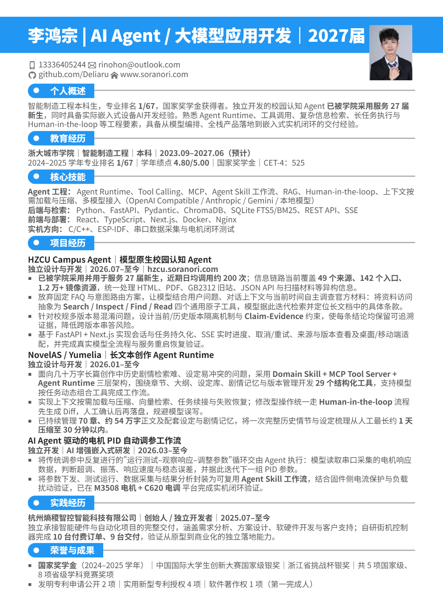

**奚坚明 · 主要开发者**


---

<div align="center">

### 化言 HuaYan

**让需求成为创新的起点，让判断成为组织的资产，让专业人才把精力留给未来。**

*从专业需求理解，到企业决策智能。*

</div>

