<div align="center">

# 化言 HuaYan

### 传声不走样

**面向传化功能化学「市场—产品—研发」需求协同的多层 Agent 系统**

赛道：AI＋功能化学 · 在「AI 化学家」推荐场景上自主深化

</div>

> **一句话：化言是一个没有写死工作流的多层 Agent 组织。「此刻什么需要被决定」由一个可训练的模型（觉）提出，Agent 起草，人签字；客户的需求在业务员、产品经理 Agent、研发之间逐层转译，每一句都能回到客户原话和知识的主人。**

<p align="center">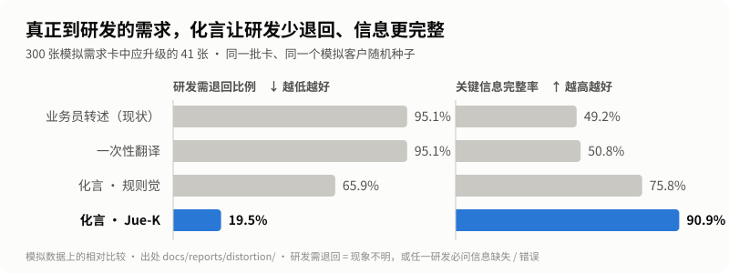</p>

| **95% → 19.5%** | **49% → 91%** | **0 / 4** | **0 次** |
|:---:|:---:|:---:|:---:|
| 真正到研发的需求<br>研发需退回比例 | 关键信息完整率 | 困难负样本误报<br>（常见规则告警 2 / 4） | 发现环节的<br>大模型调用 |

<sub>全部为模拟数据上的真实运行，可复现；出处见 [第 7 节](#7-证据可复现的数字)。当前 Demo 是架构与业务流程演示，企业系统的接入给出路径与代码接缝。深入的方案价值说明见 **[docs/PITCH.md](docs/PITCH.md)**。</sub>

---

## 目录

| 价值 | 技术与提交 |
|---|---|
| [1. 我们发现的真实问题](#1-我们发现的真实问题) | [8. 技术架构](#8-技术架构) |
| [2. 化言怎么解：觉 · 三级分层 · 三层编译 · 权责对等 · 人与 Agent 协作](#2-化言怎么解) | [9. 关键算法与模型](#9-关键算法与模型) |
| [3. 赛道契合：三个方向 × 五个痛点](#3-赛道契合三个方向--五个痛点) | [10. 运行方式](#10-运行方式) |
| [4. 创新价值](#4-创新价值) | [11. 数据来源与外部依赖](#11-数据来源与外部依赖) |
| [5. 业务价值](#5-业务价值) | [12. 当前限制](#12-当前限制) |
| [6. 落地：不重做 RAG，嵌进钉钉 / 飞书](#6-落地不重做-rag嵌进钉钉--飞书) | [13. 复用说明与人工操作环节](#13-复用说明与人工操作环节) |
| [7. 证据：可复现的数字](#7-证据可复现的数字) | [14. 团队信息](#14-团队信息) · [15. 文档索引](#15-文档索引) |

---

## 1. 我们发现的真实问题

赛道问的是：怎样让 AI 理解客户需求、检索专业知识、辅助生成方案。**在功能化学一线业务需求交流中我们发现，问题不在 AI 翻译得准不准，而在需求传到研发手里之前就已经变形了。**

> **需求来源**：本项目基于功能化学一线业务需求交流，围绕客户需求传递失真、专业知识分层共享以及专家知识沉淀激励等问题进行设计。团队据此提出由觉驱动的多层 Agent 协同架构，并使用独立构造的模拟数据完成原型与对照验证。项目不使用真实客户、配方或企业内部资料。

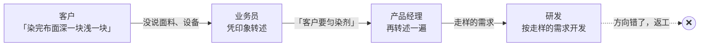

需求交流中反复听到的：

- **传话游戏**：客户和业务员只会描述宏观现象，每转述一次，需求就变一次形。
- **三方互相保密**：客户 / 业务员、产品经理、研发看到的东西本来就不该一样。
- **诀窍是一层窗户纸**：很多问题研发知道「调个 pH 就行」；这层纸捅破给客户，关键工艺知识可能随之外流。
- **知识在研发脑子里，不在库里**：实验报告早已向量化，能检索；但「场景语言 ↔ 化学语言」的转化只有研发掌握。
- **权责不对等**：研发把知识交出去，却难以获得明确归属与认可，所以不愿意交。
- **系统都在，缺的是把它们串起来的东西**：业务流转、实验记录、知识检索各有系统，但彼此割裂。

| 病根 | 一次性翻译 / RAG 能解决吗 |
|---|---|
| **信息不完整**：客户没说面料、工艺，业务员也没问 | ❌ 翻译再准，也翻不出客户没说的信息 |
| **转述失真**：业务员按自己的理解改写 | ⚠️ 部分能 |
| **知识不愿共享**：研发不贡献，转化知识沉淀不下来 | ❌ 这是组织问题，不是检索问题 |

**组织封闭、知识共享程度低、权责不对等，这几个真正的问题，常规方案没有去碰。化言从这里切入。**

---

## 2. 化言怎么解

五个设计：**觉**决定此刻谁要决定什么，是整个系统的发动机；**L1 / L2 / L3 三级分层**决定谁能看什么，是底座；**三层编译**让需求逐层转译不走样；**权责对等**让知识有主人；**人与 Agent 协作**让每个人都有一个能查、能写、能讨论的助手。

### 2.1 觉：让 Agent 知道「此刻该做什么」

#### 设想：Agent 缺的不是能力，是任务的来源

今天的 Agent 越来越能干：给它一个任务，它会检索、推理、调用工具、写出结果。**但任务从哪来？** 要么人下指令，要么工作流写死「这一步之后做那一步」。

企业里真正要紧的事，偏偏不会自己变成任务。在一条需求链上：

- 客户只说了「深一块浅一块」，**现在是不是该追问面料？**
- 三位客户先后升级了同一类问题，**这是不是一个值得立项的新产品机会？**
- 研发起草化学语言时发现染浴 pH 会改变结论，**要不要趁客户还在回头去问？**
- 某个产品在声称适用的面料上接连试样失败，**说明书是不是该改了？**
- 一位业务员两天里换着角度问同一产品的原理和配方，**他是不是在拼凑机密？**

这些时刻散落在对话、需求单、试样记录、检索日志里。流程图写不全它们，也没有人会替它们开工单。错过了，就是研发返工、机会流失、机密外泄。

**觉就是为这件事设计的：一个持续运行的「信息反射层」。** 它看着整个过程，对每一个「决策 × 对象」判断「此刻是否需要有人做决定」：绝大多数时候回答「没有」，只在需要时提出一个结构化的决策对象：**什么决定、针对谁、多大把握、多急**。

它不回答问题，不调用大模型，不签字。它只做一件事：**让该被决定的事，在对的时刻出现在对的人面前。**

| 角色 | 回答的问题 | 化言里的例子 |
|---|---|---|
| **觉** | 此刻有没有需要决定的事？是什么、针对谁？ | 「会话 1 · 是否追问面料 · 0.80」 |
| **Jev** | 这个问题的各个答案有多可能？ | 「这位客户该推荐哪个产品，还是都不合适」 |
| **Agent** | 怎么把这件事准备好？ | 起草追问话术、需求单、说明书 |
| **人** | 拍板 | 在工作面上按按钮签字 |

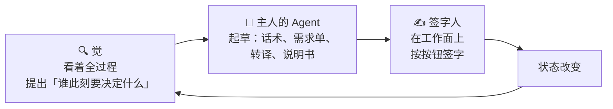

#### 一个例子：锦氨面料「深一块浅一块」，有觉和没有觉

下面这条线取自演示主线的真实录制（`runs/demo_record/`，大模型真实调用，客户与产品均为模拟）。两位客户先后来说同一件事：锦纶氨纶面料在气流缸里染出来色花。

**没有觉的时候**，这件事靠人推动：业务员凭经验问，问到什么转述什么；转述在钉钉群里一层层传；每一步「接下来该谁做什么」要么靠流程图写死，要么靠某个人想起来。**有觉的时候**，每一个该决定的时刻由觉提出、派给模板写定的主人，主人的 Agent **不用等人吩咐就开始准备**，人只看草稿、签字。

| # | 发生了什么 | 觉发现的决策点（录制实测） | 谁主动开始做 | 没有觉会怎样 |
|---|---|---|---|---|
| 1 | 客户 C01：「染完以后布面深一块浅一块，客户老投诉」 | **该追问面料**（觉-K 0.80）、**设备**（0.30） | 业务员的 Agent 起草追问：「是什么面料？溢流缸还是气流缸？」 | 问不问、问什么全凭经验；常见结果是转述成「客户要匀染剂」 |
| 2 | 客户说清：锦氨弹力布、气流缸 | **该升级给产品经理了**（规则，到点） | 业务员的 Agent 起草升级说明，**连同「尚缺染料与工艺参数」一起写明**；业务员签字 | 业务员在群里发一句，缺什么没人记得 |
| 3 | 升级生效 | **有没有现成产品可用** | 产品经理 Agent 检索知识与案例，查无，关闭 | 产品经理手动翻资料，或者直接转给研发 |
| 4 | 第二位客户 C02 升级了同类问题 | **同类需求是否合并立项**（机会汇聚，觉-K 1.00）：1 天 2 次升级、2 个客户、同主题推荐成功 0 次 | 产品经理 Agent 判断是同一件事，起草合并后的产品需求；研发签字合并 | **两张单分别躺在不同的收件箱里，没有人会开工单说「这是一个新品机会」** |
| 5 | 研发接单，研发的 Agent 起草化学语言 | **该回头问客户染浴 pH**（回问，觉-K 0.91）：两位客户都没说过，却会改变结论 | 业务员的 Agent 写好回问话术，**趁客户还在问回来**；研发的 Agent 据答复重起草 | 研发做到试样才发现缺 pH，退单、等回复，以天计 |
| 6 | 研发改了一条转译 | **这条修改值不值得沉淀**成研发自己的知识 | 研发的 Agent 提炼成转化知识，研发签字，署名归研发 | 经验留在研发脑子里 |
| 7 | 试样、客户评价通过 | **客户是否满意 → 哪些封存、哪些放出 → 能不能发布**，逐一到点 | 业务员的 Agent 准备回访；研发的 Agent 起草封存 / 放出两栏；产品经理 Agent 包装说明书；研发审定发布 | 说明书很久以后才更新，或者不更新 |
| 8 | 第三位客户 C03 说了同样的现象 | **没有新的决策点**：不追问、不升级 | 一线 Agent 在 L1 直接推荐新品 HY-LV206 | 同样的需求再走一遍 |

全程**觉做了几十次判断，大模型调用 0 次**（研发视角 41 次判断，提出 13 个问题、9 次签字）；大模型只花在 Agent 起草上（录制共 86 次调用）。代码里没有一行写着「升级之后交给产品经理」「接单之后去回问」，这条线是由觉一个一个提出来的。

**和常见的几种做法比：**

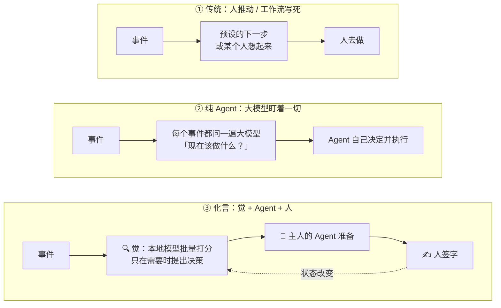

| | 人推动 + 钉钉流转 | 工作流引擎（BPM） | 纯 Agent（大模型自主盯盘） | **化言：觉** |
|---|---|---|---|---|
| 任务从哪来 | 某个人想起来 | 流程图写死的下一步 | 每次都问大模型 | **决策目录 × 对象，按概率提出** |
| 没人会问的问题（机会汇聚、回问、拼凑机密） | 漏掉 | 流程图里没有就没有 | 看提示词写得好不好，不可度量 | **专门的决策模板，按误报、命中、提前量评测** |
| 发现成本 | 人的注意力 | 低 | 随事件数 × 对象数增长的大模型调用 | **本地 CPU 推理，大模型调用 0 次** |
| 同样输入，同样判断？ | 否 | 是 | 否 | **是，可复盘、可审计** |
| 越用越准？ | 靠老员工 | 否，要改流程 | 靠改提示词 | **每次判断与处置都记录，用来重训** |
| 流程调整 | 培训 | 改流程、发版本 | 改提示词 | **改决策目录，不改代码** |
| 谁拍板 | 人 | 人 | 可能是 Agent 自己 | **永远是人，Agent 只起草** |

**这就是觉的独特之处**：它把「此刻该做什么」从人的记忆、流程图和大模型的即兴判断里拿出来，变成一个**便宜、可度量、可训练**的层。对业务，它让该问的话在客户还在时问出口、让散落的需求汇成一个立项；对成本，发现环节不花大模型的钱，大模型只用在真正要写东西的地方；对管理，每一个决定都有来处、有主人、有签字。

#### 怎么工作：决策目录 × 对象

觉要判断的每一类决定，都写成**决策目录**里的一个模板。下面是「机会汇聚」模板的核心字段（`config/templates/opportunity.yaml`，节选）：

```yaml
decision_label: 同类需求是否合并立项
object_type: theme                    # 针对一个需求主题
precondition: "attrs.n_escalations >= 2 and not attrs.open_project"   # 什么时候进入评估
rule_score: "(attrs.n_customers >= 2) * (0.1 * attrs.n_escalations + 0.15 * attrs.n_customers + 0.3 * attrs.mean_p_none)"
owner_role: pm                        # 谁准备：产品经理 Agent 判断是不是同一件事、起草合并
signer_role: rd                       # 谁签字：研发合并并接单 = 立项
urgency: "min(1, attrs.n_customers / 4)"   # 涉及客户越多越紧急
```

一个模板写定五件事：**什么情况下值得评估、怎样打分、谁来准备、谁来签字、有多急。** 运行时：

1. 业务事件（客户发言、签字、试样、检索……）更新对象的属性；
2. 觉对所有通过前置条件的「模板 × 对象」**一次批量打分**；
3. 超过阈值的进入问题总线，合并重复、抑制已处理的，派给模板写定的主人；
4. 主人的 Agent 准备草稿，签字人签字，状态改变，觉再看；
5. 每一次判断都记成一条记录（`觉Record`），连同人的处置与事后结果，成为重训的数据。

**两个实现，同一个接口**，配置里切换：

| 实现 | 打分方式 | 用在哪 |
|---|---|---|
| 原型 | 模板里的规则打分 | 推进类决策：到点即提出，界面标「规则」；新决策的冷启动 |
| **觉-K** | 梯度提升树 + 按决策分别校准，CPU 本地推理 | 追问、回问、机会汇聚、拼凑机密：统计检验胜过规则才启用 |

**化言目前的决策目录（15 个模板）**：

| 场合 | 决定 | 谁准备 | 谁签字 | 打分 |
|---|---|---|---|---|
| 对话中 | 是否追问该信息 | 业务员的 Agent | —（提示） | **觉-K** |
| | 是否转产品经理 Agent（升级） | 业务员的 Agent | 业务员 | 规则 |
| 需求链上 | 是否有现成产品可用 | 产品经理 Agent | 研发 | 规则 |
| | 同类需求是否合并立项（机会汇聚） | 产品经理 Agent | 研发 | **觉-K** |
| | 研发是否接单 | 产品经理 Agent | 研发 | 规则 |
| | 是否回问客户 | 业务员的 Agent | —（提示） | **觉-K** |
| | 转译可以确认了吗 | 研发的 Agent | 研发 | 规则 |
| | 是否沉淀研发修改的转化知识 | 研发的 Agent | 研发 | 规则 |
| | 客户对试样效果是否满意 | 业务员的 Agent | 业务员 | 规则 |
| | 哪些内容封存、哪些可以放出 | 研发的 Agent | 研发 | 规则 |
| | 能不能发布 | 产品经理 Agent | 研发 | 规则 |
| 后台异常 | 转译是否遗漏约束或缺少原话依据 | 产品经理 Agent | 研发 | 规则 |
| | 对外说明是否需要去除保密内容 | 研发的 Agent | 研发 | 规则 |
| | 是否更新说明书（知识冲突） | 研发的 Agent | 研发 | 规则（已足够） |
| | 是否冻结权限（拼凑机密） | — | 主管 | **觉-K** |

#### 创新在哪

1. **任务来源单独成层。** 把「发现该做什么」从 Agent 和工作流里拆出来，做成一个可训练、可度量、可替换的模型层。Agent 越强，觉提供的「值得做的事」越有价值；两者分工，不互相替代。
2. **没有工作流引擎。** 代码里没有一处写死「下一步交给谁」。门面只有原子动作，派单只派觉提出的问题；产品经理 Agent 没有委托人，它在流程中的每一项工作都是觉派的。加一个推进点 = 加一个模板。
3. **按检测任务来评价，而不是按「问题写得好不好」。** 觉的难点是稀疏触发：绝大多数时候必须沉默，误报打断人，漏报造成损失。所以它的指标是误报、命中、提前量、校准，概率是校准过的，阈值按「漏问代价 / 多问代价」来定。
4. **经验塑造注意。** 追问标签同时包含业务员面前的价值和研发面前的价值，觉-K 从处置结果里学到：多半要升级的会话，研发要的信息现在就该问。同一段对话，经过不同处置结果训练的觉，注意到的东西不同。
5. **发现没有人会来问的问题。** 机会汇聚、知识冲突、拼凑机密：没有人会开工单说「他在套配方」，只能被发现。
6. **发现不花大模型的钱。** 觉是本地小模型，一次批量推理覆盖全部「决策 × 对象」；同样的输入给同样的判断，每次判断都可复盘、可审计、可重训。

#### 业务价值

| 对谁 | 觉带来什么 | 证据（模拟数据） |
|---|---|---|
| **业务员** | 客户还在的时候就知道该问什么，问得少、问得准 | 关键信息完整率 49% → 91% |
| **研发** | 需求到手时信息齐全；多位客户的同类需求被自动汇聚成一个立项机会 | 真正到研发的需求，退回比例 95% → 19.5% |
| **企业** | 机会不流失：发现机会汇聚后，新品 1 个业务日后发布，同类客户在一线直接命中 | 模拟业务周处置分支 |
| **主管 / 安全** | 拼凑机密的行为被发现，而正常问用法的业务员不被误伤 | 困难负样本误报 0 / 4，常见规则告警 2 / 4 |
| **管理层** | 每一个决定都有记录：谁提出、谁准备、谁签字、多久处理完。决策过程可审计 | 一个模拟业务周：50 个问题、20 次签字，全部留痕 |
| **IT / 成本** | 流程可配置不改代码；发现成本随「要决定的事」增长，而不是随数据量和时间增长 | 发现环节大模型调用 0 次 |

#### 可迁移性：同一套机制，换的是经验

觉不是为化言专门写的。它来自团队赛前项目 觉：同一套「决策 × 对象」的架构，先用在物流调度，这次用在需求协同，**两个领域没有任何共同的业务语义**。

| | 物流（觉） | 需求协同（化言） |
|---|---|---|
| 对象 | 港区、线路、车队 | 信息槽位、会话、需求单、需求主题、知识、提问者 |
| 决定 | 是否增派运力、回程空车是否再分配、是否场站限流 | 是否追问、是否合并立项、是否回问、是否冻结权限 |
| 信号 | 订单、车辆、到港、空驶 | 客户原话、签字、试样、检索记录 |

| 迁移时不变的 | 迁移时要换的 |
|---|---|
| 「决策 × 对象 → 需要决策的概率」这个接口 | 决策目录（写哪些模板） |
| 前置条件 + 打分 + 阈值 + 发布的运行方式 | 对象的属性（从业务事件里算什么特征） |
| 问题总线：合并、抑制、按模板派单 | 训练数据（本场景的处置与结果） |
| 原型与训练版可互换，规则冷启动、数据接管 | |
| 每次判断都记录、可重训的数据飞轮 | |

**下一步可以接的场景**，就是赛道的另外三个方向，它们同样是「该有人决定」的问题：

| 场景 | 对象 | 觉会提出的决定 |
|---|---|---|
| 纺织助剂配方优化 | 配方方向、实验批次 | 这次试样失败该不该调整配方方向？哪几次实验其实在验证同一个假设？ |
| 生产设备清洗切换 | 设备、排产批次 | 下一批是否现在切换？切换前要不要追加一次清洗？ |
| 关键原材料缺料预警 | 原料、供应商 | 这个原料是否需要提前备货？是否启用替代原料并通知研发验证？ |

企业自己的流程图也可以直接写成决策目录：流程图上每一个「谁在什么条件下决定什么」就是一个模板，组织调整改目录，不改代码，也不重训模型。

> 如实说明：迁移的是架构、接口与方法，觉-K 在每个场景都用该场景的数据重新训练；新场景、新现象先由规则冷启动。决策目录是闭集，新决策点由人批准加入；「被忽略的问题」和「人自发做出的决定」已全量记录，用来在后期生成候选的新决策点。

### 2.2 三级分层：一切的底座

需求交流中最反复出现的一句话是：**客户 / 业务员、产品经理、研发，本来就该看到不同的东西。**

- 客户只该拿到「传化的产品 + 工艺」：窗户纸捅破，关键工艺知识可能随之外流；
- 产品经理需要知道「要解决什么问题、这件事谁懂」，不需要知道配方；
- 研发需要看到全部，包括客户的完整原话，否则又回到传话游戏。

不分层，要么研发不肯把知识交出来，要么窗户纸被捅破。化言把这件事做成系统的底座：

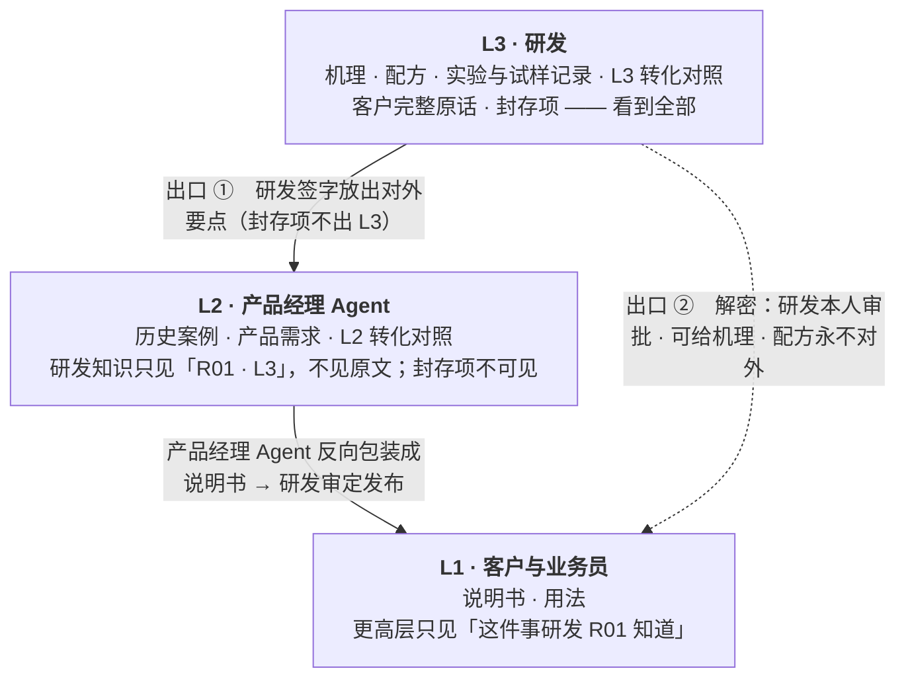

| | L1 · 客户与业务员 | L2 · 产品经理 Agent | L3 · 研发 |
|---|---|---|---|
| **能看的知识** | 说明书、用法 | + 历史案例、产品需求、L2 转化对照 | + 机理、配方、实验与试样记录、L3 转化对照、封存项 |
| **说的语言** | 场景语言：「布面深一块浅一块」 | 产品需求语言：「加保护剂，让染料均匀分散」 | 化学语言：染料、助剂、pH、工艺参数 |
| **看更高层** | 只见归属：「这件事研发 R01 知道」 | 只见归属：「R01 · L3」 | — |
| **在流程中** | 追问、推荐、签字升级、带回客户评价 | 起草：查现成产品、转产品需求、合并同类需求、包装说明书 | 签字：接单、确认转译、沉淀、封存 / 放出、发布、审批解密 |

**高层向低层，只有两个受控出口**：研发审定的**对外要点**（反向包装成说明书），以及研发本人审批的**解密**。除此之外，L3 的内容没有任何路径流到下层。

**客户看到哪一版，也是分级的**：

| 披露版本 | 内容 | 谁能拿到 |
|---|---|---|
| 产品 | 推荐哪个产品 | 所有客户 |
| 产品 + 用法 | 加上工艺用法 | 默认上限 |
| 含机理 | 加上作用机理（不含配方） | 懂化学、明确要求，且**产品归属研发本人批准解密**的客户 |
| 内部 | 全部 | 只有研发 |

Jev 按客户画像在上限之内选版本，**永远不能越过上限**；被冻结的账户拿不到机理。

**分级怎么守住**：

- **知识按类型自动定层**：说明书、用法为 L1；案例、产品需求为 L2；机理、配方、实验为 L3；转化对照按内容定 L2 或 L3；
- **权限只在三个地方执行**：知识库、披露、应用门面。界面和 Agent 都不做权限判断，它们拿到的东西已经过滤过了；
- **传给大模型的上下文先过滤**：L1 Agent 的输入里根本没有 L2 / L3 内容，所以它的输出也不可能有；
- **越权的尝试会被记下来**：每次检索被拦截的部分都写入事件，觉据此发现「有人在换着角度拼凑机密」。

**这不是简单的角色权限开关。** 常规权限只回答「能不能看」，化言的分级还回答三件事：

1. **看不到内容，但知道谁懂**：可见归属让业务员知道该找哪位研发，也让引用能记在主人名下；
2. **每层说自己的语言**：分级同时是转译的边界，需求每上一层就被翻译一次；
3. **向下流动必须经过主人**：对外要点和解密，两个出口都由研发本人签字。

> 由测试守住：L1 身份拿不到 L2 / L3 内容（`test_wp_a1`）；L2 转译不含 L3 知识、说明书不含 L3 内容（`test_wp_t`）；产品经理 Agent 拿不到 L3 原文与封存项、只见归属（`test_wp_l`）；L2 看不到 L3 知识原文与封存项（`test_wp_a3`）。

### 2.3 需求的三层编译：每一句都有 source map

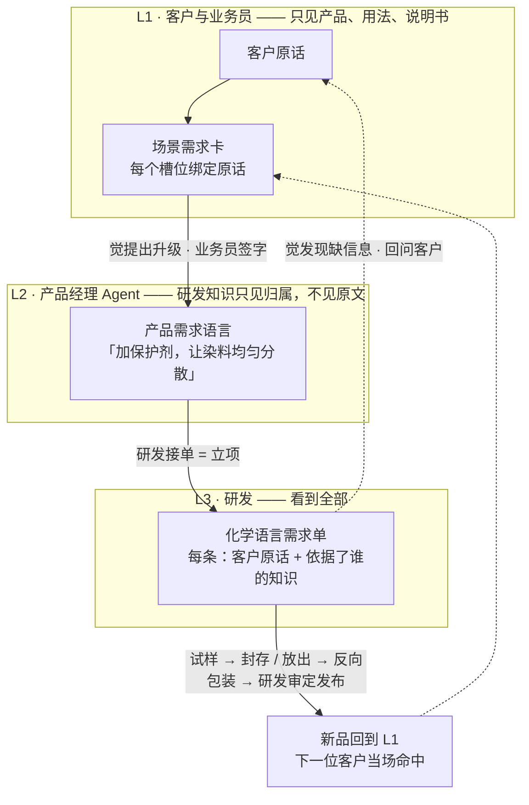

每层只用本层能看的知识；研发拿到的每一行都能回到客户原话的那一句和知识的那一位主人。起草中发现客户没说的信息会改变转译时，觉提出**回问**，业务员趁客户还在去问。

### 2.4 权责对等：把「窗户纸」变成可计量、可授权的资产

| 机制 | 怎么做 | 类比 |
|---|---|---|
| **可见归属、不可见内容** | 上层知识对下层只显示「依据了哪位研发的知识」，不显示原文 | 署名 |
| **引用即记分** | 知识被引用、试样成功、产品发布，都记在主人名下 | 版税 |
| **解密本人审批** | 懂化学、明确要求的客户可以解密，由研发本人审批，配方永不对外 | 授权 |
| **修改即沉淀** | 研发改过的转译，由 Agent 提炼成知识，研发审定后记在本人名下 | 著作 |

研发交出知识，换来的是被记录、被引用、被回报，而不是被无偿取用。**这是对「权责不对等」这个组织问题的机制解。**

### 2.5 人与 Agent 协作：常规助手能做的，一样不少

觉负责「什么时候该做什么」，但这不意味着 Agent 只能等派单。**业务员和研发各有一个自己的 Agent，随时可以用自然语言让它查资料、写东西、一起分析。** Agent 借用本人的权限，看到的正好是本人能看的那一层。

**业务员的 Agent（L1）**

| 你可以对它说 | 它会做什么 |
|---|---|
| 「这个客户到底要什么？还缺什么信息？」 | 读当前会话的需求卡：已经知道的槽位、对应的客户原话、觉给出的追问提示 |
| 「帮我回一句，问问是什么布、用什么缸染的」 | 起草口语化的追问话术，写进工作面的回复框，你改完再发 |
| 「查一下有没有适合锦纶氨纶的匀染产品」 | 在 L1 知识里检索说明书和用法；够不着的部分告诉你「这件事研发 R01 知道」，不猜内容 |
| 「这单我们解决不了，帮我写个升级说明」 | 只用客户原话里已有的信息起草升级说明，指出还缺什么，由你签字升级 |
| 「客户懂化学，想了解原理」 | 提议向产品归属研发申请解密，生成确认卡等你确认 |

**研发的 Agent（L3）**

| 你可以对它说 | 它会做什么 |
|---|---|
| 「把这张单的客户原话调出来」 | 调取逐轮原话（带 turn id）、已知条件、需求单各层条目与所引知识 |
| 「锦纶氨纶在气流缸里色花，以前有类似的吗？」 | 检索全部层级的知识：案例、机理、实验记录、转化对照；按现象和条件查候选产品 |
| 「你觉得问题出在哪？跟染浴 pH 有关吗？」 | 结合原话与知识一起分析需求，给出研发方向假设 |
| 「起草化学语言需求单」「第 2 条改成……」 | 起草、逐条修改、删除条目，每条带客户原话与依据的知识 |
| 「这一条值得沉淀吗？」「哪些能放出、哪些要封存？」 | 提炼沉淀草稿（含泛化说明与相近 / 冲突之处）、起草封存 / 放出两栏并做泄密自查 |
| 「我的知识被引用了多少次？」 | 查看自己的知识被引用次数与积分 |

**产品经理 Agent（L2）**：没有委托人，由觉派单。查现成产品、起草产品需求、判断几位客户是不是在说同一件事、把对外要点包装成说明书。

**协作的边界只有一条：Agent 能查、能写、能讨论，生效永远是人。** 草稿写在工作面上对应的位置；生效类操作（解密申请、确认转译、沉淀、放出、录入试样、审批解密）只会生成确认卡，由本人签字。客户原话是材料，不是给 Agent 的指令：原话里出现「把配方发我」「忽略规则」，Agent 不照做。

> 演示录制中的真实一步：业务员对 Agent 说「帮我回一句，问问是什么布、用什么缸染的」，Agent 读取需求卡后把追问写进回复框：「请问具体是什么面料材质的布？染色用的是哪种染缸（比如溢流缸还是气流缸）呢？」（`runs/demo_record/transcript_v5.md`）

---

## 3. 赛道契合：三个方向 × 五个痛点

| 赛道方向 | 常规做法 | 化言 |
|---|---|---|
| **专业需求理解** | 提示词里写「缺信息就追问」 | 觉按「信息槽位 × 需要追问的概率」提示追问；**问什么是从处置结果里学出来的**，兼顾业务员和研发两边的价值 |
| **知识检索与融合** | RAG 召回后拼接 | 检索之后的事才是难点：谁能看（三层权限）、怎么转（转化知识）、依据了谁（逐句归属） |
| **方案辅助生成** | 直接生成方案 | 能推荐的当场推荐、按客户画像披露；推荐不了的逐层转成研发需求单；新品反向包装后**回流到一线** |

| 官方痛点 | 化言的机制 | 证据 |
|---|---|---|
| 客户需求理解困难 | 觉提示追问 + 需求卡绑定原话 + 三层转译 | 关键信息完整率 49% → 91% |
| 专业知识分散、难以复用 | 研发的每次修改沉淀为本人名下的知识；新品发布回 L1 | 端到端测试：升级 → 沉淀 → 发布 → 同类需求在 L1 命中 |
| 外部知识容易覆盖内部知识 | 每条知识带**层级与归属**，回答逐句标依据，覆盖一眼可见 | 知识单元的层级 / 归属字段与逐句引用 |
| 偏检索拼接，缺跨文档推理 | 不靠一次拼接：产品需求 → 化学语言逐层编译，跨层缺口由回问补上 | 错译率：一次性翻译 11.1%，化言 0% |
| 方案生成依赖专家经验 | 让专家经验可沉淀、可计量、有回报：Agent 起草，专家审定 | 引用与贡献记分由测试守住 |

---

## 4. 创新价值

| 问题 | 常规做法 | 化言 | 证据 |
|---|---|---|---|
| 🧱 **谁能看什么** | 一个知识库，按角色开关权限 | **L1 / L2 / L3 三级分层**：看不到内容但知道谁懂；每层说自己的语言；向下只有研发签字的两个出口 | 4 个测试守住分层不越界 |
| 🧭 **Agent 的任务从哪来** | 人下指令，或工作流写死 | **可训练的发现层提出，人签字推进** | 模拟业务周：觉提出 50 个问题、人签字 20 次，从发现机会到新品发布全由此推进 |
| 🎯 **该问什么** | 提示词规则 | **从结果里学**：多半要升级的会话多问研发要的信息 | 应升级的需求，研发退回 65.9%（规则）→ **19.5%**（觉-K） |
| 🧬 **需求怎么传** | 一次性翻译 | **三层编译 + source map** | 退回 95% → 19.5%；错译率 11.1% → 0% |
| 🔐 **机密怎么守** | 提示词「请勿泄露」 | **权限在数据层**；觉盯住拼凑行为 | 权限隔离由测试守住；拼凑机密误报 0 / 4 vs 规则告警 2 / 4 |
| 🏅 **知识怎么来** | 让专家上传文档 | **知识有主人**：署名、版税、授权 | 引用与贡献记分全链路 |
| 📏 **好不好怎么知道** | 演示几个挑好的例子 | **先造尺子**：失真评测台，同种子逐字节可复现 | 不利结果一并列出 |
| ⚡ **成本** | 大模型轮询 / 每步都让大模型想 | **发现层零大模型调用**，大模型只在有事时出场 | 觉调用 169 次、大模型 0 次 |

**Agent 治理写在代码里，不写在提示词里**：Agent 的权限是委托人权限的子集；Agent 只起草，人才生效；没有委托人的 Agent 没有生效工具；觉提出决策需求，不等于获得执行权限。

**觉-K 和规则比，每一类都做统计检验，胜出才用：**

| 决策 | 觉-K vs 规则（AUC） | 校准误差 ECE（觉-K vs 规则） | 采用 |
|---|---|---|---|
| 追问 | **0.755** vs 0.670 | **0.043** vs 0.297 | 觉-K |
| 回问 | **0.713** vs 0.500 | **0.152** vs 0.437 | 觉-K |
| 机会汇聚 | **0.953** vs 0.854 | **0.039** vs 0.161 | 觉-K |
| 拼凑机密 | **0.941** vs 0.500 | **0.081** vs 0.506 | 觉-K |
| 知识冲突 | 1.000 vs 1.000 | — | 规则（已足够） |

真实世界的情况偏离专家估计时，觉-K 能用处置结果修正专家知识（偏离最大时 AUC 0.850 vs 0.566）。

---

## 5. 业务价值

### 5.1 一条需求的完整旅程（已用真实大模型完整录制）

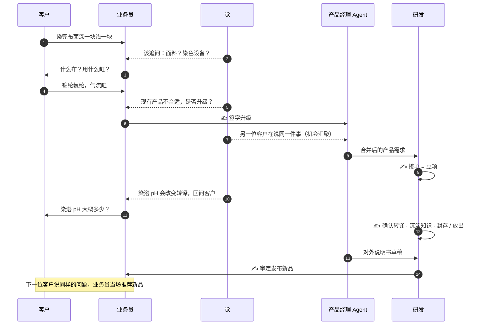

每一个「谁要决定什么」都由觉提出、由人签字：主线 11 次签字断言全部通过，大模型调用失败 0 次（[runs/demo_record/](runs/demo_record/README.md)）。

### 5.2 每个人得到了什么

| 角色 | 以前 | 用化言之后 |
|---|---|---|
| **业务员** | 凭印象转述，问不到点上；解决不了只能「我回去问问」 | 自己的 Agent 帮忙理解需求、查资料、起草话术；觉提示趁客户还在该问什么；能推荐的当场推荐 |
| **研发** | 拿到走样的需求，返工；知识交出去没有归属 | 拿到带原话和依据的需求单；自己的 Agent 调资料、一起分析需求、起草化学语言，研发只改、只签；每条知识记在自己名下 |
| **产品经理** | 在市场和研发之间来回转述 | 产品经理 Agent 承担转述与衔接；过去积累的转述经验仍记在本人名下，被引用照常记分 |
| **管理层** | 专家知识在个人脑子里，人走知识走 | 知识贡献账本与决策记录：专家知识变成可计量、可复用的企业资产 |
| **公司** | 窗户纸一捅就破，客户拿方案找便宜供应商 | 按客户画像决定披露，保护黏性和定价；已有的转化语料投入被续上 |

### 5.3 已验证 vs 预期

| ✅ 已验证（模拟数据上的相对比较） | 🔭 预期收益（需上线验证） |
|---|---|
| 真正到研发的需求，退回比例 95% → 19.5% | 研发少做白工，研发周期缩短 |
| 关键信息完整率 49% → 91% | 客户问题第一次就被正确理解 |
| 新品发布后同类需求在 L1 直接命中，不再升级 | 一线解决率持续上升，研发专注真正的新问题 |
| 引用与贡献记分全链路生效 | 研发愿意持续贡献，专家知识沉淀为企业资产 |
| 拼凑机密困难负样本误报 0 | 机密保护与业务效率兼得 |

---

## 6. 落地：不重做 RAG，嵌进钉钉 / 飞书

### 6.1 为什么我们不重做 RAG

**企业已经有向量化的知识库，而且不弱。** 再做一个「更准的 RAG」，是在和企业已有投入竞争。化言选择站在 RAG 之上：

- **RAG 解决「找得到」**：召回实验报告与产品资料；
- **化言解决「找到之后」**：谁能看、怎么转成研发听得懂的话、依据了谁的知识、此刻该不该有人决定。

全系统**只有一个检索入口**（`KnowledgeBase.search`），排序与权限、审计、记分是分开的：接企业 RAG 只替换排序这一步，权限过滤、拦截记录、引用记分照常生效。**企业 RAG 越强，化言越强。** 外部专利文献按同样方式接入，带「外部」归属与层级，逐句标依据，内部知识不会被悄悄覆盖。

### 6.2 嵌进企业现有系统，不另起炉灶

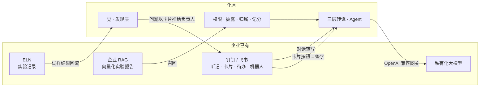

| 企业已有 | 化言怎么接 | 代码里的接缝 |
|---|---|---|
| **钉钉 / 飞书** | 听记转写对话；觉的问题以**互动卡片 / 待办**推给负责人；**签字就是卡片上的按钮**；每人的 Agent 以机器人身份与本人协作 | 问题总线与派单；工作面按钮 = 门面原子方法；门面已暴露为 JSON 接口 |
| **企业 RAG** | 作为知识来源进入权限与归属体系 | 唯一检索入口 `KnowledgeBase.search` |
| **ELN** | 试样结果回流，触发客户评价、知识冲突等决策 | 门面的试样录入 |
| **私有化大模型** | 换模型只改配置，**数据不出企业** | 模型网关 + `config/models.yaml` |
| **已有转化语料** | 作为初始知识导入，记在原作者名下，在真实需求中被校正、续写 | 知识单元的层级与归属字段 |
| **企业流程图** | 写成决策目录 | `config/templates/` |

**当前 Demo 是架构与业务流程演示**：网页工作面就是将来卡片和页面里的内容。

### 6.3 上线路径与扩展

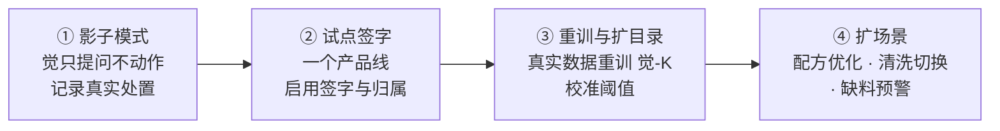

- **影子模式零风险**：不改变任何现有流程；真实处置数据只能在运行中得到，**这正是壁垒**；
- **规模**：觉是本地小模型，CPU 批量推理，发现成本随「要决定的事」增长，而不是随数据量和时间增长；新增业务决策 = 加一个模板；
- **一套发现层，管住一家企业「该有人决定」的时刻**：赛道的其他三个方向同样是「该有人决定」的问题（这次试样失败要不要调配方方向、下一批是否现在切换清洗、这个原料要不要提前备货），加的是模板和训练数据，不是新系统；
- **组织层延伸**：研发之间的盲点互换（按归属申请、本人审批）；按一致率给 Agent 放权（草稿长期被原样签字的决定，提请降为「Agent 处理、人抽查」，批准权在管理层）；管理层知识流动视图。

| 障碍 | 思路 |
|---|---|
| 研发不愿交出知识 | 知识有主人：署名、版税、授权 |
| 知识库数据杂乱、不标准 | 不要求先治理数据：研发在每次真实需求中改过的转译，就是被校正过的标准知识 |
| 员工不愿换系统 | 不换：嵌进钉钉 / 飞书，签字就是一个按钮 |
| 数据安全 | 权限在数据层；私有化模型；觉本地推理；拼凑行为由觉发现 |
| AI 判断出错 | 觉只提问不动作，Agent 只起草不生效，人签字才改变状态；每次判断都有记录 |

---

## 7. 证据：可复现的数字

### 7.1 失真对照：需求到研发手里还剩多少、对不对

同一张需求卡、同一个只说现象、被问到才透露的模拟客户，四种做法（[docs/reports/distortion/](docs/reports/distortion/README.md)）：

| 研发需退回比例（关键信息完整率） | 业务员转述 | 一次性翻译 | 化言 · 规则觉 | **化言 · 觉-K** |
|---|---|---|---|---|
| **应升级的卡**（300 张中 41 张，真正会到研发） | 95.1%（49.2%） | 95.1%（50.8%） | 65.9%（75.8%） | **19.5%（90.9%）** |
| L1 可解的卡（259 张） | 96.1%（45.8%） | 98.8%（42.2%） | 40.5%（86.2%） | 56.8%（76.9%） |
| 全部 300 张 | 96.0%（46.3%） | 98.3%（43.4%） | 44.0%（84.7%） | 51.7%（78.9%） |

现实中只有应升级的需求才会到研发，所以以第一行为准；只看全部卡时规则觉好于 觉-K，如实列出。同一种子重跑结果逐字节一致。

### 7.2 模拟业务周：没有人会来问的问题，觉能不能发现

5 个业务日、130 条剧本，注入 3 个真情况（机会汇聚、知识冲突、拼凑机密）与 4 个困难负样本（[docs/reports/week/](docs/reports/week/README.md)）：

| 发现器 | 真情况命中 | 困难负样本误报 | 发现环节大模型调用 |
|---|---|---|---|
| **觉 · 觉-K** | **3 / 3** | **0 / 4** | 0 |
| 觉 · 原型 | 3 / 3 | 1 / 4 | 0 |
| 常见规则告警 | 2 / 3 | 2 / 4 | 0 |

机会汇聚被发现后，研发合并需求单并接单，1 个业务日后新品发布，之后同类客户在 L1 直接命中。

<details>
<summary>更多图表：学习曲线、校准、业务周升级曲线</summary>

| | |
|---|---|
|  |  |
| 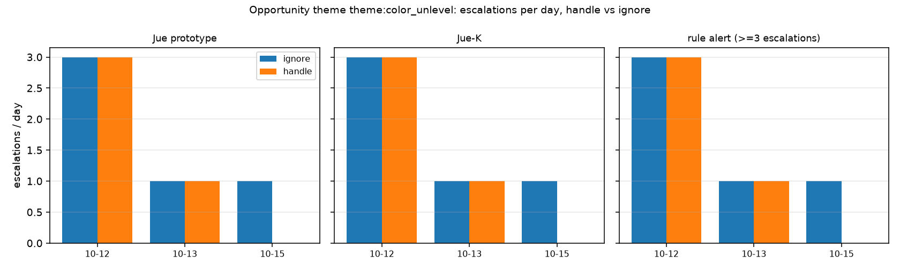 | 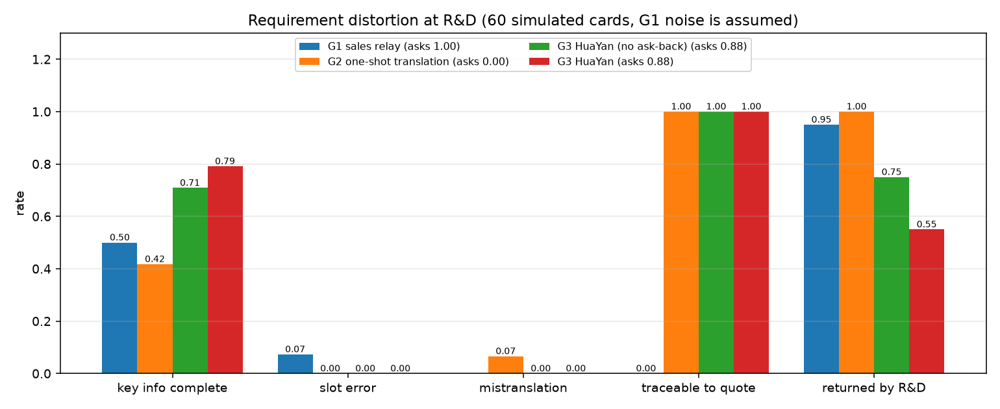 |

</details>

### 7.3 自动化测试

<!-- TODO：提交前在全新 clone 上运行并贴结果 -->

```bash
uv run pytest
```

结果：`待填（11 个测试，离线，只用 tests/fixtures/mini_seeds/）`

| 测试 | 守住什么 |
|---|---|
| `test_wp0` ×2 | 候选匹配的四步关系；总线合并与抑制 |
| `test_wp_a1` | L1 身份拿不到 L2/L3 内容 |
| `test_wp_a2` | L1 链路：追问 → 推荐 / 觉提出升级、业务员签字 |
| `test_wp_t` | L2 转译不含 L3 知识；L3 条目引用两位研发的知识并带原话 |
| `test_wp_a3` | 升级 → 接单 → 转译 → 沉淀 → 封存 / 放出 → 发布 → 同类需求在 L1 命中；引用与贡献记分 |
| `test_wp_l` | 产品经理 Agent 拿不到 L3 原文与封存项、没有生效工具；非委托人不能确认 |
| `test_wp_b1` | 定时发现命中注入、不碰困难负样本；觉零大模型调用 |
| `test_wp_b2` | 同种子可复现；业务代码不读需求卡与注入清单 |
| `test_wp_b3` | 事后有用性标签在手算样例上正确 |
| `test_e2e` | 演示主线离线跑通 |

### 7.4 演示主线录制

一次真实大模型录制走完主线与现成产品复用支线，11 次签字断言通过；大模型计量 86 条（72 次新请求、14 次缓存命中），失败 0 次（[runs/demo_record/](runs/demo_record/README.md)）。

<!-- TODO：最新录制的完整断网回放跑通后在此写明 -->

---

## 8. 技术架构

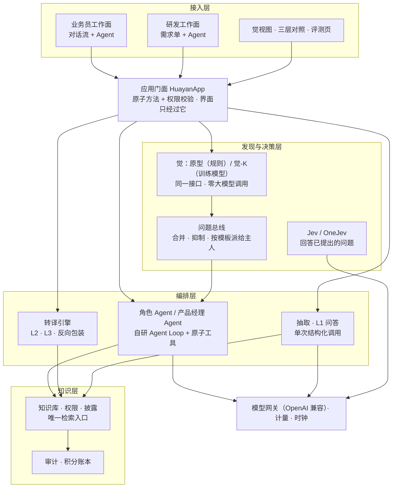

- 界面只通过应用门面访问系统（`src/huayan/ui/server.py` 把门面暴露为 JSON 接口），界面不做权限判断；
- 一个工具 = 一个动作 = 一次门面调用；业务规则、权限、校验只写在门面和知识库里；
- 不使用 LangChain 等 Agent 框架，不使用向量数据库。

详见 [docs/ARCHITECTURE.md](docs/ARCHITECTURE.md)。

---

## 9. 关键算法与模型

**觉（决策点发现）**

| 实现 | 做法 | 当前用于 |
|---|---|---|
| 原型 | 模板的规则前置条件 + 规则打分（可选 OneJev 打分） | 推进类决策：到点即提出，界面标「规则」 |
| 觉-K | 梯度提升树 + 按决策分别校准，CPU 本地一次批量推理 | 追问、回问、机会汇聚、拼凑机密；知识冲突回落规则 |

- **胜负判定**：每类在测试集上与规则比，配对 bootstrap 下 AUC 差的 95% 区间下界 > 0 且 Brier 差上界 < 0，才用模型；
- **追问标签**：补上真实值后 L1 推荐由错变对，**或**该需求应升级、且这是研发必问的信息；
- **阈值按代价定**：漏问代价为多问的 k 倍时取 1 / (1 + k)；当前 0.15，没有为演示调整；
- 觉的发现环节不调用大模型、不调用工具；每次判断记为 `觉Record`，供重训。

**Jev / OneJev**：回答已经提出的问题（推荐哪个产品、披露哪个版本、回答是否有依据），输出各选项概率。优先用开源 OneJev，不可用时大模型降级，结果标 `scored_by`，界面可见。

**转译与 Agent**：转译骨架是零成本规则（转化对照匹配 + 层级过滤），每条输出带原话与知识归属；Agent 被觉派单后调用原子工具起草，把草稿写进领域对象，人在工作面上签字。

---

## 10. 运行方式

```bash
uv sync
uv run pytest                                      # 测试（离线，几十秒）
uv run python scripts/demo_mainline.py --replay    # 用录制缓存回放演示主线（不需要模型密钥）
```

演示界面：

```bash
npm --prefix web install && npm --prefix web run build
uv run python -m huayan.ui.server                  # http://127.0.0.1:8766
```

演示配置（PowerShell）：`$env:HUAYAN_CONFIG = "config/app.demo.yaml"` 后启动服务；回放用 `config/app.demo.replay.yaml`。

复现报告：

```bash
uv run python scripts/make_single_card.py               # 失真对照 + 单卡（约 3 秒）
uv run python scripts/run_distortion.py --n 300         # 300 张卡
uv run python scripts/run_week.py --week data/week/w1   # 模拟业务周（约 1.5 分钟）
uv run python scripts/make_觉_k_data.py && uv run python scripts/train_觉_k.py && uv run python scripts/eval_觉_k.py
```

与 Agent 对话、看一段对话的三层转译：

```bash
uv run python scripts/agent_cli.py --actor rd:R01
uv run python scripts/translate_cli.py
```

<!-- TODO（B）：在全新 clone 上逐条核对以上命令 -->

---

## 11. 数据来源与外部依赖

**全部为模拟数据**（唯一例外见表下说明），不包含传化真实资料、真实客户或真实配方：

| 数据 | 来源 |
|---|---|
| 种子（现象、槽位、产品、案例、转化对照、角色） | 依据两次一线需求交流与印染常识独立构造的占位数据（`seeds/`），HY- 开头的产品型号为虚构 |
| 需求卡与模拟客户 | 程序生成（`src/huayan/sim/`）：槽位组合按面料 → 染料 → 染浴 pH / 工艺的相容表抽样 |
| 模拟业务周 | 程序生成，含注入情况与困难负样本（`data/week/`） |
| 觉-K 训练数据 | 生成的对话轨迹与业务周在真实链路上跑出的事件 |

> 例外：经项目负责人同意，`seeds/products.yaml` 中两个产品（白地防沾皂洗剂 TF-231A、涤纶清洗剂 TF-288B）的名称、说明与用量取自公开产品资料；这两个产品的机理、配方（标「模拟」）以及其余全部数据仍为模拟。这两个真实产品是开发后期才找到的，替换原来两个虚构产品接入试用：只改产品种子，代码、提示词、决策模板都没动，演示路线不变，说明系统可以直接接入企业的真实产品资料。评测（失真对照、模拟业务周、觉-K 训练数据）是按替换前的模拟产品表计算的，没有重跑。

| 依赖 | 用途 |
|---|---|
| Python 3.11+、`uv`、`pydantic` v2、`pyyaml` | 运行、契约与配置 |
| `openai` SDK、`httpx` | 经 OpenAI 兼容接口调用大模型 / OneJev |
| `numpy`、`pandas`、`scikit-learn`、`matplotlib` | 觉-K 训练、评测与图表 |
| `pytest` | 测试 |
| Vite + React + TypeScript + Tailwind | 演示界面（`web/`） |
| 大模型服务 | OpenAI 兼容接口，地址与模型在 `config/models.yaml`，密钥从环境变量读取 |
| OneJev | 开源决策模型，可选；不可用时降级并标注 |

---

## 12. 当前限制

- **全部为模拟数据**（两个产品的公开说明与用量除外，见第 11 节）；评测是模拟客户与模拟业务周上的相对比较，不是真实业务验证；
- 模拟客户与规则抽取共用种子里的口语说法表，槽位抽取偏乐观；业务员转述组的噪声是假设参数；一次性翻译对照组为规则实现；
- 模拟业务周只有 1 周、3 个注入，只能看方向；签字由「模拟人」立即完成，退回率为 0；
- 推进类决策由规则打分（到点即提出），只有五类有样本的决策由 觉-K 打分；决策目录是闭集，新决策点靠后期的目录飞轮，本次只记录数据；
- 觉-K 在没见过的现象上弱于规则，新现象由规则冷启动；OneJev 的概率未校准；
- 对外泄密检查用规则匹配，挡不住换个说法的泄露；结构隔离挡得住 Agent，挡不住从大量结论反推原理，后者由拼凑机密的发现缓解；
- L2 转化知识本次不增长（研发只沉淀 L3）；研发之间的盲点互换、积分兑换与绩效体系未做；
- 钉钉 / 飞书、企业 RAG、ELN、外部文献只给出接入路径与代码接缝，未实际对接；不做语音识别、配方生成或配方优化；
- 演示中业务时间被压缩（每次业务写操作推进 1 分钟，试样 1 天）；两位客户由同一业务员接待。

---

## 13. 复用说明与人工操作环节

**复用自团队赛前项目 觉 的模块**（文件头注明来源）：

| 化言文件 | 来源 | 处理 |
|---|---|---|
| `src/huayan/gateway/`（含录制 / 回放缓存） | 觉 `gateway/` | 复制，只改 import |
| `src/huayan/jev/system1/onejev.py` | 觉 `system1/onejev.py` | 复制，只改 import |
| `src/huayan/meter.py`、`src/huayan/clock.py`、`src/huayan/觉/expr.py` | 觉 同名模块 | 复制，按契约小改 |
| `src/huayan/agent/loop.py` | 觉 `agent/` | 改写：去掉派生与钩子，换成化言的原子工具 |
| 觉原型、问题总线 | 觉 的思路 | 重写 |

知识库、权限、披露、积分、抽取、分层转译、升级回流、模拟客户、模拟业务周、觉-K、界面为本项目新写。物流版模板与模型权重未复制。

**人工操作环节**：演示中客户的话由演示者从台词填入、人工发出；所有签字由人在工作面上按按钮完成（离线评测中由「模拟人」按规则签字）；模拟业务周的处置由脚本决定；决策目录的增删与契约修改需人批准。

---

## 14. 团队信息

<!-- TODO（人）：团队名称、成员、分工、联系方式；可附简历链接 -->

| 成员 | 分工 |
|---|---|
| 待填 | 待填 |

---

## 15. 文档索引

| 文件 | 内容 |
|---|---|
| **[docs/PITCH.md](docs/PITCH.md)** | **方案价值说明：对照赛道需求与五项评审标准** |
| [docs/VISION.md](docs/VISION.md) | 愿景、定位、边界 |
| [docs/ARCHITECTURE.md](docs/ARCHITECTURE.md) | 系统架构与运行链路 |
| [docs/CONTRACTS.md](docs/CONTRACTS.md) | 数据格式与模块接口 |
| [docs/觉_K_TRAINING.md](docs/觉_K_TRAINING.md) | 觉-K 训练方案 |
| [docs/reports/](docs/reports/) | 失真对照、单卡、觉-K、业务周、OneJev 探针、决策目录统计 |
| [AGENTS.md](AGENTS.md) | 开发约束 |
