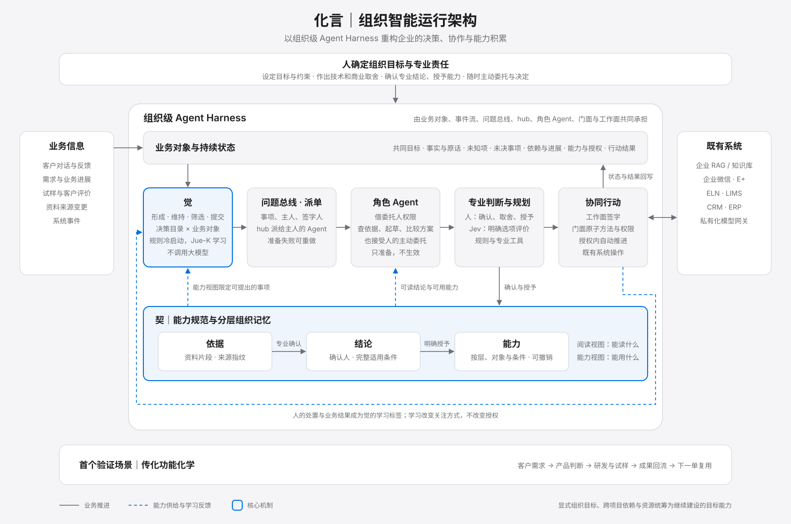
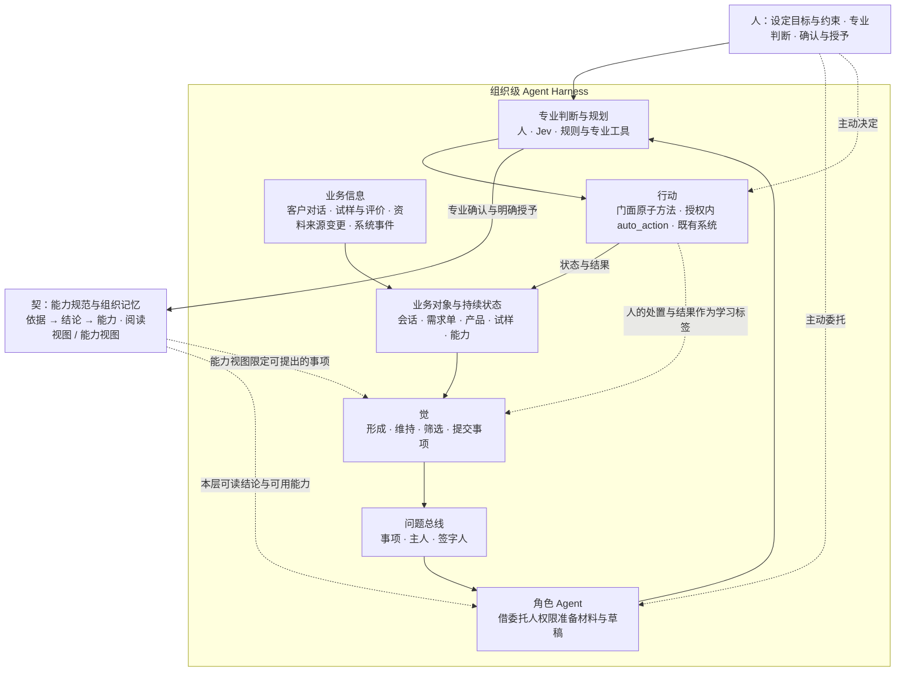
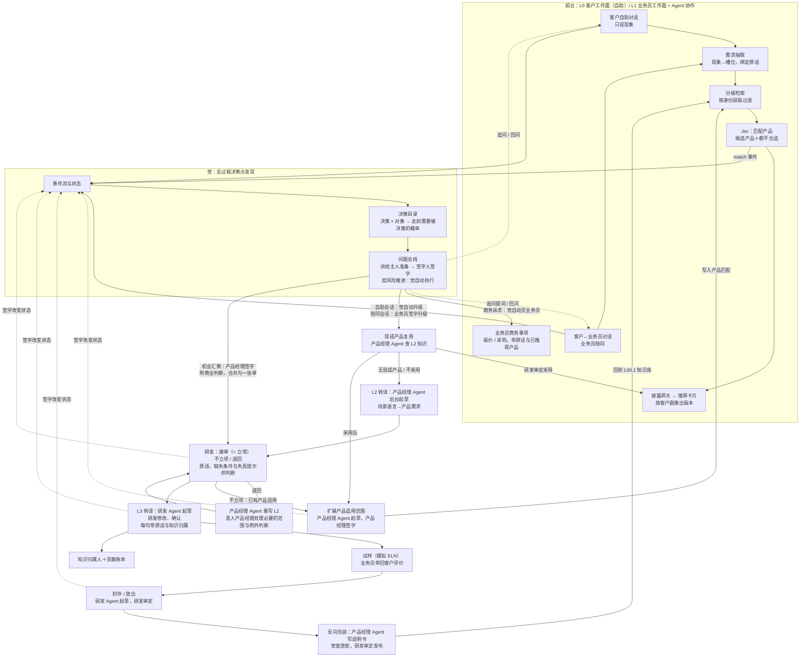

# 化言：系统架构与运行链路

> **2026-10-22 修订；2026-11-02 按 `v10` 校正当前实现（第 0.1 节）。** 配合 [VISION.md](VISION.md) 阅读。本文讲架构与职责；当前计划见 [REPLAN-v10.md](workpackages/REPLAN-v10.md)，实现状态与证据见 [v10-evidence.md](reports/v10-evidence.md)，V9 的历史计划见 [REPLAN-v9.md](workpackages/REPLAN-v9.md)。数据格式与模块接口以 [CONTRACTS.md](CONTRACTS.md) 及 `src/huayan/contracts/` 的冻结定义为准。
> - **试用目标（V9 提出，V10 承接）：业务员、产品经理、研发、研发负责人四类真人，在同一个共享试用实例中、有人协助地完成一次全链条真实业务试用**，覆盖需求、判断、试样与评价、知识回流、后续复用和管理处置，由四个真人在同一份业务上协作完成。
> - 觉是**全过程的决策点发现器**，自动派单沿「觉提出决策 → 主人准备 → 签字人签字 → 状态改变 → 觉再看」运行；人也可在权限与对象状态允许时随时主动决策，记入 `human_decision`（第 1、4、7 节）；
> - **四层是知识边界，不是审批节点**：L0 客户（公开入口、自助）、L1 业务员、L2 产品经理（产品经理 Agent 后台逐单转译，真人产品经理负责产品适用范围、产品机会与例外纠偏）、L3 研发；需求按性质分流（A 自助 / B 商务归位 / C 直达研发 / C′ 判断复用 / D 机会汇聚，第 7.0 节）；
> - **低风险推进由觉按模板 `auto_action` 自动执行**（自动升级、交业务员），**高影响动作必须人签**（立项 / 接单、技术确认、封存、发布、解密）；研发接单（= 立项）是 L2 的生效点，研发审定发布（第 2、3、4.2、7.2 节）；
> - 客户是外部入口；四类内部真人各有工作面。产品经理真人与后台 `pm:agent` 分开，研发负责人在授权范围内做管理判断，研发原文按归属授予。四类角色按需求性质参与（第 3、7.5 节）。
> 化言是面向产业的组织智能运行架构（见 [VISION 1.0](VISION.md#10-架构层级)）：组织级 Agent Harness 维持目标、状态、事项、协作与反馈，觉与契是其中两项核心机制（第 0 节）。功能化学场景的主线为**分层转译**（场景需求 → L2 产品需求 → L3 化学语言 → 反向包装回前台），业务链路图见第 0 节「业务链路」。

## 0. 总览

### 组织层：Harness、觉与契

同一张图的 Mermaid 版本，便于在 GitHub 中直接查看和修改：

Harness 是一组运行职责，由现有组件分别承担，不是另一个调度 Agent：

| Harness 职责 | 现有组件 | 代码位置 | 现状 |
|---|---|---|---|
| 保留目标、事实、未知项与进展 | 业务对象与有效状态落盘、`resume` 续跑 | `src/huayan/app.py` | 已有；显式的组织目标与完成条件尚未建模 |
| 记录发生了什么 | 事件流，人的主动决定记 `human_decision` | `src/huayan/events.py` | 已有 |
| 接纳事项 | 问题总线：觉按决策目录提出；人的主动委托直接交给自己的 Agent，主动决定经门面生效并记 `human_decision` | `src/huayan/bus.py`、`config/templates/` | 已有，25 个模板 |
| 交给负责者 | hub 按模板写定的主人派单，准备失败记录并可重做 | `src/huayan/agent/hub.py` | 已有 |
| 准备材料与方案 | 角色 Agent 借委托人权限调用原子工具 | `src/huayan/agent/` | 已有，39 个原子工具 |
| 生效与权限 | 工作面按钮调用门面原子方法，权限在门面、知识库与披露处执行 | `HuayanApp`、`src/huayan/ui/server.py` | 已有 |
| 多人接续同一业务 | 共享试用实例与服务端角色会话 | `ui/server.py --trial` | V9.1 起已有 |
| 能力供给与回写 | 契的视图、确认、授予、复核与撤销 | `src/huayan/knowledge/`、`src/huayan/ingest/` | 已有；V10 接入真实资料 |
| 依赖、等待与跨项目统筹 | 回问等待、合并单等有限表达 | — | 目标能力，从真实业务中的关联开始建设 |

### 业务链路：功能化学场景

> `assets/architecture.svg` 是 2026-10-10 的早期示意，其中产品经理逐单确认、悬赏式问题、低置信披露审批等流程已经调整，不再作为现行架构图；下方 Mermaid 为准。

读图要点：

- **两个入口**：客户在 L0 公开入口自助描述问题（自助会话），或由业务员陪同对话（陪同会话）；两者共用抽取、分级检索与 Jev 匹配，只是可见知识与升级方式不同。
- **两个回环**：右上是觉发现缺信息后回到对话追问 / 回问；左侧长线是研发成果（新品说明书或产品经理扩展的适用范围）回到产品匹配，下一位同类客户在自助阶段就能直接命中。
- **系统自动发现的问题由觉提出**：每次状态改变后评估，定时部分按业务时间扫描；既有人工申请与主动决定仍走各自合法入口并留痕。Jev 的匹配概率只是觉判断「是否升级」的信号（`match` 事件），不直接升级。
- **每一次签字或自动执行都改变状态、回到事件流**，觉再评估下一步；图中的箭头表示系统提出的路径，不限制人的合法主动操作。
- **权限卡在三处**：分级检索、披露网关、研发审批（见第 6 节）。

现行业务链路图（Mermaid），便于在 GitHub 中直接查看和修改：

### 0.1 当前实现与试用架构

知识视图、能力授予与撤销、事件、问题总线、角色工具、会话与需求单落盘、`resume` 续跑是既有基础。V9.1 起演示服务支持**共享试用实例**：`uv run python -m huayan.ui.server --trial <运行号>` 让全部浏览器共用一个门面与固定运行目录，启动即续跑、使用真实时间；不带 `--trial` 时仍按浏览器会话各建一份演示状态，供访客独立体验。

V10 在此之上接入真实资料：`ingest/reader/` 按来源编号统一读取 Word、PPT 与图表，原文和原生位置可回取，视觉模型辅助读出的内容单独标注、交人核对；试样记录汇总后经 `ingest/compile.py` 编译成带完整条件的候选结论与能力提议，研发也可在单内用 `compile_source_preparation` 导入；候选经固定证据指纹的专业审阅、确认与授予才生效。角色 Agent 依据真实资料做定向准备。当前开发者模拟链与实际模型运行已通过，专业核对与四岗位真人试用待安排，详见 [v10-evidence.md](reports/v10-evidence.md)。

试用采用简单的已分配角色会话，服务端绑定当前人（身份记在运行目录的 `roles.json`，重启后保留），继续使用现有门面权限。四个人处理同一批会话、需求、试样和知识，Agent 始终明确当前工作对象，切换页面或对象不串单。这里需要的是试用中的身份和对象对得上，不是先建企业账号、多租户或通用授权平台。

页面返回后能继续查看和处理已保存业务；普通调用失败有明确提示并可重试。Agent 执行因进程中断而未完成时，标为失败后整项重新执行。重试复用已保存结果，已生效的业务与授予原样保留。模型调用期间界面显示进行状态，一次普通失败只影响那一项。

业务时间继续经 `huayan.clock` 获取，真实试用用真实时间，模拟和回放保持可控时钟；试用中的扫描、刷新和异常处理可以有人协助。核心推荐和能力使用仍检查当前有效状态与实际条件，已撤销或条件不符的能力不能继续使用；来源由人显式刷新，历史记录照留，见 [QI.md](QI.md)。

LangGraph、Temporal 等成熟框架可参考或采用，但不预先指定更换运行底座。只有现有实现出现具体阻断、采用组件确实比局部处理更有收益时，再选择合适方案；一次有人协助的真实业务试用不以数据库 checkpointer、持久 runner 或复杂故障恢复为前提。

具体实施和试用安排在 [REPLAN-v10.md](workpackages/REPLAN-v10.md) 维护。真正需要改变冻结接口时按现有规则处理，不为了上述边界预先增加一套协议。

## 1. 设计原则

1. **发现与回答分离。** 觉只判断「该不该提问题、提什么」，Jev 只回答已提出的问题，人做最终决定。
2. **安全靠结构，不靠提示词。** 低层级 Agent 的上下文里根本没有高层级内容；模型判断只在硬上限之内起作用。
3. **每一步可回查。** 需求单上的每条要求都能回到客户原话；每次披露、审批、记分都写审计。
4. **系统越用越会。** 每次升级走完，说明书回到前台、转化对照入库；研发每判定一次「已有产品适用」，产品经理就把它扩成产品适用范围，同类需求以后在自助阶段就解决。
5. **复用已有组件，围绕真实试用补齐。** 优先处理四类真人走完业务时实际遇到的阻断；成熟组件按收益选用，不为可能出现的问题先建设通用平台。
6. **发现、执行与生效分工。** 觉提出需要的决策，派单处理总线上的问题；人可以主动决定。门面保留原子动作、权限、必要的状态与引用校验，不偷偷决定下一项业务。普通执行失败允许明确提示后重试。
7. **助手准备内容，人判断和签字。** Agent 把草稿写进工作对象，人能查看原话和依据、直接修改或用自然语言协作，再按按钮签字；人也可以亲自写正文。
8. **按需求性质分流，不按岗位顺序流转。** 四层是知识边界，不是审批节点：常规问题在 L0 自助解决，商务诉求交业务员，产品机会与适用范围交产品经理，只有现有产品解决不了的需求才带着原话直达研发。
9. **低风险自动、高影响人签。** 模板写明 `auto_action` 的低风险推进由觉自动执行并留痕；立项、技术确认、封存、发布、解密必须人签。

## 2. 分层组件

| 层 | 组件 | 职责 |
|---|---|---|
| **接入层** | 对话转写 | 演示用文本输入；落地时接钉钉听记 |
| | 角色工作面 | 客户外部入口（自助对话、追问、推荐卡、「我要报价」）；内部业务员（陪同对话与商务事项）、产品经理（适用范围、产品机会与例外）、研发（需求、原话、条件提示与试样）、研发负责人（授权范围内的团队进展、异常处置与知识贡献）。V9 要让四类真人在同一空间实际协作，不能以已有页面数量代替验收；需求轨迹显示经过了谁、由谁自动处理 |
| | 研发系统接口 | 模拟 ELN：录入试样结果（不算人的决策） |
| | 签字 | 工作面上的按钮即签字，调门面原子方法并记下签字人。业务员：发给客户、陪同会话的升级、客户评价、申请解密；产品经理：扩展产品适用范围、签产品机会（附商业判断）、必要的 L2 例外判断、沉淀本人 L2 知识；研发：接单 / 不立项 / 退回、确认转译、沉淀、封存 / 放出、发布、审批解密；研发负责人按已授权的治理动作处置，不代替知识归属人签技术结论 |
| **编排层** | 会话管理 | 一次对话的上下文、参与人身份、客户画像 |
| | **角色 Agent 与产品经理 Agent** | 当前为自研 Agent Loop + 原子工具，V9 优先沿用，补齐当前对象和普通失败处理。人的助手用绑定的委托人权限准备、查询、修改草稿；当前对象、原话与引用由显式上下文装配。后台产品经理 Agent（`pm:agent`，L2）承担逐单转译与起草，没有委托人、没有生效工具、不记积分；它与真人产品经理及真人的协作上下文分开。助手只能起草和提议，不能替真人签字 |
| | 单次调用 Agent | 需求抽取（L1）、L1 问答：单次结构化调用，输入只含本层可见内容 |
| | **转译引擎** | 化言的主体。L2：场景语言 → 产品需求语言（产品经理 Agent，只用 L2 知识）；L3：产品需求 → 化学语言（研发助手，用 L3 转化对照与机理）；反向包装：研发对外要点 → L1 说明书（输入不含任何 L3 内容）。每条输出带客户原话（turn id）与依据的知识（ku id → 归属人）。有零成本的规则模式和大模型模式 |
| | 问题总线 | 接收觉提出的问题，去重、按模板的主人 / 签字人路由，跟踪「准备 → 待签 → 处置」；签字人为空且带 `auto_action` 的低风险问题，由 hub 调门面内部入口 `auto_execute` 自动执行（不经 HTTP 暴露） |
| | 应用门面 | 界面和 Agent 通过它访问系统；按当前角色会话裁剪视图，检查既有动作权限、必要的对象状态与引用；每次有效状态改变触发觉的写后评估。`route_of` 由事件投影需求轨迹，`readiness` 展示条件与风险提示，接不接单由研发判断 |
| **决策层** | 觉 | 发现层，见第 4 节 |
| | Jev | 决策模型，见第 5 节 |
| | 权限引擎 | 结合当前角色、对象归属、层级、逐项授予和当前有效状态给出硬上限，不可被模型突破；专业条件是否完整由知识编译与领域校验负责，通用权限框架不能代替 |
| | 披露网关 | 在上限内按 Jev 的选择输出对应版本 |
| **知识层** | 知识单元库 | 每条知识带归属人、密级（L0/L1/L2/L3）、来源；L0 为说明书、用法与脱敏公开案例，L1 增加内部评价报告 |
| | 案例库 | 历史需求 → 方案 |
| | 转化对照库 | L2 条目：场景说法 → 产品需求说法（产品经理历史积累，归属本人，产品经理 Agent 引用时照常记分）；L3 条目：产品需求说法 → 化学语言（研发所有）。研发在需求单上的修改可沉淀为新条目；产品经理纠偏后的 L2 修正、扩展的产品适用范围沉淀为本人名下的 L2 条目 |
| | 事件日志 | 全链路事件，可回放，觉的输入 |
| **治理与评测** | 贡献账本 | 知识被引用（推荐卡片；研发接单时记所引 L2 知识，确认转译时记所引 L3 知识）、转化知识沉淀、产品经理扩展的适用范围被命中、试样成功、说明书发布时给归属人记分；只给人记分，产品经理 Agent 的草稿不记分 |
| | 审计日志 | 谁在什么时候看到了什么版本 |
| | 评测台 | 模拟客户对照、模拟业务周，见第 8、9 节 |
| | 降级标注 | 结果来自真模型还是降级实现（`scored_by`） |
| **模型层** | 模型网关 | 大模型主/备/桩，带 `caller` 计量 |
| | OneJev | Jev 的推理服务（9B，需 GPU）；不可用时用大模型降级 |
| | 检索 | 关键词（字符二元组）＋现象加分，检索前按权限过滤；Demo 不用向量检索 |
| | 觉打分器 | 原型：模板＋前置条件＋规则或 OneJev 打分；训练版：Jue-K（追问、回问、机会汇聚、知识冲突、泄露风险）本地推理；新增的推进类与异常类决策先用规则打分 |

## 3. 四层角色与可见性

**四层是知识边界，不是审批顺序。** 同一份需求可以在 L0 当场解决、带着已有信息交给 L1，或由 L2 后台自动转译后直达 L3；是否需要人签字取决于动作的影响，而不是层级数字。

V9 的四类内部真人是业务员、产品经理、研发、研发负责人；客户不计入这四类。研发负责人使用现有 `supervisor` 管理职责，**不增加 L4，不因管理身份默认读取所有 L3 原文，不在每张单上增加一道审批**。看团队进展、发现堵点、处置授权范围内的异常与治理事项，是管理工作；研发专业判断和知识授予仍由相应归属人承担。下表只是知识层级的上限示意，还须叠加空间、对象、同层归属与授予约束，不能按一列全量放行。

| 内容 | L0 客户 | L1 业务员 | L2 产品经理（Agent 与真人） | L3 研发 |
|---|---|---|---|---|
| 产品推荐、用法、产品说明书、脱敏公开案例 | ✓ | ✓ | ✓ | ✓ |
| 内部评价报告 | ✗ | ✓ | ✓ | ✓ |
| 历史案例 | 只看推荐结果 | 只看推荐结果 | ✓ | ✓ |
| 场景需求卡（槽位＋原话） | 只看自己的会话 | 只看自己的对话 | ✓ | ✓ |
| L2 转化对照、产品需求条目 | ✗ | ✗ | ✓ | ✓ |
| 研发需求单（化学语言条目） | ✗ | ✗ | ✓（所引 L3 知识只显示归属人与层级，不显示原文） | ✓ |
| L3 转化对照原文 | ✗ | ✗ | ✗ | ✓ |
| 客户完整原话＋追问记录 | 只看自己的会话 | 只看自己的对话 | ✓ | ✓ |
| 配方、实验记录、机理 | ✗ | ✗ | ✗ | ✓ |
| 封存项（研发决定不放出的窗户纸） | ✗ | ✗ | ✗ | ✓ |

客户身份的披露上限固定为「产品＋用法」，公开案例只带脱敏正文与归属人，不带内部案例原文；客户以 L0 身份请求更高层内容时由门面拒绝，界面不做判断。
**解密例外**（业务员陪同会话；L0 自助入口不开放解密）：客户懂化学时（能说出成因、直接要某类助剂，可以直接讲明白），经该知识归属人（研发）审批，对这一位客户、这一条结论开放完整机理，写入审计。默认权限不变。

## 4. 觉：全过程的决策点发现器

### 4.1 职责

- **输入**：整个过程的状态——会话、需求单（各层条目、草稿、修改、回问、退回、签字情况）、对外文本、试样与客户评价、产品、检索行为。对象属性只放计数与状态，不放文本。
- **输出**：每个时刻对决策目录里每个「决策 × 对象」给出「此刻需要被决策」的概率，超过阈值即提出问题；绝大多数时候接近 0。
- **不做的**：不回答问题（准备答案的是产品经理 Agent 与业务员、研发的 Agent，推荐与披露的概率由 Jev 给出）、不调用大模型、不签字。**觉不临时决定由谁处理**：每个决策的主人（谁准备）与签字人由决策目录（模板）写定。
- 每次判断的完整状态与输出都记录下来（`JueRecord`，`jue_samples.jsonl`），问题的处置与之关联，成为标签。

### 4.2 决策目录

模板 = 决策 × 对象类型 × 前置条件 × 打分 × 主人 × 签字人（× 可选的自动动作 `auto_action`），放在 `config/templates/`。分为**推进类**（需要有人决定）与**异常类**（出现需要处理的情况）；下表保留主链路的机制示例，完整目录、数量、前置条件与实际打分方式以当前 `config/templates/` 为准，不能从旧版表格反推现行实现。签字人为空、带 `auto_action` 的推进是**低风险推进**；高影响动作不得配 `auto_action`。

| 决策 | 类 | 对象 | 主人（准备） | 签字 | 打分 |
|---|---|---|---|---|---|
| 追问 `ask_slot` | 推进 | 会话 × 槽位 | — | —（提词） | Jue-K |
| 直达研发（自动升级）`route_rd` | 推进 | 自助会话 | — | —（觉自动执行 `escalate`） | 规则（信号来自 Jev 的 `match`） |
| 是否转产品经理 Agent `escalate_need` | 推进 | 陪同会话 | 业务员 Agent（升级说明） | 业务员 | 规则（信号来自 Jev 的 `match`） |
| 交业务员（商务）`handoff_sales` | 推进 | 自助会话 | — | —（觉自动执行 `assign_sales`，原话与推荐带过去） | 规则消费抽取后的商务意图，不再次用关键词猜原话 |
| 现成产品复用 `reuse_product` | 推进 | 需求单 | 产品经理 Agent（查 L2 知识） | 研发（审定采用 / 不采用） | 规则 |
| 扩展产品适用范围 `scope_update` | 推进 | 产品 × 现象（知识对象） | 产品经理 Agent（起草） | 产品经理（真人） | 规则 |
| 机会汇聚 `opportunity` | 推进 | 主题 | 产品经理 Agent（判断是否同一需求，起草合并） | 产品经理（真人，签字附商业判断） | Jue-K |
| 研发是否接单 `accept_requirement` | 推进 | 需求单 | 产品经理 Agent 起草或按退回意见重写 L2；真人产品经理处理必要的产品范围与例外判断 | 研发（接单 / 不立项 / 退回） | 规则 |
| 回问 `ask_back` | 推进 | 需求单 × 槽位 | 业务员 Agent（话术） | —（提示） | 规则 |
| 转译失真 `distortion` | 异常 | 需求单 | 该层起草者 | 研发 | 规则 |
| 转译可以确认了吗 `confirm_translation` | 推进 | 需求单 | 研发 Agent（起草 L3） | 研发 | 规则 |
| 沉淀 `contribution` | 推进 | 需求单 | 研发 Agent（提炼） | 研发 | 规则 |
| 沉淀 L2 修正 `contribution_pm` | 推进 | 需求单 | 产品经理 Agent 或本人（提炼） | 产品经理（真人） | 规则 |
| 客户评价 `market_eval` | 推进 | 需求单 | 业务员 Agent | 业务员 | 规则 |
| 封存 / 放出 `seal_points` | 推进 | 需求单 | 研发 Agent（两栏草稿） | 研发 | 规则 |
| 对外泄密 `seal_leak` | 异常 | 需求单 | 研发 Agent（改写） | 研发 | 规则 |
| 能不能发布 `release` | 推进 | 需求单 | 产品经理 Agent（说明书） | 研发 | 规则 |
| 知识冲突 `knowledge_conflict` | 异常 | 产品 × 条件 | 知识归属人的 Agent | 知识归属人 | Jue-K |
| 解密 `decrypt_request` | 推进 | 会话 | 研发 Agent | 归属研发 | 人工发起（业务员申请，不占模板） |
| 拼凑 `leak_risk` | 异常 | 提问者 | — | 主管 | Jue-K |

决策目录不属于冻结契约：`Family` 是由已加载模板校验的字符串，新增决策点 = 人批准后新增一个模板文件。

**为什么需要觉**：化言把「此刻有没有值得人处理的决策」作为单独的判断任务，关注推进的时机，以及单次问答看不出的共性需求、累积冲突、泄露风险与转译失真。确定性条件就能判断的路由标为规则；模型用在必要性和时机需要权衡的地方，效果用对照证明。执行框架负责把已经提出或由人主动发起的动作可靠做完；发现归觉，专业判断归人。

### 4.3 运行方式

- **统一循环**：状态变化 → 觉评估受影响的「决策 × 对象」→ 提出问题（总线）→ 派给主人准备 → 签字人在工作面上签字 → 门面原子方法改状态 → 状态变化。
- **两个阶段**：问题先派给主人**准备**；Agent 准备完成后由 hub 调用门面 `mark_prepared`（离线时在规则骨架起草后调用），进入签字人收件箱**待签**。未答回问与失真是给人判断的提示；门面校验对象状态、草稿与引用完整性、权限及确定性红线。人随时可以主动签字。
- **写后增量评估**：门面每个改状态的方法结束时，对受影响的组合评估一次；不依赖界面接口。
- **定时**：主题、产品 × 条件、提问者等对象按业务时间周期评估。真实试用按实际时间使用现有扫描入口，允许人工协助触发；加速时钟仅用于模拟与回放。
- **异常类自动关闭**：前置条件不再成立时（例如说明书已改写），门面以 `answered` 关闭，处置记入 JueRecord。
- **追问**保持提示通道：每轮发言给业务员的提词，不进总线，同样写 JueRecord、进觉视图。
- **自动执行**：签字人为空、带 `auto_action` 的问题发布后，hub 调门面内部入口 `auto_execute`（只查表 `{escalate, assign_sales}`，执行者 `jue:auto`），成功后写 `auto_executed` 事件并以 `auto` 结案；该入口不经 HTTP 暴露，外部请求无法冒用。
- `huayan/jue/` 不 import 网关；确定性披露红线、引用归属、计数与状态检查可以用规则。客户意图、否定、条件和专业内容的理解由既定抽取或专业准备环节产生唯一结构化结果，觉、门面与检索不得另用关键词补出第二份语义判断；现有文本比对红线不等于通用的语义失真检测。

### 4.4 实现阶段

| 阶段 | 实现 | 说明 |
|---|---|---|
| 原型 | 模板（YAML）＋前置条件＋规则或 OneJev 打分 | 复用 JUE 的 `jue_proto` 骨架；所有决策都能以原型运行 |
| 训练版 Jue-K | 梯度提升树＋按决策分别校准，本地一次批量推理；紧急度用模板规则 | 覆盖追问、回问、机会汇聚、知识冲突、泄露风险，训练方案见 `JUE_K_TRAINING.md` |
| 新决策 | 推进类与失真、泄密先用规则打分，界面标 `scored_by: rule`，显示为「到点」 | 有了带处置的样本后再进入 Jue-K 训练 |

原型和训练版对外接口一致，可以逐个决策替换，运行链路不改。

**模型与规则的分工**：推进类决策（自动升级、交业务员、扩展适用范围等路由类决策）由规则打分、到点即提出，界面标「规则」；Jue-K 用在时机和必要性需要权衡的发现上（追问、回问、机会汇聚、知识冲突、拼凑），五类各与规则同台比较，胜出即启用。

### 4.5 数据飞轮

| 飞轮 | 输入 | 产出 | 本次 | 后期 |
|---|---|---|---|---|
| 知识 | 每一次升级、研发的每一次修改、研发每一次「已有产品适用」的判断 | 经研发确认的转化知识；新品回到前台；产品经理扩展的适用范围写入产品匹配 | 沉淀由觉提出、Agent 提炼、研发 / 产品经理审定 | 跨产品线的场景知识积累 |
| 判断 | JueRecord ＋ 人的处置 | 校准概率、按代价定阈值、重训 Jue-K | 记录完整；按模板统计被忽略率 | 真实处置回填、在线校准 |
| 决策目录 | 被忽略的问题（提多了）；人自发决策（漏了：执行生效动作时同一对象上没有对应问题） | 已有决策点的调整；候选的新决策点 | 只记录（动作、对象、当时的属性快照） | 本地聚类、浅层决策树学出候选前置条件，生成候选模板，主管批准后加入目录；目录的结构性变化总是人签字 |

不在模拟业务周上演示「挖掘新决策点」：模拟周由脚本生成，挖出来的只会是脚本本身。

## 5. Jev：决策模型

### 5.1 职责

给定一个已经提出的问题和选项，输出每个选项的概率。Jev **不发现问题、不做最终决定、不是安全防线**。

### 5.2 三个固定问题

| 问题 | 选项 | 高置信 | 低置信 |
|---|---|---|---|
| 推荐哪个产品？ | 候选产品 A/B/C … ／ 都不合适 | 推荐 | 写入 `match` 事件，作为觉「是否升级」的信号；自助会话由觉自动升级，陪同会话由业务员签字升级 |
| 这份结论以哪个版本披露？ | 只给产品推荐 ／ 产品＋用法 ／ 完整机理（仅在上限允许时可选） | 按选择输出 | 交知识归属人审批 |
| 这个回答是否有知识依据？ | 有依据 ／ 部分有依据 ／ 无依据 | 输出 | 不输出，转人工 |

披露问题的输入包含客户画像：是否懂化学（从对话中判断：说得出成因、直接点名要某类助剂）、是否明确要求了解原理。懂化学不等于刨根问底：不懂化学的客户给包装好的产品方案，懂化学的客户可以直接讲明白（机理仍需研发审批解密）。

### 5.3 运行模式

优先 OneJev；不可用时用大模型降级（复用 JUE 的 `LLMSystem1Fallback`），结果标 `scored_by`，界面可见。

## 6. 权限在三处强制执行

1. **检索时**：权限引擎按当前角色、对象归属、层级与当前授予过滤；L1 Agent 不取得未授权的 L2/L3 原文。核心推荐和能力使用读取当前状态，旧草稿或聊天内容本身不构成授权。
2. **知识访问时**：知识读取与使用经过知识库的 `get` / `search` / `explore` / `view` 等受控入口，越权读取直接拒绝，写审计和事件（这些事件是觉「泄露风险」的输入）；同层知识也执行归属与授予约束。
3. **输出时**：披露网关只能在上限之内按 Jev 的选择出版本；Jev 无法突破上限。

已知局限：结构性隔离挡得住前台 Agent 的直接泄露，挡不住有人从大量结论中反推原理。后者由觉的「泄露风险」发现专门盯防，作为持续加强的方向。

## 7. 运行链路

### 7.0 按需求性质分流：五条路径

传统做法让每张单依次经过业务员 → 产品经理 → 研发；化言按需求性质分流，人只在有判断价值的地方出现。

| 路径 | 系统做什么 | 谁承担判断 |
|---|---|---|
| **A · 自助** | 客户在 L0 只说现象；觉追问必要条件；按公开知识当场推荐 | 无需专业人员介入 |
| **B · 商务归位** | 客户拿到推荐后提出报价 / 采购，觉自动交业务员，原话、已知条件与已推荐产品一并带过去 | 业务员负责报价、商务与客户关系 |
| **C · 直达研发** | 现有产品都不合适，觉自动升级；产品经理 Agent 后台完成 L2 转译；研发收到原话、条件缺口与失真提示齐全的需求单 | 研发决定接单立项、不立项或退回 |
| **C′ · 判断复用** | 研发判定「已有产品适用，只是超出标注范围」；觉提出扩展适用范围，产品经理签字后写入产品匹配；下一位同类客户在自助阶段直接命中，研发不再收到同类单 | 研发判技术适用，产品经理管产品边界 |
| **D · 机会汇聚** | 多位客户的同类未满足需求被觉在定时扫描中发现；产品经理 Agent 起草合并，产品经理签字并写商业判断；研发只收到一张合并单 | 产品经理对产品机会负责，研发对技术负责 |

业务员陪同的会话照常可用：追问以提词给业务员，升级由业务员签字（7.1）。

### 7.1 前台实时链路（L0 自助 / L1 陪同）

1. 对话片段到达（客户自助，或业务员陪同），写入事件日志；
2. 需求抽取 Agent 把现象描述转成槽位，每个槽位绑定客户原话；
3. 觉评估追问补全：缺关键槽位时，自助会话直接向客户追问，陪同会话提示业务员追问，回到第 1 步；
4. 分级检索：在请求者层级可见的知识和案例中找候选产品（客户只用说明书、用法与公开案例）；
5. Jev 给出各选项概率，写入 `match` 事件；「都不合适」概率最高时，自助会话由觉自动升级（`route_rd`），陪同会话由觉提出「是否转产品经理 Agent」、业务员 Agent 起草升级说明、业务员签字，之后进入 7.2；客户提出报价、采购等商务诉求时，觉自动交业务员（`handoff_sales`）；
6. Jev 判断披露版本，披露网关在上限内输出推荐卡片；记账、写审计。

### 7.2 升级与回流链路

这是化言的主线：同一份需求，逐层换成下一层能直接用的语言，每一步只用本层能看的知识，每一句都能回到客户原话和知识归属人。

系统提出的工作沿「觉提出 → 主人准备 → 签字人签字」运行；人也可随时主动操作。下面说明各决策的主人与签字人，每张单只经过它需要的岗位。

1. **升级**：觉自动升级或业务员签字升级时，门面创建一张空需求单（每次升级各一张，`status=draft`，带场景需求卡与客户原话）；同类需求的合并由机会汇聚提出（7.3）；
1′. **现成产品复用**：觉先提出「是否有现成产品可用」，产品经理 Agent 用历史案例与 L2 转化对照查现成产品（L1 只按说明书的适用表匹配，L2 能看到「说明书没写、但案例里用过」的方案）。找到则起草建议：产品、用法、一句面向客户的说明、知识归属；研发审定（可改那句说明）后推荐卡与说明转回原会话（陪同会话由业务员转述给客户），需求单关闭（`reused`），所引案例的归属人记分，觉随后提出「扩展产品适用范围」（见第 2 步）；审定前业务员只看到「研发审定中」（那句说明出自 L2 案例，是唯一一段由 L2 写成、流向 L1 的文本）。没找到或研发不采用，觉再对这张单提出「研发是否接单」，准备阶段派给产品经理 Agent；
2. **L2 转译与接单**：产品经理 Agent 用案例与 L2 转化对照，把场景语言转成产品需求语言（如「深一块浅一块 + 气流缸」→「需要在低浴比下仍能保持匀染效果的助剂」）；研发看到逐项绑定原话的条件、未答回问与失真提示，自行判断是否足以接单，系统不以这些计数硬拦接单。研发三种处理：**接单**（= 立项，所引 L2 知识的归属人记分）；**不立项**，若指定「已有产品适用」，客户会话收到经研发审定的公开推荐，觉提出「扩展产品适用范围」，产品经理 Agent 起草、真人产品经理批准完整适用情境，同类条件以后可复用；**退回**，产品经理 Agent 按退回意见重写，产品范围或例外判断需要真人产品经理时再交给本人。理由是便于协作的信息，不额外构成程序硬门；可复用的修正经相应归属人确认后沉淀；
3. **L3 转译与确认**：研发 Agent 用 L3 转化对照与已有机理，把产品需求转成化学语言（如「对酸性染料有缓染作用、与染料竞争染座的组分；氨纶段亲和力低需控制沾色」），研发修改、确认（所引 L3 知识的归属人记分）。起草中客户没说的信息会改变本层转译时，觉提出**回问**，业务员回头问客户，答复回填需求单；上一层的约束本层没有承接时，觉提出**转译失真**；
4. **沉淀**：研发改过、未被已有转化对照覆盖的条目，觉提出「沉淀」；研发 Agent 提炼（泛化、去掉这位客户的特定信息、指出与已有知识相近或冲突之处），研发审定后**沉淀为自己的转化知识**；
5. **试样与客户评价**：试样结果从模拟 ELN 录入；试样通过后觉提出「客户评价」，业务员把样品交给客户，带回评价并签字录入；
6. **封存 / 放出**：客户评价通过后，研发 Agent 起草两栏并做泄露自查，研发审定哪些窗户纸封存（只对 L3 可见）、哪些作为**对外要点**放出；
7. **反向包装与发布**：产品经理 Agent 只用产品需求和对外要点写对外说明书与用法；说明书命中封存项、L3 关键术语或 L3 方向时觉提出「对外泄密」，研发 Agent 改写；研发审定后发布回前台（L0 公开）知识库，下一位同类客户在前台直接命中。

### 7.3 定时发现链路

1. 觉按周期扫描事件日志，评估机会汇聚、知识冲突、泄露风险；
2. 发现的问题进入总线，按模板路由给主人与签字人（机会汇聚 → 产品经理 Agent 判断几张单是否同一件事、起草合并，产品经理签字合并并写商业判断，研发只收到一张合并单；知识冲突 → 知识归属人；泄露风险 → 主管）；
3. 处置在链路里真实生效：机会汇聚经合并后的需求单进入 7.2，研发接单即立项；说明书更新后 Jev 不再错误推荐；冻结权限后后续套问被拒。

### 7.4 走查示例（专业深链路）

以业务员陪同会话走完一条从追问到发布的深链路；客户自助会话里同样由觉追问，升级由觉自动执行。

1. 客户：「染完色以后，布面上深一块浅一块怎么办？」
2. 觉：缺面料信息，追问概率高 → 提示业务员问面料。
3. 业务员追问，客户答：「锦纶氨纶混纺。」
4. 检索到两个候选产品；Jev 给出各选项概率，推荐其中把握最高的一个。
5. Jev：客户不懂化学、未要求解密 → 只给「产品＋用法」版本。
6. 若「都不合适」概率最高 → 觉提出「是否转产品经理 Agent」，业务员签字升级；这类升级多了，觉在定时扫描中发现机会汇聚，产品经理 Agent 判断几位客户说的是不是同一件事、起草合并，产品经理签字合并并写商业判断。
7. 产品经理 Agent 起草产品需求，研发查看原话、条件缺口和提示后决定接单（立项）；研发 Agent 起草化学语言需求单，觉发现缺染浴 pH、提出回问，业务员回头问到后研发确认；三层对照视图中，同一句客户原话在三列里逐层变成产品语言和化学语言，每句标明依据了哪位研发的哪条转化知识。
8. 研发试样 → 业务员带回客户评价 → 研发审定封存 / 放出 → 产品经理 Agent 包装说明书 → 研发审定发布；下一位客户同样描述，前台直接推荐新品；贡献看板上研发的引用次数和积分增加；觉视图上能看到整条线程每个决策的提出、准备、签字。

演示中出现的概率必须来自真实运行，本示例只说明用法。

### 7.5 工作面 + Agent 协作：人怎么接入

1. **工作面在中间**：人直接在自己的工作对象上干活。客户在自助工作面上描述问题、回答追问、拿推荐、点「我要报价」；业务员直接和客户对话、处理商务事项，客户的话是材料，不经过 Agent 转述；产品经理处理适用范围待定、产品机会与待纠偏三类事项；研发直接在需求单上改条目。
2. **Agent 准备**：觉的问题派给主人；业务员、研发的 Agent（或产品经理 Agent）查会话、检索、起草，把草稿写在工作面上对应的位置，带「Agent 起草」标记：回复草稿预填进发送框，升级说明、L3 条目、封存 / 放出两栏、说明书就地出现，可直接修改；觉的批注挂在它说的那个条目上。
3. **按钮就是签字**：人看内容、修改，按按钮；按钮调门面原子方法并记下签字人。收件箱区分「准备中」与「待签」。
4. **与 Agent 协作**：工作面旁常驻「与 Agent 协作（不会发给客户）」输入框，人用自然语言让 Agent 查询（「LV205 能用在气流缸吗？」）、起草、修改草稿，改动就地出现；Agent 提议的生效动作以确认卡出现在工作面签字区，人确认才生效。
5. **产品经理 Agent 在后台工作**：它没有自己的工作台，产出在研发工作面、三层对照页、觉视图，以及产品经理工作面的只读区「Agent 后台转译中」上可见；真人产品经理从逐单转述中解放出来。
6. **觉自动执行的步骤同样可见**：在过程面板与觉时间线里显示为「觉 · 自动执行」，需求轨迹条上标为自动处理。
7. **研发负责人处理管理对象**：在同一业务空间查看有权可见的团队进展、异常、知识使用与贡献，作出有业务后果的处置；管理信息通过专门裁剪的视图提供，研发原文按归属授予，负责人只在例外处签字。四类真人的进入、协作和管理处置在 V9 真实试用中贯通。

助手看不到委托人看不到的东西：产品经理 Agent 检索到 L3 知识时只得到「研发 R01 · L3」，于是在草稿里写「需研发 R01 补充」，这句话随需求单到研发那里被接住；对外泄密命中时，它只收到「第 n 句需研发处理」，拿不到封存内容。

## 8. 模拟业务周：已有机制验证，不替代真实试用

以下是模拟业务周的验证设计与对照方式：模拟事件走真实实现，输入、角色处置与结果受控，用来度量机制；V9 再由四类真人在共享空间里跑真实业务。

生成一段模拟业务周（数百次对话及其后续事件），在其中**注入**三类情况，并混入**看起来像但不需要处理的困难负样本**。整段事件流照常走真实链路：Agent 真实运行，觉真实打分，问题真实路由，人的操作由界面按钮或模拟人完成。注入清单只在事后评估时使用。

| | 机会汇聚 | 知识冲突 | 泄露风险 |
|---|---|---|---|
| 注入 | 数日内多个不同客户陆续提出同类需求，现有产品都不适用 | 试样评价连续显示某产品在某面料上无效，说明书却写适用 | 某业务员连续多次换角度逼近某产品的配方原理 |
| 困难负样本 | 同类问题出现几次，但都有产品能解决 | 一次偶发的试样失败（设备原因） | 业务员正常地连续询问多个不同产品 |
| 处置后果 | 合并为一张单 → 研发接单（立项）→ 新品说明书发布 → 后续同类客户在前台直接匹配 | 说明书更新 → 之后不再错误推荐 | 冻结相关访问 → 后续套问全部被拒 |
| 不处置对照 | 同类客户持续升级，研发被重复派单 | 错误推荐持续，试样继续失败 | 单次越权能拦，拼凑可能已经得逞 |

每一类都在同一段事件流上跑「处置」和「不处置」两个分支，比较后果。第一版只对机会汇聚跑处置分支（处置即走 7.2 的转译与回流），另两类只评测发现。

## 9. 评测台

### 9.1 追问与转译（对应「失真可度量」）

- **需求卡**：每张写清面料、工艺、目标性能、约束等真实需求，作为隐藏答案；
- **模拟客户**：模板模式（种子中的口语说法，零成本）；大模型扮演为可选附加；只用宏观现象描述，被问到才透露对应细节；
- **三组对照**：业务员转述（现状，噪声模型参数为假设并标注）／一次性翻译（不追问、全部转化对照混用）／化言（觉追问＋两步转译＋溯源）；
- **指标**：关键信息完整率、槽位错误率、错译率、追问次数（打扰）、可回查率、需要研发退回重问的比例。

### 9.2 定时发现（对应模拟业务周）

- **三组对照**：规则告警／大模型轮询／觉；
- **指标**：召回与提前量、困难负样本误报、发现阶段大模型调用次数、处置与不处置分支的后果差异。

### 9.3 说明

模拟客户和模拟业务周是受控实验，度量机制与相对效果；对外引用时标明「模拟」。

## 10. 核心概念与数据格式

全部定义在 `CONTRACTS.md`：

| 概念 | 契约章节 |
|---|---|
| 槽位、现象、产品等种子 | ① |
| 知识单元、披露版本、推荐卡片、审计、积分 | ② |
| 会话、需求槽位（含原话引用）、追问提示 | ③ |
| Jev 三个问题与输入格式 | ④ |
| 觉的对象、属性表、模板、输出 | ⑤ |
| 问题对象与问题总线 | ⑥ |
| 需求单、试样 | ⑦ |
| 事件日志与 payload | ⑧ |
| 需求卡、业务周剧本、注入清单 | ⑨ |
| 应用门面 | ⑫ |

槽位第一版为 7 个：面料成分、染料类型、染色工艺、设备、染浴 pH、水质、限制条件（以企业数据为准调整，代码不写死槽位）。

## 11. 与 JUE 赛前代码的复用

只复制可以原样使用的部分，其余按化言的需要重写，避免把物流场景的结构带进来：

| 化言组件 | 来源 | 处理 |
|---|---|---|
| 模型网关（含录制/回放缓存） | `gateway/` | 复制，只改 import |
| OneJev 客户端、大模型降级 | `system1/onejev.py` | 复制，只改 import |
| 计量、时钟、表达式求值器 | `meter.py`、`clock.py`、`discovery/expr.py` | 复制，按契约做小改 |
| 觉原型 | `qmodel/proto` 的思路 | 重写：对象换成槽位、主题、知识、提问者 |
| 问题总线 | `bus/` 的思路 | 重写，约百行：合并、抑制、路由 |
| Agent loop、工具注册表 | `agent/__init__.py`、`tools/__init__.py` | 改写：去掉派生与钩子，工具换成化言的原子工具，增加确认卡与派单 |
| 问题网络 | — | 不复用 |
| 全新 | — | 知识库、权限、披露、积分、抽取、升级回流、L0 自助与动态分流、模拟客户、模拟业务周、Jue-K、界面 |

复制的文件头注明来源；README 中列出。物流版模板与模型权重不复制。

## 12. 运行模式与降级

| 组件 | 正常 | 降级 | 标注 |
|---|---|---|---|
| Jev | OneJev | 大模型降级 | `scored_by` |
| 觉 | Jue-K（追问、回问、机会汇聚、知识冲突、泄露风险）；其余决策规则打分 | 原型（规则打分） | `scored_by` |
| 角色 Agent | 网关主模型 | 备用模型 | 计量中记录 |
| 演示数据 | 现场新运行 | 真实运行记录回放 | 界面标明模式 |

## 13. 实施与接口问题的归口

[REPLAN-v10.md](workpackages/REPLAN-v10.md) 统一管理当前工作包、四角色真实试用、技术选型落地和接口问题（V9 的处理记录见 [REPLAN-v9.md](workpackages/REPLAN-v9.md)）。本节记录部署与业务确认背景；集成与授权以实际接通的为准。

1. OneJev 是否开启（需租 GPU，费用待授权）；
2. 企业数据（现象 × 必问信息、产品适用表等）到位时间；未到位前用大模型生成的占位种子，并标注；
3. 产品经理分工（当前取舍：逐单转述由产品经理 Agent 后台起草，真人产品经理负责适用范围、产品机会与例外纠偏，待企业确认）；研发「看到完整需求」是否包括原始对话全文；
4. 提交作品知识产权归主办方：确定复用 JUE 的哪些模块进入提交仓库；
5. 演示界面：Vite + React（已定，视觉沿用 JUE wp/e 决策台）；`src/huayan/ui/server.py` 用标准库 HTTP 服务把门面暴露为 JSON 接口。

