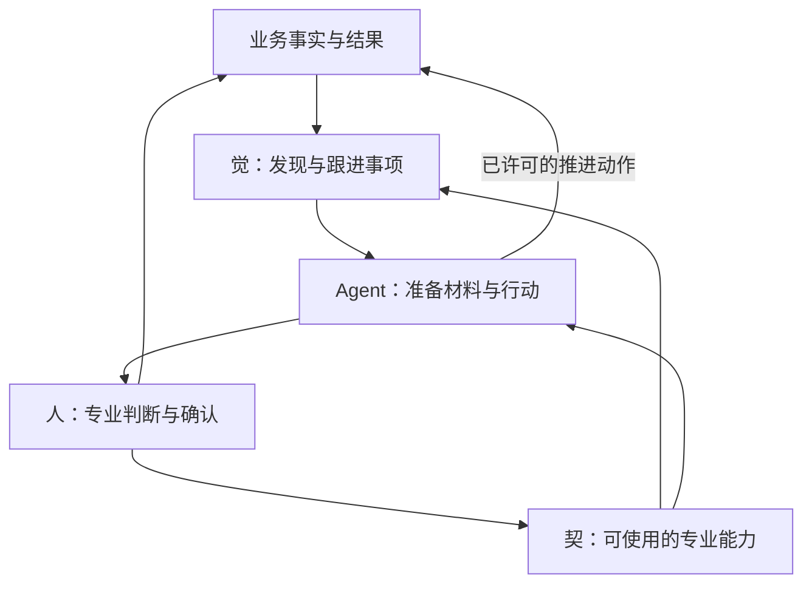

# 化言：系统架构与当前运行链路

> 实现基线：`review/v8-closeout-v9 @ 94d5a88`，2026-10-23。本文说明已有组件如何协作，以及这些机制服务什么产品目标。当前完成情况与待修正行为见 [STATUS](STATUS.md)，接口定义见 [CONTRACTS](CONTRACTS.md)，契的完整语义见 [QI](QI.md)。长期方向见 [VISION](VISION.md)。

## 1. 架构要完成的事情

化言把客户需求、专业判断和后续复用接成同一条业务链。客户表达生产现场的问题，系统保留原话、澄清条件、准备专业材料；销售、产品经理和研发在需要各自判断的地方参与；经过确认的成果进入后续业务，使相似问题可以使用已有能力。

这一目标需要两种持续能力。第一，信息变化后，系统能发现什么值得处理，并持续跟进尚未解决的事项。第二，专业人员完成判断后，组织能够在适用范围内再次使用它。**觉承接任务的形成与关注，契承接专业判断的授予与复用；Agent 和人把具体工作完成，结果再进入下一轮。**

图中是职责关系。已有主路径包含需求澄清、分流、研发处理、确认授予和后续复用；条件修正、发布与能力失效的部分组合路径仍需修正，具体状态集中记录在 STATUS。

## 2. 五项职责各自回答什么

| 组成 | 职责 | 与其他部分的关系 |
|---|---|---|
| **觉 Jue** | 从当前状态与历史事件中形成、维持、筛选并提交值得处理的事项 | 给出需要度、对象和依据，按决策目录确定准备者与责任人；处理结果进入后续关注 |
| **Jev / OneJev 接口** | 对已经提出的问题评估候选答案 | 为产品选择、披露等判断提供输入；OneJev 是可选实现，实际实现由配置决定 |
| **角色 Agent** | 检索、转译、起草、修改业务材料，调用已许可的工具 | 接受觉派出的工作和人的主动委托；产物写回工作对象，专业生效动作交相应的人 |
| **人** | 作出产品、技术、商务和治理判断 | 确认结论、批准产品范围、授予使用能力；也可直接发起工作 |
| **契 Qi** | 管理专业判断的来源、确认、使用范围、授予和有效状态 | 为各层提供当前可读、可用的知识视图，使后续业务能够使用已有判断 |

低风险推进可以按目录中明确的动作自动执行。需要承担专业责任的判断由有权的人确认。Agent 是否完成准备，以业务对象中的实际材料与状态为依据。

## 3. 客户入口、四类内部岗位与知识边界

客户可以通过外部自助入口表达需求、回答追问、获得产品与用法信息，也可由业务员陪同。V9 的四类内部真人承担以下工作：

| 岗位 | 主要工作 |
|---|---|
| 业务员 | 客户关系、商务推进、现场协调、客户反馈，以及陪同业务中的必要判断 |
| 产品经理 | 产品适用范围、产品机会、商业判断，以及本人需求转化经验的沉淀 |
| 研发 | 技术判断、需求确认、试样与专业成果、知识确认和授予 |
| 研发负责人 | 授权范围内的团队进展、异常处理和知识使用情况 |

后台 `pm:agent` 负责产品需求转译和准备。真人产品经理的判断、署名和贡献单独保留。现有 `contribute_l2` 已支持产品经理将本人修正的产品需求条目沉淀为 L2 转化知识；研发通过相应入口沉淀技术转化知识。产品经理的经验因此同样进入组织积累。

L0–L3 标记知识披露层级：公开产品信息、业务员资料、产品与转化知识、研发专业知识。读取时还要考虑对象归属、同层共享和具体授予。研发负责人沿用既有管理角色，查看获授权的内容。

需求按性质分流：成熟能力可支持客户自助；报价等商务事项由业务员处理；产品范围和共同需求由产品经理判断；新的专业技术问题带着上下文进入研发。四层知识视图为这些路径提供不同的信息范围。

## 4. 一件业务怎样经过系统

### 4.1 先把原意和条件留下来

客户原话进入会话。抽取入口处理现象、条件、否定、未知、指代与纠正，形成后续组件共同使用的结构化事实。原话和引用保留在业务对象中，下游匹配与流程依据这些结果继续工作。

觉根据当前信息判断是否需要追问。已有产品能力与条件匹配后，Jev 等候选判断提供辅助输入；匹配和业务状态进入事件流，由觉与相应岗位推进客户自助、商务衔接或专业工作。客户暂时不知道的条件应保持未知状态。

### 4.2 跨专业语言准备材料

需求从场景语言进入产品需求语言，再进入研发可以处理的化学语言。L2 准备使用对应层级的转化知识，L3 准备使用研发有权访问的专业内容。各条材料保留客户原话和知识依据，便于专业人员检查需求怎样被理解、何处需要修正。

这里的“语义编译”包含需求组织、专业知识引用和逐层转化。它为判断准备可用材料。产品经理与研发可以修改材料，把有价值的修正沉淀为后续能够使用的转化知识。

### 4.3 专业判断回到原业务

研发可以确认已有产品适用，也可以开展新的技术工作。适用范围经相应专业判断和产品批准后成为后续可用的能力；新研发工作经过试样、客户评价、对外内容整理和发布形成业务成果。客户补充条件、试样反馈和市场评价继续进入这条链。

架构要求同一次业务使用一致的当前条件和专业依据。实现中的条件更新、试样选择与发布关联问题，按 STATUS 中的具体行为修正。业务效果以真实对象的变化为准。

### 4.4 后续业务使用已经完成的专业投入

另一位客户提出相似需求时，系统根据当前有效能力和完整条件重新判断。符合条件的业务可以复用此前成果；条件不同、信息不足或依据变化时，继续交给适合的专业岗位处理。

一项专业判断的价值，由此从一次回复延伸到后续工作。使用记录保留成果来源与贡献人，也为理解哪些能力反复被需要提供依据。

## 5. 觉怎样持续工作

觉有两条观察入口：业务状态变化后的实时评估，以及按时间汇集事件的周期扫描。前者处理当前会话与需求，后者关注共同诉求、知识与结果变化等跨时间信息。

当前实现以决策目录和业务对象形成候选。模板写明前置条件、需要度评分、准备者、签字人及允许的自动动作。基线仓库中有 25 个模板文件，实际运行使用其中符合当前模式的部分。

“形成、维持、筛选、提交”分别有现行机制承接：

- **形成**：状态构建把对话、需求、能力与事件变成候选判断对象。
- **维持**：问题总线合并同一未结事项，追加证据与最新引用，保存状态；前提消失时可结案。
- **筛选**：规则或已加载模型给出需要度，结合阈值、紧急度和重复抑制决定是否提出。
- **提交**：事项带着对象与依据进入责任人的工作面，由 Agent 准备或由人直接处理。

Jue-K 按“决策家族 × 判断层”进行本地模型推理，没有模型的格采用规则评分。规则承接确定条件和冷启动，学习用于具有经验依赖的判断。Jue-K 自身不经大模型网关；原型另支持可选 OneJev 打分。

[V9.6 试用模型卡](../models/jue_k_trial/model_card.md)与完成记录列明：本轮加载的学习格为 `opportunity|L2` 与 `stale_capability|L3`；追问、回问、试样风险和泄露风险使用规则，实时觉仍为原型。该次走链未触发两个学习格，不能据此推断学习收益。

“潜意识反射”表达的是预设与经验共同塑造关注的研究思路。当前候选范围由目录、对象和特征界定；更开放的事项形成和任务类型扩展属于长期研究。既有窗口重训实验说明反馈更新机制可运行，真实业务上的校准效果仍需由实际处置和结果观察。

## 6. 契怎样把判断交给后续业务

契将三个问题分别表达：**依据来自哪里，专业人员确认了什么，哪些岗位可以怎样使用。** 企业资料通过已有来源接入机制提供依据；确认后的结论保留专业归属；能力记录被授予的使用形式、范围与有效状态。

各角色使用自己的知识视图。前台可以获得某种追问、适用判断或可说内容，而不必读取其背后的全部研发资料。适用能力按完整情境匹配，多条情境分别成立；信息不全时保留“可能适用”与待确认条件。

确认、授予与产品批准各自承接实际责任。研发技术判断可以进入产品适用范围，产品经理确认的转化知识也可参与后续准备。跨层能力由相应责任人授予，模型产生的是待确认内容。

能力使用读取当前有效状态。授权撤销、结论撤回、来源变化具有不同业务含义，现有入口分别处理。来源指纹支持显式刷新后的变化识别与复核；已发生的业务记录保留。实际消费路径的未完成部分见 STATUS，详细语义与历史设计差异见 QI。

## 7. 当前运行方式与保存

`ui/server.py` 已支持两种运行用途：独立演示会话便于分别体验；`--trial` 试用模式让多个浏览器连接同一应用门面、固定运行目录和真实时钟。试用参与者选择预设身份后，由服务端登记浏览器会话并为请求补入主体信息。

共享业务状态通过现有门面读写。等待模型返回时释放业务处理闸口，使其他参与者可以继续工作；后台按真实时间检查事项并分派准备工作。失败状态和重跑入口用于继续当前任务，已提交的结果保留在业务对象中。

需求、会话、问题状态、知识与能力等已有保存和部分续跑机制。不同对象的恢复范围以当前代码和 STATUS 为准；助手聊天与轨迹的完整恢复尚未覆盖。模型调用经统一网关记录来源与用量，真实模型、规则、模拟和回放各自保留身份。

## 8. 维护时从哪里进入

| 内容 | 现有主要入口 |
|---|---|
| 业务动作、状态改变与角色工作 | `src/huayan/app.py` |
| 实时与周期状态、评分、事项发布 | `src/huayan/jue/`、`config/templates/` |
| 事项保存、合并与处置 | `src/huayan/bus.py` |
| Agent 上下文、派单与工具 | `src/huayan/agent/` |
| 知识视图、确认、授予与有效状态 | `src/huayan/knowledge/` |
| 共享试用、角色会话与界面接口 | `src/huayan/ui/server.py`、`web/` |

现有文件夹来源适配器、统一模型网关与应用门面提供接入基础。正式企业资料源、协作平台或实验系统的连接，根据具体试用与后续部署需要落实。实现选择由执行 Agent 结合实际代码决定；本文确定职责与业务含义，具体接口继续以 CONTRACTS 为准。

