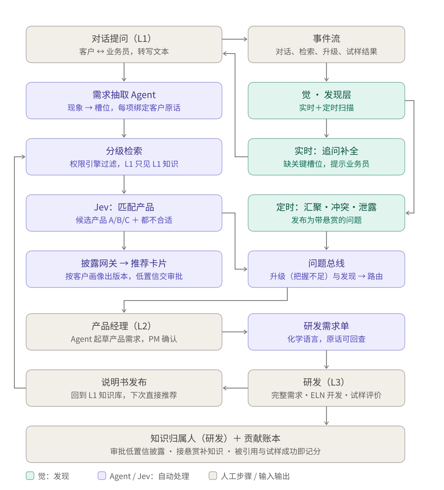
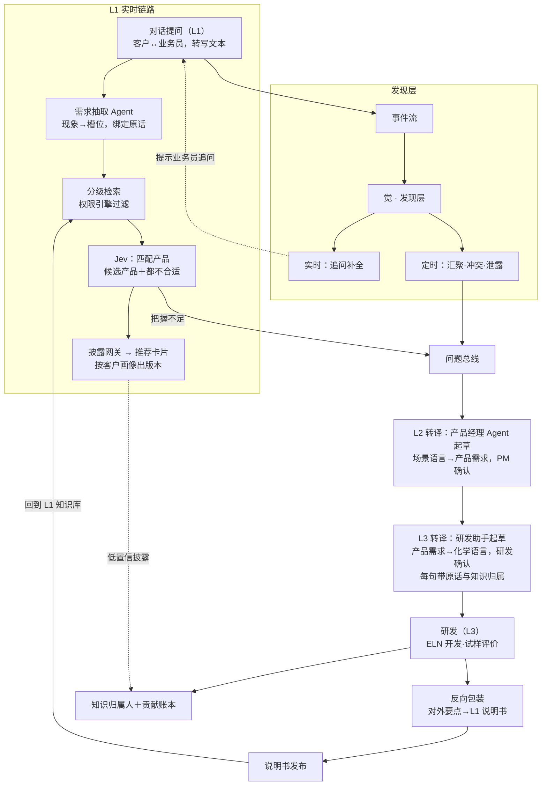

# 化言：系统架构与运行链路

> 版本 v3｜2026-10-11｜配合 `VISION.md` 阅读
> v3：主线明确为**分层转译**（L1 场景需求卡 → L2 产品需求 → L3 化学语言 → 反向包装回 L1），见 2、3、7.2 节；SVG 图未更新，转译细节以 Mermaid 为准。
> v3 补充：每个人配一个**角色助手**（Agent Loop + 原子工具，自然语言驱动，派单主动处理，生效靠委托人确认），见 2、7.5 节与 `CONTRACTS.md` 第 ⑭ 节。
> 本文描述组件、职责和链路。数据格式与模块接口见 `CONTRACTS.md`（已冻结），工作包见 `workpackages/`。

## 0. 总览

读图要点：
- **颜色**：青色是觉的发现，紫色是 Agent 和 Jev 的自动处理，灰色是人工步骤或输入输出。
- **两个回环**：右上是觉发现缺信息后，把业务员拉回对话追问；左侧长线是新产品的说明书回到 L1 知识库，下一位客户在「分级检索」就能直接命中。
- **两种进入问题总线的方式**：Jev 匹配把握不足时被动升级；觉定时扫描时主动发现。两者汇入同一条总线，再路由到对应的人。
- **权限卡在三处**：分级检索、披露网关、研发审批（见第 6 节）。

同一张图的 Mermaid 版本，便于在 GitHub 中直接查看和修改：

## 1. 设计原则

1. **发现与回答分离。** 觉只判断「该不该提问题、提什么」，Jev 只回答已提出的问题，人做最终决定。
2. **安全靠结构，不靠提示词。** 低层级 Agent 的上下文里根本没有高层级内容；模型判断只在硬上限之内起作用。
3. **每一步可回查。** 需求单上的每条要求都能回到客户原话；每次披露、审批、记分都写审计。
4. **系统越用越会。** 每次升级走完，说明书回到 L1、转化对照入库。
5. **简单优先。** 第一版只为演示闭环服务，不做通用平台。

## 2. 分层组件

| 层 | 组件 | 职责 |
|---|---|---|
| **接入层** | 对话转写 | 演示用文本输入；落地时接钉钉听记 |
| | 三视角工作台 | 业务员、产品经理、研发三种界面，外加觉视图 |
| | 研发系统接口 | 模拟 ELN：记录研发开发与试样结果 |
| | 审批入口 | 产品经理确认、研发审批解密 |
| **编排层** | 会话管理 | 一次对话的上下文、参与人身份、客户画像 |
| | **角色助手** | 业务员、产品经理、研发各一个：自研 Agent Loop + 原子工具。人用自然语言指挥，助手自己调用工具；觉和总线的问题、确认后的需求单自动派给下一棒的助手。助手借用委托人权限，有后果的动作只能提议，委托人确认后执行 |
| | 单次调用 Agent | 需求抽取（L1）、L1 问答：单次结构化调用，输入只含本层可见内容 |
| | **转译引擎** | 化言的主体。L2：场景语言 → 产品需求语言（产品经理 Agent，只用 L2 知识）；L3：产品需求 → 化学语言（研发助手，用 L3 转化对照与机理）；反向包装：研发对外要点 → L1 说明书（输入不含任何 L3 内容）。每条输出带客户原话（turn id）与依据的知识（ku id → 归属人）。有零成本的规则模式和大模型模式 |
| | 问题总线 | 接收升级和发现产生的问题，去重、路由、跟踪状态 |
| | 应用门面 | 界面只通过它访问系统；按查看者身份裁剪会话视图 |
| **决策层** | 觉 | 发现层，见第 4 节 |
| | Jev | 决策模型，见第 5 节 |
| | 权限引擎 | 按身份给出硬上限，不可被模型突破 |
| | 披露网关 | 在上限内按 Jev 的选择输出对应版本 |
| **知识层** | 知识单元库 | 每条知识带归属人、密级（L1/L2/L3）、来源 |
| | 案例库 | 历史需求 → 方案 |
| | 转化对照库 | L2 条目：场景说法 → 产品需求说法（产品经理所有）；L3 条目：产品需求说法 → 化学语言（研发所有）。研发在需求单上的修改可沉淀为新条目 |
| | 事件日志 | 全链路事件，可回放，觉的输入 |
| **治理与评测** | 贡献账本 | 知识被引用（推荐卡片、确认后的需求单）、转化知识沉淀、试样成功、说明书发布时给归属人记分 |
| | 审计日志 | 谁在什么时候看到了什么版本 |
| | 评测台 | 模拟客户对照、模拟业务周，见第 8、9 节 |
| | 降级标注 | 结果来自真模型还是降级实现（`scored_by`） |
| **模型层** | 模型网关 | 大模型主/备/桩，带 `caller` 计量 |
| | OneJev | Jev 的推理服务（9B，需 GPU）；不可用时用大模型降级 |
| | 检索 | 关键词（字符二元组）＋现象加分，检索前按权限过滤；Demo 不用向量检索 |
| | 觉打分器 | 原型：模板＋前置条件＋Jev 打分；训练版：Jue-K（一个模型覆盖五类）本地推理 |

## 3. 三层角色与可见性

| 内容 | L1 客户/业务员 | L2 产品经理 | L3 研发 |
|---|---|---|---|
| 产品推荐、用法、产品说明书 | ✓ | ✓ | ✓ |
| 历史案例 | 只看推荐结果 | ✓ | ✓ |
| 场景需求卡（槽位＋原话） | 只看自己的对话 | ✓ | ✓ |
| L2 转化对照、产品需求条目 | ✗ | ✓ | ✓ |
| 研发需求单（化学语言条目） | ✗ | ✓（所引 L3 知识只显示归属人与层级，不显示原文） | ✓ |
| L3 转化对照原文 | ✗ | ✗ | ✓ |
| 客户完整原话＋追问记录 | 只看自己的对话 | ✓ | ✓ |
| 配方、实验记录、机理 | ✗ | ✗ | ✓ |

**解密例外**：客户懂化学时（能说出成因、直接要某类助剂，可以直接讲明白），经该知识归属人（研发）审批，对这一位客户、这一条结论开放完整机理，写入审计。默认权限不变。

## 4. 觉：发现层

### 4.1 职责

判断「此刻是否出现了需要处理的情况、是哪一类、针对谁」，输出概率和紧急度；绝大多数时候输出「没有」。觉**不回答问题、不决定由谁处理、不调用大模型**。概率是校准后的「需要决策的概率」；每次调用的完整状态与输出都记录下来（`jue_samples.jsonl`），上线后用真实处置结果回填标签继续校准。

### 4.2 五类发现

| 模式 | 类型 | 对象 | 发现的情况 | 可观察信号（示例） | 交给谁 |
|---|---|---|---|---|---|
| 实时 | **追问补全** | 会话 × 槽位 | 缺少会改变推荐结果的关键信息 | 已填槽位、缺失槽位、现象类别、候选产品数、对话轮次 | 业务员 |
| 实时 | **回问** | 需求单 × 槽位 | 产品经理 / 研发转译时，客户没说的某个信息会改变转译 | 本层转化对照在该槽位各取值下的命中变化、是否已填 / 答过不清楚 | 原业务员（再问客户） |
| 定时 | **机会汇聚** | 需求主题 | 多个客户的同类需求反复出现却没有对应产品 | 同一槽位组合的升级次数、涉及客户数、匹配失败 | 产品经理 |
| 定时 | **知识冲突** | 知识单元 | 知识之间互相矛盾 | 同一「产品 × 面料」的负面试样比例、与说明书声明不一致 | 知识归属人 |
| 定时 | **泄露风险** | 提问者 | 有人在用多次提问拼凑不该看的内容 | 提问在知识单元上的集中度、被拒的高层级命中次数、提问的变化轨迹 | 主管 |

**为什么需要觉**：其他系统都是「有人问才回答」。单次问答看不出来的东西——多个客户的共性需求、多次提问拼凑出的秘密、一点点累积的知识矛盾——只有持续观察变化才能发现。

### 4.3 运行方式

- **实时**：每来一个对话片段，对该会话评估一次追问补全；需求单在 L2 / L3 起草期间，每次 tick 评估一次回问。
- **定时**：每隔一段业务时间（演示中可加速）扫描一次事件日志，评估三类定时发现。
- 发现结果经发布层变成问题（附证据、悬赏积分），进入问题总线。

### 4.4 实现阶段

| 阶段 | 实现 | 说明 |
|---|---|---|
| 原型 | 问题模板（YAML：类型 × 对象 × 前置条件）＋ Jev 打分；Jev 不可用时只用前置条件 | 复用 JUE 的 `jue_proto` 骨架，五类都先以原型跑通 |
| 训练版 Jue-K | **一个模型覆盖五类**：梯度提升树＋按类型的校准层，本地一次批量推理；紧急度仍用模板规则 | 训练方案见 `JUE_K_TRAINING.md` v3：追问 / 回问用程序轨迹的事后有用性，定时三类用多周模拟业务周的注入窗口 |

原型和训练版对外接口一致，实时与定时都可以替换，运行链路不改。

## 5. Jev：决策模型

### 5.1 职责

给定一个已经提出的问题和选项，输出每个选项的概率。Jev **不发现问题、不做最终决定、不是安全防线**。

### 5.2 三个固定问题

| 问题 | 选项 | 高置信 | 低置信 |
|---|---|---|---|
| 推荐哪个产品？ | 候选产品 A/B/C … ／ 都不合适 | 推荐 | 升级到产品经理 |
| 这份结论以哪个版本披露？ | 只给产品推荐 ／ 产品＋用法 ／ 完整机理（仅在上限允许时可选） | 按选择输出 | 交知识归属人审批 |
| 这个回答是否有知识依据？ | 有依据 ／ 部分有依据 ／ 无依据 | 输出 | 不输出，转人工 |

披露问题的输入包含客户画像：是否懂化学（从对话中判断：说得出成因、直接点名要某类助剂）、是否明确要求了解原理。懂化学不等于刨根问底：不懂化学的客户给包装好的产品方案，懂化学的客户可以直接讲明白（机理仍需研发审批解密）。

### 5.3 运行模式

优先 OneJev；不可用时用大模型降级（复用 JUE 的 `LLMSystem1Fallback`），结果标 `scored_by`，界面可见。

## 6. 权限在三处强制执行

1. **检索时**：权限引擎按请求者层级过滤。L1 Agent 的上下文里没有 L2/L3 内容，所以无从泄露。
2. **知识访问时**：所有知识读取都经过知识库的 `get` / `search`，越权读取直接拒绝，写审计和事件（这些事件是觉「泄露风险」的输入）。
3. **输出时**：披露网关只能在上限之内按 Jev 的选择出版本；Jev 无法突破上限。

已知局限：结构性隔离挡得住前台 Agent 的直接泄露，挡不住有人从大量结论中反推原理。后者由觉的「泄露风险」发现来缓解，不宣称彻底解决。

## 7. 运行链路

### 7.1 L1 实时链路

1. 对话片段到达，写入事件日志；
2. 需求抽取 Agent（L1）把现象描述转成槽位，每个槽位绑定客户原话；
3. 觉评估追问补全：缺关键槽位时提示业务员追问，回到第 1 步；
4. 分级检索：在 L1 知识和案例库中找候选产品；
5. Jev 判断推荐哪个产品；「都不合适」概率高时进入 7.2；
6. Jev 判断披露版本，披露网关在上限内输出推荐卡片；记账、写审计。

### 7.2 升级与回流链路

这是化言的主线：同一份需求，逐层换成下一层能直接用的语言，每一步只用本层能看的知识，每一句都能回到客户原话和知识归属人。

1. 升级的需求（或觉发现的机会汇聚）带着场景需求卡（槽位＋原话）进入问题总线，路由到产品经理；
2. **L2 转译**：产品经理 Agent 用案例与 L2 转化对照，把场景语言转成产品需求语言（如「深一块浅一块 + 气流缸」→「需要在低浴比下仍能保持匀染效果的助剂」），产品经理修改确认；
3. **L3 转译**：研发助手用 L3 转化对照与已有机理，把产品需求转成化学语言（如「对酸性染料有缓染作用、与染料竞争染座的组分；氨纶段亲和力低需控制沾色」），研发修改确认；修改过的条目可**沉淀为该研发自己的转化知识**，下次同类需求直接命中；
4. 需求单确认时，两层所引知识的归属人各记一次「被引用」积分；
5. 研发在模拟 ELN 中记录开发和试样，并写出**对外要点**（研发决定哪些可以出 L3）；
6. **反向包装**：产品经理 Agent 只用产品需求和对外要点生成 L1 说明书与用法，产品经理确认后发布回 L1 知识库；下一位同类客户在 L1 直接命中。

### 7.3 定时发现链路

1. 觉按周期扫描事件日志，评估机会汇聚、知识冲突、泄露风险；
2. 发现的问题进入总线，路由给产品经理、知识归属人或主管；
3. 处置在链路里真实生效：立项进入 7.2；说明书更新后 Jev 不再错误推荐；冻结权限后后续套问被拒。

### 7.4 走查示例（演示主线）

1. 客户：「染完色以后，布面上深一块浅一块怎么办？」
2. 觉：缺面料信息，追问概率高 → 提示业务员问面料。
3. 业务员追问，客户答：「锦纶氨纶混纺。」
4. 检索到两个候选产品；Jev 给出各选项概率，推荐其中把握最高的一个。
5. Jev：客户不懂化学、未要求解密 → 只给「产品＋用法」版本。
6. 若「都不合适」概率最高 → 升级到产品经理；这类升级多了，觉在定时扫描中发现机会汇聚。
7. 产品经理立项：L2 转译得到产品需求，L3 转译得到化学语言需求单；三层对照视图中，同一句客户原话在三列里逐层变成产品语言和化学语言，每句标明依据了哪位研发的哪条转化知识。
8. 研发试样、给出对外要点 → 反向包装 → 发布；下一位客户同样描述，L1 直接推荐新品；贡献看板上研发的引用次数和积分增加。

演示中出现的概率必须来自真实运行，本示例只说明用法。

### 7.5 角色助手：人怎么接入

每个人和自己的助手对话，不点流程按钮：

1. **派单**：觉发现的问题、Jev 升级的需求、上一层确认的需求单、对外要点、解密申请，自动派给下一棒的人的助手；助手先处理（查会话、检索、起草），再用一段话向人汇报；
2. **指挥**：人用自然语言说要改什么、做什么，助手理解意图、调用对应的原子工具；
3. **签字**：确认需求单、沉淀知识、录入试样、给出对外要点、发布、申请与审批解密，助手只能提议，对话里出现确认卡，委托人确认后才执行，并记下确认人。

助手看不到委托人看不到的东西：产品经理的助手检索到 L3 知识时只得到「研发 R01 · L3」，于是在草稿里写「需研发 R01 补充」，这句话随需求单派到研发那里被接住。

## 8. 模拟业务周：验证三类定时发现

只讲概念没有说服力，三类定时发现都要在真实链路里跑一遍、看到后果。

生成一段模拟业务周（数百次对话及其后续事件），在其中**注入**三类情况，并混入**看起来像但不需要处理的困难负样本**。整段事件流照常走真实链路：Agent 真实运行，觉真实打分，问题真实路由，人的操作由界面按钮或模拟人完成。注入清单只在事后评估时使用。

| | 机会汇聚 | 知识冲突 | 泄露风险 |
|---|---|---|---|
| 注入 | 数日内多个不同客户陆续提出同类需求，现有产品都不适用 | 试样评价连续显示某产品在某面料上无效，说明书却写适用 | 某业务员连续多次换角度逼近某产品的配方原理 |
| 困难负样本 | 同类问题出现几次，但都有产品能解决 | 一次偶发的试样失败（设备原因） | 业务员正常地连续询问多个不同产品 |
| 处置后果 | 立项 → 新品说明书发布 → 后续同类客户在 L1 直接匹配 | 说明书更新 → 之后不再错误推荐 | 冻结相关访问 → 后续套问全部被拒 |
| 不处置对照 | 同类客户持续升级，产品经理被重复打扰 | 错误推荐持续，试样继续失败 | 单次越权能拦，拼凑可能已经得逞 |

每一类都在同一段事件流上跑「处置」和「不处置」两个分支，比较后果。第一版只对机会汇聚跑处置分支（处置即走 7.2 的转译与回流），另两类只评测发现。

## 9. 评测台

### 9.1 追问与转译（对应「失真可度量」）

- **需求卡**：每张写清面料、工艺、目标性能、约束等真实需求，作为隐藏答案；
- **模拟客户**：模板模式（种子中的口语说法，零成本）；大模型扮演为可选附加；只用宏观现象描述，被问到才透露对应细节；
- **三组对照**：业务员转述（现状，噪声模型参数为假设并标注）／一次性翻译（不追问、全部转化对照混用）／化言（觉追问＋两步转译＋溯源）；
- **指标**：关键信息完整率、槽位错误率、错译率、追问次数（打扰）、可回查率、需要研发退回重问的比例。

### 9.2 定时发现（对应模拟业务周）

- **三组对照**：规则告警／大模型轮询／觉；
- **指标**：召回与提前量、困难负样本误报、发现阶段大模型调用次数、处置与不处置分支的后果差异。

### 9.3 说明

模拟客户和模拟业务周是受控实验，验证机制和相对效果，不代表真实业务效果；对外如实标注。

## 10. 核心概念与数据格式

全部定义在 `CONTRACTS.md`：

| 概念 | 契约章节 |
|---|---|
| 槽位、现象、产品等种子 | ① |
| 知识单元、披露版本、推荐卡片、审计、积分 | ② |
| 会话、需求槽位（含原话引用）、追问提示 | ③ |
| Jev 三个问题与输入格式 | ④ |
| 觉的对象、属性表、模板、输出 | ⑤ |
| 问题对象与问题总线 | ⑥ |
| 需求单、试样 | ⑦ |
| 事件日志与 payload | ⑧ |
| 需求卡、业务周剧本、注入清单 | ⑨ |
| 应用门面 | ⑫ |

槽位第一版为 7 个：面料成分、染料类型、染色工艺、设备、染浴 pH、水质、限制条件（以企业数据为准调整，代码不写死槽位）。

## 11. 与 JUE 赛前代码的复用

只复制可以原样使用的部分，其余按化言的需要重写，避免把物流场景的结构带进来：

| 化言组件 | 来源 | 处理 |
|---|---|---|
| 模型网关（含录制/回放缓存） | `gateway/` | 复制，只改 import |
| OneJev 客户端、大模型降级 | `system1/onejev.py` | 复制，只改 import |
| 计量、时钟、表达式求值器 | `meter.py`、`clock.py`、`discovery/expr.py` | 复制，按契约做小改 |
| 觉原型 | `qmodel/proto` 的思路 | 重写：对象换成槽位、主题、知识、提问者 |
| 问题总线 | `bus/` 的思路 | 重写，约百行：合并、抑制、路由 |
| Agent loop、工具注册表 | `agent/__init__.py`、`tools/__init__.py` | 改写：去掉派生与钩子，工具换成化言的原子工具，增加确认卡与派单 |
| 问题网络 | — | 不复用 |
| 全新 | — | 知识库、权限、披露、积分、抽取、升级回流、模拟客户、模拟业务周、Jue-K、界面 |

复制的文件头注明来源；README 中列出。物流版模板与模型权重不复制。

## 12. 运行模式与降级

| 组件 | 正常 | 降级 | 标注 |
|---|---|---|---|
| Jev | OneJev | 大模型降级 | `scored_by` |
| 觉 | Jue-K（五类） | 原型（规则打分） | `scored_by` |
| 角色 Agent | 网关主模型 | 备用模型 | 计量中记录 |
| 演示数据 | 现场新运行 | 真实运行记录回放 | 界面标明模式 |

## 13. 待定事项

1. OneJev 是否开启（需租 GPU，费用待授权）；
2. 企业数据（现象 × 必问信息、产品适用表等）到位时间；未到位前用大模型生成的占位种子，并标注；
3. 产品经理的转述由 Agent 起草还是本人撰写；研发「看到完整需求」是否包括原始对话全文；
4. 提交作品知识产权归主办方：确定复用 JUE 的哪些模块进入提交仓库；
5. 演示界面：Vite + React（已定，视觉沿用 JUE wp/e 决策台）；`src/huayan/ui/server.py` 用标准库 HTTP 服务把门面暴露为 JSON 接口。
