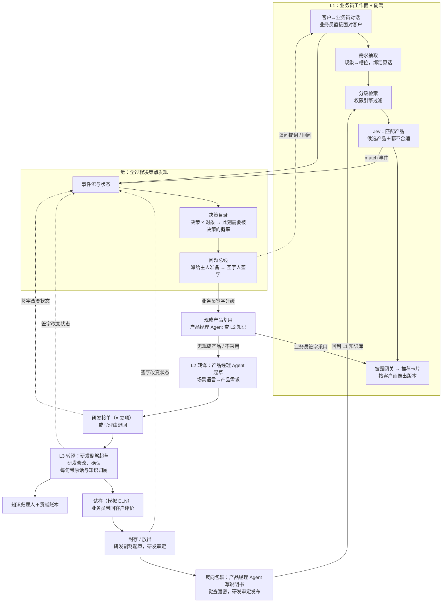

# 化言：系统架构与运行链路

> 版本 v4｜2026-10-11｜配合 `VISION.md` 阅读
> v4（依据 `workpackages/REPLAN-v5.md`，本文描述目标形态，WP-J / WP-C / WP-U2 实现前代码仍是 v3 行为）：
> - 觉是**全过程的决策点发现器**，流程由「觉提出决策 → 主人准备 → 签字人签字 → 状态改变 → 觉再看」推动，门面和派单里不写死推进（第 1、4、7 节）；
> - 产品经理由**产品经理 Agent**（`pm:agent`）担任，研发接单（= 立项）是 L2 的生效点，研发审定发布（第 2、3、7.2 节）；
> - 业务员和研发以**「工作面 + 副驾」**工作，按钮就是签字（第 7.5 节）。
> v3：主线为**分层转译**（L1 场景需求卡 → L2 产品需求 → L3 化学语言 → 反向包装回 L1）。SVG 图未更新，以 Mermaid 为准。
> 本文描述组件、职责和链路。数据格式与模块接口见 `CONTRACTS.md`（已冻结），工作包见 `workpackages/`。

## 0. 总览

读图要点：
- **颜色**：青色是觉的发现，紫色是 Agent 和 Jev 的自动处理，灰色是人工步骤或输入输出。
- **两个回环**：右上是觉发现缺信息后，把业务员拉回对话追问；左侧长线是新产品的说明书回到 L1 知识库，下一位客户在「分级检索」就能直接命中。
- **只有一种进入问题总线的方式**：觉提出。实时部分在每次状态改变后评估，定时部分按业务时间扫描；Jev 的匹配概率只是觉判断「是否升级」的信号（`match` 事件），不再直接升级。
- **每一次签字都改变状态、回到事件流**，觉再评估下一步；图中的推进箭头都经过「觉提出 → 签字」。
- **权限卡在三处**：分级检索、披露网关、研发审批（见第 6 节）。

同一张图的 Mermaid 版本，便于在 GitHub 中直接查看和修改：

## 1. 设计原则

1. **发现与回答分离。** 觉只判断「该不该提问题、提什么」，Jev 只回答已提出的问题，人做最终决定。
2. **安全靠结构，不靠提示词。** 低层级 Agent 的上下文里根本没有高层级内容；模型判断只在硬上限之内起作用。
3. **每一步可回查。** 需求单上的每条要求都能回到客户原话；每次披露、审批、记分都写审计。
4. **系统越用越会。** 每次升级走完，说明书回到 L1、转化对照入库。
5. **简单优先。** 第一版只为演示闭环服务，不做通用平台。
6. **流程由觉提出的决策推动。** 门面只有原子方法与权限校验，派单只派总线上的问题；「下一步该谁决定什么」写在决策目录里，不写死在代码里。
7. **助手生产内容，人判断和签字。** 人说意图，不说正文；副驾把草稿写进工作对象，人按按钮签字。

## 2. 分层组件

| 层 | 组件 | 职责 |
|---|---|---|
| **接入层** | 对话转写 | 演示用文本输入；落地时接钉钉听记 |
| | 两个工作面 | 业务员（面对客户的对话流）、研发（需求单）：工作面在中间，副驾在右侧；另有觉视图、三层对照、评测页。没有产品经理工作台 |
| | 研发系统接口 | 模拟 ELN：录入试样结果（不算人的决策） |
| | 签字 | 工作面上的按钮即签字，调门面原子方法并记下签字人。业务员：发给客户、升级、客户评价、申请解密；研发：接单 / 退回、确认转译、沉淀、封存 / 放出、发布、审批解密 |
| **编排层** | 会话管理 | 一次对话的上下文、参与人身份、客户画像 |
| | **副驾与产品经理 Agent** | 自研 Agent Loop + 原子工具。业务员、研发各一个副驾：被派到觉的决策时准备草稿，写进工作对象，带「副驾起草」标记；私聊用于开放式请求与查询。产品经理 Agent（`pm:agent`，L2 权限）没有委托人、没有生效工具、不记积分。助手借用委托人权限，只能起草和提议 |
| | 单次调用 Agent | 需求抽取（L1）、L1 问答：单次结构化调用，输入只含本层可见内容 |
| | **转译引擎** | 化言的主体。L2：场景语言 → 产品需求语言（产品经理 Agent，只用 L2 知识）；L3：产品需求 → 化学语言（研发助手，用 L3 转化对照与机理）；反向包装：研发对外要点 → L1 说明书（输入不含任何 L3 内容）。每条输出带客户原话（turn id）与依据的知识（ku id → 归属人）。有零成本的规则模式和大模型模式 |
| | 问题总线 | 接收觉提出的问题，去重、按模板的主人 / 签字人路由，跟踪「准备 → 待签 → 处置」 |
| | 应用门面 | 界面只通过它访问系统；按查看者身份裁剪视图；只有原子方法与权限校验，每个改状态的方法结束时触发觉的写后评估 |
| **决策层** | 觉 | 发现层，见第 4 节 |
| | Jev | 决策模型，见第 5 节 |
| | 权限引擎 | 按身份给出硬上限，不可被模型突破 |
| | 披露网关 | 在上限内按 Jev 的选择输出对应版本 |
| **知识层** | 知识单元库 | 每条知识带归属人、密级（L1/L2/L3）、来源 |
| | 案例库 | 历史需求 → 方案 |
| | 转化对照库 | L2 条目：场景说法 → 产品需求说法（产品经理历史积累，归属本人，产品经理 Agent 引用时照常记分）；L3 条目：产品需求说法 → 化学语言（研发所有）。研发在需求单上的修改可沉淀为新条目；本次 L2 条目不增长 |
| | 事件日志 | 全链路事件，可回放，觉的输入 |
| **治理与评测** | 贡献账本 | 知识被引用（推荐卡片；研发接单时记所引 L2 知识，确认转译时记所引 L3 知识）、转化知识沉淀、试样成功、说明书发布时给归属人记分；只给人记分 |
| | 审计日志 | 谁在什么时候看到了什么版本 |
| | 评测台 | 模拟客户对照、模拟业务周，见第 8、9 节 |
| | 降级标注 | 结果来自真模型还是降级实现（`scored_by`） |
| **模型层** | 模型网关 | 大模型主/备/桩，带 `caller` 计量 |
| | OneJev | Jev 的推理服务（9B，需 GPU）；不可用时用大模型降级 |
| | 检索 | 关键词（字符二元组）＋现象加分，检索前按权限过滤；Demo 不用向量检索 |
| | 觉打分器 | 原型：模板＋前置条件＋规则或 OneJev 打分；训练版：Jue-K（追问、回问、机会汇聚、知识冲突、泄露风险）本地推理；新增的推进类与异常类决策先用规则打分 |

## 3. 三层角色与可见性

| 内容 | L1 客户/业务员 | L2 产品经理 Agent | L3 研发 |
|---|---|---|---|
| 产品推荐、用法、产品说明书 | ✓ | ✓ | ✓ |
| 历史案例 | 只看推荐结果 | ✓ | ✓ |
| 场景需求卡（槽位＋原话） | 只看自己的对话 | ✓ | ✓ |
| L2 转化对照、产品需求条目 | ✗ | ✓ | ✓ |
| 研发需求单（化学语言条目） | ✗ | ✓（所引 L3 知识只显示归属人与层级，不显示原文） | ✓ |
| L3 转化对照原文 | ✗ | ✗ | ✓ |
| 客户完整原话＋追问记录 | 只看自己的对话 | ✓ | ✓ |
| 配方、实验记录、机理 | ✗ | ✗ | ✓ |
| 封存项（研发决定不放出的窗户纸） | ✗ | ✗ | ✓ |
**解密例外**：客户懂化学时（能说出成因、直接要某类助剂，可以直接讲明白），经该知识归属人（研发）审批，对这一位客户、这一条结论开放完整机理，写入审计。默认权限不变。

## 4. 觉：全过程的决策点发现器

### 4.1 职责

- **输入**：整个过程的状态——会话、需求单（各层条目、草稿、修改、回问、退回、签字情况）、对外文本、试样与客户评价、产品、检索行为。对象属性只放计数与状态，不放文本。
- **输出**：每个时刻对决策目录里每个「决策 × 对象」给出「此刻需要被决策」的概率，超过阈值即提出问题；绝大多数时候接近 0。
- **不做的**：不回答问题（准备答案的是产品经理 Agent 与副驾，推荐与披露的概率由 Jev 给出）、不调用大模型、不签字。**觉不临时决定由谁处理**：每个决策的主人（谁准备）与签字人由决策目录（模板）写定。
- 每次判断的完整状态与输出都记录下来（`JueRecord`，`jue_samples.jsonl`），问题的处置与之关联，成为标签。

### 4.2 决策目录

模板 = 决策 × 对象类型 × 前置条件 × 打分 × 主人 × 签字人，放在 `config/templates/`。分两类：**推进类**（流程往前走需要有人决定）与**异常类**（出了需要处理的情况）。完整表格（含前置条件与阶段状态）见 `workpackages/REPLAN-v5.md` 第 4.3 节。

| 决策 | 类 | 对象 | 主人（准备） | 签字 | 打分 |
|---|---|---|---|---|---|
| 追问 `ask_slot` | 推进 | 会话 × 槽位 | — | —（提词） | Jue-K |
| 是否转产品经理 Agent `escalate_need` | 推进 | 会话 | 业务员副驾（升级说明） | 业务员 | 规则（信号来自 Jev 的 `match`） |
| 现成产品复用 `reuse_product` | 推进 | 需求单 | 产品经理 Agent（查 L2 知识） | 业务员（采用 / 不采用） | 规则 |
| 机会汇聚 `opportunity` | 推进 | 主题 | 产品经理 Agent | 经「接单」生效 | Jue-K |
| 研发是否接单 `accept_requirement` | 推进 | 需求单 | 产品经理 Agent（起草 L2） | 研发（接受 / 退回） | 规则 |
| 回问 `ask_back` | 推进 | 需求单 × 槽位 | 业务员副驾（话术） | —（提示） | 规则 |
| 转译失真 `distortion` | 异常 | 需求单 | 该层起草者 | 研发 | 规则 |
| 转译可以确认了吗 `confirm_translation` | 推进 | 需求单 | 研发副驾（起草 L3） | 研发 | 规则 |
| 沉淀 `contribution` | 推进 | 需求单 | 研发副驾（提炼） | 研发 | 规则 |
| 客户评价 `market_eval` | 推进 | 需求单 | 业务员副驾 | 业务员 | 规则 |
| 封存 / 放出 `seal_points` | 推进 | 需求单 | 研发副驾（两栏草稿） | 研发 | 规则 |
| 对外泄密 `seal_leak` | 异常 | 需求单 | 研发副驾（改写） | 研发 | 规则 |
| 能不能发布 `release` | 推进 | 需求单 | 产品经理 Agent（说明书） | 研发 | 规则 |
| 知识冲突 `knowledge_conflict` | 异常 | 产品 × 条件 | 知识归属人副驾 | 知识归属人 | Jue-K |
| 解密 `decrypt_request` | 推进 | 会话 | 研发副驾 | 归属研发 | 人工发起 |
| 拼凑 `leak_risk` | 异常 | 提问者 | — | 主管 | Jue-K |

决策目录不属于冻结契约：`Family` 是由已加载模板校验的字符串，新增决策点 = 人批准后新增一个模板文件。

**为什么需要觉**：其他系统都是「有人问才回答」，流程靠写死的状态机推进。化言里「下一步该谁决定什么」本身就是觉的判断：推进的时刻、单次问答看不出来的东西（多个客户的共性需求、多次提问拼凑出的秘密、一点点累积的知识矛盾、转述中丢掉的约束），都由同一个发现器持续观察、提出。

### 4.3 运行方式

- **统一循环**：状态变化 → 觉评估受影响的「决策 × 对象」→ 提出问题（总线）→ 派给主人准备 → 签字人在工作面上签字 → 门面原子方法改状态 → 状态变化。
- **两个阶段**：问题先派给主人**准备**；主人的 Agent Loop 结束后由 hub 调用门面 `mark_prepared`（离线时在规则骨架起草后调用），问题进入签字人收件箱**待签**。前置条件写「上一步已签字、本步未签」；「无未答回问、无未处理失真」之类是可签条件，不满足时按钮不可签。
- **写后增量评估**：门面每个改状态的方法结束时，对受影响的组合评估一次；不依赖界面接口。
- **定时**：主题、产品 × 条件、提问者等对象每隔一段业务时间（演示中可加速）评估一次。
- **异常类自动关闭**：前置条件不再成立时（例如说明书已改写），门面以 `answered` 关闭，处置记入 JueRecord。
- **追问**保持提示通道：每轮发言给业务员的提词，不进总线，同样写 JueRecord、进觉视图。
- `huayan/jue/` 不 import 网关；文本类信号（泄密、失真）用规则匹配算计数。

### 4.4 实现阶段

| 阶段 | 实现 | 说明 |
|---|---|---|
| 原型 | 模板（YAML）＋前置条件＋规则或 OneJev 打分 | 复用 JUE 的 `jue_proto` 骨架；所有决策都能以原型运行 |
| 训练版 Jue-K | 梯度提升树＋按决策分别校准，本地一次批量推理；紧急度用模板规则 | 覆盖追问、回问、机会汇聚、知识冲突、泄露风险，训练方案见 `JUE_K_TRAINING.md` |
| 新决策 | 推进类与失真、泄密先用规则打分，界面标 `scored_by: rule`，显示为「到点」 | 有了带处置的样本后再进入 Jue-K 训练 |

原型和训练版对外接口一致，可以逐个决策替换，运行链路不改。

**如实说明**：推进类决策由规则打分，到点即提出，没有学习成分，不说「概率」；回问的 Jue-K 只学到基率，实际由规则前置条件驱动；Jue-K 的价值在时机和必要性不确定的决策上（追问、机会汇聚、拼凑）。

### 4.5 数据飞轮

| 飞轮 | 输入 | 产出 | 本次 | 后期 |
|---|---|---|---|---|
| 知识 | 每一次升级、研发的每一次修改 | 经研发确认的转化知识；新品回到 L1 | 沉淀由觉提出、副驾提炼、研发审定 | L2 知识的增长 |
| 判断 | JueRecord ＋ 人的处置 | 校准概率、按代价定阈值、重训 Jue-K | 记录完整；按模板统计被忽略率 | 真实处置回填、在线校准 |
| 决策目录 | 被忽略的问题（提多了）；人自发决策（漏了：执行生效动作时同一对象上没有对应问题） | 已有决策点的调整；候选的新决策点 | 只记录（动作、对象、当时的属性快照） | 本地聚类、浅层决策树学出候选前置条件，生成候选模板，主管批准后加入目录；目录的结构性变化总是人签字 |

不在模拟业务周上演示「挖掘新决策点」：模拟周由脚本生成，挖出来的只会是脚本本身。

## 5. Jev：决策模型

### 5.1 职责

给定一个已经提出的问题和选项，输出每个选项的概率。Jev **不发现问题、不做最终决定、不是安全防线**。

### 5.2 三个固定问题

| 问题 | 选项 | 高置信 | 低置信 |
|---|---|---|---|
| 推荐哪个产品？ | 候选产品 A/B/C … ／ 都不合适 | 推荐 | 写入 `match` 事件，作为觉「是否转产品经理 Agent」的信号；由业务员签字升级 |
| 这份结论以哪个版本披露？ | 只给产品推荐 ／ 产品＋用法 ／ 完整机理（仅在上限允许时可选） | 按选择输出 | 交知识归属人审批 |
| 这个回答是否有知识依据？ | 有依据 ／ 部分有依据 ／ 无依据 | 输出 | 不输出，转人工 |

披露问题的输入包含客户画像：是否懂化学（从对话中判断：说得出成因、直接点名要某类助剂）、是否明确要求了解原理。懂化学不等于刨根问底：不懂化学的客户给包装好的产品方案，懂化学的客户可以直接讲明白（机理仍需研发审批解密）。

### 5.3 运行模式

优先 OneJev；不可用时用大模型降级（复用 JUE 的 `LLMSystem1Fallback`），结果标 `scored_by`，界面可见。

## 6. 权限在三处强制执行

1. **检索时**：权限引擎按请求者层级过滤。L1 Agent 的上下文里没有 L2/L3 内容，所以无从泄露。
2. **知识访问时**：所有知识读取都经过知识库的 `get` / `search`，越权读取直接拒绝，写审计和事件（这些事件是觉「泄露风险」的输入）。
3. **输出时**：披露网关只能在上限之内按 Jev 的选择出版本；Jev 无法突破上限。

已知局限：结构性隔离挡得住前台 Agent 的直接泄露，挡不住有人从大量结论中反推原理。后者由觉的「泄露风险」发现来缓解，不宣称彻底解决。

## 7. 运行链路

### 7.1 L1 实时链路

1. 对话片段到达，写入事件日志；
2. 需求抽取 Agent（L1）把现象描述转成槽位，每个槽位绑定客户原话；
3. 觉评估追问补全：缺关键槽位时提示业务员追问，回到第 1 步；
4. 分级检索：在 L1 知识和案例库中找候选产品；
5. Jev 给出各选项概率，写入 `match` 事件；「都不合适」概率最高时，觉提出「是否转产品经理 Agent」，业务员副驾起草升级说明，业务员签字后进入 7.2；
6. Jev 判断披露版本，披露网关在上限内输出推荐卡片；记账、写审计。

### 7.2 升级与回流链路

这是化言的主线：同一份需求，逐层换成下一层能直接用的语言，每一步只用本层能看的知识，每一句都能回到客户原话和知识归属人。

每一步都是「觉提出 → 主人准备 → 签字人签字」，下面只写主人与签字人。

1. **升级**：业务员签字升级（或机会汇聚发布）时，门面创建一张空需求单（`status=draft`，带场景需求卡与客户原话）；
1′. **现成产品复用**：觉先提出「是否有现成产品可用」，产品经理 Agent 用历史案例与 L2 转化对照查现成产品（L1 只按说明书的适用表匹配，L2 能看到「说明书没写、但案例里用过」的方案）。找到则起草建议：产品、用法、一句面向客户的说明、知识归属；业务员签字采用后推荐卡给客户，需求单关闭（`reused`），所引案例的归属人记分，研发不介入。没找到或业务员不采用，觉再对这张单提出「研发是否接单」，准备阶段派给产品经理 Agent；
2. **L2 转译与接单**：产品经理 Agent 用案例与 L2 转化对照，把场景语言转成产品需求语言（如「深一块浅一块 + 气流缸」→「需要在低浴比下仍能保持匀染效果的助剂」）；研发**接单**（= 立项，所引 L2 知识的归属人记分）或写理由退回，退回后产品经理 Agent 修改、觉再次提出；
3. **L3 转译与确认**：研发副驾用 L3 转化对照与已有机理，把产品需求转成化学语言（如「对酸性染料有缓染作用、与染料竞争染座的组分；氨纶段亲和力低需控制沾色」），研发修改、确认（所引 L3 知识的归属人记分）。起草中客户没说的信息会改变本层转译时，觉提出**回问**，业务员回头问客户，答复回填需求单；上一层的约束本层没有承接时，觉提出**转译失真**；
4. **沉淀**：研发改过、未被已有转化对照覆盖的条目，觉提出「沉淀」；研发副驾提炼（泛化、去掉这位客户的特定信息、指出与已有知识相近或冲突之处），研发审定后**沉淀为自己的转化知识**；
5. **试样与客户评价**：试样结果从模拟 ELN 录入；试样通过后觉提出「客户评价」，业务员把样品交给客户，带回评价并签字录入；
6. **封存 / 放出**：客户评价通过后，研发副驾起草两栏并做泄露自查，研发审定哪些窗户纸封存（只对 L3 可见）、哪些作为**对外要点**放出；
7. **反向包装与发布**：产品经理 Agent 只用产品需求和对外要点写 L1 说明书与用法；说明书命中封存项、L3 关键术语或 L3 方向时觉提出「对外泄密」，研发副驾改写；研发审定后发布回 L1 知识库，下一位同类客户在 L1 直接命中。

### 7.3 定时发现链路

1. 觉按周期扫描事件日志，评估机会汇聚、知识冲突、泄露风险；
2. 发现的问题进入总线，按模板路由给主人与签字人（机会汇聚 → 产品经理 Agent 准备、研发接单；知识冲突 → 知识归属人；泄露风险 → 主管）；
3. 处置在链路里真实生效：机会汇聚发布为需求单进入 7.2，研发接单即立项；说明书更新后 Jev 不再错误推荐；冻结权限后后续套问被拒。

### 7.4 走查示例（演示主线）

1. 客户：「染完色以后，布面上深一块浅一块怎么办？」
2. 觉：缺面料信息，追问概率高 → 提示业务员问面料。
3. 业务员追问，客户答：「锦纶氨纶混纺。」
4. 检索到两个候选产品；Jev 给出各选项概率，推荐其中把握最高的一个。
5. Jev：客户不懂化学、未要求解密 → 只给「产品＋用法」版本。
6. 若「都不合适」概率最高 → 觉提出「是否转产品经理 Agent」，业务员签字升级；这类升级多了，觉在定时扫描中发现机会汇聚。
7. 产品经理 Agent 起草产品需求，研发接单（立项）；研发副驾起草化学语言需求单，觉发现缺染浴 pH、提出回问，业务员回头问到后研发确认；三层对照视图中，同一句客户原话在三列里逐层变成产品语言和化学语言，每句标明依据了哪位研发的哪条转化知识。
8. 研发试样 → 业务员带回客户评价 → 研发审定封存 / 放出 → 产品经理 Agent 包装说明书 → 研发审定发布；下一位客户同样描述，L1 直接推荐新品；贡献看板上研发的引用次数和积分增加；觉视图上能看到整条线程每个决策的提出、准备、签字。

演示中出现的概率必须来自真实运行，本示例只说明用法。

### 7.5 工作面 + 副驾：人怎么接入

1. **工作面在中间**：人直接在自己的工作对象上干活。业务员直接和客户对话，客户的话是材料，不经过副驾转述；研发直接在需求单上改条目。
2. **副驾准备**：觉的问题派给主人；副驾（或产品经理 Agent）查会话、检索、起草，把草稿写在工作面上对应的位置，带「副驾起草」标记：回复草稿预填进发送框，升级说明、L3 条目、封存 / 放出两栏、说明书就地出现，可直接修改；觉的批注挂在它说的那个条目上。
3. **按钮就是签字**：人看内容、修改，按按钮；按钮调门面原子方法并记下签字人。收件箱区分「准备中」与「待签」。
4. **私聊**：开放式请求与查询（「LV205 能用在气流缸吗？」），默认折叠，不会发给客户；私聊里副驾的提议以确认卡出现，签字仍回到工作面。
5. **产品经理 Agent 没有工作台**：它的产出在研发工作面、三层对照页和觉视图上可见。

助手看不到委托人看不到的东西：产品经理 Agent 检索到 L3 知识时只得到「研发 R01 · L3」，于是在草稿里写「需研发 R01 补充」，这句话随需求单到研发那里被接住；对外泄密命中时，它只收到「第 n 句需研发处理」，拿不到封存内容。

## 8. 模拟业务周：验证三类定时发现

只讲概念没有说服力，三类定时发现都要在真实链路里跑一遍、看到后果。

生成一段模拟业务周（数百次对话及其后续事件），在其中**注入**三类情况，并混入**看起来像但不需要处理的困难负样本**。整段事件流照常走真实链路：Agent 真实运行，觉真实打分，问题真实路由，人的操作由界面按钮或模拟人完成。注入清单只在事后评估时使用。

| | 机会汇聚 | 知识冲突 | 泄露风险 |
|---|---|---|---|
| 注入 | 数日内多个不同客户陆续提出同类需求，现有产品都不适用 | 试样评价连续显示某产品在某面料上无效，说明书却写适用 | 某业务员连续多次换角度逼近某产品的配方原理 |
| 困难负样本 | 同类问题出现几次，但都有产品能解决 | 一次偶发的试样失败（设备原因） | 业务员正常地连续询问多个不同产品 |
| 处置后果 | 研发接单（立项）→ 新品说明书发布 → 后续同类客户在 L1 直接匹配 | 说明书更新 → 之后不再错误推荐 | 冻结相关访问 → 后续套问全部被拒 |
| 不处置对照 | 同类客户持续升级，研发被重复派单 | 错误推荐持续，试样继续失败 | 单次越权能拦，拼凑可能已经得逞 |

每一类都在同一段事件流上跑「处置」和「不处置」两个分支，比较后果。第一版只对机会汇聚跑处置分支（处置即走 7.2 的转译与回流），另两类只评测发现。

## 9. 评测台

### 9.1 追问与转译（对应「失真可度量」）

- **需求卡**：每张写清面料、工艺、目标性能、约束等真实需求，作为隐藏答案；
- **模拟客户**：模板模式（种子中的口语说法，零成本）；大模型扮演为可选附加；只用宏观现象描述，被问到才透露对应细节；
- **三组对照**：业务员转述（现状，噪声模型参数为假设并标注）／一次性翻译（不追问、全部转化对照混用）／化言（觉追问＋两步转译＋溯源）；
- **指标**：关键信息完整率、槽位错误率、错译率、追问次数（打扰）、可回查率、需要研发退回重问的比例。

### 9.2 定时发现（对应模拟业务周）

- **三组对照**：规则告警／大模型轮询／觉；
- **指标**：召回与提前量、困难负样本误报、发现阶段大模型调用次数、处置与不处置分支的后果差异。

### 9.3 说明

模拟客户和模拟业务周是受控实验，验证机制和相对效果，不代表真实业务效果；对外如实标注。

## 10. 核心概念与数据格式

全部定义在 `CONTRACTS.md`：

| 概念 | 契约章节 |
|---|---|
| 槽位、现象、产品等种子 | ① |
| 知识单元、披露版本、推荐卡片、审计、积分 | ② |
| 会话、需求槽位（含原话引用）、追问提示 | ③ |
| Jev 三个问题与输入格式 | ④ |
| 觉的对象、属性表、模板、输出 | ⑤ |
| 问题对象与问题总线 | ⑥ |
| 需求单、试样 | ⑦ |
| 事件日志与 payload | ⑧ |
| 需求卡、业务周剧本、注入清单 | ⑨ |
| 应用门面 | ⑫ |

槽位第一版为 7 个：面料成分、染料类型、染色工艺、设备、染浴 pH、水质、限制条件（以企业数据为准调整，代码不写死槽位）。

## 11. 与 JUE 赛前代码的复用

只复制可以原样使用的部分，其余按化言的需要重写，避免把物流场景的结构带进来：

| 化言组件 | 来源 | 处理 |
|---|---|---|
| 模型网关（含录制/回放缓存） | `gateway/` | 复制，只改 import |
| OneJev 客户端、大模型降级 | `system1/onejev.py` | 复制，只改 import |
| 计量、时钟、表达式求值器 | `meter.py`、`clock.py`、`discovery/expr.py` | 复制，按契约做小改 |
| 觉原型 | `qmodel/proto` 的思路 | 重写：对象换成槽位、主题、知识、提问者 |
| 问题总线 | `bus/` 的思路 | 重写，约百行：合并、抑制、路由 |
| Agent loop、工具注册表 | `agent/__init__.py`、`tools/__init__.py` | 改写：去掉派生与钩子，工具换成化言的原子工具，增加确认卡与派单 |
| 问题网络 | — | 不复用 |
| 全新 | — | 知识库、权限、披露、积分、抽取、升级回流、模拟客户、模拟业务周、Jue-K、界面 |

复制的文件头注明来源；README 中列出。物流版模板与模型权重不复制。

## 12. 运行模式与降级

| 组件 | 正常 | 降级 | 标注 |
|---|---|---|---|
| Jev | OneJev | 大模型降级 | `scored_by` |
| 觉 | Jue-K（追问、回问、机会汇聚、知识冲突、泄露风险）；其余决策规则打分 | 原型（规则打分） | `scored_by` |
| 角色 Agent | 网关主模型 | 备用模型 | 计量中记录 |
| 演示数据 | 现场新运行 | 真实运行记录回放 | 界面标明模式 |

## 13. 待定事项

1. OneJev 是否开启（需租 GPU，费用待授权）；
2. 企业数据（现象 × 必问信息、产品适用表等）到位时间；未到位前用大模型生成的占位种子，并标注；
3. ~~产品经理的转述由 Agent 起草还是本人撰写~~（v4 取舍：由产品经理 Agent 起草）；研发「看到完整需求」是否包括原始对话全文；
4. 提交作品知识产权归主办方：确定复用 JUE 的哪些模块进入提交仓库；
5. 演示界面：Vite + React（已定，视觉沿用 JUE wp/e 决策台）；`src/huayan/ui/server.py` 用标准库 HTTP 服务把门面暴露为 JSON 接口。
