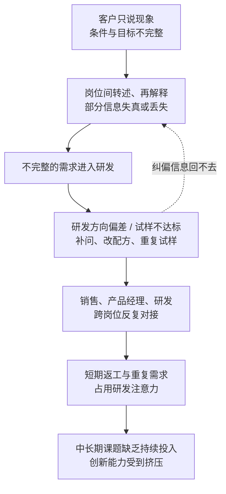
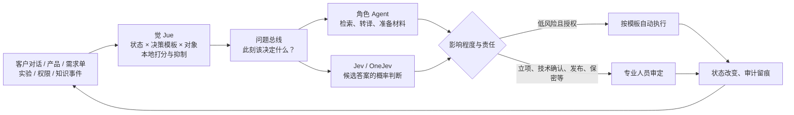
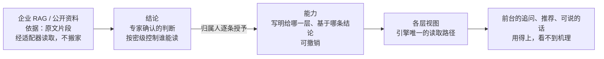
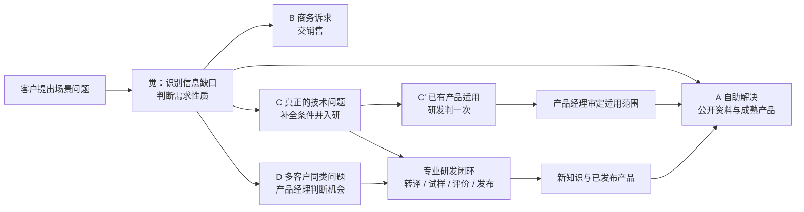
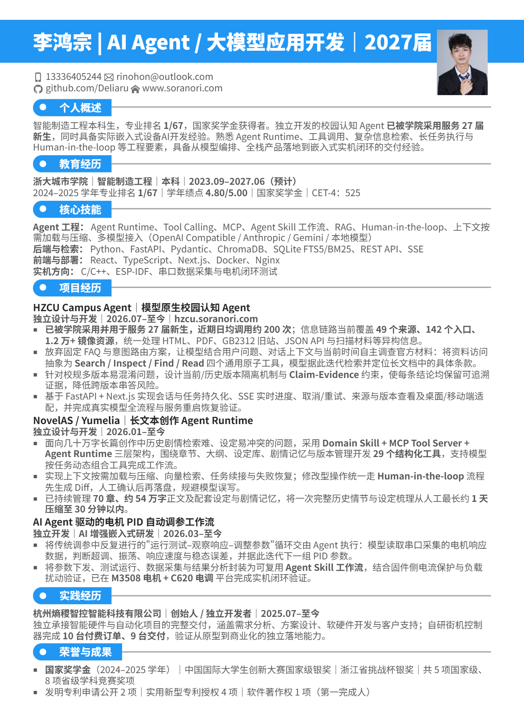
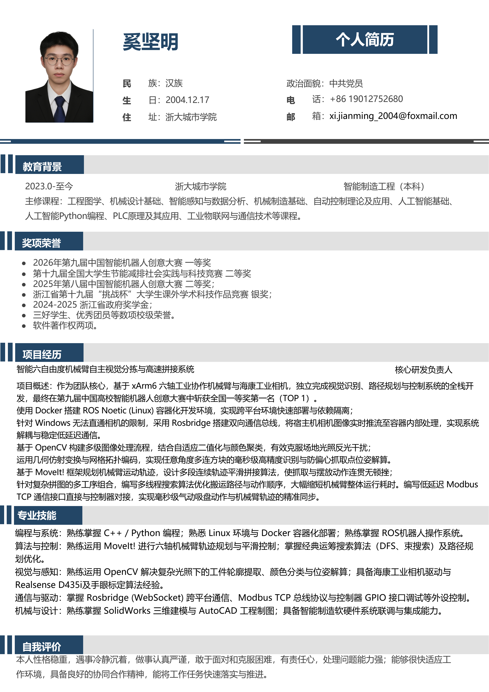

# 化言 HuaYan｜问对的人，只问一次：觉与契驱动的企业判断与研发协同架构

> **问对的人，只问一次。传声不走样，让判断有来处，让创新有余力。**  
> AI＋功能化学赛道 · 方案价值说明（按五项评审标准组织：技术可行性、技术创新、业务价值、工程化能力、企业落地）  
> 决赛版本新增能力层「契」：设计已定稿，正在实现。文中凡涉及契的内容都标注现状，以 [`docs/VISION.md`](VISION.md) 1.2 节的证据表为验收标准。

---

## 一页速读｜我们不只让 AI 解答问题，更让企业知道什么问题值得解决

**功能化学事业部真正稀缺的，不只是配方和数据，更是专业人员持续创造新产品的能力。**

一个下游客户说「染完布面深一块浅一块」，背后可能有面料、染料、设备、工艺乃至验收目标等多种约束。客户说的是现象，销售理解的是产品，产品经理考虑的是市场与产品定义，研发必须面对具体的化学与工程条件。如果信息没有在源头问清，经过数轮转述后就仓促开发，结果可能是试样不达标、配方反复修改、跨部门持续返工。

> 「我们就是因为需求不明确，产品开发了不达标一直返工，才没有精力做中长期课题。」  
> ——基于功能化学一线业务需求交流

**这不是一条消息传得慢的问题，而是企业最宝贵的研发注意力，被本可更早发现、消除或复用的决策问题持续消耗。**

化言给出的回答不是再增加一个化学问答机器人、再造一个 RAG，也不是把销售—产品经理—研发的线下审批照搬到线上。化言按赛题要求构建了**专业需求理解、知识检索融合、方案辅助生成、研发转译、试样验证、知识沉淀与新品回流**的完整专业研发闭环；并基于一线业务需求交流，让这套闭环具备**按需求性质动态分流、开工前补齐关键条件、复用专业判断与汇聚产品机会**的组织能力。

更根本的架构创新在于：**化言把「任务从何而来」从大模型与固定工作流中独立出来，交给可训练、可度量的决策发现层——「觉」。**

**觉发现此刻什么值得决定，Jev 评估已提出问题的候选答案，Agent 准备专业材料并执行授权范围内的动作，人保留高影响的专业判断。** 决策结果成为新的业务状态和组织知识，反过来改变下一份需求的走向。

决赛版本补上另一半：**判断做完之后，怎样回到需要它的地方。** 研发知道「调个 pH 就行」，这句话却走不到客户：说了怕泄密，不说客户就回修。能力层「契」把企业资料里的依据，形成专家确认的结论，再把结论授予为各层能用的能力。**能读和能用从此分开：研发的知识不给你看，但可以授权给你用，授权还能收回。** Agent 的任务从觉来，能力从契来，人负责判断和授予。

> 在化言之前，专家的判断只活在专家身上：用一次就得找他一次，想交给别人，就得连同机密一起交出去。化言让它第一次成为组织的能力：研发判断一次，全组织都能用上，知识始终在研发手里。

**从「帮员工更快完成工作」，走向「让企业不再重复做那些本可避免的工作」。传化得到的不是一个更会讲化学的助手，而是一个能把研发能力放大到每一位客户面前、而且越用越省研发的组织。**

| 可复核的证据 | 对照结果 | 证明了什么 |
|---|---:|---|
| 研发必问信息完整率 | **49.2% → 90.9%** | 真正需要进入研发的需求，开工前信息更完整 |
| 按评测定义需要退回补问的比例 | **95.1% → 19.5%** | 需求缺失或错误导致的前置退回风险显著下降 |
| 六份需求的人工中转节点 | **30 / 14 / 5** | 传统人工流转 / 逐岗协作 / 化言动态协作的结构对照，需求不再逐单经过固定岗位 |
| 六份需求进入研发的单据 | **6 / 4 / 2** | 常规问题自助、判断复用与机会合并改变了研发任务入口 |
| 模拟业务周的关键事件发现 | **3/3 命中，0/4 困难负样本误报** | 觉在机会汇聚、知识冲突、泄密风险上的受控评测表现 |
| 决策发现所需的大模型调用 | **0 次** | 觉以本地模型或规则打分；生成、抽取、Agent 执行仍可调用大模型 |

> **证据边界**：以上数字由真实代码在占位知识与程序生成的模拟场景上运行得出，不是传化真实客户与生产数据。49.2%→90.9% 和 95.1%→19.5% 是同一批 300 张模拟需求卡中**按定义应升级的 41 张**的对照；「需退回」是信息缺失/错误的评测定义，不是实际产品返工率。人工节点「30」按传统流程定义计算，逐岗协作与化言动态协作两列取自同一套代码运行的事件日志。真实工时、返工率与经营收益在试点阶段验证（见文末）。详见 [失真评测](reports/distortion/README.md)、[协作路径对照](reports/v6_routes/metrics.json)及[业务周评测](reports/week/README.md)。

**决赛版本要补上的证据（契，实现中）**：

| 要证明的事 | 现场证据 |
|---|---|
| 能读与能用分开 | 三态演示：同一个客户问题、同一份研发资料，未授予、已授予、已撤销三种状态下，客户侧的追问与推荐不同，始终看不到机理 |
| 只问一次 | 决赛资料按时间顺序回放：第一位客户的问题升级到研发，研发授予一次，第二位客户在一线解决；「每解决一个问题需要几次研发判断」随回放下降 |
| 不必先治理知识库 | 决赛资料经适配器装进替身 RAG，报告研发实际签字次数与资料数量的对照 |
| 授权不会越界 | 授予的两个适用情境不会组合出第三个；条件没问全时只给「可能适用」，不给确定推荐；撤销后，所有调用路径上的推荐一起停止，重启后仍是撤销状态 |
| 创造了价值，而不只是开关有效 | 同一批客户问题，V6 与契各跑一次：正确的自助处理数、研发重复参与次数、未经授权的确定推荐数、撤销后的行为、重启后的授权状态 |

---

## 1. 从赛题出发，却不止于完成赛题（业务价值）

### 1.1 官方要求的三种能力，我们做成了一条完整的专业链

AI＋功能化学场景要求解决专业需求理解、知识检索融合和解决方案辅助生成。它们不应是三个彼此孤立的功能，而应当共同服务于**一次真实需求从提出到验证、再到下一次复用**的全过程。

| 赛题能力 | 常规完成方式 | 化言的实现与新增价值 |
|---|---|---|
| **专业需求理解** | 多轮问答、识别关键词 | 对客户场景进行结构化抽取；觉根据补问是否改变后续推荐/研发理解来提出 `ask_slot`，在技术转译时用 `ask_back` 回问，保留原话、已知约束与未知项 |
| **专业知识检索与融合** | 向量检索报告、拼接回答 | 将产品说明书、使用方法、案例、产品需求、机理、配方和实验资料纳入**四级访问边界**；知识有来源、有主人、有引用记录，跨层转译不突破权限 |
| **解决方案辅助生成** | 根据检索内容给出推荐 | 能用已批准产品解决的当场推荐；解决不了的形成带原话与证据的研发需求，进入专业 Agent 协作、试样、客户评价、审定发布；成果再回流到客户侧 |

这条纵向能力链是化言的专业底座；动态协作则让同一套专业能力**不必对每个客户、每份需求机械地完整执行一遍**。

### 1.2 五个赛题痛点，背后还有组织的第六层难题

化言围绕五类问题构建：**客户表述不专业；知识分散难复用；内外部知识融合容易失去边界；检索拼接不能真正理解复杂专业条件；方案生成过度依赖个体专家经验**。化言分别用主动追问、分层知识、逐句溯源、语义编译及专家知识归属机制回答它们。

一线业务需求交流揭示了更深一层：**即使每一个环节都配上 AI，若需求仍在固定岗位间反复流转、每次判断都不能复用，组织仍可能在更快地重复错误。**

因此，化言有两条不能偏废的设计主线：

- **纵向专业闭环**：让 AI 理解专业问题、使用可靠知识、支持研发验证，并让解决方案返回市场。
- **横向决策协同**：让不同性质的需求进入正确的责任人，尽早解决信息缺失、重复判断和产品机会识别问题。

**前者让系统有能力解决难题；后者决定哪些难题值得消耗专家的时间。**

---

## 2. 一线业务需求交流揭示的真实矛盾：为什么有专家，却没有足够的创新时间？（业务价值）

在功能化学一线业务需求交流中，我们不仅看到了客户需求转述失真的问题，还据此归纳了销售、产品经理、研发的理想岗位职责与实际交叉。

理想情况下，销售创造并维护商业关系；产品经理定义产品、经营产品线并协调生命周期；研发开发配方、突破性能、开展必要的现场技术支持。实际却存在大量销售与产品经理、产品经理与研发之间的工作交叉。研发进一步指出，**相当一部分岗位偏移来自需求沟通不畅、反复对接和开发返工**。

问题的因果顺序应当这样理解：



需要避免两个误解。

首先，**岗位协作不是问题本身**。研发需要参与复杂定制、现场排查和技术确认，产品经理需要组织产品评审，销售需要反馈客户声音。化言要拿掉的是无效的信息搬运、重复补问、已解决问题的再次判断，而不是跨部门协作本身。

其次，**不是所有试样失败都由需求问题引起**。化学研发具有内在不确定性；化言降低的是需求理解错误、不完整约束及知识无法复用造成的**可避免的研发资源消耗**。

这一判断决定了项目的价值落点：**我们不把「少几次签字」当作终点，而把「更高质量地决定何时动用研发」当作核心。**

---

## 3. 架构创新｜Agent 缺的不是能力，而是任务和授权的来源（技术创新）

### 3.1 独立决策发现层「觉」：把未被提出的问题变成可行动的决策

今天的大模型擅长回答已经给出的问题，Agent 擅长在接到任务后调用工具。但组织日常最贵的失误往往发生在**没有人及时提出问题**的时候：

- 客户还在线，面料和工艺条件是否应该立即追问？
- 需求到了产品语言层，是否缺少一项会改变技术结论的条件？
- 多个客户的问题是否构成同一个产品机会？
- 研发判定某已上市产品其实适用，是否应该更新其适用边界？
- 一次试样与产品声明冲突，是否应当提醒审定说明书？
- 某个账号是否在通过分散提问拼凑敏感配方？

没有人主动提出这些问题，最强的 Agent 也不会凭空获得任务。传统 BPM 能可靠执行既定流程，却难以穷尽每次需要被判断的业务情境。

**化言把「发现该做什么」从生成式 Agent 中拆出，变成独立的、可训练的决策发现层。**



觉完成的是一种明确的工程分工：

| 组成 | 核心问题 | 角色边界 |
|---|---|---|
| **觉 Jue / Jue-K** | **现在有什么值得被决定？何时提出？针对哪个业务对象？** | 决策目录、候选对象、特征与打分；不调用大模型生成答案，不替人审批 |
| **Jev / OneJev** | 已提出的问题，候选答案分别有多大可能？ | 用于产品推荐、披露等 System 1 判断；与觉的任务发现分离 |
| **角色 Agent** | 怎样检索、写作、转译、准备方案与行动？ | 执行原子工具、准备草稿；权限受角色和委托关系约束 |
| **专业人员** | 哪些判断需要业务、产品或技术责任？ | 对立项、产品范围、技术结论、保密与发布等高影响决定负责 |

低风险推进动作按模板授权由觉自动执行，高影响动作仍由人负责。**「Agent 起草、人签字」是专业决策的治理原则，而不是要求每一次无风险的消息转交都再签一遍。**

### 3.2 可训练的发现，而不是堆砌触发规则

觉的决策目录将「前置条件、打分方式、对象、主人、签字人、紧急度」明确配置。当前实现支持规则冷启动，也支持 Jue-K 对有训练样本的决策做本地概率估计。

Jue-K 使用一个梯度提升树分类器与分类别校准器，从业务状态、历史处置及模拟结果中学习判断的价值。它不以生成文本的流畅度衡量效果，而把问题当成可评估的检测任务：**什么时候该沉默，什么时候该打断，漏问和多问哪个代价更高。**

| 决策 | Jue-K AUC | 规则 AUC | 当前采用 |
|---|---:|---:|---|
| 主动追问 `ask_slot` | **0.755** | 0.670 | Jue-K |
| 跨层回问 `ask_back` | **0.713** | 0.500 | Jue-K |
| 产品机会汇聚 `opportunity` | **0.953** | 0.854 | Jue-K |
| 泄密风险 `leak_risk` | **0.941** | 0.500 | Jue-K |
| 知识冲突 `knowledge_conflict` | 1.000 | 1.000 | 规则足够，回落规则 |

采用标准是配对 bootstrap 统计检验：AUC 优势的 95% 区间下界大于 0，且 Brier 差的上界小于 0，才切换到学习模型。规则分不假装是校准概率。追问阈值依据漏问与多问的代价比选择。

更值得强调的是训练目标本身：**同一项客户追问，既要判断它能否改善眼前的产品推荐，也要判断这份需求若进入研发，研发是否必须知道答案。** Jue-K 因而不只是学习业务员会怎么问，而是在学习组织后续处理对当前信息的真正需要。

这形成了化言最具辨识度的思想之一：**经验塑造注意。** 组织的处置结果不仅成为文档，还能够影响下一次系统关注什么、忽略什么。觉的这一架构思想来自团队赛前 JUE 项目的独立探索；化言把它落实到功能化学的决策目录、专业知识边界和可运行闭环中。

### 3.3 发现层独立运行，大模型把算力花在真正需要生成的地方

在报告覆盖的决策发现环节，觉采用本地 CPU 推理或规则打分，不产生大模型调用；Agent 起草、自然语言抽取和模型问答则通过兼容网关调用真实模型。

这使得「全天观察业务是否有值得处理的事项」与「高成本地生成和执行专业任务」解耦。**发现环节零大模型调用，是独立决策发现架构可复核的工程结果，也是持续运行成本可控的前提。**

### 3.4 能力层「契」：任务从觉来，能力从契来（决赛新增，实现中）

觉回答「此刻该谁决定什么」。决定做完之后，研发的判断怎样回到需要它的地方，是另一个问题。传统权限只有一个开关：**读得到才用得上**。研发的判断要么不给前台，要么连同机理一起给。

契把这个开关拆成两个：



- **能读和能用分开**：结论按密级控制谁能读，能力按授予控制谁能用。研发确认「锦氨在气流缸上色花要问 pH」，研发自己的开工门槛立刻用上；只有研发授予了「对客户层：要追问 pH」，客户自助时才会被问到，而客户永远看不到背后的机理。
- **能力是引擎唯一执行的单元**：每一次正式适用判断都必须落在某个已授权的完整情境内，条件没问全时只说「可能适用」；跨层专业输出只能使用相应层级已授权的能力，由能力渲染，Agent 不能自己写一句再声称被授予；契的有效状态跨重启保留；撤销一条能力，所有调用路径上的行为一起停止；依据带指纹，资料一改，依据它的能力自动挂起、交确认人复核。
- **签字跟着需求走，不跟着文档走**：公开资料不用审，同层使用不用授予；只有更低的一层真正需要某条内部判断时，觉才提给研发一次授予。企业 RAG 原样接入，不导出、不缓存，也不要求先治理。

**契也是觉自进化的落脚点。** 觉发现某类判断在一线反复被需要，提给研发一次授予，从下一位客户起一线自己解决：组织每做一次判断，就少一次必须由人做的判断。觉从处置里学会该注意什么，契把每一次判断变成下一次不必再做的判断。

| 状态 | 研发那边 | 客户自助时（同一个问题） |
|---|---|---|
| A 未授予 | 结论已确认，研发的开工门槛要求 pH | 不问 pH；问原理只得到「需要专业人员解答」 |
| B 已授予 | 研发授予一条「对客户层：要追问 pH」 | 开始追问 pH，推荐对的产品；仍然看不到机理 |
| C 已撤销 | 研发撤销这条能力 | 不再追问 pH |

这张三态对照是决赛的主演示：同一个客户问题、同一个模型、同一份研发资料，唯一的变量是授权状态。

---

## 4. 专业能力｜三层语义编译与四层知识治理，让专业知识真正参与决策（技术创新）

### 4.1 四层知识边界，不是四级审批

功能化学知识并非越开放越好。产品说明书可以服务客户，内部评价报告可供销售，场景与产品定义属于产品经理，机理、配方和实验记录则需要研发权限。

| 知识级别 | 主要角色 | 可见内容与职责 |
|---|---|---|
| **L0 · 客户** | 下游企业用户 | 公开说明书、使用方法、经脱敏的公开案例；可自助提问、查看推荐与提交商务诉求 |
| **L1 · 销售** | 商务人员 | 在 L0 之外可使用内部评价报告，承担报价、客户关系与市场反馈 |
| **L2 · 产品经理** | 人与后台产品经理 Agent | 产品需求、场景案例、L2 转化对照；维护产品适用范围与产品机会；对 L3 敏感知识可见归属而非原文 |
| **L3 · 研发** | 专业技术人员 | 机理、配方、实验与技术判断；接单、转译确认、试样、封存/放出及发布审定 |

知识边界**不决定流程必须依次经过四个人**。需求可以在 L0 自助解决，可以由觉转交销售，也可以经过后台 L2 转译直接到达 L3；是否人工介入由专业责任决定。

### 4.2 需求不是一次性翻译，而是逐层编译

```
客户原话 / 工艺现象
        │  来源：对话第几轮、客户说了什么、还缺什么
        ▼
L1：结构化场景与约束 ──→ L2：产品需求语言 ──→ L3：化学与技术需求语言
                               │                      │
                          引用场景/产品知识      引用机理/试验/转化知识
                               └──────── 来源与知识归属 ───────┘
```

每条需求条目保留客户原话引用 `quote_refs` 和知识来源。出现「推断了客户没说的东西」「某个条件缺失会改变转译」等情况，觉可提出失真核对或跨层回问。研发不必只相信一段看似专业的 AI 总结，而能追查它依据了谁的哪一句话、哪一条知识。

这套设计直接回应了一线对返工的担忧：**研发开工前要先知道需求的条件是否充分、哪些内容是客户明确表达、哪些仍然未知。** 研发工作面展示必问条件、原话来源、未答回问与「开工门槛」，把需求质量变成可检查的业务状态；门槛覆盖已建模的关键条件与失真状态，定量性能规格与正式验收仍由研发专业判断。

### 4.3 知识有主人：共享专业能力，不剥夺专家的价值

企业知识库往往默认「上传以后大家都可以检索」。但在功能化学事业部，专业知识可能是多年试验积累的竞争力，知识共享意味着商业披露与个人贡献两个难题。

化言把**知识归属、分层可见、受控披露、引用记分、修订沉淀**做成同一套机制：

- **可见归属、不可见原文**：低层级知道某项知识存在、由谁掌握，但不能取得越权内容。
- **可用、不可见**（契，实现中）：研发可以只把一条判断授予给前台用，而不交出原文；授权可以随时收回。
- **来源可追溯**：转译不凭空借用机理，每次引用留下知识 ID 和归属。
- **引用有账本**：知识引用、贡献、试样与发布等行为可记分，记录真正参与解决问题的人；契之后再加「被使用」：判断在哪一层被用上、用了多少次，都记在本人名下。
- **修订成资产**：研发纠正 L3 转译、产品经理审定产品适用范围与 L2 经验，能够形成可复用知识。
- **发布可审定**：面向下游的说明书与披露版本经过角色权限与专业确认；配方不因 Agent 能回答而自动外泄。

它不是一句「请大家积极共享知识」的管理口号，而是使专家贡献可记录、可授权、可复用的组织机制；积分与归属账本为后续对接知识贡献激励制度提供了数据基础。

### 4.4 安全性写在数据通路里，而不是祈求提示词听话

知识库在检索、披露和门面层执行权限控制，交给 Agent 和外部模型的上下文先按请求者身份裁剪。一个没有研发权限的 Agent，不能因为提示词说「请保密」就先拿到整个配方再决定说不说。有了契之后，研发可以把判断授予给前台使用，前台拿到的是被授予的行为（一条追问、一个推荐、一句允许说的话），仍然不是研发的原文。

觉还对分散提问的潜在拼凑行为进行独立发现。在模拟业务周的四个困难负样本中，Jue-K 误报 0 个，常见规则告警误报 2 个，说明这项检测机制在受控样本上具备区分能力（模拟数据，口径见文末）。

---

## 5. 组织创新｜从固定岗位流水线，到按需求性质组织专业判断（业务价值）

专业研发闭环保证**一份复杂需求能够从客户问题走到研发验证和知识发布**；动态协作进一步回答：**每份需求真的都要走完这一条人工路线吗？**



| 路径 | 化言怎样运行 | 企业获得的不是哪一个按钮，而是什么能力 |
|---|---|---|
| **A · 客户自助** | 客户只描述现象；觉提示补问必要条件；在权限范围内推荐成熟产品和公开案例 | **重复专业咨询不再占用销售、产品经理和研发的每一次人工响应** |
| **B · 商务归位** | 客户提出报价、采购等意图，带着已收集的原话与产品信息交给归属业务员 | **销售接手就能做商务，避免重填需求与技术转述** |
| **C · 复杂需求入研** | 现有产品不适用时，觉自动触发低风险升级；后台产品经理 Agent 起草 L2，研发得到带原话和开工条件的需求单 | **减少在研发环节才发现缺信息、方向不清的风险** |
| **C′ · 一次判断，长期复用** | 研发判断已有产品可覆盖新场景，产品经理审定并扩展适用范围；下一位同类客户直接在 L0/L1 命中 | **研发对这一类适用问题只需判断一次，判断结果变成新的产品服务能力** |
| **D · 零散需求汇成产品机会** | 多位客户的同类未解决需求被识别，产品经理附商业判断汇聚，研发对合并后的技术任务负责 | **短平快需求不必逐张变成研发任务，市场信号可形成研发投资方向** |

### 5.1 三个岗位不是被替换，而是重新获得其专业责任

| 角色 | 过去容易被迫承担的无效工作 | 化言拿走的重复性工作 | 真正保留下来的岗位价值 |
|---|---|---|---|
| **销售** | 大量技术问答、重复记录、逐级传话 | 客户自助问答、需求预采集、低风险自动转交 | 商务开发、报价回款、客户维护、市场反馈 |
| **产品经理** | 逐单重复转述、反复为研发补充上下文 | L2 自动起草、跨层原话追踪、例行信息准备 | 产品路线图与生命周期、适用边界、商业机会、转译例外纠偏 |
| **研发** | 缺信息时来回补问、重复审定已解决问题、重复接收近似任务 | 开工前补问、知识复用、重复需求汇聚 | 配方与性能突破、必要的定制支持、试样验证与技术结论 |

研发并非不再处理客户技术问题，产品经理也并非不再管理需求。**取消的是为了让信息在组织里继续移动而不得不发生的劳动；保留的是具有商业或技术判断价值的协作。**

### 5.2 从一次判断到多次收益：这是流程缩短之外的第二增长曲线

当研发在 C 中确认一个成熟产品可解决新场景，化言没有仅把这次结果留在某张需求单中。觉发现适用范围应更新，产品经理签署后该判断进入产品匹配条件和知识归属账本。同类需求再次出现时，不需要再创造一张研发需求单。

这意味着两个彼此促进的循环：

1. **产品商业循环**：既有产品适用场景扩大 → 更多客户可能在前台获得有效推荐 → 销售获得新的转化机会。
2. **专业知识循环**：研发判断被产品经理管理化 → 推荐与转译引用有归属 → 同类问题少打扰专家 → 专业人员有空间处理新问题。

**一次专家判断，可以服务许多次未来决策。一次产品开发，可以通过知识回流影响许多次未来销售。**

这是化言超出「把人替换成机器人」的地方：改变的不是一个岗位的工作速度，而是专业能力在组织中被反复使用的边际成本。

**C′ 是这条曲线已经跑通的特例，契把它推广到所有判断**（实现中）：不只是「已有产品适用」，研发的一条追问条件、一句可以对客户说的话、一个只在特定设备和面料上成立的适用情境，都可以判断一次、授予一次，从下一位客户起在一线生效。衡量它的只有一个数：**每解决一个客户问题，需要几次研发判断。** 这个数随时间下降，既是觉自进化的证据，也是企业降本的证据。

### 5.3 专业研发闭环是核心底座

当产品不存在、需求真正需要创新时，化言并不止步于「把单交给研发」。专业需求继续经历：

**L2 产品需求 → L3 技术语言 → 跨层回问与确认 → 研发技术判断 → 试样记录 → 客户评价 → 封存与受控披露 → 研发审定发布 → 客户侧再次推荐。**

这条闭环是 AI＋功能化学赛题适配度的重要证明；动态协作让它集中服务真正需要研发的新问题。完整链路有真实模型的[专业深链路录制](../runs/demo_record/README.md)作为证据，五条协作路径则由全路径讲解录制在交互工作面中展示。

---

## 6. 竞争力｜为什么不是「一个大模型 + RAG + 工作流」？（技术创新）

最容易被低估的事实是，化言的优势**不是使用了更多 AI 组件，而是把组织智能中几个本来相互割裂的问题放到了同一套运行架构里**。

| 常见方案的主能力 | 它擅长什么 | 化言增加了什么 |
|---|---|---|
| **专业问答 / RAG** | 查到说明书、实验报告、匹配知识 | 在检索之外处理何时追问、权限边界、跨层转译、知识归属及是否应进入研发 |
| **大模型 Agent** | 已有目标下规划、写作、调用工具 | 将业务状态中的决策需求独立建模，持续发现并用训练模型评估，而不是全部依赖即时提示词 |
| **传统 BPM / 审批流** | 在已定义步骤中稳定推进任务 | 面向需求性质、机会汇聚和知识冲突动态触发；低风险自动行动，高影响责任保留给人 |
| **研发管理 / PLM 系统** | 管项目、文档、产品版本与阶段 | 在研发立项之前改善需求解释与分流，并让专家判断跨客户和产品场景反复复用 |
| **知识库权限 / RBAC** | 控制谁能读到哪份文档 | 把「能读」和「能用」分开：前台用得上研发授予的判断，却读不到原文；授权可撤销，撤销后行为立即停止；授予的能力怎么组合都推不出没授予的判断（契，实现中） |
| **单点生产力工具** | 让某个员工更快处理手头事项 | 把个体能力增益连接到组织层的任务产生、专业责任、知识资产和研发注意力分配 |

这些技术当然可以组合实现类似目标。**化言没有停留在组合概念，而是给出了可运行的独立决策层、可配置的原子动作与权限系统、可训练模型、可复现评测，以及贯穿真实工作面的业务闭环。**

这也是为什么觉不是一张画在架构图顶部的「AI 大脑」标签。它有自己的输入对象、决策模板、特征、模型、阈值、问题总线、事件记录和训练数据闭环。**它是一种可以单独验证、单独改进的计算层。**

---

## 7. 证据｜不靠挑一段好看的对话证明自己（技术可行性）

### 7.1 需求质量：把「传话游戏」变成可度量的任务

同一批模拟客户和需求卡，比较业务员转述、一次性翻译、规则觉与 Jue-K。真正应当升级研发的 41 张卡中：

| 研发前置质量指标 | 业务员转述 | 一次性翻译 | 规则觉 | **Jue-K** |
|---|---:|---:|---:|---:|
| **按定义需退回补问** | 95.1% | 95.1% | 65.9% | **19.5%** |
| **必问信息完整率** | 49.2% | 50.8% | 75.8% | **90.9%** |

这里的关键创新不是「把模型写得更像人」，而是**把研发真正需要的信息作为上游提问的训练目标**。从研发投入的前置条件，而不是从一段回答是否流畅，评价需求理解系统。

报告同时公开不利结果：若把所有 300 张卡混在一起，规则觉在该退回定义上的结果优于 Jue-K，原因是 Jue-K 把追问预算集中投向更可能进入研发的需求；未见现象上的 Jue-K 表现也未必更好。**有利与不利结果一并公开，是这套评测可信的前提。**

### 7.2 组织协作：相同需求，不同协作架构

在六份相同模拟需求上，分别按传统人工流转定义、逐岗协作和化言动态协作执行：

| 指标 | 传统人工流转（按定义） | 逐岗协作（每岗配 Agent、逐级签字） | **化言动态协作** |
|---|---:|---:|---:|
| 人工中转节点 | 30 | 14 | **5** |
| 进入研发的需求单 | 6 | 4 | **2** |
| 客户自助解决 | 0/6 | 0/6 | **2/6** |
| 人工签字（低风险项） | — | 8（4） | **4（0）** |

逐岗协作一列是**同一套代码以业务员陪同会话运行**：每个岗位都有 Agent 协助，但需求仍由业务员签字升级、研发逐张接单。它相当于一组消融对照：**即使每个岗位都配上 Agent，只要需求仍按固定岗位流转，人工节点和入研单据也不会显著减少；改变结构的是觉驱动的动态分流。**

这些数字衡量的是系统实际留下的结构化事件，足以说明需求确实按不同性质走向了不同的责任人（模拟数据，口径见文末）。研发退回/回问次数在两种协作方式下可能在不同阶段终止需求，报告保留口径说明，不直接比较数量。

### 7.3 决策发现：不是所有异常都值得打扰人

模拟业务周覆盖五个工作日、130 条剧本，注入 3 个真情况（产品机会、知识冲突、泄密风险）及 4 个困难负样本：

| 发现器 | 真情况命中 | 困难负样本误报 | 发现环节 LLM 调用 |
|---|---:|---:|---:|
| 规则告警 | 2/3 | 2/4 | 0 |
| 觉原型 | 3/3 | 1/4 | 0 |
| **Jue-K** | **3/3** | **0/4** | **0** |

同一种子可重现，检测结果可回查到触发对象与条件；训练模型对常见误报做出了更好的区分，而不是把任何提示都发给人（模拟数据，口径见文末）。

### 7.4 真实模型运行：两段录制，一个在线 Demo

- **专业深链路录制**：真实大模型完整走过需求、追问、升级、机会汇聚、L3 回问、研发确认、试样、客户评价、封存/放出、发布与新客户再推荐；86 条大模型计量记录、11 次签字断言全部通过，回放时与录制事件逐条比对一致。
- **全路径讲解录制**：16 步讲解覆盖自助、商务归位、直达研发、判断复用、机会汇聚五条路径；一次录制 65 次模型调用、约 25.6 万 token、370 秒，16 步无偏离。[公网 Demo](https://www.soranori.com/huayan-demo/) 默认回放这段录制。
- **BYOK 真实模型试用**：评委可连接自己的 OpenAI 兼容大模型，实时测试抽取、结构化输出、Agent 工具执行；可选 OneJev，未接入时使用 LLM 作为 System 1 降级并在界面标注。

### 7.5 决赛版本新增的证据（契，实现中）

| 证据 | 怎么做 | 证明什么 |
|---|---|---|
| 三态演示 | 同一个客户问题、同一份研发资料，在未授予、已授予、已撤销三种状态下各跑一次 | 原始结论始终在研发手里；前台拿到的是被批准使用的判断；授权能改变行为，也能收回 |
| 只问一次 | 决赛资料按时间顺序回放，统计每解决一个问题需要几次研发判断 | 研发授予一次，同类问题不再回到研发。曲线由授予机制算出，不是拟合出来的学习曲线 |
| 与 V6 的同批对照 | 同一批客户问题按时间顺序回放，V6 与契各跑一次；统计正确的自助处理数、研发重复参与次数、未经授权的确定推荐数、撤销或依据失效后的行为、重启后的授权状态 | 契的价值不只是授权开关有效，而是专家的一次判断在一线被反复正确使用，同时守住适用边界和撤销权 |
| 冷启动签字量 | 决赛资料按公开、内部两个来源装进替身 RAG，用一批问题回放 | 研发只签被真正需要的判断，签字次数与资料数量对照 |
| 授权不越界 | 授予「锦氨 × 气流染色机」「纯锦纶 × 溢流染色机」两个情境后，问「纯锦纶 × 气流染色机」；只说了面料、没说设备时看是否只给「可能适用」；撤销一个情境后检查所有调用路径，再重启应用检查授权状态 | 每一次正式适用判断都落在某个已授权的完整情境内；撤销真正生效，且跨重启保留 |

模拟业务周里人的处置由脚本决定，用它画「越用越准」的学习曲线是循环论证，所以不报。觉在真实数据上的校准进化，在影子模式拿到真实处置之后再测。

---

## 8. 工程化能力｜48 小时交付一套可运行、可复现、可替换的系统

化言是 48 小时黑客松作品，复用团队赛前 JUE 研究的模型网关、System 1 接口与 Agent Loop，在此之上完成了功能化学的业务对象、分层知识、需求编译、觉与 Jue-K、评测和四类工作面：

| 交付物 | 规模 |
|---|---|
| Python 后端（门面、觉、Agent、知识库、转译、评测） | 约 7,100 行 |
| React / TypeScript 工作面 | 约 6,600 行 |
| 评测、录制与复现脚本 | 约 2,100 行 |
| 决策目录模板 | 19 个（推进类与异常类） |
| Agent 原子工具 | 30 个 |
| 离线自动化测试 | 11 个，约 3 秒跑完 |

已具备的工程能力：

- **契约先行、门面唯一入口**：领域对象与事件由冻结契约定义；界面和 Agent 都只通过应用门面的原子方法改变状态，权限只在知识库、披露和门面执行，界面不复制权限逻辑。
- **原子工具与委托授权**：一个工具 = 一个动作 = 调用一个门面方法；工具绑定委托人权限，没有委托人的产品经理 Agent 没有生效工具。不依赖 LangChain 等通用 Agent 框架，也不依赖向量数据库。
- **统一模型网关**：所有大模型调用经 OpenAI 兼容网关，按调用方计量；同一网关支持录制、回放与 BYOK 切换。
- **降级可见**：规则打分、LLM 降级、规则抽取在结果上逐条标注 `scored_by` / `extracted_by`，界面状态条可见，不把降级冒充为模型能力。
- **透明的 BYOK 接入**：接入前自动检测对话、JSON 输出与工具调用能力；展示调用过程、Token 与耗时；真实模型若偏离预设剧本，工作面明确提示。
- **会话隔离与安全**：演示服务按浏览器会话独立维护门面与业务时钟，评委互不覆盖；密钥只保存在会话内存，不写入项目配置或运行目录；BYOK 地址只允许公网地址，防止借演示服务探测内网。
- **可复现**：业务时间只来自统一时钟，随机数显式传入种子；同种子的模拟、训练与评测结果可复现；数据生成、训练、评测与业务代码相互隔离，觉、Jev、Agent 不能读取评测标签。
- **已上线**：公网 Demo 已部署运行，评委无需本地安装即可体验。

---

## 9. 企业价值｜从减少重复劳动，到重构研发创新资源的使用方式（业务价值）

管理者关心的最终不是一个 Agent 调用了多少工具，而是**它是否改善经营结果，或是否形成足够大的长期竞争优势**。化言的价值从这两个维度解释。

### 9.0 价值全景：降本、增收、控险、管理、资产

一句话：**研发判断一次，全组织都能用上；知识始终在研发手里；越用越省研发。** 每一条价值都写明机制、证据和现状，现状为「待实现」的属于决赛版本的契。

| 价值 | 企业今天的损失 | 化言的机制 | 怎么证明 | 现状 |
|---|---|---|---|---|
| **降本：研发时间** | 研发被信息不全的单子和同类重复问题占满 | 觉趁客户还在，追问研发必问的信息；契让一次判断在一线复用 | 研发退回比例；每解决一个问题需要几次研发判断 | 退回比例已有（模拟：95.1% → 19.5%）；判断次数待实现 |
| **降本：知识库投入** | 已经建了的知识库不好用，再治理一遍代价很高 | 经适配器接入现有 RAG，不要求先治理，资料只在被需要时变成能力 | 决赛资料回放：签字次数与资料数量对照 | 待实现 |
| **增收：响应与赢单** | 客户的问题是产线上的急事，转一圈要几天 | 常规问题客户自助、全天可用；需求按性质分流 | 自助解决率、首次推荐正确率 | 自助 2/6 已有（模拟）；推荐正确率待试点 |
| **增收：老产品进新场景** | 研发知道某产品也能用，前台不知道 | C′ 加契的适用情境：研发判断一次就成为产品边界；情境只取并集，不会凭空扩大适用范围 | 扩大适用范围后的命中次数 | C′ 已有；适用情境与命中统计待实现 |
| **增收：新品方向** | 多位客户的同类需求散在各个业务员手里 | 觉的机会汇聚 | 汇聚出的课题数、转成立项的数 | 已有：业务周注入的机会汇聚被命中（模拟） |
| **控险：机密** | 不敢把 AI 放到客户面前 | 能读与能用分开，客户只拿到被授予的判断；换着角度套话由觉盯住 | 三态演示；结构隔离测试；拼凑发现误报 0/4 | 结构隔离与拼凑发现已有；三态演示待实现 |
| **控险：对外说法的责任** | AI 说错了没人负责；资料改了，没人知道哪些对外说法受影响 | 每句对外的专业结论都有授予人和依据；依据一变就自动复核，可以一键撤销 | 撤销后行为立即停止；依据变更后复核的传播 | 待实现 |
| **控险：人员流动** | 专家一走，经验也走了 | 判断沉淀为有主人的结论和能力 | 归属账本与能力表 | 归属账本已有；能力表待实现 |
| **管理：看得见** | 不知道研发时间花在哪、哪些知识最值钱 | 「被使用」记分、「本层无能力」统计、决策目录统计 | 管理看板 | 决策目录统计已有；「被使用」记分待实现 |
| **资产：组织判断数据** | 决策散落在聊天和邮件里，用完就没了 | 状态、决策、处置、结果全量记录，用来训练觉 | 影子模式积累 | 记录已有；壁垒在上线后形成 |

其中「控险：机密」最容易被低估，却最决定能不能落地：化工企业不敢把 AI 放到客户面前，最大的顾虑就是泄密。契让「AI 直接服务客户」从不敢变成可控，这是其他价值的前提。

按角色看，每个人得到的东西：

| 角色 | 得到什么 |
|---|---|
| **管理层** | 专家判断变成组织资产；研发的时间花在哪、价值在哪都看得见 |
| **研发** | 少接信息不全的单，同类问题只判断一次；判断被用上就记功，交出判断也不怕泄密 |
| **产品经理** | 逐单转述交给 Agent，自己回到产品范围和机会判断上 |
| **业务员** | 现场就知道该问什么，常规问题客户自己就能解决，回到商务本职 |
| **客户** | 更快得到对的方案，少回修；懂化学、有需要的客户可以申请解密 |
| **IT 与信息安全** | 不换系统，不复制文档；每一条对外说法都可以审计、可以撤销 |

### 9.1 经营收益：更少无效消耗，更多产品与销售机会

| 价值机制 | 可观察的先行指标 | 试点阶段验证的最终结果 |
|---|---|---|
| **开工前把需求说清楚** | 必问条件完整率、待回问数、来源可回查率 | 因需求误解导致的试样返工次数与费用是否下降 |
| **成熟产品直接解决问题** | 客户自助完成数、产品适用边界更新、同类需求无需入研次数 | 服务响应与商务转化是否改善，成熟产品是否拓展新增应用场景 |
| **相似需求合并成课题** | 重复需求合并数、产品经理的商业判断记录 | 研发项目碎片化是否缓解，需求机会是否转化为高价值新品 |
| **专家判断持续复用** | 知识引用数、产品边界复用次数、知识归属积分；契之后加上授予次数、「被使用」次数、每个已解决问题的研发判断次数 | 专家重复答疑与重复判断工时是否降低 |
| **专业责任回归岗位** | 商务事项与技术事项正确分流比例、重复人工中转节点 | 销售、产品经理、研发实际工时结构是否改善 |

这不是一句「AI 帮企业降本增效」。化言触及的经营逻辑是：**既减少把有限研发资源投入错误目标的概率，也提高既有产品、既有技术结论被重复使用的可能。**

### 9.2 经济价值怎么估：参数由事业部自己填

Demo 里的「放到贵司算一算」估算卡，由事业部填写自己的参数：

**潜在释放的前期研发工时 ≈ 每月相关需求量 × 可减少的重复处理比例 × 每单平均前期处理工时 × 12。**

折算金额时再乘事业部自己的研发小时成本；估算成熟产品覆盖新场景带来的新增收入，则另外输入应用场景规模、转化率与产品毛利。比例默认取自同一批需求的结构对照，金额全部由使用者的参数算出。

试点阶段同时记录研发返工原因、试样轮次、前期补问工时、研发课题类型和产品适用范围复用，就能把机制收益转化为可信的财务收益。

### 9.3 战略价值：不只是给研发省时间，而是改变积累创新能力的方式

企业知识库可以积累文档，传统流程可以积累单据，但它们未必能积累**组织在什么情境下做出了什么判断，以及这个判断是否值得下一次继续沿用**。

化言正在构建三类相互强化的资产：

1. **产业需求语义资产**：把下游生产现象、约束条件、产品规格与技术语言建立可追溯的对应关系。
2. **专家知识与产品资产**：将一次技术判断、适用范围确认、转译修正和试样反馈转为后续可用的知识及产品边界；经契授予后，成为各层可用、不可见、可撤销的判断能力。
3. **组织决策资产**：记录何时应追问、何时不必立项、何时应合并机会，保留判断、执行与结果，用于校准未来的决策发现。觉只用它代为判断的那一层看得到的决策来学，学不到没被授予的东西。

短期，这是让销售、产品经理和研发更少被重复劳动占用的工具性收益；长期，持续在真实产品线运行后，便有机会形成事业部独有的**需求理解能力、专家知识网络和可训练的决策习惯**。

最终目标不是让每个人都配上一个更能干的机器人，而是让组织本身**更早发现值得处理的问题，更准确地把问题交给正确的人，更持续地从每次处置中学会下一次如何处理。**

### 9.4 面向上下游：从内部协作，走向产业需求语言的连接层

功能化学事业部处在材料供应与下游制造场景之间。下游客户说的是生产现象，内部使用的是产品与化学语言。谁能长期把这两套语言准确连接，并把解决结果安全地返回客户，谁就有机会形成更深的技术服务关系与产品认知优势。

化言的 L0 客户入口、分层披露、公开案例、产品适用范围与原话追溯，为这一方向提供了原型基础；形成行业共通的需求语义、扩大上下游认可度，是长期产业愿景。

---

## 10. 落地｜不替换已有系统，让旧投入成为新能力的底座（企业落地）

### 10.1 真实产品资料只改种子即可接入

开发后期，我们找到两个公开产品的资料——白地防沾皂洗剂 **TF-231A**、涤纶清洗剂 **TF-288B**，用其名称、说明与用量替换了原来的虚构产品。**只改产品种子，代码、提示词、决策模板一行不动，演示路线不变**，全路径讲解随后重新录制，16 步无偏离。

这说明事业部接入自己的产品说明书、使用方法与案例时，主要工作是整理资料，而不是改造系统。

### 10.2 不重做 RAG：让过去积累的知识真正进入决策

事业部已有实验报告、向量知识库、工艺经验，化言没有必要与它们争夺「谁检索得更准」。

**RAG 解决「在哪里找到知识」；化言进一步解决「谁能看到、怎样转成决策所需的语言、何时应该使用、依据属于谁、结果如何被记住」。**

在工程上，今天的 `KnowledgeBase.search` 是统一检索入口，权限、审计和引用记分包在它外面。决赛版本由契接入企业 RAG（实现中）：企业 RAG 经适配器实时查询，不导出、不缓存文档；片段密级按来源定，公开资料是 L0，内部资料默认最高密级，不依赖文档原本有没有打好标签；资料只在被某一层真正需要时，经归属人授予变成能力；引擎只读按人计算的视图，企业 RAG 的内容因此真正进入追问、匹配和转译，而不只是多一个检索结果。企业知识库越强，化言能利用的专业知识越多。

### 10.3 与既有系统的接缝

| 已有系统 | 化言如何结合 | 目前具备什么 |
|---|---|---|
| **企业 RAG / 实验知识库** | 经契的适配器实时查询，不导出、不缓存；片段密级按来源定，资料按需经授予变成能力，保留归属及引用审计 | 已有：统一 `KnowledgeBase.search` 与知识契约。实现中：适配器与按人计算的视图；决赛用替身 RAG 装决赛资料 |
| **钉钉 / 飞书** | 客户交流转写、智能待办、专业人员确认卡与 Agent 协作入口 | 四类角色工作面、API 门面、问题总线与审定动作 |
| **ELN / 试验管理** | 试样结果回流，影响知识冲突、需求判断及产品说明 | 系统内已有试样记录与相关业务事件 |
| **企业大模型 / OneJev** | 使用企业自己的兼容模型接口或内部部署 | OpenAI 兼容网关、BYOK 配置与能力检测、可选 OneJev 与降级说明 |
| **现有需求与产品资料** | 形成初始产品、场景及转译知识，日后由真实处置持续更新 | 结构化种子（已验证公开真实产品可直接替换接入）、知识归属、产品适用范围更新与引用记分 |
| **现有决策规则** | 写成决策目录中的模板及责任关系 | 规则前置条件、模型打分、责任人配置 |

这套接入思路**不要求员工迁移到一个新 App**：现有协作入口负责交互，已有知识库负责召回，化言负责持续发现决策、组织专业动作和保留责任链。

### 10.4 试点路线：从一个事业部到集团

| 阶段 | 实施重点 | 验证指标 |
|---|---|---|
| **影子运行** | 不改变人员的正式工作，由化言并行观察需求与决策，记录提问、判断、处置 | 信息完整率、触发正确性、人工补问、误报与漏报 |
| **限定产品线试点** | 在功能化学事业部少量成熟产品与高频场景启用客户自助、适用范围更新、需求汇聚及人工审定 | 需求退回率、研发重复判断工时、产品复用与人工流转 |
| **研发效果评估** | 跟踪进入研发后的真实试样、返工原因与产品落地结果 | 因需求问题导致的返工轮次、项目周期及研发工时结构 |
| **组织学习扩展** | 用真实决策与结果重训 Jue-K，扩充受控的决策目录与知识网络 | 持续有效的决策覆盖、知识复用和新产品机会转化 |
| **集团复制** | 将觉的计算层、问题总线、权限与归属机制复制到集团其他事业部，替换领域对象、种子与决策目录 | 新事业部的冷启动周期、模板复用率与决策数据积累速度 |

影子运行既降低部署风险，也是获取真实决策数据的步骤：Jue-K 在事业部真实处置数据上重训与校准后，形成事业部自己的决策数据壁垒。

---

## 11. 更远的架构愿景｜一套发现层，连接组织「该有人决定」的时刻

专业研发闭环在需求、研发验证与知识发布的纵向链路上验证了决策发现；动态协作在客户、销售、产品经理和研发之间验证了按需求性质重组协作。两者共同说明：**觉的发现机制可以不依赖某一条固定流程，而围绕业务对象和专业判断运行。**

这为下一步提供了可研究的方向：

- **研发实验**：一次试样失败，是否意味着应更改实验假设，还是只是需要补充工艺条件？
- **生产现场**：设备换线前是否需要追加清洗或复核某个参数？
- **供应链**：关键原材料是否需要提前备货，是否需要启动替代验证？
- **组织知识**：哪些重复决定可以经批准降为自动执行，哪些新的决策空白应进入目录？

跨场景可迁移的是**「状态—候选决策—专业 Agent—人类责任—事件结果」的计算架构**；迁移到新事业部或新场景时，替换的是业务对象、专业工具、决策目录与训练样本。契同样可以迁移：任何有专业壁垒、又需要跨岗位复用判断的场景，都可以把「能读」和「能用」分开，让专家的判断可授权、可复用、可撤销。

**化言的长期方向，可以被称为企业的决策神经系统：用可训练的发现层连接事件、知识、智能体和专业责任，让组织不仅会执行任务，还会持续发现什么值得决定。**

---

## 12. 评委可以亲自验证什么？（技术可行性）

### 12.1 三种运行方式，如实标注

| 模式 | 体验 | 标注方式 |
|---|---|---|
| **录制回放** | 查看真实模型录制的输出与完整业务过程 | 界面显示「回放」，结果来自录制 |
| **接入真实模型（BYOK）** | 自带 OpenAI 兼容模型；现场验证自然语言抽取、Agent 工具调用与业务状态变化；OneJev 可选 | 显示模型名、调用过程与 Token；未接 OneJev 时由大模型降级，界面标明 |
| **离线运行** | 运行本地 Jue-K、规则抽取和离线业务骨架，复现需求路径 | 状态条标明降级，规则不冒充在线 Agent |

评委不仅可以看排好的故事，也可以在 BYOK 模式下**用自己的话描述一个客户问题、尝试不同表达方式、查看觉追问的条件，或在研发工作面让 Agent 修改草稿**。每一步有调用和状态依据，真实结果若偏离剧本则如实提示。

### 12.2 推荐验证顺序：从业务价值看到架构证据

1. **先看一个需求为什么会错**：客户只说现象，系统标出研发开工仍缺的关键条件，并由觉主动追问。
2. **再看复杂需求怎么被正确处理**：带着原话与条件进入研发，在需要时进行 L2/L3 转译、回问和专业审定。
3. **再看一次判断如何被复用**：研发确认成熟产品适用，产品经理更新边界，同类需求再次出现后不再生成研发单。
4. **再看判断怎样可用不可见**（契，实现中）：同一个客户问题在未授予、已授予、已撤销三种状态下的不同行为。
5. **再看零散需求怎样变成产品机会**：多个客户的问题由产品经理汇聚，研发集中处理真正值得开发的任务。
6. **最后用评测和模型解释机制**：查看失真对照、Jue-K 模型训练与独立决策目录；想验证生成式环节的评委可以切换 BYOK。

**演示重点不是节点越少越好，而是决策是否发生在正确的时刻、正确的岗位，并留下可复用的结果。**

### 12.3 决赛路演的七拍

| 拍 | 讲什么 | 现场拿出什么 |
|---|---|---|
| 1 故事 | 客户说「深一块浅一块」，研发其实知道「调个 pH 就行」，但这句话走不到客户那里，客户回修了三次 | 一段客户原话 |
| 2 重新定义 | 不是翻译不准，而是组织里的判断流转不起来：该问的没问，问了传歪，判断了用不上 | 三个病根对应三个机制 |
| 3 觉：问对的人 | 觉在客户还在时追问研发必问的信息；需求按性质分流 | 追问演示；退回比例 95.1% → 19.5%（模拟） |
| 4 契：可用不可见 | 同一个问题、同一份资料，三种授权状态下行为不同 | 三态演示 |
| 5 进化：只问一次 | 第一位客户升级到研发，研发授予一次；第二位同类客户在一线解决；换了工艺条件的客户不被错误推广；撤销后退回研发 | 四步主演示；同一批问题上 V6 与契的对照：正确自助处理数、研发重复参与次数、未经授权的确定推荐数 |
| 6 企业价值与落地 | 降本、增收、控险、管理、资产；不替换、嵌进去，不需要先治理知识库，先上影子模式 | 价值全景表（9.0）；签字次数与资料数量对照 |
| 7 收尾 | 觉让组织在对的时刻问对的人；契让专家的判断成为全组织可授权、可复用、可撤销的能力 | 「问对的人，只问一次」 |

讲的时候守住主次：觉是发动机，排第一；契是让企业愿意买单的那一半。两者用「任务从觉来，能力从契来」绑在一起讲。

---

## 13. 评委最可能质疑的地方，我们正面回答

| 追问 | 回答 |
|---|---|
| **这不就是业务工作流加 LLM？** | 工作流可以连接步骤；化言额外把需要被发现的决策单独建模，有对象、条件、模型、阈值、问题总线、处置记录与训练评测，并能在原流程没有显式提交任务时发现机会、缺口与冲突。 |
| **为什么不直接让一个通用 Agent 管所有事情？** | 通用 Agent 可以做推理与工具执行；组织还需要低成本持续发现、责任边界、可审计的触发与历史处置反馈。觉专门承担这一层，并不试图取代生成式模型。 |
| **每个岗位都配一个 Agent 不就够了？** | 逐岗协作对照给出了答案：同一套代码按固定岗位流转时，人工中转节点 14 个、入研单据 4 张；觉驱动动态分流后降到 5 个、2 张。 |
| **这是在替代销售和产品经理吗？** | 不是。客户自助替代重复性技术问答，自动转译替代逐单传话；销售保留商业职能，产品经理保留产品范围与市场机会，研发保留技术判断。 |
| **你们凭什么说能减少研发返工？** | 一线业务需求交流中反复把需求不清与返工关联；当前对照证明开工前信息质量改善及重复判断减少，真实返工率下降在试点阶段通过试样轮次与返工原因归因验证。 |
| **如果 AI 问对了问题，却生成错了方案怎么办？** | 需求条目有原话及知识来源，权限不靠提示词；技术确认、试样与发布等高影响动作由人审定，模型输出不是化学正确性的最终证明。 |
| **已经有 RAG 和 PLM，为什么要你们？** | 不替换。RAG 提供知识，PLM 管产品与项目；化言提供主动决策发现、跨角色转译与责任协同，并由契经适配器接入企业 RAG，让原有资料按需变成各层能用、看不到原文的判断，真正进入决策过程。 |
| **Jue-K 真比规则强吗？** | 不是所有任务都强。四类决策在现有测试通过统计标准而启用 Jue-K；知识冲突保留规则。未见现象上存在退化，报告不隐藏。 |
| **数据都来自自己模拟，意义是什么？** | 证明机制能够运行且可度量。数据生成、训练、评测与业务运行有隔离，复现实验与不利结果公开；真实效果由影子运行获得独立数据。 |
| **你们真能接我们的模型和资料吗？** | 已有 BYOK OpenAI 兼容接入与模型能力检测、可选 OneJev；两个公开真实产品已经只改种子接入。企业内部 RAG/ELN/协作平台按试点路线逐项对接。 |
| **行业领先或标准化有证据吗？** | 我们展示的是可演进的技术结构，以及功能化学产业需求语言标准化的潜在方向；行业认可需要在真实运行中逐步取得。 |
| **这和 RBAC、知识库权限有什么区别？** | 权限系统只有一个开关：读得到才用得上。契把「能读」和「能用」分开：客户侧用得上研发授予的判断（追问 pH、推荐对的产品），却读不到背后的机理；授权可以撤销，撤销后行为立即停止。三态演示就是这个区别。 |
| **研发会不会被签字累死？** | 不按资料总量审。公开资料不用审，同层使用不用授予，客户说法由业务员顺手授予；研发只签被更低的层真正需要过的判断，时机由觉提出。决赛资料回放会报告实际签了几次。 |
| **AI 对客户说错了，谁负责？** | 每一句对外的专业结论都由一条能力渲染，能力写明谁授予、依据哪份资料；资料一改，依据它的能力自动挂起交复核；授予人随时可以撤销。 |
| **觉的进化是不是自己教自己？** | 不是。只有人的处置和真实结果当标签，系统自己的决定永不当标签；觉只用它代为判断的那一层看得到的决策来学，学不到没被授予的东西。决赛展示的是授予机制带来的「研发判断次数下降」，不报模拟业务周的学习曲线。 |
| **要不要先把知识库治理好？** | 不用。企业 RAG 经适配器原样接入；内部资料默认最高密级，只在被需要时由归属人授予，不依赖文档原本有没有打好标签。 |
| **数据出不出企业？** | 契不复制、不缓存企业文档，结论、能力与账本都在企业内部；觉在本地 CPU 推理。要说清的一点：编译和研发 Agent 调用的模型如果在企业外部，送去的内部片段就离开了企业；要原文不出企业，就把这两处换成私有化模型，只改网关配置。 |

最后六条回答描述的是契的设计；决赛现场以 [`docs/VISION.md`](VISION.md) 1.2 节证据表里的实际现状为准，拿不出证据的不说成已做到。

---

## 14. 技术与证据索引

| 内容 | 当前仓库路径 | 用途 |
|---|---|---|
| 系统架构 | [`docs/ARCHITECTURE.md`](ARCHITECTURE.md) | 原子门面、觉、问题总线、Agent、知识库与网关 |
| 契约与权责 | [`docs/CONTRACTS.md`](CONTRACTS.md) | 权限、对象、事件、自动动作与角色边界 |
| Jue-K 训练与选择 | [`models/jue_k/model_card.md`](../models/jue_k/model_card.md)、[`docs/reports/jue_k/`](reports/jue_k/README.md) | 模型结构、训练数据、配对检验与局限 |
| 失真对照 | [`docs/reports/distortion/`](reports/distortion/README.md) | 模拟需求质量和前置退回定义 |
| 业务周发现 | [`docs/reports/week/`](reports/week/README.md) | 机会、知识冲突、泄密风险的检测 |
| 协作路径对照 | [`docs/reports/v6_routes/metrics.json`](reports/v6_routes/metrics.json) | 6 份模拟需求在三种协作方式下的结构事件与角色变化 |
| 真实模型录制 | [`runs/demo_record/README.md`](../runs/demo_record/README.md) | 专业深链路录制与全路径讲解录制的计量、签字与回放 |
| 全路径讲解剧本 | [`demo/story.yaml`](../demo/story.yaml) | 五条协作路径的多角色真实状态变化 |
| 真实模型试用 | [`src/huayan/gateway/byok.py`](../src/huayan/gateway/byok.py)、[`web/src/components/Demo.tsx`](../web/src/components/Demo.tsx) | BYOK 接入、能力检测、前端试用、降级提示与收益估算卡 |
| 长期愿景 | [`docs/VISION.md`](VISION.md) | 主张与证据表（1.1、1.2）、觉与契的分工、觉的自进化、边界与演进方向 |
| 能力层「契」 | 《契：化言的知识能力层》v3.3 定型版设计文档（待并入仓库） | 依据、结论、能力；两条规则；可能适用与确认适用；有效状态持久化；适用情境并集、渲染出口、唯一视图、依据指纹；冷启动签字；需人批准的契约改动与测试 |
| 运行与复现 | [`README.md`](../README.md) | 启动、配置、模型接入与报告路径 |

---

## 15. 如实说明：48 小时黑客松交付范围与试点验证路线

化言是 48 小时黑客松作品。下表区分本次交付已经做到的、以及进入试点后要验证的内容：

| 范围 | 本次交付 | 试点验证路线 |
|---|---|---|
| **系统软件** | 觉与 Jue-K、19 个决策模板、多角色 Agent、L0–L3 知识分层、三层编译与溯源、受控披露与归属账本、专业研发闭环、动态协作五条路径、录制回放与 BYOK，公网部署运行 | 对接钉钉 / 飞书、企业 RAG、ELN 与生产权限系统；企业级身份认证、安全审计与并发压测 |
| **数据** | 客户、配方、机理与训练数据为占位种子与程序化模拟，不含传化真实客户或内部配方；TF-231A、TF-288B 两个产品的名称、说明与用量取自公开资料，其机理、配方仍为模拟 | 导入事业部真实产品、场景与转化资料；在真实处置数据上重训 Jue-K |
| **评测** | 300 张模拟需求卡、一周模拟业务周（3 正例、4 困难负样本）、6 份需求的三种协作方式对照、Jue-K 配对 bootstrap 检验；评测按替换公开产品前的模拟产品表计算 | 影子运行收集真实触发、漏报与误报；用真实试样轮次、返工原因、研发工时结构与商务转化验证经营收益 |
| **模型** | Jue-K 在四类决策上统计胜出规则后启用，知识冲突保留规则；未见现象与低追问预算下不总优于规则 | 新产品线、新客户语言重新采样与校准；按适用域与回落机制部署 |
| **组织机制** | 知识引用与贡献积分、归属账本；产品经理与研发的责任分工在模板中写定 | 与事业部知识贡献激励、绩效与知识许可制度对接 |
| **决赛新增：能力层「契」** | 设计已定型（v3.3），实现中；验收标准是 VISION 1.2 的证据表：三态演示、四步主演示、与 V6 的同批对照、冷启动签字量、授权不越界、重启后授权状态 | 企业 RAG 经适配器真实接入；在真实资料上统计授予次数、「被使用」次数与每个问题的研发判断次数 |

评测口径补充：模拟客户与规则抽取部分共用术语表；业务员转述组使用假设的漏记和误记比例；一次性翻译基线由规则流程实现；「退回补问」是评测规则对缺信息的判定，不是研发阶段产品开发返工次数；部分签字由模拟人按脚本立即完成，试样耗时与业务时钟经过压缩。BYOK 接入成功不等于任意提供商的全部模型都已通过全链路验收。

**团队**

| 成员 | 分工 |
|---|---|
| **李鸿宗** | 主要开发者 |
| **奚坚明** | 主要开发者 |
| **奚坚超** | 分析协助 |

**李鸿宗 · 主要开发者**



**奚坚明 · 主要开发者**



---

## 收束｜竞争力的下一次跃迁，不只是员工用上 AI

第一代企业信息化，让知识进入系统；第二代 AI 应用，让员工能够向知识提问、让 Agent 帮助执行任务。

**化言要探索更进一步的可能：组织能否让需要被处理的问题主动出现，让正确的人只在真正有价值的判断时介入，让每一次专业判断不再止于一张工单，而是变成下一次决策的起点？**

在功能化学行业，这意味着让客户需求更准确地被理解，让成熟产品更有效地服务市场，让研发不必反复消耗在本可提前澄清、避免或复用的问题上。

**觉让组织在对的时刻问对的人；契让专家的判断不再局限于专家本人，成为全组织可授权、可复用、可撤销的能力。**

**真正要释放的不是几个岗位的劳动时间，而是持续创新的能力。**

**化言：问对的人，只问一次。让需求成为创新的起点，让判断成为组织的能力，让专业人才把精力留给未来。**
