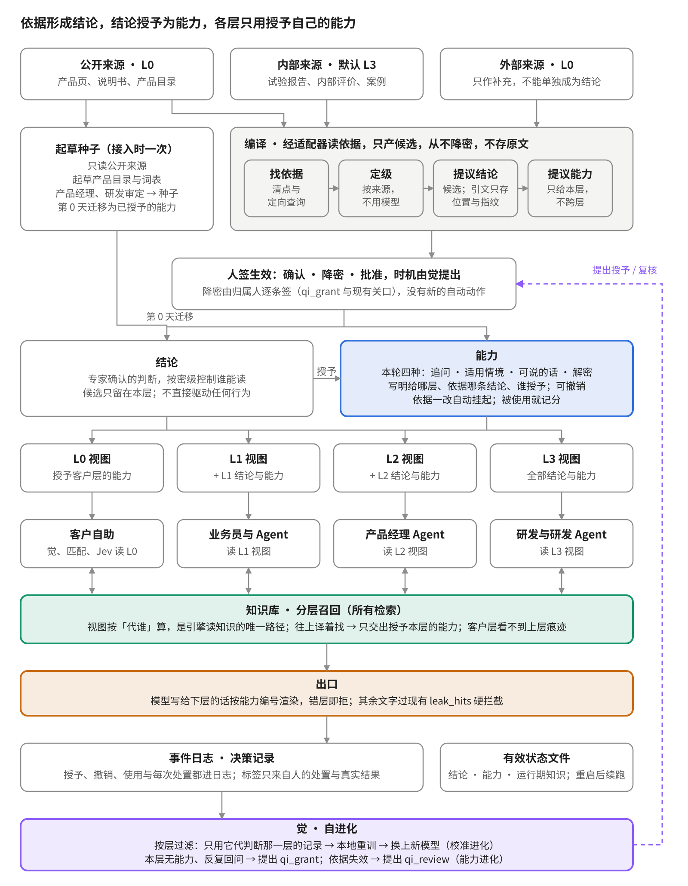

# 契：化言的知识能力层（v3.3 · 依据、结论、能力）

2026-10-18 · v3.3 定型

> **本文是契的设计文档**，从 Claude Docs 设计稿（[原稿](https://claude.ai/code/artifact/c4b96c26-b91f-4ab6-a261-5ca22cff07f5)，rev 88）导出，之后以仓库里的这份为准。
> **实现计划见 `docs/workpackages/REPLAN-v7.md`**，接口与契约以 REPLAN-v7 第 2 节为准。实现前的三处校正（演示数据改用 LV205、`phrase` 本轮无入口、适用的批准走 C′ 原路）见 REPLAN-v7 第 1 节；第 12 节的例子在 REPLAN-v7 的 Q7 里按校正后的数据更新。

> **v3.3 定型**：第三轮独立评审认为 v3.2 可以定型。本版只修正语义，不再加机制：适用情境区分可能适用与确认适用，确定推荐只给确认适用；契的有效状态跨重启保留；企业直接给的资料首次逐份清点；一条能力只依据同一位确认人的结论；技术主张收敛为「每一次正式适用判断都落在某个已授权的完整情境内，跨层专业输出只用相应层级已授权的能力」；决赛主演示从三态开关推进到四步能力复用，并与 V6 在同一批问题上对照。v3.2 与 v3.1 的修订全部保留。

## 定义

**契是化言的知识能力层：它把企业资料里的依据，形成由专家确认的结论，再把结论授予为各层可以使用的能力。能读和能用从此分开：研发的知识不给你看，但可以授权给你用。专家的判断由此成为组织可授权、可复用、可撤销的能力。**

### 为什么要分开

v2 只有一种对象：知识条目。它同时是被读的内容、驱动行为的规则和对外说的话。一个对象身兼三职，密级只能描述其中一种，签字也只能表达一种意思。结果是：L3 的研发结论签字后，会直接改变客户侧的追问；下行时找不到「哪条内部结论被批准成了哪条低层能力」；下层的话可以凭空生成，只能事后比对。这些不是三个缺陷，而是同一个缺陷。

v3 把三个角色拆成三类对象：

| 对象 | 是什么 | 例子 | 怎么控制 |
| --- | --- | --- | --- |
| **依据** | RAG 里的原文片段，不搬家 | `RPT-031` 第 2 段 | 密级由来源决定：公开来源 L0，内部来源默认 L3 |
| **结论** | 某位专家确认过的一个专业判断 | 「色花在气流缸上的主因是低浴比下局部酸浓度过高」 | 归确认人所有，密级取所依据片段的最高级 |
| **能力** | 把一条结论授权给某一层使用的一次授予 | 「对客户层：色花加气流缸要追问 pH」「对客户层：可以说『无需另加醋酸』」 | 写明给哪一层、基于哪条结论、谁授予、谁批准，可撤销 |

### 两条规则

整个系统只遵守两条规则，第 4 节展开：

1. **谁做判断，就读谁那一层的视图**。视图 = 本层能读的结论 + 授予本层的能力。
2. **发给哪一层的东西，只能由授予那一层的能力构成**。

打个比方：病人读不到药理，但用得上医生开的处方。处方就是能力。

**还有一条执行约束：能力是引擎唯一执行的东西。** 只把它写成规则不够，契把它落成四条结构：

- **适用判断落在授权情境内**：每一次正式适用判断，都必须落在某个已授权的完整情境内；条件没问全时只是「可能适用」（第 3 节）。
- **说出去的专业结论由能力渲染**：跨层专业输出只能使用相应层级已授权的能力；Agent 只能选能力编号，不能自己写一句结论再声称它被授予（第 4 节）。
- **视图是唯一路径**：旧的全局产品字段不再独立生效，撤销一条能力，所有路径上的行为一起停；契的有效状态跨重启保留（第 7、8 节）。
- **能力的依据可校验**：依据指针带内容指纹，资料一改就能发现（第 3、5 节）。

### 名字

「契」取契约之意，而且这次名副其实：**每一份契约，就是一次授予**。专家把自己的一条判断，按写明的范围交给组织使用；知识的所有权仍归专家，组织拿到的是被授权的使用能力。

觉决定「此刻该谁决定什么」；契决定「专家的判断能被谁、以什么形式用上」。契里的能力，要么有人签过，要么原样来自企业已经公开发布的资料，没有一条是模型自己生效的；什么时候该签、该谁签，由觉提出。

### 与企业 RAG 的分工

|  | 企业 RAG | 契 |
| --- | --- | --- |
| 存什么 | 全部文档原文（依据） | 结论与能力，加上指回 RAG 的指针 |
| 规模 | 成千上万份文档 | 几百条结论、几百条能力 |
| 以谁为准 | 原文以 RAG 为准 | 结论以确认人为准，能力以授予为准 |
| 运行期做什么 | 实时提供证据 | 决定每一层能用什么、能说什么 |

契只经适配器访问 RAG，不导出、不缓存文档。能力不依赖具体的 RAG 实现；企业换 RAG 时，依据指针要按指纹重新映射并校验，结论和能力本身不用重建。

### 契不是什么

- **不是检索系统**：检索质量由企业 RAG 负责。
- **不是知识图谱或向量库**：结论就是现有的知识单元，能力的六种形式就是化言引擎现有的输入。
- **不执行权限**：权限仍只在知识库、披露网关和门面里执行（铁律 4）；契负责的是「授予了什么」这份数据。
- **不让模型定密**：大模型只在编译期从依据提议候选结论；定级按来源，降密由能读原级别的归属人逐条签，模型和 Jev 都不参与。契自己的组件在运行期也不调用大模型。

## 架构总览

**依据只经适配器读取；结论由专家确认；能力由专家授予。各层只读自己的视图，发出去的只能是授予自己那一层的能力。**

<picture>
  <source media="(prefers-color-scheme: dark)" srcset="assets/qi_architecture_dark.png">
  
</picture>

从上往下读：编译经适配器从 RAG 里找依据，片段的密级由来源决定（公开来源 L0，内部来源默认 L3）；模型只提议候选结论，候选只留在自己的密级层。结论只供阅读，能力才驱动行为，两者之间唯一的通道是人签的确认与授予：同层使用随确认生效；要给更低的层用，由能读原级别的归属人逐条授予，现有的放出要点、复用审定、解密、扩适用入口也都写进同一张能力表。视图按「谁」算出，是引擎读知识的唯一路径：客户自助时的觉、匹配和 Jev 读客户层视图；所有 Agent 的检索经过分层召回，客户层看不到任何上层的痕迹。发出去的专业结论由能力渲染，其余文字过现有的 `leak_hits` 硬拦截。每一次授予、撤销和使用都留在事件日志里，是觉自进化的燃料（第 10 节）：觉按层过滤后在本地重训、换上新模型，学到的只是「什么时候该提给人」。

图里还有两样是落地时补上的（见 `docs/workpackages/REPLAN-v7.md` 第 1.4 节）：接入一家企业时，先从公开来源起草产品目录与词表，由产品经理和研发审定成种子，种子在第 0 天迁移为第一批已授予的能力；结论、能力与运行期新增的知识存在一个有效状态文件里，重启后续跑。本轮能力表实际使用四种形式，客户说法（`phrase`）没有入口，转化对照只在同层使用。

## 三类对象与六种能力形式

**新增的类型只有两个：依据片段 `Fragment` 和能力 `Capability`。结论就是现有的知识单元 `KnowledgeUnit`，种子结构就是能力的视图。**

### 依据

```python
class Fragment(BaseModel):          # RAG 原文片段，运行期经适配器实时取回，不落盘
    doc_id: str
    span: str                       # 片段在文档中的位置，RAG 怎么定位就怎么填
    text: str
    meta: dict[str, str] = {}       # 作者、部门、更新时间等，RAG 有什么给什么
```

**依据的密级由来源决定，不由模型判断。** 适配器分三类来源，接入时由企业配置一次：

| 来源 | 例子 | 片段密级 | 可信度 |
| --- | --- | --- | --- |
| 公开来源 | 企业官网产品页、对外发布的说明书与 TDS | L0：企业发布时已经降过密 | 内部 |
| 内部来源 | 企业 RAG 里的试验报告、内部评价、案例 | L3，除非有人按资料把它定得更低 | 内部 |
| 外部来源 | 期刊、标准、行业文章 | L0 | 外部：只能作补充依据 |

内部来源默认 L3。要定得更低只有两种方式，都由人按资料决定，模型不参与：接入时把整个来源配成某一层（比如企业单独存放的销售资料库配成 L1），在配置里写一次；或者研发把某一份文档定得更低，记入本地的片段密级表 `{doc_id, level, decided_by}`。定级的人必须能读原来的级别，所以是研发，不是产品经理。表里没有的内部文档一律按 L3。

### 结论

结论就是现有的 `KnowledgeUnit`，只加三个字段：

- `evidence: list[str] = []`：所依据的片段指针加指纹 `"<doc_id>#<span>@<fingerprint>"`。指纹是确认时片段内容的摘要，只存摘要，不存原文；
- `confirmed_by: str | None`：确认人，迁移进来的种子取原 `owner`；
- `status`：`candidate`、`active` 或 `withdrawn`。

结论的 `level` 不低于所依据片段中的最高密级。结论只能被读，**不能直接驱动任何行为**。

**候选结论永不跨层。** 编译出的结论先处于 `candidate` 状态，只能在自己的密级层作为起草素材，比如研发 Agent 起草 L3 条目时引用、研发在需求单上看到「候选，依据见原文」。它要驱动任何行为，哪怕只在同层，也必须先被确认；要影响更低的层，还要再经降密签字（第 6 节）。

### 能力

```python
class Capability(BaseModel):
    id: str                         # "cap:<n>"
    form: Literal["phrase", "ask", "applicable", "translation", "statement", "decrypt"]
    audience: Level | str           # 给哪一层用；decrypt 为某一位客户的 id
    payload: dict                   # 该形式的参数，见下表
    based_on: list[str]             # 依据的结论 id，至少一条
    granted_by: str                 # 授予人：所依据结论的确认人
    approved_by: str | None         # 批准人：按形式查表，不需要时为 None
    status: Literal["proposed", "active", "suspended", "revoked"]
    at: datetime
```

授予给第 k 层的能力，第 k 层及以上都能用，第 k 层以下不能用。

**一条能力只依据同一位确认人的结论**，授予人就是这位确认人。要把几位研发的结论合成一个判断时，由最终负责的研发先确认一条自己的综合结论，依据里引用别人的结论，再由他授予；被引用结论的确认人照常记分。不设多级签批。

### 六种形式：全部是化言现有的东西

| 形式 | payload | 喂给引擎哪里 | V6 里的现状 | 跨层时谁签 |
| --- | --- | --- | --- | --- |
| `phrase` 说法 | 客户口语 → 槽位取值或现象 | 抽取 | 只是种子字段，没有归属和签字 | 按来源：会话里业务员改正得来的是 L1，授予客户层由该业务员签；内部资料里来的由研发签；公开资料里的不用签 |
| `ask` 追问 | 现象 × 槽位：必须问，或各取值的大致比例（先验） | 觉的追问、开工门槛 | 只是种子字段（`required_slots`、`slot_priors`），人已批准，没有逐条归属 | 研发逐条签 |
| `applicable` 适用 | 一个情境：产品 × 现象 × 一组同时成立的条件 | 候选匹配 | 各槽位的允许取值彼此独立，和 `solves` 也是独立相乘；扩展走 C′（产品经理签 `extend_scope`），收窄走 `knowledge_conflict`（研发更新说明书） | 研发判断，产品经理批准，沿用 `scope_update`；公开产品页的只需产品经理核对 |
| `translation` 转译 | 本层说法 → 下一层说法 | 三层转译 | 各层转化对照，研发与产品经理的同层沉淀 | 不跨层 |
| `statement` 可说的话 | 一句可以对该层说的话 | 推荐卡片、Agent 回复、说明书，一律由系统按编号渲染 | 说明书与用法、公开案例、内部评价、`public_points`、研发审定的复用说明 `customer_note` | 研发逐条签，走 `seal_points`、复用审定或 `qi_grant`；公开来源的原文不用签 |
| `decrypt` 解密 | 对某一位客户、某一个产品开放机理 | 披露网关 | `DecryptGrant`：粒度为「客户 × 产品」，经业务员查看，审批人必须是产品归属研发，目前没有撤销接口 | 产品归属研发逐条签 |

**这张表的意思是：契没有发明新的放出方式。** 其中 `statement`、`applicable`、`decrypt` 在 V6 里已经有各自的签字入口，契把它们统一成同一种对象；`phrase` 和 `ask` 今天只是种子字段，契第一次给它们补上了归属和签字。以后再加一种放出，只是给这张表加一行，以及引擎里对应的一处读取。

### 适用判断：情境只取并集，分清可能与确认

**每一次正式适用判断，都必须落在某个已授权的完整情境内。** 这条要求在 `applicable` 上最容易被违反。V6 的 `Product.applicable` 是「每个槽位一组允许取值」，各槽位之间、和 `solves` 之间都是独立相乘（`domain.consistent`）。研发只验证过「锦氨 × 气流染色机」和「纯锦纶 × 溢流染色机」，两条一旦拆进各槽位的取值集合，就会多出「锦氨 × 溢流」「纯锦纶 × 气流」两条没人验证过的判断。

契让一条 `applicable` 能力表达一个完整情境：产品 × 现象 × 一组必须同时成立的条件。多条能力是多个已批准的情境，匹配时命中任意一个即可，不做交叉组合。这是对匹配语义的有意修改：`match_candidates` 的签名不变，判断从「每个槽位各自允许」改成「存在一个已授予的情境与已知条件相容」；`correct_product` 用命中情境的条件数衡量具体程度。

**可能适用与确认适用要分开。** 情境里的条件，客户可能只说了一部分。客户只说锦氨、没说设备时，「锦氨 × 气流染色机」这个情境与已知条件不冲突，但还没被确认。候选因此带上状态：某个情境的条件全部已知且满足，是**确认适用**；没有冲突、但还有条件未知，是**可能适用**，未知的条件就是现有的 `Candidate.unknown_slots`。

- **确定推荐只给确认适用。**
- **可能适用的产品也可以推荐，但只能是有条件的推荐**：卡片上由系统按情境列出待确认的条件，比如「适用于气流染色机，请确认您的设备」，不由 Agent 自己写。
- **要不要追问这些条件，仍由觉按信息价值决定。** 如果规定「可能适用就只能追问」，等于用一条硬规则推翻觉的追问判断。

这样「没有未经授权的确定推荐」由结构保证。V6 今天在觉不再追问、Jev 又有把握时，会直接推荐还有未知条件的产品；第 0 天以后匹配结果不变，只是这类推荐的卡片多出待确认的条件。

第 0 天，每个产品现有的 `solves × applicable` 迁移成一个情境，匹配结果与 v6 相同。C′ 扩现象、研发补充新的适用条件，都变成加一个情境，而不是改字段。这个保证只针对适用判断，不是「任意组合都不泄密」：两句允许说的话放在一起，仍可能让人推断出没有直接公开的信息，这类拼凑由觉的 `leak_risk` 盯着。数值范围加组合条件（例如「用量 0.8 到 1.2 g/L 且浴比低于 1:6」）仍然表达不了，照旧只作结论供研发阅读。

### 三条结构约束

- **配方永不对外**：`kind=formula` 的结论不能作为任何 `audience < 3` 的能力的依据。
- **外部不能单独成为依据**：只依据外部片段的结论不能被确认。
- **自己的决策不能单独成为依据**：只依据化言自身决策记录、没有独立结果验证（试样、客户评价）的经验类结论，不能成为能力，避免系统用自己的输出教自己（第 10 节）。

这三条是数据约束，和「Jev 不能突破披露上限」同类，不随业务增长。

## 两条规则

**规则一管「用什么判断」，规则二管「说出什么」。v2 的跨层问题都出在没有分清这两件事。**

### 规则一：代谁判断，就读谁那一层的视图

第 k 层的视图 = 密级 ≤ k 的已确认结论 + 授予 ≤ k 的能力。种子形状的结构（产品适用表、必问条件、客户说法、转化对照）都从视图里的能力算出来。

关键在「代谁」：系统替客户做的判断，必须读客户层的视图，哪怕做判断的是觉。

| 判断 | 代谁 | 读哪一层的视图 |
| --- | --- | --- |
| 客户自助会话里的追问、候选匹配、Jev 推荐 | 客户 | L0 |
| 陪同会话里给业务员的追问提词 | 业务员 | L1 |
| L2 转译（产品经理 Agent） | 产品经理 | L2 |
| L3 转译、回问的判断 | 研发 | L3 |
| 定时扫描：机会汇聚、知识冲突、拼凑机密 | 系统内部，结果只交给有权处理的人 | L3，结果按收件人的层级裁剪 |

这条规则直接消除了 v2 最严重的问题。研发确认了「锦氨加气流缸要问 pH」这条结论之后，研发自己的开工门槛立刻用上它；但客户自助会话里的觉读的是客户层视图，只有研发明确授予了一条「对客户层：要追问 pH」的能力，客户才会被问到。**认可一条知识，和允许它改变客户侧的行为，从此是两次不同的签字。**

### 规则二：发给哪一层的东西，只能由授予那一层的能力构成

| 发出去的东西 | 必须由什么构成 |
| --- | --- |
| 推荐卡片 | 系统按授予该层的 `applicable` 情境选出产品，按授予该层的 `statement` 渲染原文；只是可能适用时，由系统按情境列出待确认的条件，不给确定推荐 |
| 追问、回问的问题 | 问哪个槽位，由该层视图决定：授予该层的 `ask`，或该层适用情境算出的区分度；问法用槽位自带的 L0 问法 |
| Agent 写给该层的回复、说明书草稿 | 专业结论只能以能力编号的形式出现，由系统按编号取出授予该层的 `statement` 原文渲染；Agent 只写连接语，不能自己写一句结论再声称它被授予 |
| 解密内容 | 授予这位客户、这个产品的 `decrypt` |

片段原文对它自己所在的那一层，等同一条已授予的 `statement`：公开产品页的原文可以原样说给客户听，因为企业发布它时已经降过密。

**出口两道检查，都是硬拦截。** 第一道是渲染：稿子里的能力编号由系统换成原文，编号不是授予收件层的，渲染直接拒绝，这一步不靠文字比对。第二道是现有的 `leak_hits`（封存要点、研发假设、L3 转化术语的二元组比对），连同它的全部调用点原样保留，检查 Agent 自己写的连接语。连接语里仍可能夹带改写过的专业断言，这是自由对话的实际边界，所以不说零泄露。真正的结构保证在输入侧：写给第 k 层的 Agent 只读第 k 层的视图（规则一、第 7 节），读不到的就说不出来。

### 高层的决定，下层能看到什么

研发在自己的需求单上发起回问，判断依据是 L3 的；但客户能看到的只是结果：被问了「染浴 pH 大概多少」。问法是槽位自带的 L0 问法，所以内容满足规则二。客户能从「被问了 pH」推测「pH 有关系」，这是做决定的研发自己负责的受控泄露，和今天的回问完全一样。规则一管的是「代人判断」，不管「人在自己的工作里判断」。同理，觉也不能把研发的这类决定学成客户侧的习惯（第 10 节）。

## 编译：从依据形成结论，再提议能力

**编译分两段：从依据到结论是开放的，什么新判断都能进来；从结论到能力是封闭的，只能落进六种形式。编译只产生候选，从不降密。** 编译是一个离线脚本，经适配器访问 RAG，整批重跑；本地只保存候选结论（引文只存位置和指纹）、片段密级表和编译报告，不保存文档原文。编译调用模型时用单独的网关配置 `ingest`，关闭缓存。但不缓存不等于不外发：模型服务在企业外部时，送去提议结论的内部片段就离开了企业（见第 7 节「模型网关」）。代码放在 `src/huayan/ingest/`，入口 `scripts/compile_qi.py`，产出放 `data/ingest/`，不入库（铁律 7）。

### 适配器

企业 RAG 和外部资料源实现同一个接口，编译期和运行期共用：

```python
class SourceAdapter(Protocol):
    kind: Literal["internal", "public", "external"]   # 接入时配置，决定片段的默认密级
    default_level: Level            # internal 默认 3；public、external 为 0
    def search(self, query: str, k: int) -> list[Fragment]: ...
    def fetch(self, doc_id: str, span: str) -> Fragment | None: ...   # 取不回 = 指针失效
    def list_docs(self) -> list[str] | None: ...   # 企业直接给的资料提供清单；企业 RAG 可返回 None
```

两条接入要求：`search` 只返回原文片段，不接受生成好的答案；化言的服务账号只开放化言需要的文档范围。

### 第一段：依据 → 结论

1. **找依据**：首次入库分两种。企业直接给的资料（决赛就是这种），适配器提供资料清单，逐份读取、全部清点一遍，不依赖现有的产品和现象分类，新产品、新工艺的资料也能进来；接企业 RAG 时不遍历全库，按企业的产品清单和现象清单逐项查询。之后都按缺口生成定向查询，缺口来自两处：现有结构对不上的地方，以及运行期「本层无能力」的记录（第 7 节）。研发也可以直接指定一份文档，用 `fetch` 取回。
2. **定级**：按来源定，不调用模型。公开来源 L0；内部来源取来源配置或片段密级表，都没有就是 L3；外部来源 L0，但只能作补充依据。
3. **提议结论**：大模型经网关（caller `ingest:extract`）从片段里提出专业判断，每条必须给出引文；校验器用 `fetch` 核对引文确实在原文里，查不到就丢弃。本地只存引文的位置和指纹，不存引文。结论的密级不低于所依据片段的最高密级，状态为 `candidate`。结论可以是任何专业判断，不受现有结构限制，所以新概念、新产品可以先作为候选进来。

### 第二段：结论 → 能力提议

4. **对齐**：用现有的 `find_slot_values`、`find_phenomenon` 把结论对到已有的槽位、现象和产品上。
5. **提议能力**：能落进六种形式的，生成能力提议，授予对象只能是结论自己的密级层。公开来源的结论本来就在客户层：它的 `statement` 原样引用原文，`applicable` 交产品经理按产品页核对。**编译从不提议跨层授予**，跨层只有研发在第 6 节的关口里做。
6. **对比现有能力**：完全相同的丢弃；同一目标出现不同取值的，标为冲突，交给现有的 `knowledge_conflict`。

### 编译报告

列出：发出的查询、取回的片段及各来源占比、候选结论、能力提议、冲突项，以及按第 9 节分好类的待签清单（每一类要谁签、预计多少次）。另外列出两类边界：

- **已确认但未能形成能力的结论**：比如「用量在 0.8 到 1.2 g/L 之间、且浴比低于 1:6 时才有效」这种数值范围加组合条件，现有六种形式表达不了。它仍然是结论，研发可以读、可以在需求单上引用，但不会自动驱动任何行为。表达能力的边界由此显式可见。
- **对不上的新概念**：新的现象、槽位取值、产品，列出来由人决定是否扩展现有结构。

### 依据失效

每次重跑时，对所有结论的依据指针逐个 `fetch`，用指纹比对内容。取不回、或指纹对不上的，相关结论标为待复核，基于这些结论的能力自动挂起，觉提出 `qi_review`，主人与签字人是确认人。只存指针的话，重取只能发现「取不回」，发现不了「被改了」。企业换 RAG 时走同一条路：在新 RAG 里检索原来的位置，指纹一致才重新挂上指针，对不上的交确认人复核。

### 决赛：替身 RAG

决赛给的是原始文件。按企业给的分类装进本地替身 RAG 的两个来源：公开（产品说明书、官网产品页这类对外资料）和内部（其余全部）。替身实现 `search`、`fetch` 和资料清单 `list_docs`，检索用现有的二元组打分；首次编译按清单逐份清点。化言的编译期和运行期都只经适配器访问它，从不直接读文件；界面和材料标注「替身 RAG」。决赛资料与由它编译出的一切都不入库（铁律 7）。

**不做**：导出或缓存原文、遍历企业 RAG 全库（企业直接给的资料除外）、在 RAG 侧写回标签、让模型定级或建议降密、增量编译、保存原文的版本快照、热加载。

## 生效：确认、降密、批准

**一条知识要生效，要回答三个不同的问题：它对不对（确认），能不能给更低的层用（降密，也就是授予），业务上同不同意（批准）。三个问题分开签。安全只取决于降密这一步，而降密一律由能读原级别的归属人逐条签：研发的判断由研发签，会话里来的信息由业务员签。分类看信息从哪来，不看它被做成哪种形式。**

| 签字 | 回答什么 | 谁签 | 在哪签 |
| --- | --- | --- | --- |
| 确认 | 这条结论对不对 | 离这件事最近的归属人：内部技术结论是研发；公开产品页的适用情境是产品经理；会话里的客户说法是做出改正的业务员 | 研发：签需求单时逐条勾选单上引用的候选结论；产品经理：在 `scope_update` 里按产品页核对；业务员：改正槽位时确认 |
| 降密（授予） | 这条判断能不能给更低的一层用，以什么形式 | 能读原级别的归属人，逐条：研发的判断由研发签，会话里来的说法由业务员签 | 现有关口：放出对外要点、复用审定、解密审批、扩适用；另加一个 `qi_grant`。业务员对说法的确认和授予是同一次点击 |
| 批准 | 业务范围上同不同意 | `applicable` 由产品经理批准，其他形式不需要 | `scope_update` |

**同层自用不需要授予**：研发确认一条 L3 结论，它在研发层的能力同时生效。只有跨层才需要单独的授予，所以签字负担集中在真正需要判断的地方。

**适用类能力沿用 C′ 的分工**：研发判技术、授予；产品经理管产品范围、批准。现有的 `scope_update` 模板原样承担这一步，对象从「研发不立项时指定的产品」扩展到任何待批准的适用能力，包括公开产品页编译出的适用条件。公开产品页本身不需要降密，产品经理核对的只是「编译得对不对」：Jev 的第三问（依据核对，已实现、尚未接入）逐条对照原文，标出对不上的条目，产品经理重点看被标出的。Jev 只帮着查对错，不参与降密。

### 觉提出的决策点

| 模板 | 对象 | 前置条件 | 主人（准备） | 签字 |
| --- | --- | --- | --- | --- |
| `qi_grant` 授予（新家族） | 结论 × 层级 | 这条结论在更低的一层被需要过：分层召回记过「本层无能力」，或研发为同一现象反复回问同一个槽位；提不提、何时提由觉打分 | 确认人的 Agent：附原文位置，列出那一层被问到的原话、建议的形式和措辞 | 确认人，逐条勾选形式与措辞。还是候选的结论，交给它对齐到的产品或现象的归属研发，授予时一并确认 |
| `scope_update` 批准适用（扩展现有模板） | 产品 × 现象或条件 | 有待批准的适用能力：研发授予的，或公开产品页编译出的 | 产品经理 Agent 起草，Jev 标出与原文对不上的条目 | 真人产品经理 |
| `qi_review` 复核（`knowledge_conflict` 家族的新模板） | 一条结论 | 依据失效、所依据的结论被撤回，或试样、市场评价的结果与能力矛盾 | 确认人的 Agent：列出受影响的能力 | 确认人：保留、修改或撤回 |

三个模板都由觉打分，复用现有的 `knowledge` 对象类型。新家族只有 `qi_grant`，`test_wp_b1` 的家族数由 19 改为 20。**没有新的自动动作**：`auto_action` 仍只有 `escalate` 和 `assign_sales`，契里没有一条跨层能力是自动生效的。v3 的 `qi_level`（定级）和 `qi_confirm`（单独确认）取消：定级按来源，确认并入研发本来就要签的需求单。

### 撤销与挂起

- **撤销能力**：授予人随时可以撤销一条能力，对应行为立即停止，结论不受影响。因为视图是唯一路径（第 7 节），撤销后不会有旧字段在别的调用方继续生效。解密也一样：现有的 `DecryptGrant` 没有撤销接口，契补上。已经发生的推荐、追问留在事件日志里，不追溯修改。
- **撤回结论**：确认人撤回一条结论，所有只依据它的能力自动挂起，觉提出 `qi_review`，主人与签字人是它们的授予人。
- **依据失效**：依据取不回或指纹对不上，同上，从依据开始往下传播。

传播只有一个方向：依据 → 结论 → 能力。每一步都是数据上的引用，不需要额外的规则引擎。

### 记分：在「被引用」之外加上「被使用」

现有的「被引用」记分和它的测试原样保留。新增一种：运行期每用一次能力，比如推荐卡片用了一条 `statement`、匹配命中一条 `applicable`、追问用了一条 `ask`，就写一条 `capability_used` 事件，给它所依据结论的确认人记一次「被使用」。资料作者若与确认人不同，在结论确认时记一次贡献分。积分由此也能记在真正起作用的判断上，而不只是被检索到的文字上。

### 现有入口在 v3 里写的是什么

它们的界面和流程都不变，只是落库的东西统一成能力：

| 现有入口 | 写入什么 |
| --- | --- |
| C′：研发判「已有产品适用」→ 产品经理扩适用范围 | 一个新的适用情境，研发授予、产品经理批准；不再改产品的 `solves` 字段 |
| 封存/放出：研发放出对外要点 | 若干条 `statement`，授予客户层 |
| 研发审定现成产品复用的那句说明 | 一条 `statement`，授予业务员层 |
| 研发审批解密 | 一条 `decrypt`，授予这一位客户、这一个产品 |
| 研发沉淀转化知识 | 一条结论，加同层的 `translation` |
| 研发更新说明书（`knowledge_conflict`） | 挂起或替换对应的适用情境与 `statement`；不再直接改产品字段 |
| 业务员改正槽位取值 | 一条 `phrase`，业务员确认并授予客户层 |
| 新品发布 | 产品的说明与用法成为授予客户层的 `statement`，适用条件成为一个适用情境 |

## 运行期：视图驱动引擎，分层召回

**视图是引擎读知识的唯一路径：所有调用方按「谁」拿到视图，旧的全局产品字段不再独立生效。引擎函数的签名不变，只有匹配语义改成情境并集（第 3 节）。Agent 的检索改为分层召回：大模型决定怎么找，知识库决定能用什么。**

### 视图驱动引擎

知识库新增 `view(actor)`：按提问者所在的层，再加上只授予这个人的能力（比如给某位客户、某个产品的 `decrypt`），从已确认结论和已授予能力算出种子形状的结构：槽位与客户说法、现象与必问条件和先验、产品与适用情境、各层转化对照。只按层级算不够：解密是给一位客户的，不是给全体 L0 的。`match_candidates`、`translate.py`、觉的属性计算本来就是这些结构的纯函数，按第 4 节规则一的表传入对应视图即可。

**唯一路径是硬要求。** 今天有十几处调用方直接读 `kb.products()`：会话、回答、Agent 工具、觉的状态计算、转译、失真评测等；`update_applicable`、`extend_solves` 直接改全局产品对象。契里 `products()` 改为从视图投影，知识库不再持有可改的产品适用字段，这两个入口改为写能力。否则撤销一条 `applicable` 后，新视图里已经没有它，旧产品对象里却还留着，某个调用方会继续推荐。

后果之一：客户和业务员对同一个问题可能拿到不同的推荐，因为业务员层被授予的能力更多。这是正确的行为。界面上标明「这条推荐来自业务员层的能力」。

### 分层召回

传统权限检索只有两种做法：先召回再过滤，最好的答案常在研发报告里，删完就没了；先过滤再召回，只在说明书里找，而客户说的是现象语言，常常答非所问。两者都把看不了的知识当作没用。

分层召回把检索放在三类对象上走一遍：

1. **问题往上译**：用各层的 `translation` 能力把查询扩展成产品语言和研发语言，比如「气流缸」「深一块浅一块」扩展出「低浴比」「匀染」。扩展出的词只在知识库内部使用，不返回给任何人。
2. **全层级查找**：在知识库内部，经适配器查 RAG，并查全部结论。这一步的结果不交给任何大模型。
3. **答案往下走**：命中的片段 → 依据它的已确认结论 → 基于这些结论、授予给提问者这一层的能力。返回的是能力本身：一条可说的话、一条要追问的条件、一个适用的产品。候选结论没有任何能力，在这一步自然被跳过。
4. **用不上的只记一笔**：命中的结论在提问者这一层没有能力，就记一次「本层无能力」（结论 × 层级），供觉提出 `qi_grant`。返回什么按层不同：内部各层的 Agent 拿到存根，内容与现有的 `search_blocked` 相同，只有归属人、层级和类别；**客户层什么都拿不到**，没有存根，没有提示，返回和「没找到」完全一样。

和 v2 的区别在第 3 步：返回的不只是已公开的文字，还有被授予的判断。客户层拿到「要追问 pH」「候选 LV206」，前提是研发授予过这两条能力；客户看不到结论本身，也看不到「上面还有结论」。

### Agent 自己想关键词、换策略

Agent 的检索离不开大模型：要提出关键词、读结果、决定下一步。所以分工是：

|  | 大模型（Agent） | 知识库（非大模型） |
| --- | --- | --- |
| 提出查询 | 用本层的话提出关键词 | 用 `translation` 能力往上扩展 |
| 执行查找 | 不参与 | 全层级查找 |
| 读结果 | 只读本层的结论与授予本层的能力 | 把命中沿「结论 → 能力」往下走 |
| 决定下一步 | 根据提示换说法、追问客户、建议升级 | 给出本层词汇的提示 |

提示只从本层视图里算，与上层命中无关：用户的话命中了授予本层的 `phrase`、`ask` 或已发布产品，才给出「相关条件：设备」「相关产品：LV206」这类提示；上层命中只产生第 4 步的记录和存根。所以提示里永远不会出现本层没被授予的条件：研发没有授予「要问 pH」时，客户层的提示里就不会有 pH。Agent 有线索可以继续查，但从头到尾读不到上层原文。

知识库新增只读方法 `explore(query, actor)`，返回本层可读的已确认结论、授予本层的能力、本层词汇的提示，以及存根（只对内部各层）。研发层的结果里另外带上本层的候选结论，标明「候选」，只作起草素材。Agent 的检索工具改为调用它；`search` 保持不变。

现有代码里已有两处先例：觉计算回问信号时，用内部最高权限匹配转化对照、只输出计数（`trans_hits`）；`search_blocked` 只告诉调用方「谁知道」。分层召回把这两种做法放到同一个模型上。

### 出口

见第 4 节规则二：对外的专业结论由能力渲染，编号不属于收件层就拒绝；其余文字过现有的 `leak_hits` 硬拦截。

### 模型网关

运行期不改。现在三个模型层级都指向同一个外部服务。**不缓存不等于不外发**：研发 Agent 读到的 L3 结论、编译时送去提议结论的内部片段，都会发给这个服务。所以部署时要分开说清三件事：原文存在哪（契不复制、不缓存），模型在哪调用，是否允许第三方处理企业资料。企业要求 L3 不出内网时，在 `config/models.yaml` 里把研发 Agent 和编译用的层级换成私有化模型。编译另用一份不带缓存的 `ingest` 配置，避免原文留在缓存文件里。这一条不作为契的能力宣传。

## 第 0 天迁移：现有种子就是已授予的能力

**启动时，现有种子按它们今天实际服务的层级，全部登记为已确认的结论和已授予的能力。第 0 天的系统行为与 v6 完全一致；现有测试、演示路径、失真对照与业务周的数字都不受影响。** 种子文件的格式不变，仍是演示数据的编写格式；新增一个加载步骤 `migrate_seeds(seeds)`，产出结论与能力。

| 种子里的东西 | 迁移成的结论 | 迁移成的能力 |
| --- | --- | --- |
| 产品说明、用法 | L0 结论，归产品归属研发 | `statement`，授予客户层 |
| 产品机理 | L3 结论，可解密 | 无；已有的解密授权迁移为 `decrypt`（客户 × 产品） |
| 产品配方 | L3 结论 | 无，结构约束禁止 |
| 产品的适用现象与适用条件（`solves × applicable`） | L0 结论（本来就写在说明书里） | 一个适用情境，授予客户层 |
| 现象的必问条件 | L3 结论（研发开工必问，人已批准） | `ask`（必问），授予客户层（今天客户自助就会被问到） |
| 现象下各槽位取值的先验（`slot_priors`） | L1 结论，归现象维护人 | `ask`（先验），授予客户层（今天觉的 `p_fix` 就在用） |
| 现象的成因 | L3 结论 | 无 |
| 槽位的取值、客户说法、问法 | L0 结论 | `phrase`，授予客户层 |
| L2 转化对照 | L2 结论，归产品经理 | `translation`，授予产品经理层 |
| L3 转化对照 | L3 结论，归各位研发 | `translation`，授予研发层 |
| 历史案例 | L2 结论 | 无 |
| 公开案例（`public.yaml`） | 依据对应的案例结论 | `statement`，授予客户层 |
| 内部评价（`public.yaml`） | L1 结论 | `statement`，授予业务员层 |

种子里没有归属人的条目（槽位、现象），迁移时登记到配置指定的维护人。

为什么行为不变：今天所有层用的是同一份全局种子，而迁移后每一条能力都授予了它今天实际服务的最低一层，所以各层视图算出的结构与今天相同；每个产品原样迁成一个情境，匹配结果也与今天相同。差别只从第 1 天开始出现：新进来的结论，默认只在自己的密级层生效，要影响更低的层，必须有人授予。

### 有效状态跨重启保留

**契的状态是组织资产，不是一次运行的内存。** 今天 `HuayanApp.build` 每次启动都新建运行目录、从种子重建知识库，所以连 C′ 扩出来的适用范围，重启之后也会丢。研发今天批准的能力如果明天就没了，「专家判断一次，组织长期复用」就不成立。

做法只有一项：把契的有效状态存成一个带版本号的 JSON 文件，内容是已确认的结论（依据只存指针和指纹）、能力及其状态、片段密级表。启动时先做第 0 天迁移，再加载这个文件；每一次确认、授予、撤销、挂起之后，整体写入新版本。事件日志照旧只记历史，不用来重建状态，也不引入独立的事件溯源。文件路径可配置：演示和测试仍是每次运行独立的沙箱；试点和决赛回放指向同一个文件。文件放在 `data/qi/`，不入库（铁律 7）。

## 冷启动与签字量

**签字跟着需求走，不跟着文档走。** 企业接入第一天，契里只有迁移进来的种子，RAG 里却有成千上万份资料。如果每份资料、每条候选结论都要研发签，研发会被淹没，「降本增效」就说不出口。契按信息从哪来、往哪流，把要生效的东西分成五类，只有一类需要研发签：

| 类别 | 例子 | 要不要降密 | 谁来处理 |
| --- | --- | --- | --- |
| ① 公开来源的内容 | 官网产品页、对外说明书：「LV206 用于低浴比气流染色机中的锦纶氨纶弹力面料」 | 不要，企业发布时已经降过密 | `statement` 原样渲染原文，不用签；适用情境由产品经理按产品页核对一次，Jev 标出对不上原文的条目 |
| ② 会话里来的客户说法 | 「气流缸」就是气流染色机 | 要：会话信息是 L1，给客户层用是一次授予。但它只用来理解客户的话，目标只能是已有的 L0 词表 | 改正槽位的业务员当场签，确认和授予是同一次点击。内部资料里来的说法不属于这一类，归第⑤类 |
| ③ 由公开适用情境推出的追问 | LV205 和 LV206 适用的设备不同，所以要问设备 | 不要，也不需要任何能力：觉现有的区分度（`splits`）直接从客户层视图里的适用情境算出 | 无需签 |
| ④ 内部资料在同层使用 | 研发 Agent 起草需求单时引用一份 L3 报告 | 不要 | 研发签需求单时逐条勾选，这张单本来就要签 |
| ⑤ 内部判断给更低的层用 | 「锦氨在气流缸上色花要问 pH」，要让客户自助时就问 | **要，研发逐条签** | 研发 |

①③④不涉及降密；②是业务员对自己会话信息的一次授予，内容只是词汇对应。它们都由离那件事最近的人顺手处理。只有⑤把研发的判断交给更低的层，必须由研发逐条签；而它只在更低的一层真的需要时才出现：分层召回反复记到「本层无能力」，或者研发为同一个现象反复回问同一个槽位，觉才提出 `qi_grant`。没人需要的内部结论，永远不来打扰研发。

**所以研发不按资料总量审，只审被需要的判断**：产品经理每个产品页核对一次；研发签的次数跟着「被更低的层真正需要过的内部判断」走，不跟着 RAG 里有多少文档走。真实需求、结论版本和授予对象多了，签字也会增长，但每一次都对应一个真实的需要。编译报告在第一天之前就把这五类的待签数量列出来。

**用决赛资料证明，而不是承诺。** 决赛资料按公开和内部两个来源装进替身 RAG，用一批问题回放，报告「这 N 个问题里，研发只需要签 M 次，产品经理核对了 K 页」。数字从事件日志统计，只在决赛环境里跑，不入库。

## 与觉的接口：决策记录

**决策不是契的第四类对象，也不是契的卖点；它是觉自进化的燃料。** 契在这里只做三件事：把能力的授予、撤销和使用（`capability_used`）记进事件日志；定下一条安全规则，保证觉学不到没被授予的东西；把从决策里发现的需要（反复回问、本层无能力）变成授予的候选。觉怎么用这些记录自进化，见 VISION 第 6 节。

决策记录是现有事件日志上的一张只读视图：谁、在什么情况下、对哪个决策点、做了什么决定、后来结果怎样。它自己不驱动任何行为。

### 从哪些事件投影出来

| 一行决策的字段 | 来自现有事件 |
| --- | --- |
| 决策点、当时的属性、觉给的 `p_need` | `JueRecord`（觉提出的）；`human_decision` 的属性快照（人自发做的，觉没提） |
| 谁决定、怎么决定 | `question_resolved`（签、接受、退回、忽略）、`agent_action_decided`、`auto_executed`、`requirement_edited` |
| 后来结果怎样 | `requirement_returned`、`trial`、`market_eval`、`reuse_declined`、`project_declined` |
| 用到了哪些知识 | 新增的 `capability_used`，以及现有的引用记录 |
| 密级 | 做决定的人所在的层，和这一行引用过的内容，两者取高 |

不新增存储，不改 `JueRecord`。投影是一个纯函数 `decisions(events)`，和现有的决策目录统计放在一起。

### 两种标签，不加权重

| 标签 | 回答什么 | 来源 | 用在觉的哪里 |
| --- | --- | --- | --- |
| 处置 | 这个决策点该不该提、该提给谁 | 人对觉所提问题的处置；人自发做了觉没提的决定，就是觉漏提了一次 | 「要不要提」的概率，以及决策目录的漏提统计 |
| 结果 | 提了之后，决定是不是对的 | 需求单被退回、试样通过与否、市场评价 | 事后有用性标签。Jue-K 现在用的就是这种标签，只是把模拟出来的真值换成真实结果 |

不按角色加权重。想加权重，是因为不同来源的可信度不同；这件事用结构解决更干净：**只有人的处置和真实世界的结果能当标签，Agent 和系统自己的决定只作为当时的情况记录，永不当标签。** 权重是一组要人拍脑袋定的系数，最后会变成另一种 if-else。

### 三条防线

- **代谁判断，就只用谁那一层的决策来学。** 这是规则一在学习上的延伸：觉在第 k 层提出的决策点，只用密级不超过 k 的决策行训练。研发在需求单上反复回问 pH，客户虽然看得到被问了什么，但那是研发按 L3 判断做的决定，这一行按 L3 计。否则觉会学会在客户自助时提出 pH 追问，等于绕过了授予。要让客户侧以后都问，只有一条路：「反复回问」成为 `qi_grant` 的前置条件，觉提出这个问题，主人与签字人是研发，由研发决定。
- **不用系统自己的决定教自己。** 只依据系统决定、没有独立结果验证的经验，不能成为契的能力（第 3 节的第三条约束）。觉学到的也只是「什么时候该提给人」，不是「人该怎么判」。
- **记下当时的提出概率，留一点探索。** 觉只提它认为该提的点，没提的点永远看不到结果，数据会越来越像觉自己。`JueRecord` 里本来就有 `p_need`，作为提出概率保留；另在代价最低的追问提示上，留一小部分低于阈值的点照样提示，让数据不只来自觉已经相信的东西。

### 决策还能给契提出候选

- 业务员把客户说的「气流缸」改成「设备＝气流染色机」：这是一条说法候选，业务员当场确认（第 9 节第②类）。
- 研发为同一现象反复回问同一个槽位：这是 `qi_grant` 的前置条件之一，由研发决定要不要授予客户层一条 `ask`。
- 试样或市场评价的结果与一条能力矛盾：触发 `qi_review`。

三种都只是候选，生效仍走第 6 节的签字。

### 怎么评估，不说什么

- 按时间切分：用前一段的决策训练，在后一段上和现有的规则原型、Jue-K 比较。
- **不用脚本写定的人的处置当标签画曲线。** 模拟周里人的处置由脚本决定，拿它说明「越用越准」是循环论证。**自进化演示用的是结果标签**：模拟世界里客户的真实条件、研发最终需要的信息，与觉的判断无关；在世界偏离专家先验时，让「在运行中按窗口重训的觉」和「冻结的觉」跑同一批问题对照（REPLAN-v7 的 Q6、Q7）。这证明的是自进化的机制与方向，真实增益仍要真实处置数据。
- 只有觉学习。Jev 和各 Agent 都基于大模型，按愿景约定不训练大模型；它们从决策里得到的只是统计报告。

## 从模型推出的创新点

**核心只有一个：把「能读」和「能用」分开。下面五条都是它的推论，而不是并列的五个功能。** 组件本身（检索、分级、出处、审批）都是成熟工程；新意在于用一个模型收拢了化言里六种零散的「放出」，并让它直接驱动决策引擎。不说首创。

### 核心：知识可用不可见

传统权限系统只有一个开关：读得到才用得上。契把它拆成两个：结论按密级控制谁能读，能力按授予控制谁能用。研发的判断可以授权给客户层使用，客户却永远读不到判断背后的机理。专家的判断由此成为组织可授权、可复用、可撤销的能力：每一次正式适用判断都落在某个已授权的完整情境内，跨层专业输出只用相应层级已授权的能力。

### 推论 1：研发签一次字，各层的行为同步改变

研发确认一条结论、授予给客户层一条 `ask`，客户自助入口从下一位客户起就会追问这个条件；授予一条 `applicable`，经产品经理批准后，客户在自助阶段就能命中这个产品。不重训模型，不改提示词，不经任何人转述。C′ 是这条推论已经跑通的特例。

### 推论 2：用最深的结论判断，只交出授予本层的能力

分层召回在全部层级里找答案，再沿「结论 → 能力」往下走，交给提问者的是被授予的判断，而不只是已公开的文字。用不上的结论只记一笔，交给它的主人决定授不授予；客户层连「上面有结论」也看不到。

### 推论 3：上行每句指回原话，下行每句指回授予

上行的三层转译，每条需求指回客户原话，用来防失真；下行发给第 k 层的专业结论，由授予第 k 层的能力渲染出来，用来防泄密。两个方向遵守同一条原则：每句话都要有来处。

### 推论 4：积分记在被使用的判断上

能力每被使用一次，给它所依据结论的确认人记分。在「被引用」之外加上「被使用」；哪条结论在哪一层反复「用不上」，也成为研发决定放出什么的依据。

### 推论 5：签字跟着需求走，不跟着文档走

降密是唯一影响安全的签字。研发的降密只在更低的一层真的需要某条判断时，才由觉提出；公开资料、同层使用不需要降密，会话里的客户说法由业务员顺手授予。所以企业接入第一天，研发不必面对整个 RAG 的待审清单，签字跟着真实的需要增长，能在决赛资料上实测（第 9 节）。

### 用大白话讲

| 讲什么 | 一句话 |
| --- | --- |
| 契是什么 | 研发的知识不给你看，但可以授权给你用；授权还能收回 |
| 推论 1 | 研发签个字，前台马上就会问新的问题、推荐新的产品 |
| 推论 2 | 用最深的知识判断，只说你能听的话；说不出的，记下来交给知识的主人决定 |
| 推论 3 | 往上传，每句话都找得到客户原话；往下说，每句结论都由授权渲染 |
| 推论 4 | 谁的判断被用上了，就给谁记功 |
| 推论 5 | 研发只签真正被需要的那几条，不按资料总量审 |

打个比方：病人读不到药理，但用得上医生开的处方；病人问到医生不便说的，医生自己决定说不说。

「数据可用不可见」是隐私计算领域的常用说法，靠的是密码学。契做的是「专家知识可用不可见」，靠的是授予。借用这个说法时要讲清这一区别。

**定位一句话**：觉让组织在对的时刻问对的人；契让专家的判断不再局限于专家本人，成为全组织可授权、可复用、可撤销的能力。前者靠决策目录与 Jue-K 证明，后者靠三态演示证明（第 12 节）。

## 一个完整例子：一份研发报告变成几条能力

> **注意**：本节用 LV206 讲例子，与现有种子冲突（LV205 已覆盖「锦纶 × 溢流」；LV206 在种子里是立项产品）。实现与决赛演示改用 LV205、研发 R01、K5 =「锦纶氨纶 × 经轴染色机」，见 REPLAN-v7 第 1.1 节；本节在 Q7 按此更新。

**主角是研发 R02 的实验报告 `RPT-031`《气流缸低浴比下锦氨弹力面料色花分析》和补充试验 `RPT-044`（均为模拟），存在替身 RAG 的内部来源里；外加 LV206 发布后的公开产品页 `WEB-206`（模拟），和外部资料源里的一篇文章 `EXT-07`。** 产品沿用现有种子。

### 依据

定向查询「色花 气流染色机 锦纶氨纶」取回五个片段，密级全部按来源定，没有一步用到模型：

| 片段 | 内容（模拟） | 来源 | 密级 |
| --- | --- | --- | --- |
| `p1` | 客户原话：气流缸染锦氨浅色，深一块浅一块，回修 3 次 | 内部 | L3 |
| `p2` | 成因：低浴比下局部酸浓度过高，锦纶初染过快 | 内部 | L3 |
| `p3` | 试样表：升温曲线、pH 随时间变化 | 内部 | L3 |
| `p4` | 补充试验：LV206 在溢流染色机上的纯锦纶面料同样改善色花 | 内部 | L3 |
| `p5` | LV206 产品页：用于低浴比气流染色机中的锦纶氨纶弹力面料，无需另加醋酸调 pH | 公开 | L0 |

### 结论

| 结论 | 依据 | 密级 | 怎么确认 |
| --- | --- | --- | --- |
| C1 色花在气流缸上的主因是局部酸浓度过高、锦纶初染过快 | p2, p3 | L3 | 先是候选；R02 签一张引用它的需求单时勾选确认 |
| C2 LV206 也适用于溢流染色机上的纯锦纶面料 | p4 | L3 | 先是候选；客户层需要它时经 `qi_grant` 交给 R02，授予时一并确认 |
| C3 客户说的「气流缸」就是气流染色机 | 一次会话里业务员 S01 的改正 | L1 | S01 改正槽位时确认 |
| C4 锦氨在气流缸上的色花，研发开工前必须明确染浴 pH | p2, p3 | L3 | 同 C1 |
| C5 LV206 适用于气流染色机上的锦纶氨纶弹力面料，无需另加醋酸调 pH | p5 | L0 | 产品经理在 `scope_update` 里核对 LV206 产品页 |

外部文章主张「色花时把匀染剂加到 2 g/L 以上」。它不能单独成为结论，只在 R02 签需求单时作为外部说法并排展示，R02 看过后不采纳。

### 能力

| 能力 | 基于 | 给哪一层 | 怎么生效 | 谁签 |
| --- | --- | --- | --- | --- |
| K1 `phrase`：「气流缸」→ 设备=气流染色机 | C3 | 客户层 | L1 到 L0 的授予，S01 改正时当场签 | 业务员，一次点击 |
| K2 `ask`：锦氨色花要明确染浴 pH | C4 | 研发层 | 同层，随确认生效 | 无额外签字 |
| K3 `ask`：同上 | C4 | 客户层 | R02 几次为这类需求回问 pH 后，觉提出 `qi_grant`，R02 授予 | 研发，一次 |
| K4 `applicable`：LV206 × 色花 × {锦纶氨纶} × {气流染色机} | C5 | 客户层 | 公开来源，产品经理核对产品页后生效 | 产品经理，一页一次 |
| K5 `applicable`：LV206 × 色花 × {锦纶} × {溢流染色机} | C2 | 客户层 | 客户层多次记到「C2 无能力」后，R02 在 `qi_grant` 里授予，产品经理在 `scope_update` 里批准 | 研发一次，产品经理一次 |
| K6 `statement`：「无需另加醋酸调 pH」 | C5 | 客户层 | 公开产品页原文，按编号渲染 | 不用签 |

**K4、K5 是两个情境，匹配时取并集。** 客户说纯锦纶在气流染色机上色花，或锦氨在溢流染色机上色花，LV206 都不会被推荐：这两种组合没人验证过。如果按 v3.1 把它们拆进各槽位的允许取值，面料就成了 {锦纶氨纶, 锦纶}，设备成了 {气流, 溢流}，两条没人签过的判断会凭空出现。

C1 没有任何低于研发层的能力，它是窗户纸。两份报告和一个产品页进来，研发一共签了两次授予（C4、C2 各一次），外加本来就要签的需求单上的几个勾；产品经理核对一页、批准一个情境；业务员点了一次。

### 运行期

- **客户自助**：客户 C03 说「气流缸染锦氨，深一块浅一块」。抽取、觉和匹配都读客户层视图：抽取按 K1 识别出设备；觉按 K3 提出 pH 追问；匹配按 K4 命中 LV206；推荐卡片由系统按 K6 和产品页原文渲染。K3、K4、K6 各写一条 `capability_used`，R02 和产品经理记「被使用」。
- **客户追问原理**：「为什么不用加醋酸？」分层召回命中 C1，但 C1 在客户层没有能力。客户得到的回答和「没找到」一样：「这个问题需要专业人员解答，可以帮你联系业务员」，没有存根，没有提示。系统内部记一次「C1 在客户层无能力」。业务员接手后，他的 Agent 拿到存根「研发 R02 持有相关结论」，可以按现有流程申请解密。这类记录多了，觉在总线上提出 `qi_grant`（主人与签字人是 R02），hub 派给 R02 的研发 Agent 告知 R02，由 R02 决定授不授予一条更深的 `statement`，或者维持现状。
- **如果 R02 没有授予 K3**：客户自助时不会被问 pH，因为客户层视图里没有这条追问，提示里也不会出现 pH。需求一旦升级到研发，研发层的 K2 让开工门槛要求 pH，研发发起回问，客户这时才被问到。两种做法都成立，选哪种由研发决定。回问的次数会成为觉提出 `qi_grant` 的理由，但觉自己学不到「要问 pH」，因为那些决策行按 L3 计（第 10 节）。
- **业务员 Agent 的检索**：业务员问「LV206 在气流缸上效果怎么样」。业务员层用的是授予客户层的 K4、K6 和授予业务员层的内部评价，Agent 据此回答业务员。它起草给客户的回复时，想引用内部评价里「有 1 家客户在气流缸上效果不稳」：这条 `statement` 只授予了业务员层，渲染直接拒绝；如果 Agent 把它改写成自己的话，`leak_hits` 按收件层比对，与业务员层的内部评价重合，硬拦截。

### 决赛主演示：从授权开关到能力复用

先用三态对照证明授权真实控制行为：同一个客户问题、同一个模型、同一份研发资料，唯一的变量是授权状态。

| 状态 | 研发那边 | 客户自助时 |
| --- | --- | --- |
| A 未授予 | C4 已确认，研发自己的开工门槛要求 pH | 不问 pH；问原理只得到「需要专业人员解答」 |
| B 已授予 | R02 在 `qi_grant` 里授予 K3 | 同一句话，开始追问 pH；仍然看不到机理 |
| C 已撤销 | R02 撤销 K3 | 同一句话，不再追问 pH |

但三态只证明授权开关有效。决赛要证明的是：**专家的一次判断，可以成为其他岗位反复使用的专业能力，同时保留适用边界、撤销权和知识归属。** 所以三态之后接四步：

| 步骤 | 发生什么 | 证明什么 |
| --- | --- | --- |
| 1 第一次咨询 | 客户 C05 说纯锦纶在溢流染色机上色花。公开资料里 LV206 只覆盖「锦氨 × 气流染色机」，客户层没有合适的候选，需求升级到研发。R02 依据补充试验 `RPT-044` 判断 LV206 适用；觉提出 `qi_grant`，R02 授予 K5，产品经理批准 | 专家判断仍由专家做出，资料留在研发手里 |
| 2 第二次同类咨询 | 客户 C07 同样是纯锦纶 × 溢流染色机。前台补齐面料和设备后，按 K5 确认适用，直接推荐 LV206，没有进研发；C07 看不到 `RPT-044` | 一次判断变成前台的能力，研发没有被再次打扰 |
| 3 不同的工艺条件 | 客户 C08 是纯锦纶 × 气流染色机：K4、K5 都不覆盖这个组合，LV206 不是候选，需求照常进研发。另一位客户只说了纯锦纶、没说设备：LV206 只是可能适用，卡片列出「适用于溢流染色机，请确认设备」 | 授权不会被推广到没验证过的情境，也不会把没问全的情况说成确定 |
| 4 撤销或依据失效 | R02 撤销 K5，或 `RPT-044` 的指纹变了、K5 自动挂起：同类咨询重新进入研发链路。重启应用后，K5 仍是撤销或挂起状态 | 撤销权真实有效，授权状态跨重启保留 |

再用同一批客户问题按时间顺序回放，V6 原方案和契各跑一次，指标都从事件日志统计：

| 指标 | 怎么统计 | 要看什么 |
| --- | --- | --- |
| 正确的自助处理数 | 前台确定推荐、且与研发判断一致的问题数 | 契应当更多：授予过的判断在一线复用 |
| 研发重复参与次数 | 同一类判断第二次及以后仍进研发的次数 | 契应当更少 |
| 未经授权的确定推荐数 | 确定推荐里，没有落在任何已授权完整情境内的次数 | 契应当为 0；V6 的独立条件集合和对未问全候选的直接推荐，可能产生这类推荐 |
| 撤销或依据失效后的行为 | 撤销、挂起之后，同类问题是否回到研发链路 | 契应当立即回到研发；V6 没有撤销 |
| 重启后的授权状态 | 重启应用后重放同类问题 | 契保留授予与撤销；V6 重启后丢失 C′ 扩出的适用范围 |

每一步都要在离线配置下真实跑出来，数字从事件日志统计，不写死文案。

## 需要人批准的改动、测试与边界

**v3.3 是知识层的一次真正重构，不是最小改动，需要你明确批准。理由是：它用一个模型收拢了现有的六种零散「放出」和按类型定级的 `KIND_LEVEL`，之后每加一种放出只是加一行形式表；能力成为引擎唯一执行的单元，撤销真正生效；第 0 天迁移保证现有行为不变；安全只取决于人签的降密，不取决于模型。**

### 需要人批准

- [ ] 契约 2.1：`KnowledgeUnit` 加 `evidence`（位置加指纹）、`confirmed_by`、`status`（`candidate`、`active`、`withdrawn`）。
- [ ] 契约 ② 新增：`Fragment`、`SourceAdapter`（带 `kind`、`default_level` 与可选的 `list_docs`）、`Capability`；`KnowledgeBase.view(actor)`、`explore(query, actor)` 与 `ExploreResult`（客户层不含存根与上层提示）。`products()` 改为从视图投影；`update_applicable`、`extend_solves` 改为写能力。`search` 不变。
- [ ] 契约 1.5：产品的适用改为情境列表，`consistent` 与 `match_candidates` 按「任一情境相容」判断，签名不变；`Candidate` 加 `status`（`confirmed`、`possible`），`unknown_slots` 取命中情境里未知的条件；确定推荐只给 `confirmed`，可能适用的推荐卡片由系统列出待确认条件；`correct_product` 用命中情境的条件数。领域函数加 `migrate_seeds`，把每个产品的 `solves × applicable` 迁成一个情境，并覆盖必问条件与 `slot_priors`；种子格式不变。
- [ ] 契约 7.1：新增 `render(draft, audience)`，把稿子里的能力编号换成原文，编号不是授予收件层的直接拒绝。`leak_hits` 现有行为与全部调用点不变；加关键字参数 `audience`，默认不传，传入时增加 `claim` 来源（与收件层之上的已确认结论重合），同样是硬拦截。
- [ ] 契约 ⑧：事件加 `claim_confirmed`、`claim_withdrawn`、`capability_granted`、`capability_revoked`、`capability_suspended`、`capability_used`、`evidence_changed`；`retrieve` 的 payload 加 `n_unanswerable`。决策只是投影，不再加事件。
- [ ] 契约 ⑩：caller 加 `ingest:extract`；网关加一份不带缓存的 `ingest` 配置。
- [ ] 契约 5.2：`knowledge` 对象加按层计的「本层无能力」次数、同一槽位的回问次数等计数属性。
- [ ] 契约 5.4 与 ⑨：加只读投影 `decisions(events)`；Jue-K 的训练行带 `level`，按决策点代表的层过滤；追问提示加一个小的探索比例（配置项）。`JueRecord` 不变。
- [ ] 契约 ⑪：配置加 `sources`（每个来源的 `kind` 与默认密级）和 `qi_state`（有效状态文件的路径，演示与测试为空）。
- [ ] 契约 ⑫：门面加 `sign_qi_grant`、`revoke_capability`（含解密）、`withdraw_claim`；研发签需求单时可勾选候选结论；业务员改正槽位时可确认并授予说法；一条能力的 `based_on` 只能是授予人自己确认的结论；每次确认、授予、撤销、挂起后写入有效状态；所有发往下层的文字先经 `render`。门面内部按 actor 取视图。现有的扩适用、放出、复用审定、解密、沉淀、发布、更新说明书入口改为写能力，界面不变。
- [ ] 契约 ⑭：Agent 检索工具改为调用 `explore`；起草给下层的文字时，专业结论只写能力编号。
- [ ] 决策目录：新家族 `qi_grant`（`test_wp_b1` 的家族数 19 → 20）；`qi_review` 作为 `knowledge_conflict` 家族的新模板；扩展 `scope_update` 的对象范围。不加新的 `auto_action`。
- [ ] AGENTS.md：目录加 `src/huayan/ingest/` 与替身 RAG；铁律 4 补一句「引擎只读视图，行为只由能力驱动，跨层能力只来自人签的授予」。

### 测试：写进现有测试文件，覆盖完整场景

AGENTS.md 规定全项目不超过 11 个测试。下面的场景写进现有测试里，每个场景有独立的构造与断言；如果你希望每个场景是独立的测试函数，需要放宽这条上限：

| 测试文件 | 新增场景 |
| --- | --- |
| `test_wp_a1` | 定级按来源：内部默认 L3，公开 L0；候选结论不进入任何更低层的视图；未授予客户层的 L3 结论不改变客户层视图；授予「锦氨 × 气流」「纯锦纶 × 溢流」两个情境后，「纯锦纶 × 气流」不命中；只知道部分条件时候选为可能适用、没有确定推荐，条件全部满足才确认适用；配方不能作为低层能力的依据；只依据外部片段、或只依据系统自身决定的结论不能成为能力 |
| `test_wp_t` | `render` 把授予收件层的编号换成原文，错层编号被拒；不传 `audience` 时 `leak_hits` 的结果与现在逐条一致，传入后与上层结论重合的句子被拦截 |
| `test_wp_l` | `explore` 对客户层不返回存根和上层提示，命中上层时的返回与「没找到」相同；对 L1、L2 只返回本层内容、能力、提示和存根，不出现 L3 原文 |
| `test_wp_a3` | 授予 → 客户被追问；撤销 → 不再追问；撤销解密；撤销一个适用情境后，所有经 `products()` 的调用方都不再推荐；依据指纹变化 → 能力挂起、觉提出复核；撤回结论 → 同上；适用能力需产品经理批准才生效；依据他人结论的授予被拒；用同一个状态文件重建应用后，授予与撤销都保留；「被引用」记分的现有断言不变，「被使用」记分正确 |
| `test_wp_b1` | 家族数 20；`auto_action` 仍只有两种；决策投影的行与密级正确，客户层的训练行里没有高于客户层的行 |
| `test_e2e` | 第 0 天迁移（含适用情境）后演示主线结果与迁移前一致；决赛主演示的四步在离线配置下跑通 |

测试里的适配器直接用替身 RAG 的实现，指向 `tests/fixtures/` 下的小目录，不新造桩。

### 对 Jue-K 与已有证据的影响

第 0 天迁移保持现有行为，Jue-K 的特征分布不变，不重训。失真对照、业务周的数字保持原样。现有 Jue-K 仍用程序生成的模拟轨迹训练；决策投影只在接入真实使用之后才提供新的训练数据。用决赛资料编译出的结论与能力、签字量回放另跑一次，单独报告，不入库。

### 边界与措辞

- **可以说**：研发的知识可以授权给别的岗位用，而不必给他们看；专家的一次判断可以成为其他岗位反复使用的能力，同时保留适用边界、撤销权和知识归属；每一次正式适用判断都落在某个已授权的完整情境内；跨层专业输出只用相应层级已授权的能力；授予、撤销立即改变各层行为，状态跨重启保留；经适配器接入企业 RAG，不复制文档；冷启动时不按资料总量审，研发只签被需要的判断。
- **不能说**：可证明安全；零泄露；任意组合都不泄密；已对接企业 RAG；系统能自动构建本体；原文不出企业、L3 不出内网（除非编译和研发 Agent 都配置了私有化模型）；模型能判断密级；签字量有固定上界；系统越用越准（有真实数据之前）。
- **受控泄露要主动讲**：内部各层的存根会透露「上层有相关结论」，这和今天 `search_blocked` 的「可见归属」同级；客户层连这一点也看不到。研发自己发起的回问会让客户知道「这个条件有关系」，这是研发自己负责的决定。两句允许说的话放在一起仍可能让人推断出没有直接公开的信息；Agent 自己写的连接语里也可能夹带改写过的专业断言。前者由觉的 `leak_risk` 盯着，后者由输入侧（只读本层视图）和 `leak_hits` 兜住。
- **表达能力有边界**：落不进六种形式的结论只供研发阅读，编译报告逐条列出。
- **第 0 天的授予是历史默认**：迁移进来的能力代表「今天系统就是这么用的」，不代表研发逐条重新确认过。试点时应让各条能力的归属人分批复核一遍。
