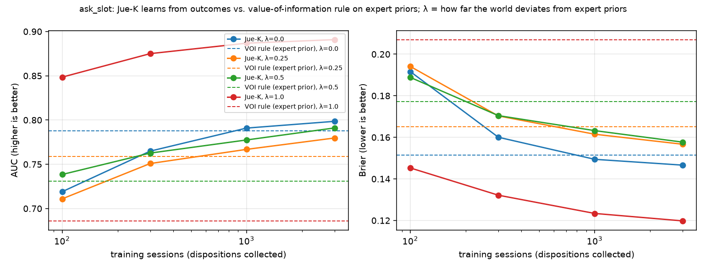

# Jue-K v0 评估

> 全部为模拟数据：占位种子 + 程序生成的需求卡与对话轨迹（追问 / 回问），以及生成的业务周在真实链路上跑出的事件（定时三类；抽取规则、Jev 桩、转译规则模式），不调用大模型。复现：
> `make_jue_k_data.py` → `train_jue_k.py` → `eval_jue_k.py`、`eval_ask_policies.py`（合计约 6 分钟，CPU）。
> 模型说明见 `models/jue_k/model_card.md`；数字见 `metrics.json`、`ask_policies.json`。

## v4 补充：学习曲线（WP-J；下方 v0 结论待 WP-C 合入后按 v5 语义重训替换）

追问：真实世界的槽位先验偏离专家估计 λ 时，Jue-K（在 N 个会话的处置结果上训练）与只用专家先验的信息价值规则 `p_fix` 对比，数字见 `learning_curve.json`，解读见 `docs/JUE_K_TRAINING.md` 第 12 节。
专家准确（λ=0）时约 1000 个会话后两者持平；λ=0.5 时约 100 个会话持平、之后 Jue-K 反超，3000 个会话时 AUC 0.791 vs 0.731（需求卡相容性修正后重跑）。λ 是假设，整条扫描如实列出。

## 结论（如实，v0）

| 决策类型 | Jue-K 相对原型规则 | 一句话 |
|---|---|---|
| 追问 `ask_slot` | **同等追问次数下正确率更高，概率校准** | 平均每会话追问 0.75～1.25 次时，最终正确率高 2.8～3.6 个百分点（95% 区间不含 0）；最高正确率相同（约 91%）；ECE 0.038 vs 0.338 |
| 回问 `ask_back` | 只给出校准后的基率 | AUC ≈ 0.51：模型看不到真实值，现有属性不含区分信息；加数据也不改善（见第 4 节） |
| 机会汇聚 | 校准更好，发现效果相同 | AUC 0.971 vs 0.861、ECE 0.025 vs 0.161；6 个测试周两者都 6/6 发现、0 误报 |
| 知识冲突 | 相同 | 注入与困难负样本在属性上可完全分开（AUC 1.000），规则已经足够 |
| 泄露风险 | **Jue-K 区分得开，原型区分不开** | AUC 0.904 vs 0.500：真实链路上每次检索都被拦截几十条，原型规则对所有人饱和；Jue-K 主要靠「要求讲原理的次数」。6 个测试周两者都 6/6 发现，困难负样本误报 1/6 vs 6/6 |

Jue-K 的增量：
1. **追问更省**：同样的追问预算答对更多；原型的规则分接近阶跃（τ 从 0.5 到 0.6，追问从 1.63 次直接掉到 0.45 次），中间没有可选的操作点，Jue-K 是连续的校准概率，可以按代价取任意点；
2. **概率是校准过的**：可以按代价比定阈值（见第 2 节），而原型的规则分只是排序分数（见可靠性图）；
3. **一个模型、一套特征覆盖五类决策**，运行时每次判断都被记录（`jue_samples.jsonl`），接入真实处置结果后可以继续校准。

未见现象上 Jue-K 不占优（第 2、4 节），换真实种子时必须覆盖全部现象再训练。

## 1. 校准 `reliability.png`

每类在 test 上，AUC / Brier / ECE（ECE 为 10 个等频分箱）：

| 组合 | n（正例） | Jue-K 校准前 | Jue-K 校准后 | 原型规则分 |
|---|---|---|---|---|
| ask_slot / test | 1005（265） | 0.785 / 0.160 / 0.065 | 0.782 / 0.156 / 0.038 | 0.736 / 0.288 / 0.338 |
| ask_slot / heldout | 889（188） | 0.462 / 0.193 / 0.147 | 0.467 / 0.171 / 0.073 | 0.616 / 0.279 / 0.339 |
| ask_back / test | 247（61） | 0.500 / 0.191 / 0.106 | 0.512 / 0.196 / 0.119 | 0.500 / 0.391 / 0.453 |
| ask_back / heldout | 182（52） | 0.496 / 0.250 / 0.196 | 0.468 / 0.261 / 0.220 | 0.500 / 0.376 / 0.414 |
| opportunity / test | 166（59） | 0.975 / 0.059 / 0.017 | 0.971 / 0.062 / 0.025 | 0.861 / 0.148 / 0.161 |
| knowledge_conflict / test | 379（62） | 1.000 / 0.000 / 0.000 | 1.000 / 0.000 / 0.000 | 1.000 / 0.000 / 0.000 |
| leak_risk / test | 89（41） | 0.898 / 0.102 / 0.115 | 0.904 / 0.102 / 0.095 | 0.500 / 0.539 / 0.539 |

追问标签是「补上真实值后最终推荐由错变对」（第 4 节），正例约 24%。

## 2. 追问操作点 `ask_curve.png`

2,000 张新抽的测试卡（训练与校准都没见过）与 2,000 张留出现象的卡，交互回放，每轮问 p ≥ τ 的槽位（最多 2 个），最多 8 轮；最终按 `correct_product` 的同一规则用已知槽位选产品，与真值一致（含正确判为应升级）算正确。同一张卡在各策略下用同一随机种子回放，按相同平均追问次数插值比较，配对 bootstrap（1,000 次）给 95% 区间。

| 策略（test） | 平均追问 | 最终正确率 |
|---|---|---|
| 不追问 | 0.00 | 54.6% |
| B1 必问清单 | 1.92 | 90.8% |
| B2 信息价值规则 | 1.63 | 90.8% |
| 觉原型（规则分，τ=0.5） | 1.63 | 90.9% |
| Jue-K τ=0.05 | 1.63 | 90.9% |
| Jue-K τ=0.1 | 1.49 | 90.2% |
| Jue-K τ=0.15 | 1.34 | 89.5% |
| Jue-K τ=0.2 | 1.20 | 88.5% |
| Jue-K τ=0.3 | 0.76 | 83.0% |
| Jue-K τ=0.5 | 0.19 | 66.0% |

| 平均追问次数 | Jue-K − 觉原型（test） | Jue-K − 觉原型（heldout） |
|---|---|---|
| 0.5 | −0.0 pp [−1.1, +1.2] | −1.2 pp [−2.1, −0.3] |
| 0.75 | **+3.2 pp [+2.1, +4.2]** | −0.6 pp [−1.1, −0.1] |
| 1.0 | **+3.6 pp [+2.6, +4.6]** | —（超出曲线范围，不比较） |
| 1.25 | **+2.8 pp [+2.0, +3.6]** | — |
| 1.5 | **+1.0 pp [+0.4, +1.6]** | — |

- 阈值放低后所有策略收敛到约 1.63 次、91%：可问的槽位由模板前置条件决定，与打分无关，这是曲线的上限。
- **阈值要按代价定**：Jue-K 输出的是「问了能让推荐由错变对」的概率。设漏问的代价是多问一句的 k 倍，阈值取 1 / (1 + k)。演示主题（色花、已知锦纶氨纶）追问设备的概率在重训前是 0.16、重训后是 0.145，正好落在 τ = 0.15 附近（重训只换了定时三类的样本，但五类共用一个模型，追问的打分也会小幅移动）；沿用原型的 0.5 几乎不问（0.19 次、66.0%）。阈值没有为演示调整。用 Jue-K 做实时发现时，追问阈值应设 0.15 左右。
- 留出现象各只有 1 个候选产品，两条曲线最多只到 0.91 次追问，只比较曲线覆盖的预算（不外推）；预算少时 Jue-K 略差于原型。

## 3. 定时发现（6 个测试周，阈值 0.5）

| 发现器 | 窗口内发现 | 提前量中位数 | 困难负样本误报 | 其他报警 |
|---|---|---|---|---|
| Jue-K | 18 / 18 | 49 h | 1 / 24（泄露风险） | 29 |
| 觉原型（规则模式） | 18 / 18 | 49 h | 6 / 24（全部是泄露风险） | 29 |

测试周与训练周同一生成方式、在真实链路上跑出事件、未参与训练。「其他报警」29 个全部是注入外的机会汇聚：真实链路上有的会话 L1 没推荐出来、有的必问槽位没问到，使同一主题多次升级；按觉的定义它们是合理的发现，训练时这类主题不进样本。留出周 `data/week/w1` 上与规则告警的对照见 `docs/reports/week/`（Jue-K 3/3 命中、0/4 误报）。

v1 曾直接按剧本合成定时事件（每问一个产品只被拦截约 2 条），在这种事件上 Jue-K 与原型都是 0 误报；到真实链路上取值差两个数量级，Jue-K 漏报泄露风险。现在训练和评估都用真实链路事件。

## 4. 训练数据诊断（决定了 v0 的标签与特征）

- **样本量不是瓶颈**：追问训练卡从 50% 加到 100%，AUC 只从 0.853 升到 0.859；回问从 10% 到 100% 始终约 0.5。84% 的追问行、88% 的回问行与其他行特征完全相同——特征只来自契约 5.2 的属性，看不到已知槽位的具体取值。
- **标签由「候选集合是否变化」改为「最终推荐是否由错变对」**：旧标签下 Jue-K 的 AUC 已达贝叶斯最优（用种子先验精确计算）的 97%（0.857 vs 0.880），但追问曲线与原型重合——候选集合变了不代表推荐变对。改标签后同一回放中，同等追问次数的正确率提高 1～4 个百分点（上表即新标签的结果）。原设计担心新标签「几乎总是 0」，实测正例 24%，可以训练。
- **现象不进特征**：旧标签下去掉现象独热，留一现象的 AUC 中位数从 0.508 升到 0.672；新标签下两者相当（0.603 vs 0.588，规则分 0.614），对测试集与回放无影响。保留去掉的版本，避免模型记住现象。
- **回问靠加数据救不了**：分开训练、去掉 turn、加样本，AUC 都在 0.48～0.53。要改善需要给槽位对象增加类似「会改变命中的取值所占的先验比例」的属性，这要改契约 5.2。

## 局限
- 追问、回问的标签只看补上一个槽位的即时效果，不计连续补两三个槽位的联合作用；不区分推荐错的代价。
- 抽取噪声的置信度区间不重叠，比真实抽取容易；定时注入的模式固定。
- 定时事件用 Jev 桩跑出；换成 OneJev 或大模型降级后 `mean_p_none` 的分布会变。知识库检索目前把全部排名里被拦截的知识计入 `n_blocked`，检索口径修正后要重新生成样本并重训。
- 转化对照匹配的字符二元组规则会让相近取值误命中（如「溢流染色机」命中「气流染色机」），压低回问的取值区分度。
