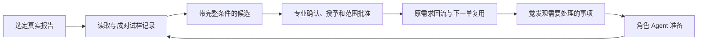

# REPLAN-v10｜从一份真实报告到下一单复用

> 2026-10-28 审查修订｜基线：`v10 @ 840bd46`，业务实现 `319a2e7`（V9.6a）。
> 状态：规划稿，待实施。决赛 2026-11-08；V9.7 真人试用和 V9.8 展示收尾由本版承接。

**本轮目标：在项目方陪同下，四类岗位用一份真实报告完成专业判断，再让下一件符合条件的需求用上这份判断。** 先做出可审阅的材料，沿现有门面完成确认与授予，按试用暴露的问题继续改。

愿景见 [VISION](../VISION.md)，机制见 [ARCHITECTURE](../ARCHITECTURE.md)、[QI](../QI.md)，已有实现和运行记录见 [V9](REPLAN-v9.md)，展示见 [FINALS-SCOPE](FINALS-SCOPE.md)。工作包沿用原编号，范围按本次审查收窄。

## 1. 本轮怎样承接架构与愿景

化言连接客户需求、组织判断和专业能力复用。觉形成、维持、筛选并提交值得决策的事项；Jev 回答已提出的问题；Agent 准备与执行；契管理专业判断的来源、范围、授予和撤销。人也可以主动委托和处理事项。

业务员负责需求与客户，真人产品经理负责产品范围与商业判断，研发负责专业判断与成果，负责人在授权范围内看进展和处理例外。继续使用 V9 的共享实例、角色会话、保存、任务重试和现有工作面。

原件、页面、读数和试样表放在读取工具侧；契保存判断、能力与依据指针。图文查证是一条展示支线，与报告编译共用读取能力。长期的通用信息反射、注意力校准和组织能力积累继续沿真实处置与结果发展，本轮先留下可使用的能力和反馈。

## 2. 起点与复用

输入是用户提供的 v3 方案、主办方资料目录，以及本次四张审查意见图。目录中的文件数和 v3 的报告盘点用于选样，处理成绩按实际运行记录。

直接复用：共享实例、按角色进入、后台任务、整项重试、知识视图、七种能力形式、专业限制原文、确认/授予/批准/撤销、recheck、推荐重匹配、模型网关及 System1Client/ClefClient。V9 的开发者走链已有记录，真实岗位试用仍需完成。

本轮重点补齐：选定报告的解析与读数、A/B 记录、完整条件候选、温度一个字段，以及 `confirm` 和 `attach_evidence` 两处已确认缺口。原始资料和运行产物沿用 `data/`，评测题目与答案单放 `data/knowledge_v10/evaluations/`。

## 3. 决赛范围与工作包

**11 月 8 日前先完成“决赛必需”链路。“可演示即可”只做到指定结果，不作为真人试用的前置条件。决赛后项按实际试用需要安排。** 每包完成记录分别标注首版结果和后续项。

| 包 | 优先级 | 首版做到什么 | 首版依赖 |
|---|---|---|---|
| [V10.0](WP-0v10.md) | 决赛必需 | 选报告和问题，给出来源清单与 C1/C4 接口约定 | 现有项目、实际原件 |
| [V10.1](WP-1v10-sources.md) | 决赛必需，精简 | 复用清单；统一读取入口接现有角色权限 | V10.0 |
| [V10.2](WP-2v10-evidence.md) | 决赛必需，按样例做 | 解析当前报告；需要时补图表读取 | V10.0 清单；无需等待 V10.1 入口 |
| [V10.3](WP-3v10-retrieval.md) | 可演示即可 | 一道图表题查准，关键词 A 与图文 C 对照 | V10.1 入口、V10.2 对应来源 |
| [V10.4](WP-4v10-trials.md) | 决赛必需 | 一份 A/B 记录和原文对照，随后补文本配方与负例 | V10.0 清单、V10.2 当前报告的读取函数 |
| [V10.5](WP-5v10-compiler.md) | 决赛必需 | 一条完整条件 IR 导入候选，补充依据留待确认 | V10.4 首份记录 |
| [V10.6](WP-6v10-conditions.md) | 决赛必需，单字段 | 温度闭区间：抽取→匹配→下一单 | V10.5 条件样例；C2 在本包确定 |
| [V10.7](WP-7v10-review.md) | 决赛必需 | 研发审阅确认、授予，产品经理按需批准，下一单复用 | V10.5；温度复用再接 V10.6 |
| [V10.8](WP-8v10-revisions.md) | 可演示即可 | 改一处引用条件，展示挂起和两种复核结果 | V10.7、现有 recheck |
| [V10.9](WP-9v10-business-loop.md) | 决赛必需，一条链 | 觉/人发起准备，Agent 读选定资料，结果回原单 | V10.1 入口、V10.5/V10.7；温度场景接 V10.6 |
| [V10.10](WP-10v10-validation.md) | 决赛必需 | 开发者走通后交四类真人试用，记录结果和帮助 | 主链就绪；选样和人员安排提前开始 |

决赛后：动态来源授权、撤权后的缓存管理、历史权限回看、通用版本与依赖传播、多字段数值条件、修正后的试样/发布全链自动化、别名版本化重跑、分块/前缀消融及大样本概率校准。

## 4. 先做出结果，再补后续环节

- **M1：一份报告能读、能审。** V10.0 选定原件后，V10.2 和 V10.4 围绕这一份材料一起做，产出 A/B、结果、条件和原文对照。CLI 或静态审阅材料即可展示；不用先完成公共查证入口、全格式覆盖或全库索引。
- **M2：一次判断服务下一单。** 把首份记录交 V10.5、V10.7，沿现有门面完成候选、确认与授予；V10.6 补温度字段后，验证同范围、未知和超范围三种需求。
- **M3：四类真人完成业务。** V10.9 接上一条定向准备与回流链，V10.10 先由开发者走通，再交真实岗位使用。项目方可帮助操作、补材料和重跑。
- **展示支线。** V10.3 展示一道图表查证；V10.8 展示一次来源变化复核。支线进度不阻塞 M1—M3。

工作包是修改归口，不是逐个整包完成才可进入下一包的阶段门。报告读取和审阅按一个具体样例连续交付；共用文件按依赖顺序修改，首条链路通过后再扩材料。

## 5. 全局约定与共用回归

以下约定集中维护，各包引用编号并只补自己的验收。复用现有实现和测试，在相关入口变化时检查，不在每包新增一套防护代码。

| 编号 | 全局约定 | 共用检查 |
|---|---|---|
| G1 主体与知识边界 | 服务端身份、L0–L3、同层归属与授予沿用现有规则。读取工具在统一入口检查选定来源，业务使用走现有能力视图 | 公共/内部来源按角色读取；专业生效由有权的人完成 |
| G2 原意、条件与出处 | 原话在抽取入口理解；报告保留 A/B、阶段、单位及限制，未知有原文可查；其余专业条件交研发处理 | 已有事实保留；关键限制随候选走；边界样例结果正确 |
| G3 确认与能力状态 | 候选经人确认与授予后使用；签字对应实际审过的依据，使用检查当前范围和状态 | 补充依据先确认；撤销/挂起后的行为沿既有路径更新 |
| G4 对象与执行 | 复用 V9 的对象上下文、保存、后台任务和整项重试；正式状态由应用门面写入 | 两单各归各单，重启与重跑保留业务，签字/授予只生效一次 |
| G5 模型与反馈 | 大模型走网关并带 caller；觉按现有家族使用规则、OneJev 和本地 Jue-K；人的处置和实际结果用于后续学习 | 展示实际模型、准备结果及处置；模型输出保留为辅助材料 |
| G6 数据与证据 | 内部资料留 data；评测真值由 eval/sim 使用；真实/模拟、调试回归/未见样本分别记录 | 原件与人工金标可核对，报分母、错误实例和人工帮助 |

契约差异在用到的工作包内列清并按会话授权落实：V10.0 先处理图片输入 C1、证据映射 C4；温度 C2 在 V10.6、确认 C7 在 V10.7 确定。普通实现选择直接做。来源失败沿现有 QI/recheck 语义，本轮不另设计状态体系。

各包先跑受影响的检查；集成时运行 `uv run pytest`，涉及前端时运行 `npm --prefix web run build`。本轮文档修订检查链接、范围和依赖即可。

## 6. 保留的 v3 修正

| 核对事项 | 采用的处理 | 归口 |
|---|---|---|
| Jev 图片能力与当前文本调用路径混淆 | 保留已有实验性图片能力的说明；首轮可先用文本核对，复用 Clef 适配并记录实际模型与输入 | V10.3/V10.4 |
| 百分号未说明口径 | 保存原始单位和未知基准；有充分信息时再换算 | V10.4 |
| 文档条件统一附到全部块 | 区分共同、A/B 和阶段条件 | V10.2/V10.4 |
| 数字都要求文本匹配 | 文本引用原句，图像引用区域，派生量记录输入和公式 | V10.2/V10.4 |
| `Fragment.meta` 假设 | 当前字段不存在，位置和版本先放读取侧映射 | V10.0 |
| `attach_evidence` 直接 active | 新依据先作为候选，确认后挂接 | V10.5/V10.7 |
| `confirm` 自动刷新指纹 | 确认绑定本次审阅依据；有差异时重新审阅 | V10.7 |
| 单次观察与复用范围 | 保存原观察，复用范围由专业判断及其依据确定 | V10.5/V10.7 |
| 历史负例与能力过时 | 负例用于比较和冲突材料；现有 stale_capability 保持其业务使用及归因语义 | V10.9 |
| scope 核对固定查旧产品页 | 使用本次专业判断的依据，产品页是其中一种来源 | V10.7 |

模型资料沿前轮核对：[TypeSafe 图像文档](https://docs.typesafe.ai/images)、[Clef](https://developers.cloudflare.com/workers-ai/models/clef/)、[EmbeddingGemma 2 模型卡](https://ai.google.dev/gemma/docs/embeddinggemma/model_card_2)。

## 7. 验收记录与本次修订

检索只保留 A/C、Jev 开/关两组对照。以逐题失败分析决定默认配置，记录正确证据、值/单位/组别、耗时和人工修改；小样本先说明发生了什么。业务侧记录每解决一件问题需要几次研发判断，以及下一单是否复用、觉提出的事项是否有用。

本次同步总计划、11 个分包、索引和 [合并审查稿](V10-REVIEW.md)。各包完成记录填写提交、运行入口、实际资料与模型、验收结果和遗留项；目前均待实施。本次仅修订规划文档，未执行各包实现。
