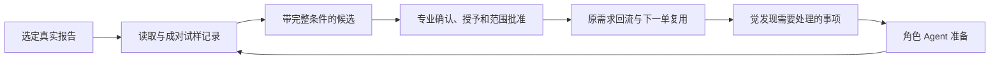

# V10 工作包合并审查稿｜精简修订

> **规划快照**：本文是 2026-10-28 实施前的合并审查稿，之后没有随实施更新，不反映实现现状。当前计划见 [REPLAN-v10](REPLAN-v10.md)，状态见[阶段证据](../reports/v10-evidence.md)和各包最新完成记录。

> 2026-10-28｜按用户审查修订，实施尚未开始。
> 保留工作包编号，按决赛所需收窄范围。先交一份试样审阅包，再贯通判断与下一单复用；共用约定集中在总计划。本稿与分包同步，本次仅修订规划文档。

## 目录

- [REPLAN-v10｜从一份真实报告到下一单复用](#plan)
- [WP-0v10｜选定报告、问题与首批接口](#wp-0)
- [WP-1v10｜来源清单与统一读取入口](#wp-1)
- [WP-2v10｜选定资料的解析与证据读取](#wp-2)
- [WP-3v10｜一道图表题的检索与查证](#wp-3)
- [WP-4v10｜一份成对试样记录与原文审阅包](#wp-4)
- [WP-5v10｜从试样记录形成完整条件候选](#wp-5)
- [WP-6v10｜温度一个字段的抽取与范围匹配](#wp-6)
- [WP-7v10｜审阅确认、授予与下一单复用](#wp-7)
- [WP-8v10｜一次来源修改的挂起与复核演示](#wp-8)
- [WP-9v10｜一条定向准备与原需求回流链](#wp-9)
- [WP-10v10｜走通业务、真人试用与两组小对照](#wp-10)

---

## REPLAN-v10｜从一份真实报告到下一单复用

> 2026-10-28 审查修订｜基线：`v10 @ 840bd46`，业务实现 `319a2e7`（V9.6a）。
> 状态：规划稿，待实施。决赛 2026-11-08；V9.7 真人试用和 V9.8 展示收尾由本版承接。

**本轮目标：在项目方陪同下，四类岗位用一份真实报告完成专业判断，再让下一件符合条件的需求用上这份判断。** 先做出可审阅的材料，沿现有门面完成确认与授予，按试用暴露的问题继续改。

愿景见 [VISION](../VISION.md)，机制见 [ARCHITECTURE](../ARCHITECTURE.md)、[QI](../QI.md)，已有实现和运行记录见 [V9](REPLAN-v9.md)，展示见 [FINALS-SCOPE](FINALS-SCOPE.md)。工作包沿用原编号，范围按本次审查收窄。

### 1. 本轮怎样承接架构与愿景

化言连接客户需求、组织判断和专业能力复用。觉形成、维持、筛选并提交值得决策的事项；Jev 回答已提出的问题；Agent 准备与执行；契管理专业判断的来源、范围、授予和撤销。人也可以主动委托和处理事项。

业务员负责需求与客户，真人产品经理负责产品范围与商业判断，研发负责专业判断与成果，负责人在授权范围内看进展和处理例外。继续使用 V9 的共享实例、角色会话、保存、任务重试和现有工作面。

原件、页面、读数和试样表放在读取工具侧；契保存判断、能力与依据指针。图文查证是一条展示支线，与报告编译共用读取能力。长期的通用信息反射、注意力校准和组织能力积累继续沿真实处置与结果发展，本轮先留下可使用的能力和反馈。

### 2. 起点与复用

输入是用户提供的 v3 方案、主办方资料目录，以及本次四张审查意见图。目录中的文件数和 v3 的报告盘点用于选样，处理成绩按实际运行记录。

直接复用：共享实例、按角色进入、后台任务、整项重试、知识视图、七种能力形式、专业限制原文、确认/授予/批准/撤销、recheck、推荐重匹配、模型网关及 System1Client/ClefClient。V9 的开发者走链已有记录，真实岗位试用仍需完成。

本轮重点补齐：选定报告的解析与读数、A/B 记录、完整条件候选、温度一个字段，以及 `confirm` 和 `attach_evidence` 两处已确认缺口。原始资料和运行产物沿用 `data/`，评测题目与答案单放 `data/knowledge_v10/evaluations/`。

### 3. 决赛范围与工作包

**11 月 8 日前先完成“决赛必需”链路。“可演示即可”只做到指定结果，不作为真人试用的前置条件。决赛后项按实际试用需要安排。** 每包完成记录分别标注首版结果和后续项。

| 包 | 优先级 | 首版做到什么 | 首版依赖 |
|---|---|---|---|
| [V10.0](#wp-0) | 决赛必需 | 选报告和问题，给出来源清单与 C1/C4 接口约定 | 现有项目、实际原件 |
| [V10.1](#wp-1) | 决赛必需，精简 | 复用清单；统一读取入口接现有角色权限 | V10.0 |
| [V10.2](#wp-2) | 决赛必需，按样例做 | 解析当前报告；需要时补图表读取 | V10.0 清单；无需等待 V10.1 入口 |
| [V10.3](#wp-3) | 可演示即可 | 一道图表题查准，关键词 A 与图文 C 对照 | V10.1 入口、V10.2 对应来源 |
| [V10.4](#wp-4) | 决赛必需 | 一份 A/B 记录和原文对照，随后补文本配方与负例 | V10.0 清单、V10.2 当前报告的读取函数 |
| [V10.5](#wp-5) | 决赛必需 | 一条完整条件 IR 导入候选，补充依据留待确认 | V10.4 首份记录 |
| [V10.6](#wp-6) | 决赛必需，单字段 | 温度闭区间：抽取→匹配→下一单 | V10.5 条件样例；C2 在本包确定 |
| [V10.7](#wp-7) | 决赛必需 | 研发审阅确认、授予，产品经理按需批准，下一单复用 | V10.5；温度复用再接 V10.6 |
| [V10.8](#wp-8) | 可演示即可 | 改一处引用条件，展示挂起和两种复核结果 | V10.7、现有 recheck |
| [V10.9](#wp-9) | 决赛必需，一条链 | 觉/人发起准备，Agent 读选定资料，结果回原单 | V10.1 入口、V10.5/V10.7；温度场景接 V10.6 |
| [V10.10](#wp-10) | 决赛必需 | 开发者走通后交四类真人试用，记录结果和帮助 | 主链就绪；选样和人员安排提前开始 |

决赛后：动态来源授权、撤权后的缓存管理、历史权限回看、通用版本与依赖传播、多字段数值条件、修正后的试样/发布全链自动化、别名版本化重跑、分块/前缀消融及大样本概率校准。

### 4. 先做出结果，再补后续环节

- **M1：一份报告能读、能审。** V10.0 选定原件后，V10.2 和 V10.4 围绕这一份材料一起做，产出 A/B、结果、条件和原文对照。CLI 或静态审阅材料即可展示；不用先完成公共查证入口、全格式覆盖或全库索引。
- **M2：一次判断服务下一单。** 把首份记录交 V10.5、V10.7，沿现有门面完成候选、确认与授予；V10.6 补温度字段后，验证同范围、未知和超范围三种需求。
- **M3：四类真人完成业务。** V10.9 接上一条定向准备与回流链，V10.10 先由开发者走通，再交真实岗位使用。项目方可帮助操作、补材料和重跑。
- **展示支线。** V10.3 展示一道图表查证；V10.8 展示一次来源变化复核。支线进度不阻塞 M1—M3。

工作包是修改归口，不是逐个整包完成才可进入下一包的阶段门。报告读取和审阅按一个具体样例连续交付；共用文件按依赖顺序修改，首条链路通过后再扩材料。

### 5. 全局约定与共用回归

以下约定集中维护，各包引用编号并只补自己的验收。复用现有实现和测试，在相关入口变化时检查，不在每包新增一套防护代码。

| 编号 | 全局约定 | 共用检查 |
|---|---|---|
| G1 主体与知识边界 | 服务端身份、L0–L3、同层归属与授予沿用现有规则。读取工具在统一入口检查选定来源，业务使用走现有能力视图 | 公共/内部来源按角色读取；专业生效由有权的人完成 |
| G2 原意、条件与出处 | 原话在抽取入口理解；报告保留 A/B、阶段、单位及限制，未知有原文可查；其余专业条件交研发处理 | 已有事实保留；关键限制随候选走；边界样例结果正确 |
| G3 确认与能力状态 | 候选经人确认与授予后使用；签字对应实际审过的依据，使用检查当前范围和状态 | 补充依据先确认；撤销/挂起后的行为沿既有路径更新 |
| G4 对象与执行 | 复用 V9 的对象上下文、保存、后台任务和整项重试；正式状态由应用门面写入 | 两单各归各单，重启与重跑保留业务，签字/授予只生效一次 |
| G5 模型与反馈 | 大模型走网关并带 caller；觉按现有家族使用规则、OneJev 和本地 Jue-K；人的处置和实际结果用于后续学习 | 展示实际模型、准备结果及处置；模型输出保留为辅助材料 |
| G6 数据与证据 | 内部资料留 data；评测真值由 eval/sim 使用；真实/模拟、调试回归/未见样本分别记录 | 原件与人工金标可核对，报分母、错误实例和人工帮助 |

契约差异在用到的工作包内列清并按会话授权落实：V10.0 先处理图片输入 C1、证据映射 C4；温度 C2 在 V10.6、确认 C7 在 V10.7 确定。普通实现选择直接做。来源失败沿现有 QI/recheck 语义，本轮不另设计状态体系。

各包先跑受影响的检查；集成时运行 `uv run pytest`，涉及前端时运行 `npm --prefix web run build`。本轮文档修订检查链接、范围和依赖即可。

### 6. 保留的 v3 修正

| 核对事项 | 采用的处理 | 归口 |
|---|---|---|
| Jev 图片能力与当前文本调用路径混淆 | 保留已有实验性图片能力的说明；首轮可先用文本核对，复用 Clef 适配并记录实际模型与输入 | V10.3/V10.4 |
| 百分号未说明口径 | 保存原始单位和未知基准；有充分信息时再换算 | V10.4 |
| 文档条件统一附到全部块 | 区分共同、A/B 和阶段条件 | V10.2/V10.4 |
| 数字都要求文本匹配 | 文本引用原句，图像引用区域，派生量记录输入和公式 | V10.2/V10.4 |
| `Fragment.meta` 假设 | 当前字段不存在，位置和版本先放读取侧映射 | V10.0 |
| `attach_evidence` 直接 active | 新依据先作为候选，确认后挂接 | V10.5/V10.7 |
| `confirm` 自动刷新指纹 | 确认绑定本次审阅依据；有差异时重新审阅 | V10.7 |
| 单次观察与复用范围 | 保存原观察，复用范围由专业判断及其依据确定 | V10.5/V10.7 |
| 历史负例与能力过时 | 负例用于比较和冲突材料；现有 stale_capability 保持其业务使用及归因语义 | V10.9 |
| scope 核对固定查旧产品页 | 使用本次专业判断的依据，产品页是其中一种来源 | V10.7 |

模型资料沿前轮核对：[TypeSafe 图像文档](https://docs.typesafe.ai/images)、[Clef](https://developers.cloudflare.com/workers-ai/models/clef/)、[EmbeddingGemma 2 模型卡](https://ai.google.dev/gemma/docs/embeddinggemma/model_card_2)。

### 7. 验收记录与本次修订

检索只保留 A/C、Jev 开/关两组对照。以逐题失败分析决定默认配置，记录正确证据、值/单位/组别、耗时和人工修改；小样本先说明发生了什么。业务侧记录每解决一件问题需要几次研发判断，以及下一单是否复用、觉提出的事项是否有用。

本次同步总计划、11 个分包、索引和 [合并审查稿](V10-REVIEW.md)。各包完成记录填写提交、运行入口、实际资料与模型、验收结果和遗留项；目前均待实施。本次仅修订规划文档，未执行各包实现。

### REPLAN-v10 附注一｜决赛范围、按需读取与路演证据

> 2026-10-29｜补充 V10 总计划，不改动各工作包正文；与正文冲突时以本附注为准。
> 已完成：V10.0、V10.2、V10.3。决赛：2026-11-08，现场答辩评分。

#### 背景

主办方确认：决赛由现场评委按答辩评分。此前提出的四个方向（多模态拆分识别、历史案例预测、迭代更新、客户运营中心）不单独计分，只作为答辩时可能被问到的问题准备，不新增工作包。V10 继续以“真实资料进入化言闭环”为主线。

#### 1. 决赛范围

| 包 | 决赛前 | 决赛后 |
|---|---|---|
| V10.1 来源与访问边界 | 来源类别（公开 L0／内部 L3）× 角色层级，在读取工具统一入口检查一次；派生结果继承来源类别 | 缓存撤销、动态来源授权、聚合层数量隐藏、历史原文的权限回看 |
| V10.4 成对试样记录 | 全部：TrialRecord、A/B 组别、配方与曲线读取、核对、负例、受控汇总 | — |
| V10.5 编译与候选 | 只编译操作经验与负例；其余记录留在试样表，不进契 | 全量 IR、别名版本化重跑 |
| V10.6 数值条件 | 只做温度：闭区间包含判断，从抽取贯通到下一单匹配 | 其他字段、开端点、单位换算、修正后贯通发布与试样准备 |
| V10.7 审阅与复用 | 一条链路：一份真实报告 → 研发确认 → 授予 → 下一单复用 | 其余能力形式、批量审阅 |
| V10.8 来源修订 | 一条链路：修改被引用条件 → 挂起 → 复核恢复或建立新判断 | 取不回与权限撤销的区分、替代推荐、历史回看 |
| V10.9 觉与回流 | 一条缺口 → 准备 → 签字 → 回流原单的演示链路 | 多事项并行、完整觉观察表 |
| V10.10 验收与试用 | 见第 4 节 | 全部检索与分块对照 |

各包验收中重复出现的重启续跑、不重复签字、不串单、越权不可读，统一用一组共用回归测试覆盖，不在各包分别实现。

#### 2. V10.2 改为按需读取

- 入库只做：原生 Office 解析、MinerU 版面与 OCR、图注表注、区域坐标、页面与图表区域的图像向量。入库阶段不调用视觉模型。
- 检索命中后，由读取工具按证据键回取原页或裁图，调用视觉模型产出结构化读数（值、单位、对象、组别、条件、原图位置、读取方法）。
- 读数按图片内容指纹与模型版本缓存；同一图片再次命中时直接使用，研发审阅与契编译引用同一份读数。
- 例外：试样报告在入库时完成全部读取，包括工艺曲线的三层读取（文本框 → 字符画 → 读图），保证汇总不因未被检索而缺项。

#### 3. Agent 只拿证据键

Agent 与 UI 只接收 block_id、页码或区域，通过读取工具的回取接口取得内容；工具先按第 1 节检查权限，再渲染所需页面或裁图。底层文件路径不对 Agent 和 UI 暴露。V10.3 的读取接口按此补充说明。

#### 4. V10.10 改为路演证据

决赛前只产出三类证据，按“已真实运行／模拟／待验证”分别标注：

1. 真实业务链：一份真实报告完成成对记录 → 候选 → 研发确认与授予 → 下一单复用（满足、待补、超范围各一例）→ 修改被引用条件后挂起与复核。
2. 读取能力：从 35 题中选已核验答案的真实题批量运行，记录正确页、读数、单位、条件与引用，区分“未找到”和“读错”。不追求全量与检索对照。
3. 真人试用：四类岗位在共享实例中的操作、协助与反馈记录；缺少真人参与时如实标为未完成。

---

## WP-0v10｜选定报告、问题与首批接口

> 决赛必需｜状态：待实施｜先让第一份报告进入开发。

### 目标

选定一份真实试样报告、一个后续需求和一道图表题，让读取与编译可以立即开始。

### 依赖

当前分支、v3 方案、资料目录和可取得的原件。

### 必读

[总计划](#plan)、[VISION](../VISION.md)、[QI](../QI.md)；`contracts/gateway.py`、`contracts/knowledge.py`。

### 允许修改的范围

本包记录、`data/knowledge_v10/manifest/` 和 `evaluations/` 的本地清单、必要的合成夹具。契约应用按总计划约定执行。

### 交付物与设计

1. **一张简明清单。** 记录源文件、来源类别、产品、归属、内容指纹和重复文件对应；选定试用的专业处理人。原件可用即交给 V10.2/V10.4。
2. **首份报告和小组样例。** 优先 TF-213HE/TF-213Q，先选一份能形成 A/B 比较的报告；随后补文本配方、图像曲线和负例，样例可重叠。20 份分层报告作为扩展目标，随实际失败补齐。
3. **问题与答案状态。** 35 题保留原清单，标明有答案、待人工核对和缺来源；先挑一道来源齐全的图表题。记录哪些样例用于调试，留未见报告作后续核对。
4. **只先定 C1/C4。** C1：在现有网关中增加图片输入，保留文本调用及计量；C4：用文件指纹和块位置映射到现有 Fragment，读取侧保存页码/区域。需要的字段和调用示例写在本包。温度 C2、确认 C7 留到相关包开工时确定。

### 验收

共用回归：G6。

- 报告和图表题可以打开，清单能定位到原件，已指定首个专业判断场景。
- C1/C4 有可供实现的输入输出示例；读取与试样专项可以开始。
- 缺资料与待核对答案直接记在清单中，不影响已有材料的开发。

### 不做

全库盘点、一次决定 C1—C8、全套模型选型评测。

### 完成记录

待填写：原件和清单位置、首个场景、C1/C4 决议。交给 V10.2、V10.4，V10.1 同时复用。

---

## WP-1v10｜来源清单与统一读取入口

> 决赛必需，精简｜状态：待实施｜资料登记与访问入口分开交付。

### 目标

让选定资料有清楚身份，并把内部查证接到现有角色权限。

### 依赖

[V10.0](#wp-0) 清单。V10.2/V10.4 可以先直接使用清单，查证入口供 V10.3/V10.9 使用。

### 必读

[总计划](#plan) G1；`ingest/folder.py`、`knowledge/permission.py`、`ui/server.py` 的角色会话。

### 允许修改的范围

`src/huayan/ingest/folder.py`、读取侧清单与入口、`app.py`/`ui/server.py` 对应接口及相关测试。

### 交付物与设计

1. **清单部分。** 复用 V10.0 的来源键、路径、指纹、产品和归属；Word/PDF 同一报告在清单中关联，完全重复文件合并计数。固定原件副本或指针即可满足首轮试用。
2. **访问入口部分。** 按“来源类别×当前角色层级”选择公共/内部资料，沿用已有同层归属和授予规则；选定试用资料的归属在清单固定。返回给工作面或 Agent 的资料统一经过这个入口。
3. 原文片段、页面和试样记录共用来源键；处理函数复用入口已取得的材料。任务结果沿既有按对象和主体查看的方式显示。

### 验收

共用回归：G1。

- 公开资料和选定内部报告能按现有角色进入；研发可以读取本次处理材料，业务员和 `pm:agent` 获得其可用内容。
- 既有 md/txt/csv 仍可读；试样结果与原件通过来源键对上。

### 不做

决赛后再按企业 RAG 的接入需要处理动态来源授权、撤权缓存、聚合数量隐私和历史权限；本轮不建独立 ACL 平台。

### 完成记录

待填写：来源清单及入口、角色检查结果。清单交读取包，入口交 V10.3/V10.9。

---

## WP-2v10｜选定资料的解析与证据读取

> 决赛必需，按样例交付｜状态：待实施｜先处理首份报告用到的格式。

### 目标

把首份报告中的文字、表格和曲线读出来，并能回到原页核对。

### 依赖

[V10.0](#wp-0) 的清单和 C1/C4；与 V10.4 围绕同一报告推进。无需等待 V10.1 的查证入口。

### 必读

v3 第 05 节；[总计划](#plan) G2/G5；`ingest/folder.py`、`gateway/client.py`。

### 允许修改的范围

`src/huayan/ingest/reader/`、网关图片适配、资料处理脚本、实际使用的解析依赖及相应测试。

### 交付物与设计

1. 按文件头识别当前文件，先接通这份 DOC/DOCX 的段落、表格、文本框和必要页面渲染；遇到实际格式问题选用转换组件。
2. 每块保留来源指纹、段落/表格/页面位置与原始内容。检索用小块，读数与审阅回取表头、单位、脚注、图例和相邻条件；短报告整体抽取。
3. 优先原生数据，曲线按文本框→字符画→视觉读取处理。读数带对象、组别、值、单位、条件与出处；难读项直接给人工补读。
4. 图片读取复用现有网关。完成首份报告后，再为 V10.3 接通选定 PPT/PDF 图表题；其余格式随试用材料扩展。

### 验收

共用回归：G2/G5。

- 首份报告的表格与工艺曲线能与原页并排核对，读取函数可交给 V10.4。
- 一个数值及其单位、组别和条件能回到明确位置；人工补读项可见。
- 后续图表题需要的格式单独记录结果，格式覆盖按实际文件说明。

### 不做

全格式齐备后才交付、整本扫描书处理、完整版本与索引重建体系。

### 完成记录

待填写：已支持文件、解析/读取配置、原文核对结果和补读项。交付 V10.4，图表来源交 V10.3。

---

## WP-3v10｜一道图表题的检索与查证

> 可演示即可｜状态：待实施｜作为业务主链之外的展示支线。

### 目标

从一道来源齐全的真实问题，展示找到正确页、读出结果和回看出处。

### 依赖

[V10.1](#wp-1) 统一入口、[V10.2](#wp-2) 对应文件的证据与读取能力。报告编译主链不等待本包。

### 必读

v3 第 10、10B 节；[总计划](#plan)；现有 `System1Client`、网关与资料检索入口。

### 允许修改的范围

读取侧索引、检索和查证模块；配置、脚本、现有工作面的查证结果组件及对应测试。

### 交付物与设计

1. 按产品和明确版本筛选资料，先交关键词检索 A，再接 EmbeddingGemma 2 图文检索 C。命中后回取完整证据，答案展示数值、单位、条件和出处。
2. 使用同一题目、来源、解析、读取模型和页数预算比较 A/C，逐题记找到或漏掉了什么，据此选择默认配置。
3. Jev 核对/重排作为另一个开关，记录它修正或误判的案例；首轮用于辅助核对和排序。
4. 一道题通过后扩到现有可评分题；跨报告汇总直接使用 V10.4 的结构化表。

### 验收

共用回归：G1/G2/G5/G6。

- 一道图表题能从问题走到正确页面、正确读数与可回看的引用。
- A/C 及 Jev 开关各有同条件的逐例记录，失败能归到解析、检索或读取环节。
- 配置和实际处理范围写入演示说明。

### 不做

独立文本向量 B 组、分块/前缀消融、大样本概率校准、全库索引优化；这些留给决赛后按失败问题开展。

### 完成记录

待填写：题目、证据、读取结果、两组对照及默认配置。作为 V10.10 的可用展示材料。

---

## WP-4v10｜一份成对试样记录与原文审阅包

> 决赛必需｜状态：待实施｜本包产出首个可展示结果。

### 目标

让研发直接看到：在什么共同条件下，原工艺 A 改成试样工艺 B，分别取得了哪些结果。

### 依赖

[V10.0](#wp-0) 的选定原件；按需要调用 [V10.2](#wp-2) 当前报告的读取函数。可以从原生文字和表格开始，不等待查证入口和其他格式。

### 必读

v3 第 05B 节；[总计划](#plan) 的 v3 修正表；现有业务 Trial 的含义。

### 允许修改的范围

`src/huayan/ingest/reader/` 的试样结构、配方/曲线/结果读取与表查询；审阅导出、脚本和相关测试。

### 交付物与设计

1. 形成 TrialRecord：共同条件、A/B 配方与曲线、变化项、质量/时间/成本结果、操作经验和后续计划，字段带原文位置。缺失按原文记载，A/B 与阶段分别保存。
2. 表格直接读，文本配方保留原行后抽取；曲线复用 V10.2。单位按原样保存，百分比基准不明时标明未知。总时长可从已读曲线计算，与报告结论同口径核对。
3. 导出一份“记录＋原文/裁图＋待补项”的审阅包，CLI、Markdown 或现有工作面都可。人工补读和修改随记录保留，随即交 V10.5。
4. 首份通过后补文本配方和负例。把已处理记录汇成简单表，支持按产品、条件和结果筛选；统计按可比口径给出纳入份数，重复文件只算一份。

### 验收

共用回归：G2/G6。

**首版：完成即交 V10.5。**

- 一份真实 A/B 报告形成记录与原文审阅包，展示完整条件和结果；研发能够指出修改或直接送入编译。

**随后补充：单独记录进度。**

- 补充文本配方的读取结果与原文对照。
- 一份效果不佳的报告保留时间、成本、品质各自的变化及操作警告。
- 用已处理的小组报告回答一个负例问题和一个汇总问题，结果与人工核对相符。

### 不做

全量 111 份处理作为前置条件、通用实验数据库、自动因果归纳。历史 TrialRecord 保持资料读数的含义。

### 完成记录

待填写：首版审阅包、人工修改及交接 V10.5 记录；随后补充的文本配方、负例与小组汇总分别记录进度和结果。

---

## WP-5v10｜从试样记录形成完整条件候选

> 决赛必需｜状态：待实施｜先编译一条值得复用的判断。

### 目标

把首份报告中的观察或操作经验，整理为研发可以确认的候选，完整保留适用条件和限制。

### 依赖

[V10.4](#wp-4) 的首份记录与原文；使用 V10.0 的证据映射。数值比较未接通时，条件可先以原文进入审阅。

### 必读

[QI](../QI.md) 编译与生效；`ingest/compile.py`、`knowledge/store.py` 的 admit/grant/attach_evidence；v3 第 06、07 节。

### 允许修改的范围

`src/huayan/ingest/compile.py`、IR/条件核对/审阅包模块、`scripts/compile_qi.py`、候选补充依据入口及对应测试。

### 交付物与设计

1. 最小 IR 包含陈述性质、对象、结果、条件、限制原文和证据。按材料区分观察、主张、建议、假设，先完成本次实际需要的类型。
2. 条件逐项列出“已结构化”或“保留原文待判断”，共同条件、A/B 和阶段随记录传递。修复当前 admit 只认出一部分条件就提议适用的缺口。
3. 复用 admit 生成 candidate KU、proposed ask/applicable 和 IR↔KU 映射；产品/现象先使用现有词表，未对齐原词留给人处理。
4. 相同 payload 的新依据保持候选并记下待挂接目标，交 V10.7 确认后关联。综合判断的确认人与原材料贡献分别记录。

### 验收

共用回归：G2/G3。

- 一条真实观察或经验成为候选，原文、条件和拟用方式可并排审阅。
- 材料/设备已识别、升温限制未结构化的样例，限制仍完整保留。
- 同 payload 的补充依据出现在待审列表，确认与挂接由 V10.7 完成。

### 不做

别名版本化重跑、新指标体系、自动概念归纳和知识图谱。首版由人补齐未对齐项。

### 完成记录

待填写：IR、条件清单、候选编号及待审项。交 V10.7；温度样例同时交 V10.6。

---

## WP-6v10｜温度一个字段的抽取与范围匹配

> 决赛必需，单字段｜状态：待实施｜首版只处理摄氏温度和闭区间。

### 目标

客户说出温度后，系统能判断是否落在专业人员已授予的范围内，并让下一单使用这项判断。

### 依赖

[V10.5](#wp-5) 的条件样例。C2 的具体字段及兼容方式在本包开工时列清，按总计划的契约约定实施；V10.7 的首次候选审阅可以先开始。

### 必读

[QI](../QI.md) 完整情境；`l1/extract.py`、`domain.py`、`knowledge/store.py` 的视图；相关 session/seeds 契约。

### 允许修改的范围

温度需要的最小契约差异、抽取入口、领域比较、能力视图、调用门面和温度展示及相关测试。

### 交付物与设计

1. 在既有抽取入口识别摄氏温度单值/闭区间及“不清楚”，保留原话，作为当前需求的已知条件传给匹配。
2. 能力情境保存专家确认的温度范围，与现有枚举条件共同匹配。在现有 `domain.py::match_candidates` 中加入温度闭区间包含判断，客户区间需完整落在授权区间内；满足且无其他未知/限制时为 `confirmed`，温度未知为 `possible` 并进入 `unknown_slots`，超范围则不命中该情境。
3. 沿“客户抽取→当前需求→能力视图与匹配→下一单结果”完成最短链路，界面显示温度及所用能力。先处理这条链需要的字段和调用方。
4. 其他数值、单位口径和专业限制继续保存原文并交研发判断。修正后重新准备试样、重新发布等路径作为第二步扩展，现有 V9.6a 行为继续保留。

### 验收

共用回归：G2/G3。

- 其余条件满足且无未知/限制时，用合成授权 70—80℃验证现有匹配结果：75℃与 72—78℃为 `confirmed`；温度未知为 `possible`，且列入 `unknown_slots`；85℃与 75—85℃不命中该情境。
- 一段实际模型抽取的温度进入当前条件，后续同条件需求采用对应有效能力。
- 原有枚举匹配通过现有回归；真实复用的温度范围有专业依据和确认记录。

### 不做

pH/用量/时间等多字段、开区间、单位换算平台，以及数值条件修正到试样/重新发布的全链改造；决赛后按试用需要扩展。

### 完成记录

待填写：C2 最小差异、温度抽取与比较结果、下一单记录。交 V10.7/V10.9。

---

## WP-7v10｜审阅确认、授予与下一单复用

> 决赛必需｜状态：待实施｜先复用现有工作面和生效入口。

### 目标

研发审阅一条真实候选，按用途授予并完成必要的产品范围批准，让下一件符合条件的需求用上它。

### 依赖

[V10.5](#wp-5) 首条候选。先用现有枚举和原文限制审阅，温度复用再接 [V10.6](#wp-6)。

### 必读

[QI](../QI.md) 生效与授予；`knowledge/store.py` 的 confirm/attach_evidence/grant/approve；`app.py` 对应门面。

### 允许修改的范围

知识库确认与挂接入口、候选审阅材料、对应门面/工具、研发与产品经理工作面的必要展示和测试。

### 交付物与设计

1. 在现有工作面提供原文、读数、完整条件、候选和拟用方式。首条可先用导出的审阅包配合现有按钮；研发能修改、补充或退回。
2. 修复 `confirm`：签字绑定本次实际审过的指纹，来源变化时展示差异再确认。C7 所需参数在本包确定，第一条复用不等待完整来源版本系统。
3. 接上 V10.5 的补充依据候选，经专业确认再挂接。界面按候选状态和确认事件显示实际签字情况。
4. 沿现有确认→用途授予→必要的真人产品经理批准完成生效。范围材料使用本次专业判断的依据，随后由能力视图和匹配入口服务下一单。

### 验收

共用回归：G1/G3/G4。

- 一条候选完成专业确认、授予和必要批准，下一件符合条件的需求采用对应能力。
- 确认前改变依据，审阅者能看见差异；补充依据经确认后出现在已挂接依据中。
- 温度接通后走满足、待补、超范围三种需求；其余限制在专业工作面保留。

### 不做

独立审批平台、批量确认全库和重建所有七种能力编辑界面。

### 完成记录

待填写：候选与能力编号、审阅依据、签字及下一单结果。交 V10.9；V10.8 复用此入口演示。

---

## WP-8v10｜一次来源修改的挂起与复核演示

> 可演示即可｜状态：待实施｜使用现有指纹、recheck 与 qi_review。

### 目标

用一次明确的来源变化，展示专业能力怎样挂起，以及复核后怎样继续使用。

### 依赖

[V10.7](#wp-7) 已生效能力、V10.0 的来源指纹和现有 recheck。业务回流与真人试用不等待本包。

### 必读

[QI](../QI.md) 依据失效；`ingest/compile.py` 的 recheck、`knowledge/store.py` 的 evidence_changed/confirm，以及 V9.6a 推荐更新路径。

### 允许修改的范围

复核演示脚本、现有 recheck/确认路径遇到的具体缺口、必要的差异展示和相关检查。

### 交付物与设计

1. 在演示用资料副本中修改一处被引用的条件，保存修改前后片段，人工执行 recheck，展示关联结论待复核、能力挂起。
2. 复用 qi_review 和 V10.7 的审阅入口展示两种处置：原判断与范围仍成立，确认新依据后恢复；判断或范围改变，建立新结论/能力并完成相应生效。
3. 查看一张受影响推荐的变化，沿用既有替代或撤回处理。留一份操作记录即可，演示可由项目方协助。

### 验收

共用回归：G3。

- 被引用条件改动后，对应能力挂起并出现复核事项。
- 两种复核结果各走通一次，能说明后续使用的是哪条能力和依据。

### 不做

通用版本系统、无关段落增量优化、全量依赖传播、历史权限回看、缓存撤权及来源故障分类；正式接入企业来源时再补。

### 完成记录

待填写：测试副本、改动片段、挂起和两种复核结果。作为 V10.10 展示材料。

---

## WP-9v10｜一条定向准备与原需求回流链

> 决赛必需，一条业务｜状态：待实施｜复用现有觉、Agent 和门面。

### 目标

需求需要专业判断时，Agent 把选定报告和候选准备到这张单上；人处理后，结果回到原需求并可供下一单使用。

### 依赖

[V10.1](#wp-1) 读取入口、[V10.5](#wp-5) 候选、[V10.7](#wp-7) 生效。温度场景接 V10.6；V10.3 检索和 V10.8 来源演示均为可选接入。

### 必读

[VISION](../VISION.md) 3.0、3.0′、6.2；`jue/state.py`、`agent/hub.py`、`agent/tools.py`、`app.py` 及现有复用/授予模板。

### 允许修改的范围

现有门面、角色工具、Agent 准备上下文、相关既有模板和工作面，以及这条链的集成检查。

### 交付物与设计

1. 选择现有复用或授予事项：觉按当前规则提出，人也可以主动委托。Agent 带 req_id 和已知条件，通过统一入口按产品/来源编号读取选定资料。
2. 调用读取与编译函数，把证据、候选和待补项保存到原需求的准备材料中。先按编号定位资料即可，图文检索接通后再作为补充工具。
3. 专业确认、授予和必要批准完成后，沿现有业务路径更新原需求与下一单；事项由觉按当前对象状态更新或结案。
4. 留一张简短观察表：提出了什么、谁处理、哪些帮助有用、哪里仍需人工。历史负例作为比较材料，继续沿既有试样归因和能力使用语义处理。

### 验收

共用回归：G1/G4/G5。

- 一张单完成“事项或主动委托→Agent 准备→人处理→结果回原单”，并与 V10.7 的下一单复用接上。
- 准备材料能从原需求直接查看，处理后事项状态正确。
- 开发者记录有用、多余或遗漏的事项，交给真人试用继续反馈。

### 不做

新调度平台、所有家族一起改造、新概念自动扩目录与 Jue-K 重训；按这次试用出现的问题继续补。

### 完成记录

待填写：业务对象、准备材料、实际参与岗位、回流和事项结果。交 V10.10。

---

## WP-10v10｜走通业务、真人试用与两组小对照

> 决赛必需｜状态：待实施｜承接 V9.7/V9.8。人员与样例准备从 V10.0 开始。

### 目标

先让开发者走完资料形成判断、结果回流和下一单复用，再交四类真实岗位使用，记录它帮助了什么、还卡在哪里。

### 依赖

V10.4/V10.5/V10.7/V10.9 主链，温度场景接 V10.6。V10.3/V10.8 完成后纳入展示，不作为真人试用的前置条件。

### 必读

[总计划](#plan)、[FINALS-SCOPE](FINALS-SCOPE.md)、[V9](REPLAN-v9.md) 的走链记录及 `docs/trial/` 角色说明。

### 允许修改的范围

本轮运行与对照脚本、必要回归、角色说明、试用记录、报告和展示口径。实现问题回所属组件修复。

### 交付物与设计

1. **开发者走链。** 业务员提交需求，Agent 准备真实报告与候选，研发判断/授予，产品经理按需批准，结果回原单，下一单复用；再用温度满足、未知、超范围三种输入检查结果。专业判断、试样和评价的真实或模拟来源随记录说明。
2. **真人试用。** 四类岗位在共享实例中完成各自工作，负责人可事后查看。项目方在场讲解、补资料和重跑，记下人工帮助、阻断和修改意见，修掉影响办事的问题后继续。
3. **逐例核对。** 首份报告及后续文本配方/负例与原文核对。35 题保留完整状态表，按核验后的可评分子集报告；调过提示词的样例记回归，另取未见报告核对实际语义。
4. **图表展示支线保留两组对照。** V10.3 完成后，比较① 关键词 A 对图文 C；② 同一配置下 Jev 开/关。固定来源、解析、读取模型和页数预算，记录每题的成功、错误、耗时和人工修改，按失败原因选默认配置。
5. **展示证据。** 主线展示下一单发生了什么变化；可用时补一道图表查证和一次来源复核。同步角色指南与 FINALS-SCOPE，保留长期愿景，当前成果按实际结果填写。

### 验收

共用回归：G1—G6，在此集中走受影响的共用检查；现有测试保留，运行全套 pytest，涉及前端时构建。

- 开发者完成一次业务链，至少一份专业判断被下一件符合条件的需求使用。
- 四类真实岗位有实际操作和反馈，记录系统完成的工作及项目方帮助；软件走通和真人试用分别填写进度。
- 图表展示支线完成时，附两组对照的逐例结果及实际可评分题数，按观察到的错误与改善选择配置；该支线单独验收。
- 汇总研发判断次数、审阅修改与耗时、复用结果及觉的有用/多余/遗漏事项。

### 不做

分块/前缀等额外消融、显著性结论、大样本校准平台和长期收益测算。20 份及更大报告集按试用后需要扩展。

### 完成记录

待填写：运行与模型配置、共用回归结果、真人参与和帮助、下一单结果、两组对照及剩余问题。主链和真人试用完成后更新总计划，展示支线单独记状态。
